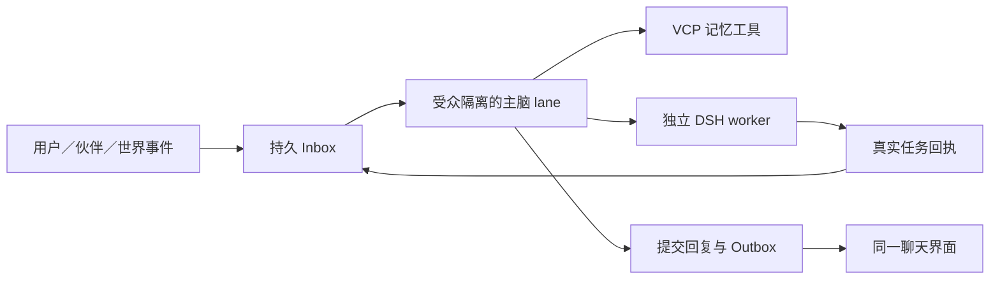
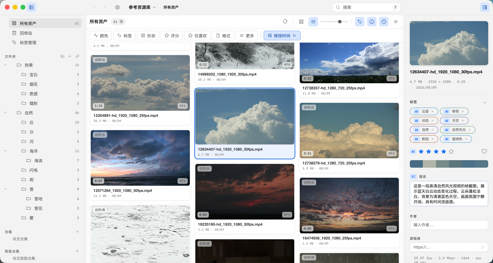

# WorldlineBox · 世界线盒子

**连接持续聊天的虚拟伙伴、记忆、世界场景、数字资产与执行工具。**

Windows x64 · Electron / React / TypeScript / Three.js · 本地数据存储 · MIT

[English](README.en.md) · [项目仓库](https://github.com/whoiswennie/WorldlineBox) · [使用手册](docs/user-guide/README.md) · [开发文档](docs/developer/README.md)

WorldlineBox 是一个本地优先的桌面应用，结合**虚拟伙伴、持久世界状态、数字资产管理与 DSH 执行环境**。
伙伴模块正按 Super Agent 思路重构：用户留在一个聊天界面，主脑理解请求、查询记忆、协调独立任务，执行结果再作为事件回到原会话。
本次开发使用新的数据目录；旧伙伴聊天、认知证明链与旧 VCP 宿主不再是运行入口。

## 四个主要入口

| 入口 | 当前功能 |
| --- | --- |
| **伙伴** | 持续私聊、群聊、流式回复、独立任务、记忆查询与遗忘，以及应用内世界场景。 |
| **启动器** | 管理精确 DSH 运行制品、实例、插件、技能、终端、整合包、快照和备份。 |
| **资产管理** | 导入、组织、搜索、预览和分析图片、音视频、文档与 3D 模型。 |
| **浏览器** | 多标签浏览、收藏、下载，以及网页内容与媒体采集。 |

启动器是默认首页。伙伴数据独立于资产库，不要求先选择一个资产库。

## 持续聊天的 Super Agent 伙伴

首次进入提供「小伴」，可创建伙伴并编辑名字、人格与相处方式。联系人、私聊、群聊和世界频道位于同一个工作区；用户无需管理 DSH Session。
消息按页读取，当前回复流式展示并可停止；发送失败保留草稿。不同会话分别排队，同一伙伴在不同受众中的模型上下文隔离，多个 lane 可以并发。

主脑运行于 DSH 原生 Agent Loop；WorldlineBox 负责持久事件、来源与受众、每条 lane 的顺序和任务状态。独立任务使用自己的 DSH worker，完成回执回到来源会话。「已提交」与「实际完成」是不同状态。当前伙伴模型接口要求 OpenAI Chat Completions；资产分析等模块的协议支持范围独立。

### 记忆与上下文

- 记忆底座是最新独立移植的 VCP Memory 模块，负责日记、语义检索、历史回查及上下文预处理／记录闭环。
- 使用应用内置的 EmbeddingGemma 2、768 维向量与运行组件；伙伴不配置另一套外部向量服务。
- 主脑可主动搜索记忆、回查聊天、读取片段、写入或按 ID 忘记；回复后的整理通过持久后台队列处理，可能额外调用模型。
- 「记忆」面板可搜索、手动保存、查看当前伙伴在当前域的最近记录并逐条忘记。遗忘会撤回相关来源的使用、隔离旧上下文并阻止旧捕获回写；不会物理擦除 DSH 的原始冷日志。
- DSH 负责活动上下文压缩；lane/epoch 与原生摘要、尾部交接用于限制单个活动会话。交接可能调用模型并产生等待；失败时保留原会话，不能把空会话当作成功恢复。

持续聊天指用户界面与业务会话保持连续，不表示把全部历史塞进模型，也不保证任意旧事实都能被正确召回。真实模型内容质量、数月对话表现与完整 lifetime 边界仍需验收；协议夹具和组件测试不能代替这些结论。

### 实际世界场景

世界频道可打开「世界场景」，在位置图与 Three.js 三维场景之间切换。每位伙伴拥有自己的小屋，可沿可达路径移动、经过出入口前往公共花园，与家具进行坐下、休息、阅读、用餐等交互。物理位置、路线、占用和动作由持久的宿主状态驱动。

新三维视图复用真实小屋、花园与已有美术资源。已有美术 ID 使用对应动作图组；新建伙伴目前显示本人姓名标记。WebGL 不可用时返回位置图。世界事件只投给同场实际观察者；私人小屋不向其他伙伴开放。坐在电脑前是一种世界动作，不代表 DSH 工作已经执行。

旧的独立世界窗口、15 位默认联系人、关系／作息／概率日常、梦境和成长工作台已退役，不是本轮新系统的功能。QQ、微信、手机网关及更完整世界模拟属于后续接入范围。

## DSH：主脑协调与独立执行

主脑只获得协调、记忆、同域消息与世界工具，实际文件、命令等工作交给 DSH worker。来源与任务工作目录由宿主绑定；用户私聊任务可取得完整 DSH 工具范围，群聊、伙伴和世界来源使用 scoped 范围，文字不能自行扩权。应用重启按持久事件与原生 event ID 恢复；投递状态未知时保留同一标识，避免另起任务重复执行。

### 启动器、实例与整合包

启动器可以同步官方目录、下载或导入运行制品，创建独立实例，启停 DSH Web 工作台，并打开真实 ConPTY 终端。
DSH 运行制品通过启动器下载或导入，不随 WorldlineBox 应用包预装。
模型访问仍需配置对应账户或 API；WorldlineBox 不附带可离线运行的大语言模型。

实例的插件、技能、配置和缓存保持独立；运行制品安装后自动使用临时数据检测共享存档兼容性，界面展示逐项结果与失败原因。通过后可共享会话、账户、模型设置与默认工作区，无需发行版本白名单。运行版本可以独立删除，也可清理下载和安装残留；引用保护保留仍被使用的制品。
运行版本页优先展示已安装制品及其占用、引用和检测结果，下载与本地导入分开管理。浏览实例不会自动准备 CLI；任务通过独立 CLI 执行，复用受文件变更监听保护的校验结果，无需启动 Web 工作台。
共享能力按具体运行制品验证，不承诺任意第三方插件或历史数据格式都兼容。

支持 `.dshpack` 整合包导入导出、完整备份、实例快照和恢复。
整合包分享配置与依赖组合，完整备份用于保存所选环境和数据；二者包含范围不同，不能用整合包代替账户与会话备份。
详见[DSH 启动器使用指南](docs/user-guide/dsh-launcher.md)。

### 随应用提供的工具环境

Windows 应用包携带校验过的 Node.js、npm、pnpm、CPython、pip、Git、FFmpeg、ffplay 和 ffprobe。
CPython 包含完整标准库、`ensurepip` 与 `venv`，可以在实例中创建虚拟环境。

这些工具自动加入应用与 DSH 子进程的工具环境，CLI 可以直接按 `node`、`python`、`git`、`ffmpeg` 等名称调用。
这不会替换系统工具或默认修改 Windows 全局 PATH；只有显式启用系统 `dsh` 命令时，才配置其受管入口。
精确工具清单、哈希校验与源码分发要求见[便携工具说明](docs/developer/portable-tools.md)和[第三方声明](THIRD_PARTY_NOTICES.md)。

## 数字资产管理与扩展生态

资产管理保留为完整的独立模块，不要求为每个资源库建立角色或 DSH 实例：

- 本地资源库、文件和文件夹导入、组织与整理、标签、评分、合集、多工作区和多标签页。
- 全文与高级条件搜索、过滤、排序和分页浏览，查看元数据与派生媒体处理进度。
- 语义搜索与相似资产检索统一使用内置多模态模型；各库可单独关闭资产语义搜索，向量索引随资源库保存。
- 图片、视频、音频、文本、PDF 和 3D 模型预览，以及缩略图、转码和媒体信息处理。
- 资产 AI 分析，通过配置的模型生成描述、标签等结果；可按需选择哪些资料交给外部服务。
- WebDAV 资源库双向同步、浏览器扩展保存网页图片与视频、音乐播放和同步歌词。
- WorldlineBox 插件、自动化脚本和本机 MCP 通道，扩展资产界面或供外部客户端使用。

资产管理器以 [Serpent](https://github.com/dolag233/Serpent) 为基础，逐项同步至 0.3.2：AI 分析与 AI 搜索可保存和切换多套命名服务配置，大型资源库导入与图像序列识别提速，媒体处理按可用内存调整并发，并同步原生拖拽和 Windows MCP 凭据恢复修复。扩展按合集保存、批量传输取消、自定义快捷键、侧栏拖拽排序、断开映射盘探测和 Windows 更新清理沿用此前已验证的增量实现。可切换新旧界面、编辑和保存主题、调整背景与面板不透明度、从库内资产或文件选择文件夹封面，并设置卡片文字对齐。Windows/macOS 安装版提供登录启动设置。WorldlineBox 的名称、独立版本号、数据目录及启动器、伙伴、浏览器等模块保持原有约定；[0.3.0 升级记录](docs/developer/asset-manager-030-upgrade.md)、[0.3.1 逐项同步记录](docs/developer/serpent-031-upgrade/README.md)和 [0.3.2 升级记录](docs/developer/serpent-032-upgrade/README.md)列出来源、验证范围和限制。

内置浏览器已自带资产采集能力，无需安装扩展。地址栏「保存到资产库」可选择资源库与文件夹、直接新建目录、导入本地文件，保存网页图片、音视频、选中文字及文件链接。网页保存生成包含可读文字与来源的 `.txt` 快照；最近采集记录独立分页，支持搜索、状态筛选和取消任务。支持范围见[内置浏览器使用说明](docs/user-guide/browser.md#保存到资产库)。外部 Chrome/Edge 仍可单独安装扩展。

MCP 使用应用内的本机 loopback 服务，可在设置中启停和管理连接凭据。
WorldlineBox 资产插件与 DSH 原生插件属于不同协议，分别在各自的管理入口安装。
用户文档见[资产使用手册](docs/user-guide/README.md)，扩展接口见[插件、脚本与 MCP 作者手册](docs/manual/README.md)。

## 全局截图、录屏与临时问答

左侧栏的截图、录屏按钮与「全局工具」菜单可在各模块使用；设置中的「全局工具与快捷键」提供截图、录屏、提取文字、截图翻译、长截图、划词助手六项快捷键。应用运行期间也可在其他程序中使用，Windows 划词助手默认快捷键为 **Ctrl+Alt+Shift+D**。

截图支持框选、画笔、箭头、文字、形状、遮盖、马赛克及撤销重做，可复制、保存到资产库或系统 `Downloads/WorldlineBox` 目录。图片问答、文字提取与翻译使用全局 LLM，图片功能需要支持视觉的模型；用户点击发送后才提交当前编辑后的图片，支持临时多轮追问，关闭即清空。划词助手支持纯文字模型；Windows 应用未提供 UIA 选区时，可显式粘贴或输入原文。

录屏支持屏幕、窗口与选区，MP4/WebM 单次最长 2 小时，GIF 最长 60 秒且无声音。默认开启系统声音、关闭麦克风，录像保存在 `Downloads/WorldlineBox`。长截图需要手动滚动目标内容，再逐屏添加和拼接。操作说明见[全局工具](docs/user-guide/browser.md#全局截图录屏与划词助手)。

## 保存与恢复

伙伴数据位于应用用户目录的 `companion-bot-v2`：`bot.sqlite` 保存会话、分页消息、事件、任务和物理世界；`memory` 保存按伙伴与受众域隔离的 VCP 数据。DSH 管理自己的原生 Session 与冷日志。资产库继续使用独立的资源库数据库。

新入口不迁移、双写或读取旧伙伴数据库。关闭应用会停止当前运行，持久事件和作业供下次恢复；不会在离线期间虚构聊天或外部工作。当前 UI 没有旧版的完整伙伴重置／成长档案管理流程。备份或清理数据前先退出应用，不要把记忆“忘记”当作所有原始记录的物理删除。

## Windows 安装与源码运行

当前伙伴、DSH 便携工具和安装流程重点面向 **Windows 10 / 11 x64**。
仓库保留 macOS 的资产域与原生构建配置，但不能据此认为所有 Windows 新增能力已在其他平台验证。
已发布的文件以 [GitHub Releases](https://github.com/whoiswennie/WorldlineBox/releases) 实际内容为准；最新源码的本地构建不等于已经公开发布。

使用伙伴前，在启动器安装并选择受支持的官方 DSH 运行制品，在「模型设置」配置兼容 OpenAI Chat Completions 的连接，再进入「伙伴」聊天。
当前主脑和伙伴委派任务使用应用配置的模型连接；启动器自身的终端、Web 工作台和账号设置仍由 DSH 管理。

### 三个正式 BAT 入口

在项目根目录依次使用：

| 脚本 | 作用 |
| --- | --- |
| `01-Setup-Environment.bat` | 准备项目固定 Node.js、锁定依赖、Electron、原生数据库模块、媒体组件和 Inno Setup，并校验便携工具与构建输入。 |
| `02-Start-Development.bat` | 检查已准备环境并启动开发模式，正常启动会编译当前源码；不自动安装依赖或重编译原生模块。 |
| `03-Build-Installer.bat` | 依次执行类型检查、应用打包及产物校验、Inno Setup 安装器构建。 |

最终安装器为 **`out/make/inno/WorldlineBoxSetup.exe`**。
打包应用目录为 `out/WorldlineBox-win32-x64/`，应用入口为其中的 `WorldlineBox.exe`。
`npm run package` 仅生成打包应用；要生成正式 EXE 安装器，应使用 `03` 或按构建文档继续执行 `make:inno`。

首次准备需要联网；缺少 Python / C++ Build Tools 时，`01` 会尝试通过 winget 安装，系统可能请求权限或重启。
项目使用自己的固定 Node.js 和 Inno Setup，不要求替换系统版本。
环境缺失或依赖锁变化时重新运行 `01`，不要把 `02` 或 `03` 当作依赖安装脚本。

完整的[逐文件工具清单](resources/portable-tools/manifests/win32-x64.json)、版本锁、下载来源与获取脚本均纳入 Git 管理。大型工具二进制由 `01` 按固定官方发行包 URL 和 SHA-256 获取，再核对完整清单，不依赖旧机器的安装目录。`git pull` 后如果工具锁变化，`02` 和 `03` 会在启动前提示运行 `01`；更新先验证新包，再切换目录并保留旧包备份。只修复工具可运行 `npm run tools:repair`。需要代理时运行 `01-Setup-Environment.bat -Proxy http://127.0.0.1:7897`，详情见[便携工具说明](docs/developer/portable-tools.md)。
媒体组件的在线恢复与可信离线导入方式见[构建与打包](docs/developer/build-packaging.md)。

正常开发版与安装版共享 `%APPDATA%\WorldlineBox`；DSH 存储位于其 `dsh-launcher` 子目录。
可通过绝对路径环境变量 `WORLDLINEBOX_USER_DATA_PATH` 统一指定应用数据位置。
测试使用独立临时目录；`.tools/`、`node_modules/`、`dist/`、`out/` 和测试报告不进入源码提交。

## 开发与验证

Electron、React、TypeScript、Vite、Three.js 和 SQLite。资产库由 Library Worker 管理；新 BotStore 在主进程执行小事务，VCP 使用常驻 Node Worker，DSH 承担原生推理与工具循环。

| 命令 | 用途 |
| --- | --- |
| `npm run typecheck` | 应用与浏览器扩展类型检查。 |
| `npm run lint` | ESLint。 |
| `npm run test:bot:quick` | 新伙伴模块的短时定向测试，使用 Electron ABI。 |
| `npm run test:bot:e2e` | 隔离配置的真实 Electron 伙伴与世界 UI 验证。 |
| `npm run test:bot:protocol` | 真实 DSH / VCP 路径与受控模型协议夹具；不代表真实模型质量。 |
| `npm run test:bot:real` | 显式联网模型验收，会使用已配置服务；是否通过以保存的结果为准。 |
| `npm run verify:bot:memory` | 校验已暂存的独立 VCP 模块。 |
| `npm run verify:package` | 验证已有打包产物。 |

已有定向测试覆盖事件幂等、事务回滚、并发与取消、遗忘及迟到结果、世界物理与 UI。三维 Electron 截图验收使用过软件 WebGL，不构成硬件帧率证明。完整真实模型、安装包及长期表现需要各自的验证记录。

## 文档与参考

- [使用手册](docs/user-guide/README.md) · [伙伴使用说明](docs/user-guide/companions.md) · [DSH 启动器](docs/user-guide/dsh-launcher.md)
- [Super Agent 运行说明](docs/developer/superagent-bot-runtime-guide.md) · [开发文档](docs/developer/README.md) · [构建与打包](docs/developer/build-packaging.md)
- [重构调研（旧态证据）](docs/developer/superagent-bot-research-2026-11-02.md) · [实施方案](docs/developer/superagent-bot-implementation-plan-2026-11-02.md)
- [插件、脚本与 MCP 作者手册](docs/manual/README.md) · [浏览器扩展](extension/README.md)
- [产品方向](docs/product-brief.md) · [初始工程验证记录](docs/developer/validation-0.1.0.md)

世界内容与运行器、IM 网关、手机连接及完整世界线分支编辑器属于后续方向。

## 许可与来源

本项目使用 [MIT 许可](LICENSE)。感谢 [Serpent](https://github.com/dolag233/Serpent) 作者 dolag233 及贡献者提供资产管理基础和持续改进；按功能增量整合并保留其版权声明。WorldlineBox 保持独立名称、版本和自有功能。
当前独立记忆模块位于 `resources/vcp-memory`，保留 VCPToolBox 等上游代码的来源清单与许可；它替代已退役的旧 VCP 宿主。图标包含维护者提供的素材；媒体、工具、字体与其他资源遵循各自许可，见 [THIRD_PARTY_NOTICES.md](THIRD_PARTY_NOTICES.md)。DSH 运行制品保留自身许可；Git、FFmpeg 等组件的分发义务不能由本仓库 MIT 许可替代。
