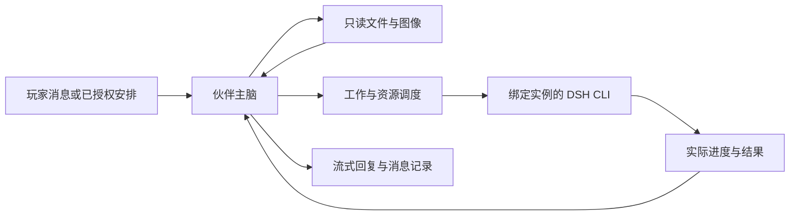

# WorldlineBox · 世界线盒子

**让虚拟伙伴拥有可以持续生活的世界，也让聊天、记忆、资产与执行工具彼此连接。**

Windows x64 · Electron / React / TypeScript / Three.js · 本地数据存储 · MIT

[English](README.en.md) · [项目仓库](https://github.com/whoiswennie/WorldlineBox) · [使用手册](docs/user-guide/README.md) · [开发文档](docs/developer/README.md)

WorldlineBox 是一个本地优先的桌面应用，结合**虚拟伙伴、持续保存的虚拟世界、数字资产管理和 DSH 执行环境**。
你可以与伙伴长期私聊或群聊，观察她们在小屋和公共花园中的生活，也可以把明确的现实任务交给伙伴，由 DSH CLI 执行并回报进度与结果。
人物的身份、记忆、关系、作息和世界状态由 WorldlineBox 管理，具体电脑操作交给执行后端。

## 四个主要入口

| 入口 | 可以做什么 |
| --- | --- |
| **伙伴** | 联系人、流式私聊与群聊、自动记忆、用户与角色资料、日历、生活事件、工作台、世界观察与伙伴社交记录。 |
| **启动器** | 安装和选择精确 DSH 运行制品，管理独立实例、插件、技能、终端、整合包、快照和备份。 |
| **资产管理** | 导入与组织图片、音视频、文档和 3D 模型，搜索、预览、分析、自动化并同步资源库。 |
| **浏览器** | 多标签浏览、收藏与下载；采集图片、音视频、文字、网页文字快照和常见文件到资产库。 |

启动器是默认首页，无需先创建资产库。聊天、世界观察和资产管理可以配合使用，独立世界窗口不会占住主聊天页面。

## 虚拟伙伴与长期聊天

### 联系人、身份与流式消息

- 提供 15 位内置伙伴，包括大肥鱼、小肥鱼、白幻、黑幻、Gemini、GPT、Grok、Kimi、MiniMax、Qwen、咕咕嘎嘎、咕嘎、Doro、菲比啾比和弗糯糯，也可以创建自定义联系人。
- 私聊与群聊使用持续会话，支持未读、置顶、静音、引用、附件、分页历史和消息搜索；相同成员组合复用对应会话。
- 回复逐步流式展示，正文、能力调用、后续结果保留在同一个回复流程中；多个任务分别保留进度和停止入口。
- 支持 Markdown、代码高亮、表格、数学公式和 Mermaid 图表；浏览旧消息时，新内容不会强制把页面拖到底部。
- 上下文明确区分玩家、当前扮演的伙伴、实际发言者、回复对象和原始委托人，并保留跨会话委托来源，避免将玩家身份与角色间的姐妹关系混用。

角色名字与模型服务无绑定关系。所有伙伴可继承全局模型，也可独立配置 API 地址、密钥和模型。
目前支持 OpenAI Chat Completions、OpenAI Responses、Anthropic Messages、Gemini 原生 API 和 DashScope 原生 API。
角色配置与 API 密钥分开保存；密钥通过 Electron 的系统安全存储加密，不写入聊天正文或消息数据库。

伙伴聊天与 DSH 任务执行使用两套独立的模型设置。DSH 直接使用当前所选实例保存的账号、API、默认模型、插件和技能；世界线盒子的全局模型不会覆盖 DSH，也不向任务注入全局 API Key。伙伴可以使用一种模型聊天，同时由配置了另一种模型的 DSH 执行任务。

所有 DSH 实例统一共享会话、附件、默认工作区、账号与 DSH 模型配置，不再提供独立存档模式。已有实例会进行保留原件的合并迁移；新版本通过隔离兼容性检查后接入同一存档。

### 自动收录与召回记忆，无需 Embedding 模型

正式消息保存后会进入持久记忆处理队列，由伙伴已有的模型连接理解事实、偏好、约定、经历和任务状态。
每次回复前自动查找相关记忆，需要核查时继续读取原始消息，不要求用户反复说“记住这个”或“回忆一下”。

- 检索结合 SQLite 全文索引、标签、结构化事实、时间与来源关系，不需要额外部署向量数据库或 Embedding 模型。
- 计划、进行中、完成、主观感想和待证实假设有不同标记，修正内容保留可核查的来源与历史。
- 每位伙伴有独立记忆范围，群聊按实际成员与来源权限使用资料，不能读取其他伙伴的私人记录。
- 独立的大型记忆管理窗口提供搜索、筛选、分页、来源查看、修正与遗忘，不把全部原文堆进聊天侧栏。
- 网络或模型暂不可用时保留待处理队列，恢复后继续整理；删除或撤回来源会影响依赖它的记忆。

自动理解仍可能遗漏或误解。有来源可核查不等于每条旧信息每次都会被想到；完整历史保存在本机，按需检索，而非每轮全部发送给模型。
实现细节见[自动记忆说明](docs/developer/companion-memory-implementation.md)。

### 用户资料、头像与公开形象

设置中的「用户信息」可以填写名字、公开介绍、头像和正交三视图；伙伴联系人资料也支持同样的公开形象设定。
头像与三视图分开保存：头像用于聊天和联系人，三视图用于表达正面、侧面和背面的标准外观。
15 位内置伙伴均附带对应的公开三视图；自定义上传优先，重置后可恢复内置形象。小肥鱼使用用户确认的原始设定图。

- 用户和伙伴上传头像时都会进入圆形校准编辑器，支持拖动、缩放、旋转、网格、键盘微调和多尺寸实时预览。
- 保存实际裁剪的头像副本，不修改原图；资料图片使用应用管理的副本，移动原文件不会破坏已保存的设定。
- 每次交互提供相关双方最新的公开介绍及头像、三视图绝对路径，伙伴也知道自己的形象文件位置。
- 支持视觉的所选模型会收到实际图片像素；不支持视觉时保留文字和路径，并区分“知道文件在哪”与“已经看过图片”。

### 文件与多模态交流

伙伴主脑可以使用内置的 `read_file`、`read_image` 和 `send_file`，在当前交互允许的范围内只读查看文本、真正读取图片像素，或把已有成果附到回复中。
文本可按行分页读取；图片经过实际解码和尺寸处理，再交给支持视觉的模型。

聊天前端支持图片缩略图与放大浏览、音视频播放和文档类型卡片，用户发送、伙伴查看或附回的文件快照可以随消息回看。
音视频可播放、文档可展示，并不自动代表主脑已经理解其内容。
需要搜索、运行程序、生成或修改文件时，仍由 DSH CLI 执行，不把只读视觉工具扩展为另一套通用命令执行器。

## 状态、日常与正式工作

伙伴手帐侧栏展示当前心情、精力、表达倾向、好感和相处阶段，提供日历、便签与工作概览。
详细人设在联系人页查看，完整记忆、日程和任务过程分别在独立窗口中管理。

| 系统 | 当前行为 |
| --- | --- |
| **情绪与关系** | 使用 PAD 连续状态，以及好感、信任、尊重等关系量；由有来源的互动、工作结果和环境事件更新，参与语气、活动偏好和交互决策。 |
| **作息与习惯** | 睡觉、醒来、用餐、休息和兴趣活动按世界时间安排；实际参与活动才累计养成进度。 |
| **日历与提醒** | 支持一次、每日、每周、每月和间隔重复，提供修改、暂停、恢复、立即执行、取消和结果查看。 |
| **概率生活事件** | 在指定时间窗口中，按精力、情绪、关系、当地感受和已观察天气调整联系、拜访、休息、学习、娱乐或公园散步的机会。 |
| **正式工作台** | 用户或伙伴可以提出工作，受理、进行、暂停、完成、失败和取消各有状态；用户授权的外部工作与伙伴内部工作分开处理。 |

生活事件采用持久的累计风险算法，机会随实际流逝时间积累，刷新页面或多开窗口不会反复抽签。
事件可以选择其他伙伴作为对象；冷却、每日预算和有限回应链限制重复打扰。
相关算法与执行边界见[状态模型](docs/developer/companion-state-algorithm.md)、[作息模型](docs/developer/companion-routine-algorithm.md)和[行为事件契约](docs/developer/companion-events.md)。

**电脑是集中工作的地方，普通回复可以使用手机。**
空闲、走路、休息和习惯活动中可以原地交流；集中工作、吃饭或睡觉时，普通消息等待。
有明确现实期限或打断要求的消息先经过语义判断，紧急互动可以中断当前行为。
实际电脑工作仍需要走到有权使用的空电脑并坐稳，不能用一句“已完成”代替执行。

工作概览汇总进行中、等待中与待确认数量，最多预览两条；完整工作台可以分页查看任务与执行记录。
提醒和生活便签不被所有并行任务挤满，每件工作保留自己的来源、过程和结果。

## 可以持续生活的虚拟世界

### 小屋、街区与公共花园

每位伙伴拥有自己的小屋，包含电脑桌、卧室、厨房、餐桌和休息区域。
角色采用独立动作组的三帧精灵动画，在 Three.js 场景中表现行走、跑步、转身、坐下、工作、吃饭、睡眠、看手机、说话和聆听等状态。
头顶状态卡直接显示她正在做什么，位置、家具交互锚点和动画由同一套宿主状态驱动。

- **独立多窗口观察**：同时观察不同小屋或公共区域，主窗口可以继续聊天、查看任务或管理资产。
- **街区地图**：以家庭头像定位住址，显示伙伴的实际出行位置与路线，并可进入相应小屋或花园视角。
- **三维公共花园**：包含环形步道、曲线支路、树冠、木椅、藤架、动态喷泉与六盏夜间路灯，使用真实家具坐标和碰撞范围。
- **真实移动与占用**：沿可通行路径抵达地点；电脑、长椅有预约和占用规则，两人不能同时冒领同一资源。
- **拜访许可**：先申请，对方同意后才能进入；许可与实际到达是不同状态，不能靠聊天文字获得通行权。
- **公园散步**：默认生活计划包含概率散步；实际园内行走才计算放松时间，去程、停步聊天和回程不算完成。

场景按材质合并静态几何，动态水滴使用着色器点集，可见窗口使用统一帧预算；隐藏和最小化窗口停止绘制。
性能取决于硬件、场景与窗口数量，实机测量和验证条件见[世界系统与公共花园验收](docs/developer/companion-world.md)。

### 统一世界时间、天气与有限感知

世界默认与当前电脑真实时间同步，也可以选择**现实 20 分钟对应虚拟世界一天**的压缩模式。
聊天中的时间认知、日程、作息、社交日期与世界昼夜使用同一时钟和时区。
昼夜、局部光照、晴雨雪天气、室内外温度与舒适度共同影响生活状态和可选活动。

伙伴没有玩家的全图视角。她们以自身位置、视距、光照、遮挡与清醒状态持续观察周围：

- 只在同场景、可见范围内发现人物与家具，不透视其他房间。
- 过去见过的对象保留最后观察时间，离开视野后不会自动刷新成远处的实时状态。
- 公开联系人与住址不等于知道对方在家，也不能读到别人的内心、工作内容或未来路线。
- 天气未知时不会默认为晴天；在户外或靠近可观察的真实门口后才更新天气见闻。
- 感知由本地计算按固定间隔采样，不是每秒调用一次模型；模型在对话或决策时使用自己的感知资料。

主聊天、社交、世界决策和旧工具记录重放共用这道资料边界。详细说明见[有限环境感知](docs/developer/companion-perception.md)。

### 伙伴之间的自主交流

伙伴可以主动给玩家或其他伙伴发消息，也可以在生活事件、拜访或实际偶遇中开始交流。
远程手机文字与同场当面交谈是不同渠道；现场交谈需要真实距离、可交流状态和双方当前感知共同允许。
两人或多人交谈时使用说话、聆听动作，有限回应结束后恢复生活，不把群成员全部当成玩家。

「伙伴社交观察」提供按世界日期、伙伴、会话和内容查询的后台视角，分页查看伙伴私聊、群聊和当面交流。
观察面板复用聊天展示、双方头像和引用关系；切换观察视角只改变消息排版，不会把玩家加入会话或授予电脑权限。
用户委托伙伴联系别人时，原始发起人和允许共享的内容随委托保留，已发生的回复或许可可以回报原玩家。

## DSH：让伙伴真正完成电脑任务

主脑负责理解目标、决定下一步和与用户交流；**DSH CLI 是实际任务执行的主要能力**。
每条用户消息运行自己的回复循环，工具结果返回后可以继续检查、修正和执行，最后再报告成果。

- DSH 使用所选 CLI 实例的精确运行制品、插件、技能、工作目录与权限配置，执行中的任务不会因切换默认实例而换环境。
- 用户可以查看实时进度、日志和结果，停止操作会处理实际子进程；取消状态不能代替进程退出确认。
- 伙伴内部讨论、好感度、拜访许可或其他伙伴的话，不会自动成为操作玩家电脑的授权。
- “已排队”“已受理”“正在调用”与“实际成功”分别记录，重启或迟到回包不会把取消的工作重新标成成功。

### 启动器、实例与整合包

启动器可以同步官方目录、下载或导入运行制品，创建独立实例，启停 DSH Web 工作台，并打开真实 ConPTY 终端。
DSH 运行制品通过启动器下载或导入，不随 WorldlineBox 应用包预装。
模型访问仍需配置对应账户或 API；WorldlineBox 不附带可离线运行的大语言模型。

实例的插件、技能、配置和缓存保持独立；运行制品安装后自动使用临时数据检测共享存档兼容性，界面展示逐项结果与失败原因。通过后可共享会话、账户、模型设置与默认工作区，无需发行版本白名单。运行版本可以独立删除，也可清理下载和安装残留；引用保护保留仍被使用的制品。
运行版本页优先展示已安装制品及其占用、引用和检测结果，下载与本地导入分开管理。浏览实例不会自动准备 CLI；任务通过独立 CLI 执行，复用受文件变更监听保护的校验结果，无需启动 Web 工作台。
共享能力按具体运行制品验证，不承诺任意第三方插件或历史数据格式都兼容。

支持 `.dshpack` 整合包导入导出、完整备份、实例快照和恢复。
整合包分享配置与依赖组合，完整备份用于保存所选环境和数据；二者包含范围不同，不能用整合包代替账户与会话备份。
详见[DSH 启动器使用指南](docs/user-guide/dsh-launcher.md)。

### 随应用提供的工具环境

Windows 应用包携带校验过的 Node.js、npm、pnpm、CPython、pip、Git、FFmpeg、ffplay 和 ffprobe。
CPython 包含完整标准库、`ensurepip` 与 `venv`，可以在实例中创建虚拟环境。

这些工具自动加入应用与 DSH 子进程的工具环境，CLI 可以直接按 `node`、`python`、`git`、`ffmpeg` 等名称调用。
这不会替换系统工具或默认修改 Windows 全局 PATH；只有显式启用系统 `dsh` 命令时，才配置其受管入口。
精确工具清单、哈希校验与源码分发要求见[便携工具说明](docs/developer/portable-tools.md)和[第三方声明](THIRD_PARTY_NOTICES.md)。

## 数字资产管理与扩展生态

资产管理保留为完整的独立模块，不要求为每个资源库建立角色或 DSH 实例：

- 本地资源库、文件和文件夹导入、组织与整理、标签、评分、合集、多工作区和多标签页。
- 全文与高级条件搜索、过滤、排序和分页浏览，查看元数据与派生媒体处理进度。
- 实验性语义搜索与相似资产检索，支持本机模型、自定义向量服务和每库独立绑定；索引随资源库保存。
- 图片、视频、音频、文本、PDF 和 3D 模型预览，以及缩略图、转码和媒体信息处理。
- 资产 AI 分析，通过配置的模型生成描述、标签等结果；可按需选择哪些资料交给外部服务。
- WebDAV 资源库双向同步、浏览器扩展保存网页图片与视频、音乐播放和同步歌词。
- WorldlineBox 插件、自动化脚本和本机 MCP 通道，扩展资产界面或供外部客户端使用。

资产管理器已按功能同步 Serpent 0.3.0，并增量接入 0.3.1 及本地最新源码修复：自定义快捷键、侧栏拖拽排序、批量传输性能与取消、断开映射盘探测和 Windows 更新清理。可切换新旧界面、编辑和保存主题、调整背景与面板不透明度、从库内资产或文件选择文件夹封面，并设置卡片文字对齐。Windows/macOS 安装版提供登录启动设置。WorldlineBox 的名称、独立版本号、数据目录及启动器、伙伴、浏览器等模块保持原有约定；[0.3.0 升级记录](docs/developer/asset-manager-030-upgrade.md)和 [0.3.1 逐项同步记录](docs/developer/serpent-031-upgrade/README.md)列出来源、验证范围和限制。

内置浏览器已自带资产采集能力，无需安装扩展。地址栏「保存到资产库」可选择资源库与文件夹、直接新建目录、导入本地文件，保存网页图片、音视频、选中文字及文件链接。网页保存生成包含可读文字与来源的 `.txt` 快照；最近采集记录独立分页，支持搜索、状态筛选和取消任务。支持范围见[内置浏览器使用说明](docs/user-guide/browser.md#保存到资产库)。外部 Chrome/Edge 仍可单独安装扩展。

MCP 使用应用内的本机 loopback 服务，可在设置中启停和管理连接凭据。
WorldlineBox 资产插件与 DSH 原生插件属于不同协议，分别在各自的管理入口安装。
用户文档见[资产使用手册](docs/user-guide/README.md)，扩展接口见[插件、脚本与 MCP 作者手册](docs/manual/README.md)。

## 全局截图、录屏与临时问答

左侧栏的截图、录屏按钮与「全局工具」菜单可在各模块使用；设置中的「全局工具与快捷键」提供截图、录屏、提取文字、截图翻译、长截图、划词助手六项快捷键。应用运行期间也可在其他程序中使用，Windows 划词助手默认快捷键为 **Ctrl+Alt+Shift+D**。

截图支持框选、画笔、箭头、文字、形状、遮盖、马赛克及撤销重做，可复制、保存到资产库或系统 `Downloads/WorldlineBox` 目录。图片问答、文字提取与翻译使用全局 LLM，图片功能需要支持视觉的模型；用户点击发送后才提交当前编辑后的图片，支持临时多轮追问，关闭即清空。划词助手支持纯文字模型；Windows 应用未提供 UIA 选区时，可显式粘贴或输入原文。

录屏支持屏幕、窗口与选区，MP4/WebM 单次最长 2 小时，GIF 最长 60 秒且无声音。默认开启系统声音、关闭麦克风，录像保存在 `Downloads/WorldlineBox`。长截图需要手动滚动目标内容，再逐屏添加和拼接。操作说明见[全局工具](docs/user-guide/browser.md#全局截图录屏与划词助手)。

## 保存、恢复与伙伴重置

正式消息、记忆、关系、日程和世界个人状态保存在应用用户目录的 SQLite 中，资源库保存在所选资源库目录。
世界恢复位置、路线、占用、生活阶段和已经提交的事件，读取历史使用分页，不在每次启动时重放多年日志。

关闭应用后不会继续调用模型或运行新的电脑任务。下次启动会恢复持久状态、按规则补算物理生活，再接续允许恢复的工作。
离线时间不会被编造成已经聊天、执行现实任务或沿路观察到了全部场景。

内置联系人受保护，不能直接删除；完整重置会恢复默认资料、人设与形象，并清理对应聊天、记忆、关系、日程、工作和动态生活数据。
自定义联系人可移除。重置或移除先停止该伙伴的回复、后台作业和所属执行进程，确认停止后再清理记录。
大量历史采用分批清理与持久进度，关闭后可继续；重置不会撤销已发生的外部文件修改，也不会清空其他伙伴无关的数据。
详见[重置与生命周期](docs/developer/companion-reset.md)。

## Windows 安装与源码运行

当前伙伴、DSH 便携工具和安装流程重点面向 **Windows 10 / 11 x64**。
仓库保留 macOS 的资产域与原生构建配置，但不能据此认为所有 Windows 新增能力已在其他平台验证。
已发布的文件以 [GitHub Releases](https://github.com/whoiswennie/WorldlineBox/releases) 实际内容为准；最新源码的本地构建不等于已经公开发布。

首次运行建议：打开「设置 → 用户信息」填写公开资料，在「全局模型」配置连接，再到「联系人」发起聊天。
需要执行电脑任务时，先在启动器安装 DSH 运行制品并选择当前 CLI 实例，完成执行侧的模型或账户配置。

### 三个正式 BAT 入口

在项目根目录依次使用：

| 脚本 | 作用 |
| --- | --- |
| `01-Setup-Environment.bat` | 准备项目固定 Node.js、锁定依赖、Electron、原生数据库模块、媒体组件和 Inno Setup，并校验便携工具与构建输入。 |
| `02-Start-Development.bat` | 检查已准备环境并启动开发模式，正常启动会编译当前源码；不自动安装依赖或重编译原生模块。 |
| `03-Build-Installer.bat` | 依次执行类型检查、应用打包及产物校验、Inno Setup 安装器构建。 |

最终安装器为 **`out/make/inno/WorldlineBoxSetup.exe`**。
打包应用目录为 `out/WorldlineBox-win32-x64/`，应用入口为其中的 `WorldlineBox.exe`。
`npm run package` 仅生成打包应用；要生成正式 EXE 安装器，应使用 `03` 或按构建文档继续执行 `make:inno`。

首次准备需要联网；缺少 Python / C++ Build Tools 时，`01` 会尝试通过 winget 安装，系统可能请求权限或重启。
项目使用自己的固定 Node.js 和 Inno Setup，不要求替换系统版本。
环境缺失或依赖锁变化时重新运行 `01`，不要把 `02` 或 `03` 当作依赖安装脚本。

完整的[逐文件工具清单](resources/portable-tools/manifests/win32-x64.json)、版本锁、下载来源与获取脚本均纳入 Git 管理。大型工具二进制由 `01` 按固定官方发行包 URL 和 SHA-256 获取，再核对完整清单，不依赖旧机器的安装目录。`git pull` 后如果工具锁变化，`02` 和 `03` 会在启动前提示运行 `01`；更新先验证新包，再切换目录并保留旧包备份。只修复工具可运行 `npm run tools:repair`。需要代理时运行 `01-Setup-Environment.bat -Proxy http://127.0.0.1:7897`，详情见[便携工具说明](docs/developer/portable-tools.md)。
媒体组件的在线恢复与可信离线导入方式见[构建与打包](docs/developer/build-packaging.md)。

正常开发版与安装版共享 `%APPDATA%\WorldlineBox`；DSH 存储位于其 `dsh-launcher` 子目录。
可通过绝对路径环境变量 `WORLDLINEBOX_USER_DATA_PATH` 统一指定应用数据位置。
测试使用独立临时目录；`.tools/`、`node_modules/`、`dist/`、`out/` 和测试报告不进入源码提交。

## 开发与验证

技术栈为 Electron、React、TypeScript、Vite、Three.js 和 SQLite。
主进程管理窗口、模型与执行生命周期，UtilityProcess 持有持久状态，渲染层展示已提交的数据。

| 命令 | 用途 |
| --- | --- |
| `npm run typecheck` | 应用与浏览器扩展的 TypeScript 检查。 |
| `npm run lint` | ESLint 检查。 |
| `npm run test:unit` | 单元与界面测试；含原生模块的案例应使用 Electron 测试入口。 |
| `npm run test:worker` | 在 Electron 运行时验证真实 SQLite 与 Worker。 |
| `npm run test:e2e:companions` | 在真实 Electron 中验证聊天、资料、动作、世界、社交、工作与重置流程。 |
| `npm run verify:package` | 检查已打包的 ASAR、原生模块、媒体及工具资源。 |

行为验证包括真实坐标与抵达、姿态过渡、资源占用、来源撤回、事务故障回滚、重启恢复、有限感知和多窗口性能。
本地测试 provider 用于控制回复与动作选择，实际窗口、IPC、SQLite 和物理流程运行生产代码；这类验收与在线模型的开放语义表现分开记录。
当前实现仍在持续完善，模型理解质量、服务可用性、第三方插件及硬件环境会影响使用体验。

## 文档与参考

- [使用手册](docs/user-guide/README.md) · [伙伴与消息](docs/user-guide/companions.md) · [DSH 启动器](docs/user-guide/dsh-launcher.md)
- [开发、测试与构建](docs/developer/README.md) · [构建与打包](docs/developer/build-packaging.md)
- [自动记忆实现](docs/developer/companion-memory-implementation.md) · [状态算法](docs/developer/companion-state-algorithm.md) · [工作系统](docs/developer/companion-work-orders.md)
- [世界与公共花园](docs/developer/companion-world.md) · [有限感知](docs/developer/companion-perception.md) · [伙伴社交](docs/developer/companion-social.md)
- [插件、脚本与 MCP 作者手册](docs/manual/README.md) · [浏览器扩展](extension/README.md)
- [产品愿景与架构边界](docs/product-brief.md) · [初始工程验证记录](docs/developer/validation-0.1.0.md)
- 机制参考：[PCL](https://github.com/Meloong-Git/PCL)、[DeepSeek Harness](https://github.com/deepseek-ai/deepseek-harness)、[DSH PackForge](https://github.com/DSH-PackForge/dsh-pack-plugin)。

未来方向包括更多公共场景、世界内容与运行器适配，以及更丰富的交互方式；当前小屋与街区不等同于任意游戏运行器或完整世界线分支编辑器。

## 许可与来源

本项目使用 [MIT 许可](LICENSE)。资产管理基础来自 dolag233 及原项目贡献者，保留其版权通知。
图标包含维护者提供的素材；媒体组件、工具、字体及其他第三方资源遵循各自许可，见 [THIRD_PARTY_NOTICES.md](THIRD_PARTY_NOTICES.md)。
DSH 运行制品保留其原始许可。公开分发携带的 Git / FFmpeg 等组件时，也需要履行对应许可证的源码与声明义务，不能仅以本仓库的 MIT 许可替代。
