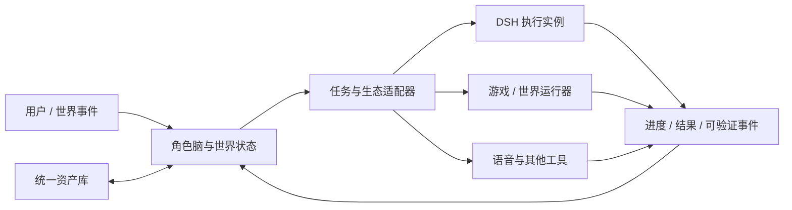

# WorldlineBox · 世界线盒子

**虚拟角色与虚拟世界的中枢，让角色、世界、资产和执行工具拥有共同的家。**

[English](README.en.md) · [项目仓库](https://github.com/whoiswennie/WorldlineBox) · [设计方向](docs/product-brief.md)

WorldlineBox 面向持续存在的虚拟角色、AI 伙伴、互动叙事和虚拟世界。它希望保存角色的人格、记忆、关系与行为，维护世界的状态和世界线，并组织它们使用的图片、声音、模型、文本与其他资产。需要完成真实任务时，由它协调 DSH（DeepSeek Harness）或生态内其他执行工具；需要进入一个世界时，由对应的游戏或世界运行器呈现场景。

这个项目也将提供类似 PCL 的环境管理体验：多个引擎版本和整合包可以共存，用户能选择明确的运行环境，把插件安装到指定实例，保留旧环境，并在新副本中验证升级。DSH 是优先对接的执行后端之一。

## 当前版本

这是 **0.1.0 初始工程版本**。当前已保留并完成品牌迁移的基础包括：

- Electron + React + TypeScript 桌面壳、Windows 安装包构建与开发启动。
- 本地资产库、导入与组织、标签、评分、合集、搜索及多工作区。
- 图片、视频、音频、文本、PDF 与 3D 资产的预览和派生媒体处理。
- 素材 AI 分析、WebDAV 资产库同步、浏览器扩展、插件、脚本和 MCP 通道。

Windows x64 已增加 [DSH 启动器](docs/user-guide/dsh-launcher.md)：精确运行制品、独立插件实例、启停与工作台、整合包、快照和完整备份。不同版本和整合包共享会话、默认工作区、登录授权及模型/API 配置；插件、技能与各实例的执行配置保留独立。启动器位于应用栏首项，并作为默认启动页。

**角色脑、世界状态系统和游戏运行器适配仍属于后续建设计划。** DSH 真正不同数据格式的迁移和第三方插件兼容需要逐版本验证，不能把愿景说明当作已经通过的兼容性矩阵。

## 我们要建设的世界线盒子

| 领域 | WorldlineBox 的职责 |
| --- | --- |
| 角色 | 组织人格、记忆、情绪、关系、行为习惯、形象和声音，支持长期陪伴与角色扮演。 |
| 世界与世界线 | 维护人物、地点、事件、规则和时间；支持世界状态的保存、分支和回顾。 |
| 资产 | 为角色与世界统一管理素材、文档、模型、音乐及生成结果，并提供可追溯的引用。 |
| 执行环境 | 管理 DSH 等后端的精确版本、插件组合、运行时与独立实例。 |
| 整合包 | 将可复现的引擎、插件、配置和内容组合为可分享、可安装的环境。 |
| 生态连接 | 通过适配器对接任务执行器、游戏、世界运行器、语音和其他项目。 |

角色可以在对话中保持自己的身份和情绪；真正执行任务时，向执行后端提交结构化委托，再接收进度和结果，用角色自己的方式反馈。长期人格与世界状态由 WorldlineBox 持有，执行后端负责具体工具和任务。升级某个后端不应要求重建整个角色和世界。

图示是目标架构；当前工程已经提供资产域与桌面基础，其他分支需要逐步实现。

## DSH 管理的基本约定

1. **安装制品、环境与存档分开。** 精确版本的程序可以复用；会话、默认工作区、登录凭据和模型配置由启动器的共享存档层持有。
2. **同版本也能有多个整合包。** 每个实例的 `DSH_HOME`、profile、插件依赖、技能及 agents 目录保持独立；只通过明确的原生适配路径访问共享存档，不共享整套 profile。
3. **不强制跟随最新版本。** 插件与整合包绑定明确的版本和锁文件；缺少兼容证据时显示未知，不承诺自动修复插件。
4. **升级在副本中进行。** 验证通过后切换，保留旧实例。程序版本回退不等于数据库或会话格式可以降级。
5. **管理器独立存活。** 某个 DSH 实例无法启动时，仍应能查看日志、修复环境和恢复旧实例。

PCL 的安装实例与隔离思路、DSH 的 profile / bundle 能力，以及 PackForge 的整合包机制为此提供参考。本项目不复制 PCL 源码，不把其他项目尚未覆盖的能力描述成已经具备。

## Windows 一键使用

首次获取完整源码后，在项目根目录双击：

| 脚本 | 作用 |
| --- | --- |
| `01-Setup-Environment.bat` | 准备指定版本的 Node.js、npm 依赖、Electron、原生数据库模块、校验过的媒体组件和 Inno Setup。 |
| `02-Start-Development.bat` | 启动开发模式；与安装版共享当前用户 `%APPDATA%\WorldlineBox`，DSH 数据保存于其 `dsh-launcher` 子目录。 |
| `03-Build-Installer.bat` | 执行类型检查、打包应用并生成 `out/make/inno/WorldlineBoxSetup.exe` 安装包。 |

首次准备需要联网。缺少 Python / C++ Build Tools 时脚本尝试使用 winget 安装，系统可能请求权限或重启。Node.js 与 Inno Setup 使用项目内工具，不要求更换全局 Node.js。开发和安装包脚本会自动准备缺少的环境；错误时会保留窗口和错误信息。

`.tools/`、`node_modules/`、`dist/`、`out/` 和测试输出不进入 Git。受校验保护的媒体组件由准备脚本获取；GitHub API 限流时也可使用[构建文档](docs/developer/build-packaging.md)中的离线导入方式。

## 开发路线

- **阶段一：稳定基础。** 完成品牌、图标、构建入口和资产功能基线，形成可运行的 Windows 工程。
- **阶段二：环境管理。** 增加运行时目录、实例注册、进程监督、独立数据与 DSH 版本适配器。
- **阶段三：整合包。** 增加锁定清单、来源校验、导入预览、安装任务、快照与副本升级。
- **阶段四：角色与世界。** 建设角色记忆、关系和行为系统、世界状态与世界线，以及执行结果回流。
- **阶段五：生态连接。** 扩展世界运行器、游戏、语音和其他工具适配，保持管理数据与执行后端解耦。

## 文档与参考

- [产品愿景与架构边界](docs/product-brief.md)
- [现有资产功能手册](docs/user-guide/README.md)
- [开发、测试与构建](docs/developer/README.md)
- [0.1.0 验证结果与已知限制](docs/developer/validation-0.1.0.md)
- [插件、脚本与 MCP 作者手册](docs/manual/README.md)
- 机制参考：[PCL](https://github.com/Meloong-Git/PCL)、[DeepSeek Harness](https://github.com/deepseek-ai/deepseek-harness)、[DSH PackForge](https://github.com/DSH-PackForge/dsh-pack-plugin)

## 许可与来源

本项目使用 MIT 许可，见 [LICENSE](LICENSE)。资产管理基础来自 dolag233 及原项目贡献者；保留其版权通知。所依赖的媒体组件、字体和其他第三方资源遵循各自许可，见 [THIRD_PARTY_NOTICES.md](THIRD_PARTY_NOTICES.md)。新图标使用本项目维护者提供的素材。
