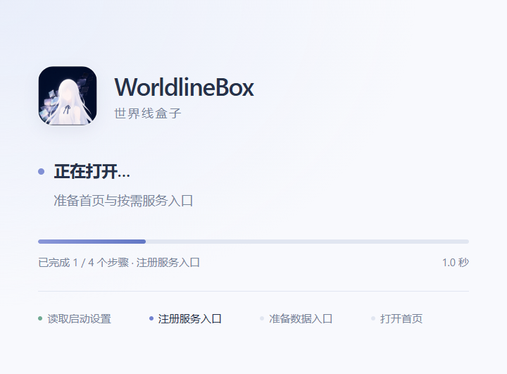
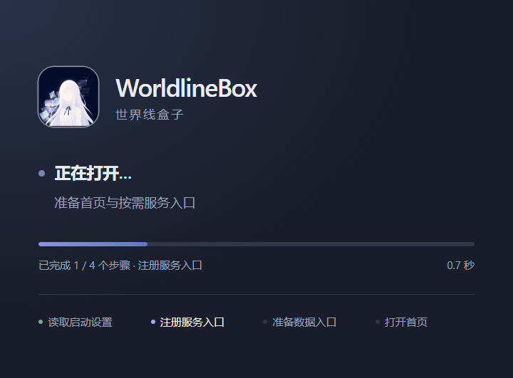

# 浏览器、全局网络与启动界面验收（2026-10-18）

## 实现与范围

应用栏新增按需加载的浏览器；实时终端导航、页面、xterm 渲染器和四个 xterm 包依赖移除。伙伴使用的 DSH CLI 上下文与任务入口保留。

浏览器使用沙盒化 `WebContentsView`，远端网页没有应用 preload 或 Node 权限。标签页、收藏、下载记录和有限导航历史原子保存；Cookie / LocalStorage 由专属 `persist:worldlinebox-browser` 分区持久保存。切换模块隐藏原生视图，保留页面运行状态；重启仅加载当前标签。最多 50 个标签、8 个活跃页面、1000 个收藏、2000 条历史和 200 条下载记录。没有 Chrome 扩展、密码管理器或云同步功能。

按用户最终要求，首页和无 URL 的新标签为 `about:blank`，新空白标签聚焦地址栏。哔哩哔哩、Pixiv、GitHub、Bing 搜索作为预置收藏；版本化迁移只补充新预置项，不重建用户移除的其他项目。已打开的旧标签继续恢复。收藏采用快捷栏和带站点标记、域名、搜索、文件夹筛选的紧凑侧栏；添加与编辑按需展开。

`getApplicationNetwork()` 共享原有网络配置位置，更新下载分区、应用默认分区、浏览器和 DSH 工作台分区；新分区也挂接同一策略。设置保存串行执行，失败回滚全部使用者，成功后关闭旧连接并取消旧下载请求。Node HTTP / fetch 同时更新全局代理；已运行的 Library Worker 收到环境更新，冷 Worker 不因网络设置而启动，新命令继承最新环境。全局自定义代理使用无账户密码的 HTTP/HTTPS 地址。Chromium 的系统代理按目标解析；Node 和命令行工具使用解析出的显式代理环境，不能把任意复杂 PAC 规则等同于各工具自己的 PAC 引擎。

镜像仍按 npm、Python、GitHub 来源应用；普通网页保持原站 URL。网络页分离草稿与当前已应用配置，代理及来源方案可独立新增、编辑和立即启用。连接检查分别展示三类来源、实际代理、HTTP 状态、耗时、失败与回退尝试；不以可连接代替带宽保证。

启动窗口取消圆形旋转框，以原始圆角 Logo、品牌文字、状态点、实际阶段进度和阶段列表呈现，支持明暗主题及减少动画偏好。进度只按完成的阶段更新，不做反复扫动或插值。主窗口仍在真实界面绘制后交接。开发热更新复用 React Root，避免入口重新求值时重复创建 DOM 根。

## 开发 BAT 软件本体验收

运行 `01-Setup-Environment.bat` 更新移除 xterm 后的锁定依赖和环境收据，再多次从原 `02-Start-Development.bat` 启动。仅通过 `WORLDLINEBOX_USER_DATA_PATH` 指向独立测试目录；没有 E2E 标志，没有接触真实账户、API Key 或日常存档。

实际界面确认：终端导航消失；浏览器加载哔哩哔哩；保存收藏；切换模块保留页面；后续修改为空白页后，新标签实际显示空白并聚焦地址栏，旧收藏与标签继续保留。最终再次从开发 BAT 启动，确认快捷栏同时显示哔哩哔哩、Pixiv、GitHub、Bing 搜索四个内置默认收藏，保存的 `defaultsVersion` 为 2、主页为 `about:blank`。通过界面新增 `开发版验收代理`（`http://localhost:7897`）及 `验收 npm 镜像`（`https://registry.npmmirror.com`），保存后顶部与列表均显示正在使用，磁盘配置一致。

从新增配置点击连接检查，npm、Python 返回 HTTP 200；GitHub 官方接口返回 HTTP 403，随后镜像返回 HTTP 200，两次尝试均在界面显示。重启继续保留代理、来源方案和收藏。测试目录：`.tools/test-output/browser-dev-b443e1a99ac34247ba62fdd675c0c2d9`。

本机一次后续开发启动，日志中应用启动阶段到主窗口绘制完成为 **3545 ms**，Renderer 自身报告 2690 ms；此数值不包含 BAT / Forge 的编译时间，不能作为所有机器的冷启动承诺。对应日志 `worldlinebox-20261018T123930.log`。

## 真实互联网下载与热切换

显式启用 `WORLDLINEBOX_NETWORK_LIVE=1` 运行 `dsh-network-live.test.ts`。临时 HTTP CONNECT 中继 A / B 转发到本机真实 Clash 7897，保留 TLS 校验；并未拦截、伪造上游响应。

- 12 次真实请求覆盖官方 npm 元数据与归档、Chromium 与 Node 下载、新代理与 npmmirror、网络服务重建、TUNA Python 索引、改为直连，以及已打开原生浏览器分区 / 应用默认分区 / Node fetch 的热切换。
- 保存 B 后，三个全局使用者均通过 B，新请求没有继续进入 A；切换直连后的包请求不进入任一中继。
- 所有 `is-number@7.0.0` 包归档均为 3730 字节，通过官方 SHA-512。SHA-256：`7b75c1057198cf97696909a9bee176c9c5e9bcb5b03bf3ecef2f484defadd51e`。
- 实际镜像响应来源为 `cdn.npmmirror.com`；TUNA `idna` 索引实际读取 18,304 字节。

最后一次网络专用验收通过，证据目录 `C:/Users/hp/AppData/Local/Temp/worldlinebox-network-live-vMPCZx`；本机日志 `.tools/test-output/browser-native-network-final.log`。该日志中的浏览器旧夹具超时另行修正，网络部分本身完成 12 次请求并通过；最终浏览器结果见下节。

本轮不重新宣称完成 DSH 整包冷安装测速；上轮开发 BAT 完整冷安装 3 分 44 秒的独立证据见 [此前下载验收](dsh-download-acceptance-2026-10-17.md)。小包实测和某一时刻的代理表现不能保证任意上游带宽。

## 原生浏览器两进程验收

`browser-native.test.ts` 在本机临时 HTTP 站点和两个真正独立的 Electron 进程上调用生产 `BrowserService`。页面由测试 runner 在 loopback 提供，浏览器只进行出站请求。

最终通过的夹具验证了：

1. 新标签总是空白，即使用户主页另有地址；空白标签可按 ID 编辑已有收藏，不能误收藏空白地址。
2. 切标签和隐藏 / 显示模块后，原生 WebContents ID 与页面内存标记不变；前进后退正常。
3. 真实 HTML video 播放后进入全屏，检查 `document.fullscreenElement`、原生视图坐标覆盖整窗，并检查退出后坐标恢复。测试窗口须显示但设为透明和不可聚焦；不等待 Windows 上可能延迟的 requestFullscreen 返回 Promise，而校验实际 DOM 与原生事件状态。
4. DownloadItem 下载 4100 字节，已有 `sample.bin` 内容不变，新文件为 `sample (1).bin`，SHA-256 为 `4c2475b1fed2ff1195f37db141dce15c61c22f4893034a0427ddf5445c73e985`。
5. 只清缓存保留 Cookie / LocalStorage；关闭第一个进程并启动第二个，标签、收藏、静音、缩放、前进后退历史和登录测试标记全部恢复，仅活动标签创建视图。
6. 显式按站点清 Cookie / 站点数据后测试登录标记删除，收藏不受影响。

最终证据目录 `C:/Users/hp/AppData/Local/Temp/worldlinebox-browser-native-4EZfkI`，日志 `.tools/test-output/browser-native-final.log`，通过耗时 3.7 秒。恢复进程结束时 Chromium 打印过 GPU 清理诊断，但进程退出码为 0，所有断言通过；不能以此代替真实商业网站的 DRM、账号风控或所有视频编码验证。

## 检查与视觉证据

- 12 个单元测试文件 **82 项通过**，覆盖网络方案的新增/切换/失败草稿、会话回滚、Worker 更新、收藏编辑与版本化预置、启动交接等。
- 10 个 DSH 回归测试文件 **74 项通过**，覆盖安装、运行制品、CLI、任务、兼容性和工作台浏览器。与前组有部分重叠，不相加为独立用例总数。
- 生产构建的启动交接、损坏 DSH 索引隔离、缺少启动器依赖隔离、启动器交互 **4 项端到端测试通过**。
- 主项目与浏览器扩展 TypeScript、改动文件 ESLint、`git diff --check` 通过。
- 启动窗口使用真实生产 HTML / CSS 受控重放，480 × 354 DIP 无溢出，Logo 为 56 × 56 DIP，未创建旋转圆框。重放仅用于视觉验收，不作为启动耗时证据。

相关 API 行为参考 [Electron WebContents](https://www.electronjs.org/docs/latest/api/web-contents)、[WebContentsView](https://www.electronjs.org/docs/latest/api/web-contents-view) 和 [Node 24 HTTP 全局代理](https://nodejs.org/download/release/latest-v24.x/docs/api/http.html)。
