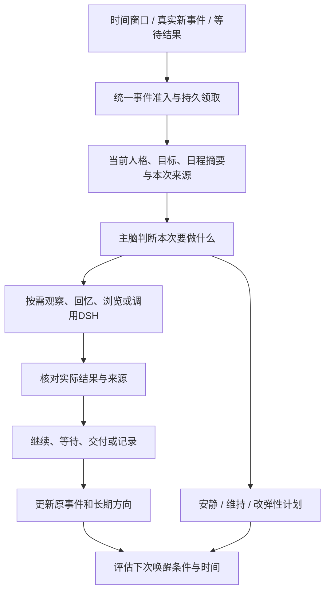

# 伙伴统一日程与自主行为重构标准

日期：2026-10-29。本文是统一日程重构的规范基线；最初的源码调研已进入正式实现。**当前实现、验证凭证及未验证边界见[实施交付记录](companion-agenda-implementation-2026-10-29.md)**。下文“重构前现状”保留调研时的事实，示例时间不代表用户的真实安排。草案截图不能代替实际组件或应用运行验收。

用户要求：每位伙伴拥有自己的一份日程；用户能看见时间、机会、条件、并发、实际行为和结果；伙伴主脑能自主维护安排、持续学习、观察环境并调用能力。撤销独立的任务中心及重复的记忆调度界面；实现统一的执行归属，不能只给旧系统换名称。

## 1. 重构前源码的真实能力与缺口（历史调研）

主脑的原生能力根为 `world / memory / dsh / wait`，实际绑定浏览器时还有 `browser`。`world` 下面已经代理 `schedule / routine / life_rule / work / activity / state / topic / experience`。工具声明不等于每个调用入口都拥有这些作用权限。

| 领域 | 当前能做什么 | 当前缺口 / 限制 | 源码依据 |
| --- | --- | --- | --- |
| 固定 / 重复日程 | 新建、查询、修改、暂停、取消、立即执行；提醒、现实执行、持续世界行动 | 写操作要求本轮真人要求；主动调用会被拒绝。不是伙伴自己的完整行为日程 | `src/shared/companion-schedule-tool.ts`；`src/main/companions/service.ts:4084` |
| 作息与习惯 | 检查、配置睡眠、用餐、习惯；有实际运行阶段 | 主动交流不能修改；习惯数组整份替换，容易覆盖；默认起居模板较固定 | `src/shared/companion-routine.ts:14`；`service.ts:4073` |
| 概率生活事件 | 联系、拜访、休息、虚拟学习、兴趣、散步；持久机会窗口 | 不能组合通用观察 / 深思 / 研究；写操作要求当前真人来源。默认植入“联系朋友”和下午散步 | `src/shared/companion-life-event.ts`；`src/companions/life-event-store.ts:55`；`service.ts:3909` |
| 工作与持续活动 | 有执行循环、检查点、真实结果、取消 | 工作、行动、日程同时成为用户需要理解的不同系统 | `src/main/companions/activity-task-service.ts`；`src/main/companions/autonomy-service.ts` |
| 长期知识学习 | 周期计划→阅读→整合→回忆自测→回顾→下一轮，真实来源与断点保存 | 主脑公开工具没有统一的学习目标管理入口；独立 5 秒领取循环；不是同一份日程 | `src/shared/companion-capability-tools.ts:33`；`src/shared/companion-learning-goals.ts`；`src/main/companions/learning-goal-service.ts:29` |
| 人格培养 | 来源约束的培养方向、练习、反思与版本发布 | 与长期知识目标、日程分属不同入口；方向不能直接当作已形成的人格 | `src/shared/companion-cognition.ts`；`src/main/companions/growth-service.ts` |
| 文件交付 | 读取文本 / 图片，向当前聊天附送已有文件 | 主动入口在实际文件分派器中被拒绝；有工具名不能据此承诺自主发文件 | `src/shared/companion-file-tool.ts`；`service.ts:3208` |
| 浏览器观察 | 真实标签、正文、页面截图、视频采样；按实际绑定可用 | 浏览器页面截图不等于用户整个桌面；主脑没有独立原生桌面观察根 | `src/shared/companion-browser.ts`；`src/main/companions/capability-availability.ts` |
| DSH / 深入分析 | 实际能力目录、后台执行、结果回流；部分入口有禁工具的独立思考通道 | 主动聊天的现实 `dsh` 会被拒绝；不能通过删掉这一行就获得可靠自主权限。独立思考通道不等于文件 / 网络能力 | `service.ts:3052`；`src/main/companions/thought-capabilities.ts` |
| 并发 | 已有伙伴级并发控制，默认 3，设置范围 1～10；跨会话共享，部分子执行已去重计数 | 执行类别分散；需统一事件根计数、等待释放和资源争用，不能重新串行化 | `src/shared/companion-task-concurrency.ts:3`；`src/companions/task-concurrency-store.ts:14` |
| 用户主动联系 | 已有后台主动问候检查 | **仍有隐藏的 9～22 点、四小时间隔、每日最多两次、沿最后用户消息继续的旧规则**；不能称为已统一的自主日程 | `service.ts:4765` |
| 当前界面 | 侧栏有工作台、行动、记忆处理摘要、日历、作息、记忆学习安排；另有任务中心 | 重复查询、重复呈现；用户难以判断何时执行、归属哪个安排 | `src/renderer/companions/CompanionPlanner.tsx:83`；`CompanionTaskDashboard.tsx`；`CompanionScheduleManager.tsx` |

需要修正的判断：并非完全没有管理工具，也并非所有交流天然只能串行；真正缺少的是**统一的行为主体、持续权限和主脑自主规划闭环**。

## 2. 产品唯一入口与删除范围

每位伙伴一个“日程”入口；可切换日期 / 周、查看全部伙伴的汇总。不同来源的事件仍保留各自来源和私密范围，不能为了汇总把群聊、私聊与其他伙伴资料混合给模型。

日程包含“今天 / 接下来 / 长期方向 / 已发生”几种视图。它们是同一份数据的查询，不另建四套队列。正常首页只展示行为和结果；精确来源、能力调用、修复、索引、租约等进入事件详情中的“执行记录”。

| 旧入口 | 新归属 |
| --- | --- |
| 任务中心、工作台、持续行动清单 | 日程上的事件与实际执行，记录挂在该事件下面 |
| 日历与待办、作息、概率生活规则 | 同一种事件规则的不同触发与资源配置 |
| 长期学习面板 | “长期方向”及其每日练习 / 阅读安排 |
| 日记整理 / 深度整合 / 梦境的独立调度卡片 | 日程上的“梳理经历 / 回顾 / 联想”及其子步骤 |
| 索引、标签、正文修复独立一级待办 | 原事件的后台步骤；失败在原事件上显示“需要处理” |
| 开发设置里的任务并发 | 伙伴运行设置里的“可同时进行的事项” |
| 记忆库 | 继续用于读知识、经历、来源和版本，不再另设一套日程 |
| 认知档案 | 继续只读展示当前人格及形成依据，不承担调度职责 |

睡眠与后台记忆整理可以重叠；不要把所有记忆处理硬塞到晚上，造成白天欠账。用户也可以在晚间看到一次“回顾今天”；后台的正文保存和撤回处理不必等待这个机会。

撤销旧的独立“任务中心”产品和公开管理协议，不把改名后的任务中心作为新入口。执行器、日志、租约、检查点、取消与恢复是可靠运行需要的内部机制，纳入统一事件归属；不能因为撤掉界面而丢失它们。

## 3. 唯一领域模型

```text
伙伴
 ├─ 长期方向 Goal（可选：知识、方法、人格培养、持续项目）
 │   └─ 日程规则 EventRule（可以属于某个方向）
 ├─ 日程规则 EventRule（基础、自主、用户约定、临时来信）
 │   └─ 本次机会 / 发生 Occurrence
 │       └─ 实际执行 Run
 │           ├─ 步骤 Step → 观察 / 推理 / 世界 / 浏览 / DSH / 记忆
 │           └─ 真实结果、来源、交付、失败与恢复回执
 └─ 单一日程查询投影 AgendaView
```

四层不可混淆：规则是“常常在午后读书”；发生是“今天这一场读书机会”；执行是“本次已经读了哪些材料”；长期方向是“逐步理解音频分析”。规则和目标不是已经发生的经历。

`EventRule` 的主要信息：

| 类别 | 字段 / 要求 |
| --- | --- |
| 身份 | `id, companionId, revision, origin(user/self/system), createdBy`；owner 由宿主绑定 |
| 含义 | 名称、完整意图、`goalId`、固定承诺或可调整事项、形成原因 |
| 触发 | 指定时点、周期窗口、真实事件、等待完成后的继续；必须显式指定时区 |
| 机会 | 必定考虑或窗口机会概率；概率是行为调度参数，不能复用为情绪 / 好感数字 |
| 条件 | 宿主能核验的条件表达式；引用版本化事实，不执行模型生成的 JavaScript |
| 权限 | 持续授权引用、读取范围、工具范围、交付目的地、禁用动作 |
| 资源 | 伙伴认知槽、本人身体、界面控制、文件 / 发布资源、是否可并发 |
| 重叠 | `overlapPolicy`：允许独立并行、合并新的同类来源、等上次结束、跳过本次或明确替代；不能因为是同一伙伴就全部串行 |
| 延误 | 窗口关闭后的跳过 / 延后 / 按事实重规划；固定约定记录违约，不偷偷抹掉 |
| 生命周期 | 启用、暂停、结束、被新版替代；历史只追加 |

`Occurrence` 保存：规则修订、窗口起止、候选时间、概率种子 / 阈值 / 累积机会、实际条件结果、为什么触发 / 为什么没触发、`nextCheckAt` 和明确的检查语义。

`Run` 保存：同一发生的稳定执行 ID、父子归属、状态、实际起止、检查点、来源版本、工具作用回执、发布回执、故障周期、原始错误。

不要再以当前选中的聊天 ID 定义整位伙伴的日程。聊天是可选的来源 / 回复端口；事件归伙伴，私密资料只在相应受权执行中可见。

## 4. 触发、概率与时间必须可解释

1. **固定时点**：例如 15:00 提醒。日程明确展示时点。到点进入可执行状态，真实资源不可用时显示“已到点，等待连接”，不能把等待画成已经执行。
2. **机会窗口**：例如 14:00～16:00，有 60% 基础机会研究感兴趣的问题。窗口内可根据实际空闲和干扰选择时机；展示窗口、基础机会、当前条件与下一次检查时间。
3. **真实事件触发**：用户来信、伙伴回复、已授权材料更新、DSH 返回、出现新经历。展示“收到消息后 / 新经历稳定后”，到事件真实发生再出现本次时间，不能捏造未来时点。
4. **过程接续**：执行等待别人回复 / 工具返回后，以同一个 Run 继续。不要新建一张无归属待办，也不要把“继续”解释为重新开始。

概率采用持久机会时钟，可复用当前 `companionLifeHazard` 的独立于刷新频率的设计。若采用基础窗口概率 `p`，在条件不变、资源持续可用的完整窗口中，它才具有该基础含义；中断与条件改变后，不能仍声称准确有 `p` 的最终发生率。

同一机会的种子、阈值、已累计机会写入账本。页面刷新、进程重启、模型说“再试一次”、编辑无关文案都不能重新抽签。规则修改要明确哪些未来窗口采用新版；当前窗口不因连续修订获得无限抽签。失败重试也不另抽一次。

固定承诺 / 用户来信不走概率抽签。概率决定“有没有这个自主机会”，主脑在机会中仍可以选择安静、维持原计划或暂不行动；这些是正常结果，不算质量失败。

统一采用绝对 UTC 时间保存，IANA 时区解释周期和显示；世界时间按产品现行与现实同步的规则投影。跨夜、夏令时跳过 / 重复、月底、时区更改都要有明确策略。等待超时和租约使用真实单调时间 / 截止时间，不能随展示时区改变。

离线不伪造观察、研究或发言。重新启动后，固定约定按规则显示错过并处理，社交机会过期就过期，未完成阅读从已核验检查点继续；屏幕观察需要新的真实快照。

## 5. 基础事件与自定义事件

基础事件是同一协议内的系统类型，不是另一个隐藏定时器。创建伙伴时，系统生成可读、可追溯的初始生活安排；当前 profile 只提供初始倾向，不在创建后继续由用户改人设。

| 事件 | 触发依据 | 主脑实际可做的选择 |
| --- | --- | --- |
| 自我唤醒 | 自己选择的下一次回看时间 / 状态发生重要变化 | 看日程、待续事项、当前处境；调整弹性安排；也可决定没有新事可做 |
| 用户消息 / 伙伴消息 | 真实收件 | 独立会话回应、接着原事件、合理安排后续；同一会话维持顺序 |
| 生活作息 | 本人生活计划和世界实际状态 | 睡眠、起居、用餐、休闲，记录实际延后与中断 |
| 环境观察 | 明确窗口 + 对应持续授权 | 看获准的电脑 / 屏幕 / 网页，判断是否有值得回应的新情况 |
| 探索与学习 | 长期方向、本人的问题、已有材料、兴趣机会 | 读资料、做分析、练习、核验、记录未理解之处 |
| 记忆记录 | 新来源出现且达到当前记录策略 | 判断是否值得写，整合同事件，保留来源；允许无新增 |
| 回顾与联想 | 新经历、重要纠正、计划中的回顾机会 | 回顾事实、形成自我认识候选；联想保留非事实身份 |
| 人格复核 | 跨情境证据 / 明确重要经历 | 维持现状、提出局部修订，经过现有发布门才进入当前人格 |

自定义事件复用同一触发器、条件、执行与恢复机制：例如“工作日上午合适时看看我在做什么”“每周两次继续学习混音”“忙完后去问姐姐近况”。不要求把这些自然意图压成六个写死动作。

基础类型不能被主脑删掉以关闭来源撤回、可靠交付等完整性职责；非必要的自主观察、社交、研究可以暂停和调整。关闭主动联系只影响主动打扰，不该顺带关闭自己的思考、世界生活与记忆整理。

## 6. 自我唤醒是完整主脑入口



自我唤醒不是每秒让模型生成一段日记。宿主先做廉价的时间 / 条件 / 授权 / 变化检查，有有效机会才推理；没有变化时主脑可以安排下一次回看。事件驱动可提前唤醒，不必等固定轮询。静默推理不自动生成聊天气泡。

重复通知按真实事件标识去重；同一批变化可合并为一次唤醒。定时自唤醒必须指向未来且满足该规则的可解释节奏，不得用零延迟递归或不断新建同义规则占满队列。真实来信与工具完成可以立即接续；它们不是绕过节奏的虚构“新事件”。触发关系要检查自循环与重复派生，长期计划只逐步物化近期发生，不提前无限展开未来。

“晨间规划、午后探索、晚间回顾”可作初始模板，不能全体伙伴永久绑定同一时间。伙伴结合用户约定、真实学习困难和自己的生活修订未来弹性窗口；每次修订有原因、前后版本、影响的未来事件。

这不承诺模拟出真实人类意识或已获科学验证的人格成长曲线。所实现的是连续的目标、有限感知、情境化选择、经验修正和可追溯的行为习惯。

## 7. 主脑的管理能力与持续权限

目标工具根（名称为待实现协议）：

| 工具 | 可做什么 | 不能由模型直接填写的内容 |
| --- | --- | --- |
| `agenda` | 查本人日程、读事件、创建 / 修订未来安排、暂停 / 恢复 / 结束、提出下次回看 | 已执行、已成功、执行次数、完成时间、权限签发 |
| `goals` | 读 / 建目标、拆阶段、安排练习、回顾差距、调整路线、申请结束 | 知识已掌握、人格已形成、无证据的完成认证 |
| `observe` | 实际绑定后的用户活动摘要、获准窗口 / 屏幕快照 | 模型臆造的屏幕、未知的用户想法、旧截图充当现在 |
| `world` | 世界感知与行动、伙伴社交、话题 | 瞬移、代人同意、跨私密域读取 |
| `memory` | 本人来源约束的记忆与知识能力 | 把计划 / 梦 / 别人推测当作事实经历 |
| `browser` | 绑定浏览器中的实际查看与操作 | 以网页内容扩大任务、擅自发布和交易 |
| `dsh` | 当前范围内的分析 / 研究 / 执行、已有文件读取与交付 | 任意终端、目录、账号与外部收件人权限 |
| `wait` | 暂停本次推理并等待真实继续条件 | 通过空转把等待说成完成 |

主脑自主修改安排分三种：

- **系统完整性事件**：宿主维护，不允许模型关闭撤回、发布验证、结果落盘等职责。
- **固定约定**：用户明确指定的时点、限制和交付，伙伴可以报告冲突 / 提出调整，不能自作主张改承诺。
- **自主 / 已授弹性事件**：伙伴可以创建和修订未来安排；读取和执行能力仍落在有效权限范围内。

用户说“你自己定期研究音频分析”，应产生一份可追溯的持续授权与长期目标，而非日后每次都要求本轮真人再授权。新推理携带真实 `grantId / revision / revocationEpoch`，不拿旧消息假装本轮用户指令；宿主在工具作用前与结果使用前重新核对。

持续授权至少限定：伙伴、目标或自主领域、可用工具、可读资料 / 文件根、是否能看屏幕 / 哪些窗口、是否可公开网络、产物根、当前用户的交付端口、有效状态、撤销版本。建立该能力不意味着本次调研就开始查看用户桌面。

屏幕观察按用户明确启用的范围长期生效，不每次弹确认；界面显示真实观察指示和一键暂停。锁屏、观察被暂停、窗口不在允许范围时直接等待；禁止降级为调用 DSH 截图绕过。屏幕内容作为来源，不能签发权限。截图默认短期保留或不长期保留，是否写入记忆另走明确策略；不能观察一次就无条件把所有内容写成日记。

研究可在自己的产物目录使用已授工具；向当前用户发自己的授权范围内产物是该事件的交付步骤。向其他伙伴转发用户文件、调用外部账号、发邮件 / 发布 / 购买等不因“有自主性”自动获权。

DSH 需要区分独立思考与外部执行：前者只处理本次合法输入，可使用现有禁工具思考通道；后者只授予本目标所需能力与目录。当前执行器无法落实范围隔离的能力必须标为不可用，不能只凭提示词宣称已限权。

## 8. 并发保持自然，资源冲突保持真实

沿用用户可配置的伙伴并发数量，默认 3 不是每日额度。不同聊天可以同时推进；相同会话中的发言与引导保持顺序，不能把 A 私聊近期内容带给 B。

规则：

1. 槽位计算实际活跃的独立事件根；睡眠不占认知槽，长久目标不因存在就占槽。
2. 阅读、与用户聊天、与另一伙伴聊天可以并行，是否还可启动研究由真实槽位和资源决定。
3. 同一事件的子 DSH / 读文件不再重复算作另一个顶层事项；它们仍受实际工具 / 模型资源并发约束。
4. 等待伙伴回复、DSH 长计算、连接恢复时释放不需要的认知槽；有结果后公平重新准入，不握住槽位自等。
5. 一具虚拟身体不能同时在家与公园；一个正在控制的界面不能被两个过程同时输入；同一文件写入 / 人格发布用资源键串行。
6. 不给长时间外部调用包住整位伙伴的全局锁；一个错误事件不能堵塞另一聊天。
7. 来源落盘、撤回和租约这类完整性步骤是父事件的内部服务，不因普通认知槽全满而无法提交 / 取消。需要模型做语义整理的部分才接受相应推理调度。
8. 固定约定、用户消息和自主事项有明确优先级与等待老化；主动生活不会无限饿死，用户操作也能及时响应。

不新增每日次数、每日 token / 金额 / 总时长等产品额度。事件概率、安静窗口、合理的检查间隔、有限修复、工程并发是不同概念，不能把隐藏每日两次限额换名称保留。

## 9. 学习、记忆与人格是一条来源链

长期方向统一归档但保持不同验收：知识目标看实际读到和能引用什么；方法目标看条件下的练习与可核验产物；人格方向看跨情境的真实表达和反思。一个学习自测通过不能把人格直接改为“专业、成熟”。

示例方向“逐步学会认真听音乐并解释自己的判断”：

1. 主脑读取当前理解、兴趣、用户期望和真实材料范围，拆为可修订阶段。
2. 在日程生成下一次“继续音频分析”，内容引用上轮未解的问题与对应资料版本。
3. 本轮实际阅读 / 分析 / 练习；需要 DSH 时子步骤留在同一个事件下。
4. 资料中的事实进入知识；实际做过的事情进入经历；方法保留适用条件和练习证据；尚未确认的问题保留为问题。
5. 回忆和检验后记录差距，决定下次阅读 / 练习，而非每轮新建同义笔记。
6. 对自己表达、判断或价值的反思成为自我认识候选，达到现有人格发布门后只修订相应片段。
7. 新人格被后续推理采用，形成可追溯版本。旧 profile 不能与新 profile 并列争夺当前身份。

用户说“讲话别那么机械，多结合你自己的观察”可以成为培养方向和具体练习条件，不立刻写成“我已自然富有感情”。计划里的“学习”也不再靠虚拟 `study` 动画冒充真实阅读。

技术步骤默认折叠：日程显示“梳理刚才的经历”，展开才有判断 / 正文修复 / 保存 / 索引 / 标签。索引与标签不再被呈现为伙伴做了多份独立工作。独立的后台完整性维护也必须有可查来源归属，不硬塞进一个并不存在的人类式活动里。

## 10. 单一调度权与可恢复执行

新调度器持有规则物化、机会结算、准入、Run 生命周期和下一次继续。领域组件只报告可用条件、执行本次确定操作并返回检查点 / 结果，不再各自启动独立语义日程。

逐项替换：

| 当前循环 / 状态 | 目标 |
| --- | --- |
| `checkProactive()` 每分钟 + 隐藏 4 小时 / 每日 2 次 | 可见的主动联系事件规则，由统一准入驱动 |
| `CompanionScheduleService` 的独立到期领取 | 统一规则 / 发生；其提醒 / 世界 / DSH 逻辑转为执行适配器 |
| `CompanionLearningGoalService.start/pump` | 长期目标阶段 + 学习事件；保留阅读、整合、自测检查点和证据校验 |
| `CompanionAutonomyService` 的独立工作 / 生活领取 | 统一事件领取；原社交与世界执行作为适配器 |
| 记忆捕获 / 整合 / 标签 / 月度语义整理各自触发 | 同一事件注册与归属，按真实来源去重；完整性步骤作为子步骤 |
| `tasks.page / tasks.list` 的多队列拼接 | `agenda.read / agenda.event.read` 的唯一用户查询 |

世界物理时钟、路由、媒体响应、连接健康、租约心跳不是“再一套人生计划”，保留其必要底层机制。不能为了文字上的“只有一个定时器”破坏物理世界或可靠投递。必须只有一个**逻辑事件领取者与生命周期权威**。

Run 状态要区分：已排期、条件未就绪、可领取、执行中、等待结果、已完成、安静 / 无变化、窗口过期、暂停、已搁置、已放弃、结果待核对。Rule 状态与一次 Run 失败分开，不能暂停本次误停整个长期方向。

保留现有健壮性约定：一次结构化输出最多 2 次修复；语义 / 授权失败不靠格式修复伪造通过；每恢复周期实际处理失败累计 3 次搁置；显式恢复启动新周期，终身失败记录不清零；放弃保留原始事件和成功阶段。等待模型 / 资源不算质量失败。

持久唯一键至少含 owner、规则发生标识、稳定步骤作用标识；同一执行重试使用同一作用键。网络结果未知时标记待核对，先查实际回执；不能保证任意外部服务的 exactly-once，更不能直接重发消息 / 重写文件。规则修订和成功提交使用 CAS 与来源 / 撤销版本校验。

## 11. 一份日程的界面示例

以下均为示例，不是当前伙伴的真实安排或概率：

| 时间 | 事项 | 触发与状态 | 展开可看 |
| --- | --- | --- | --- |
| 07:30 | 起床，看看今天的安排 | 作息时点 | 昨天遗留事项、今天改动 |
| 09:00～09:30 | 看看用户正在忙什么 | 基础机会 60%；仅获准窗口且未暂停 | 是否真实观察、观察时间、选择安静或交流的理由 |
| 09:12～ | 回应用户；同时回应姐姐 | 两条真实来信，各自独立事件；并发 2 / 3 | 各自消息和来源，彼此私聊内容不串入 |
| 10:00～10:40 | 继续学习音频分析 | 长期方向的第一个近期窗口 | 本次问题、已读资料、未解决内容与下次练习 |
| 有新经历，稳定后 | 梳理刚才的经历 | 来源事件触发；后台可并行 | 是否新记 / 复用 / 修订、索引及格式修复 |
| 15:00 | 交付约好的报告 | 用户固定约定 | 实际文件、交付回执、未完成说明 |
| 20:30～21:00 | 回顾今天，考虑接下来 | 自我唤醒窗口 | 调整哪些弹性安排、哪些认识维持不变 |
| 23:00 | 休息 | 作息时点；可并行后台整理 | 实际入睡、被固定承诺延后等情况 |

并行事项在时间线上并列摆放；过长标题截断但可展开。窗口以淡色范围表示，实际运行才画实体时间段；不知道结束时间时用“进行中”，不伪造预计完成。条件触发的未来事项放在同日条件区，发生后进入真实时间位置。

页面顶部显示“当前同时进行什么 / 接下来最早的约定”；事件详情说明“由谁提出 / 为什么安排 / 什么时候考虑 / 需要什么条件 / 本次做到了哪里”。普通用户不会先看到模型公平准入、索引撤回、leaseToken 等技术词。

日程更改入口可以保留，但主要交互是对主脑自然说话，例如“这周先研究混音，下午空闲再做”“今天不要看我的电脑”“你自己安排周末”。主脑使用相同的正式命令提交，界面不再直写另一套设置。

## 12. 读取性能与上下文

唯一日程查询按 owner + 时间窗 + 稳定游标分页。列表只取标题、时间、条件摘要、状态、父子关系与修订；点击详情才读正文 / 原始日志 / 文件。父事件与子步骤按归属去重，不能把一场学习计为规则、发生、执行、DSH、笔记五张独立事项。

每位伙伴的日程投影由已提交的事件变更增量更新；订阅携带 owner / revision，只更新受影响卡片。重入展示当前已核验快照再增量同步；后台刷新不清空整页。隐藏页面停止读取；加载失败保留同一来源有效快照并说明时间，撤权则立即隐藏相应资料。看日程本身不能领取执行、推进概率、调用模型或扫描全部日记。

主脑只拿当前 persona、当前事件、相关目标阶段、近期相关安排与来源，不每次注入全日程和所有历史。深度记录按 ID 读取；其他会话内容仍隔离。对后台观察的长期存储与上下文使用需独立约束。

## 13. 具体实施顺序与完成标准

1. **协议与归属**：实现 EventRule / Occurrence / Run / Step / Goal / Grant 及索引、CAS、幂等；明确新协议版本，拒绝旧调度消息。
2. **调度内核**：统一时间、概率、条件、伙伴槽、资源键、公平继续、暂停 / 搁置 / 放弃；模型服务不参与廉价条件轮询。
3. **执行接入**：将固定安排、来信、世界活动、知识学习、日记 / 回顾 / 人格复核逐项接入。每切一个领域，同次变更关闭它的旧领取循环，禁止旧新双执行。
4. **主脑能力**：真实绑定 agenda / goals / observe；持续自主范围以宿主授权表示，删除“所有主动入口一律不能改安排”的旧假设，完整保留固定约定与来源限制。
5. **日程界面**：一个查询源、并发时间线、条件区、长期方向与事件详情；聊天侧栏只呈现同源缩略日程。撤销任务中心 / 工作台 / 记忆处理独立入口，保留事件详情内的专业诊断。
6. **删除旧逻辑**：旧公开 tasks/work/schedule/routine/life_rule 管理路径按替换清单退役，不以兼容转发重新保留两套生命周期；更新创建模板和系统提示词中硬编码的作息 / 每日限额 / 单一注意力说法。复用的是受验证的领域执行代码，不是过时调度协议。
7. **短时验收**：虚拟时钟与固定概率种子覆盖跨日 / 重启 / 不重复抽签；可控模型与工具返回覆盖并发 / 来源撤销 / 结果未知 / 搁置恢复；短真实 SQLite 检查持久性。界面用模拟事件和少量本地组件预览检查日程、暗色 / 窄屏、增量刷新。禁止自动恢复已撤销的长时真实测试。

开发者数据不做兼容迁移；若切换协议需要重建，仅在明确界定的伙伴受管数据内做一次可审计退役 / 重建，不能重删用户刚创建的新伙伴或动全局模型设置、资产原文件。本次设计调研不执行清理。

最终完成条件：

- 任何可执行伙伴行为都有唯一的事件归属和可查触发解释。
- “聊天中让其安排”和“日程上查看”返回同一规则、修订及真实执行。
- 主脑能在持续授权内自主创建 / 调整自己的未来安排，用户固定承诺与撤销即时生效。
- 两个不同会话和一场学习可按伙伴并发数并行，同一事件子过程不重复占顶层槽。
- 学习多个轮次沿同一方向继续，有真实阅读和证据，不能只生成“学习中”的文案。
- 记忆 / 索引 / 标签 / 修复是有来源归属的过程，不重新堆成一套用户待办。
- 断电 / 重启、未知外部结果、三次失败、显式恢复和放弃均不丢原事件、不重复产生作用。
- 旧任务中心和旧自主问候 / 领域独立领取循环确已移除；只改界面名称不算完成。

## 14. 首次调研版本的边界（历史）

首次调研仅交付了本标准和 `artifacts/agenda-design-2026-10-29/agenda-prototype.html` 中明确标注的示例草案。此后用户已要求正式开发，当前源代码已切换到统一日程。后续实际组件位于 `src/renderer/companions/CompanionAgenda.tsx`，运行接入见[实施交付记录](companion-agenda-implementation-2026-10-29.md)。没有为用户实际开启屏幕观察，没有运行真实模型成长实验；这些边界不因源代码实现而自动改变。
