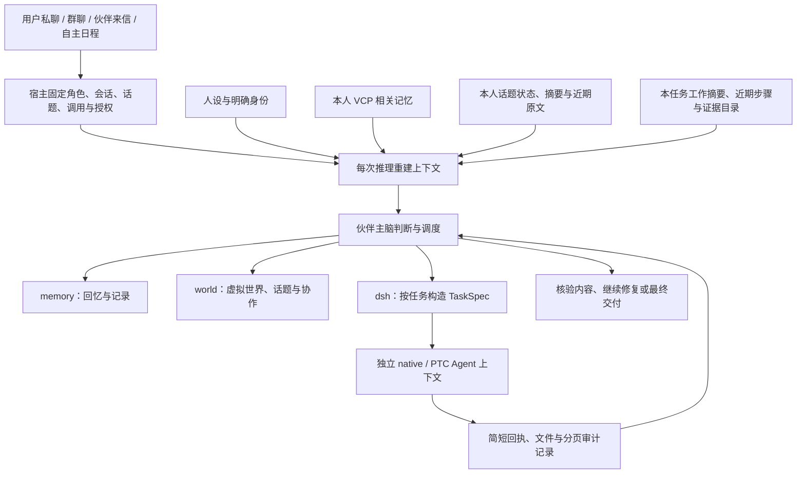

# 虚拟伙伴统一 Agent 架构与工程实施方案

日期：2026-10-22。对应本地 WorldlineBox 与已调研 DSH 源码。本文是实施和验收依据，未完成的项目不视为已有能力；实际结果另外记录。

## 1. 目标与不可变约束

伙伴是具有稳定身份、生活状态和自己记忆的主脑。主脑负责理解、交谈、规划、调度和判断结果，DSH 是可以按任务装配、拥有独立上下文的执行 Agent。主脑不直接获得 shell、文件写入等通用执行工具。

- 所有认知入口使用同一上下文装配范式：用户私聊、群聊、伙伴通信、自主生活、日程、行程、内部工作与现实工作。权限和工具随入口装配，身份保持一致。
- 短期消息是可替换的模块，绑定 `companionId + conversationId + invocation kind/id`。不同联系人、会话和独立任务不得混用消息或工具历史；被引用消息也必须通过相同的可见范围校验。
- 跨入口连续性来自本人 VCP 长期记忆，有来源、版本、可见范围和遗忘状态。主动回忆、回复前相关召回、事件记录与更新都继续使用这一系统。
- 人设是稳定身份；有据的个人认识、当前情绪和生活状态影响表达，不能改写自己或对方的身份。peer 消息、记忆和工具结果不能自动获得真人权限。
- 主脑每次重建上下文，不建立无限追加的模型会话，也不另设用户未要求的全局 token 配额。近期对话有合理的时间、字符数和消息数上界，工具结果按相关性和恢复需求投影。
- 插件由启动器和宿主管理。伙伴选择工具组合、技能、执行方式、显式上下文、工作目录、会话策略与交付要求。

## 2. 统一调用模型

每次调用由宿主建立 Invocation，包含角色、入口、消息端口、目标、来源、参与者、授权和持久状态。主脑不能通过模型生成的 ID 改变自身或会话绑定。恢复时重新从宿主读取身份、有效记忆、世界状态、DSH 环境和当前任务，不能依赖冻结快照中的旧权限。

上下文装配顺序：

1. 当前伙伴稳定身份和人设，明确真人、其他伙伴、自身三者的 ID 与称呼。
2. 入口与当前目标、未完成事项、当前授权、可用能力。
3. 当前世界与生活状态、时间、可见参与者。
4. 该伙伴本人的有效 VCP 聚焦回忆、来源和有据个人认识；允许主动进一步检索、阅读与记录。
5. 当前消息端口的近期连续窗口、当前来源消息与合法明确引用；缺口明确标注，不伪造连续性。
6. 本次 Invocation 的有效工作状态与精选工具回执。旧工具正文不反复塞回，证据可通过受范围校验的记录工具续读。

实现的默认近期窗口为最近 7 日、最多 256 条、480,000 字符，至少保留近期 32 条以支持稀疏联系；硬上界仍适用。当前源消息必须可用。选择完整消息，避免悄悄截断语义。时间与长度只管理短期消息，不冒充模型总预算。

入口授权独立：人类委托可调用所授权现实任务；伙伴交流与自主生活不能仅凭旧记忆继承玩家电脑权限。日程执行使用原定持久授权与最新状态，撤销、取消和重置及时失效。任务上下文端口以任务 ID 隔离，不把同一伙伴所有自主任务拼为一个消息历史。

## 3. 三类主脑能力

| 能力 | 主脑用途 | 宿主责任 |
| --- | --- | --- |
| memory | 主动检索、阅读、事件记录、修订、整理、遗忘 | 本人所有权、来源和版本、VCP 路由、撤回与隐私校验 |
| world | 感知当前世界、行动、日程与行程、联系伙伴、协作与进度 | 真实位置/忙闲/联络许可、持久目标、消息投递、工作租约、有限交流链 |
| dsh | 发现现实执行能力、构造 Agent 任务、运行/续用、检查记录与交付 | 实例与版本绑定、实际工具约束、独立上下文、进程/会话生命周期、文件交付和证据 |

模型工具目录只有这三个入口，旧的公开工具别名与旧 checkpoint 适配直接删除。附件感知和交付通过 dsh 的只读操作提供，明确其窄权限；不能以统一命名掩盖不可用功能。

## 4. DSH 任务工厂与工作目录

TaskSpec 保留目标与执行说明，扩展工具集合、技能集合、native/PTC 执行方式、显式输入、独立或续用会话、工作目录、交付要求。账号、密钥、provider 和模型继续来自绑定实例。宿主根据版本和实际 Agent catalog 校验请求，缺少能力时返回可诊断失败，不能只在 prompt 说“只用这些工具”。

能力发现分两层：实例安装清单与实际 Agent 可见清单。安装不等于启用，启用不等于已挂载，已挂载不等于外部服务可用；状态未知要明确。技能返回元信息和完整说明读取入口；工具支持按需查看 schema 与使用限制；CLI 指令、slash 指令与操作系统程序分别说明。版本、实例或安装内容变化使缓存失效，执行时再检查实际集合。

默认工作目录位于当前资产库 `.worldlinebox` 数据根：`companions/dsh-tasks/<companionId>/<YYYY-MM-DD>/session-<id>/`。日期使用宿主明确时区；目录由宿主生成、校验和创建，登记角色、会话、任务与创建时间。新会话获得新目录；续用原生会话恢复原目录，跨日不搬移。不同伙伴默认隔离，协作通过显式输入或共享交付，不靠碰巧共用 cwd。

如选择已有项目目录，宿主校验来源与用户授权，保存解析后的绝对路径。会话固定 runtime、实例、cwd、权限与工具配置；不兼容的变更建立新会话并显式交接。进程取消、断线恢复、输入去重和现有 Broker 的 pin 机制继续有效。

交付采用两层：主脑得到简短结构化回执（状态、会话、摘要、文件、检查结论、剩余问题、记录读取游标）；详细事件保存在受范围约束的记录库。进程退出成功不等于业务目标完成，文件存在不等于内容正确。要求主脑根据任务验收条件继续检查和修复，真实验收另由宿主测试对照期望文件内容/世界状态判断。

## 5. 启动器实例管理

插件与技能操作必须在用户操作时明确显示并冻结安装目标：实例名、精确运行版本、安装位置。切换 CLI 选择不得悄悄改变正在安装的目标。每个实例详情显示安装来源、包/技能名称、版本或 commit、启用状态、错误与管理动作。

复用实例已有停止锁与原子写入。插件支持列出、启停、卸载；技能支持列出、启停、卸载与刷新。只管理经路径校验的实例本地副本，不删除仓库原目录或 runtime 共享内置资源。运行版本提供的只读内容应标明来源和不可直接删除的原因。变更后刷新能力目录；在运行的任务继续使用已固定配置。

## 6. 协作与长期任务

协作具有持久目标、发起来源、参与者、分工、对话链与结果引用。联系人查询仅返回宿主公开目录的名称、ID与启用状态，不因此获得对方私聊、记忆或任务；实际投递、来往和结果才进入本人经历。每位伙伴保留自己的推理与短期消息端口，接收显式共享的子任务和上下文；主办伙伴负责汇总与验证。

伙伴群聊按真实收件人分别创建首轮任务，每个人都可以回应或沉默；所有首轮进入终态后，发起者最多一次汇总，再允许模型明确指定的一次后续。新发言可以开始新一轮，不能让每条自动回复再次向全群扇出。个人暂停不消耗领取次数，也不妨碍其他话题；退出、删除和结束精确取消原话题旧任务，重入不能复活已取消动作。

现实子任务不得通过伙伴转述无限扩大玩家授权。明确用户任务可由宿主保存可传递的窄任务授权，参与者只在该目标与工作目录范围执行；撤销和取消沿任务树传播。未实现窄授权传递时必须明确标记该边界，不把纯聊天当作现实合作完成。

长期任务状态在数据库/checkpoint 中保存，重建时装入目标、已确认结果、待办、失败及恢复点。不同任务历史互不追加；既有工作租约和修订检查用于避免重复启动与重复外部动作。时间推进、睡眠和不同会话不应让未完成工作消失。

主脑持久日志不再以 64 步作为任务总寿命。64 步仅让出一次事件循环；绝对步骤编号、调用与结果完整保存，重启从原调用槽位续接。提供给模型的工作历史使用最多 32 个近期完整步骤及累计工作摘要，字符压力下保留完整调用/结果对；摘要带本调用、来源、授权和合法证据投影的水位。摘要失败、撤回或来源变化不推进水位，不能靠旧摘要恢复已经失效的秘密或权限。已完成动作通过精确 invocation 证据目录查询，不依赖 UI 最近 100 项列表。

## 7. 实施顺序与兼容

1. 保存调研与验收矩阵；上游源码只读，用户存档按后续明确清理授权处理。
2. 建立统一 Invocation 与上下文装配、消息隔离、近期窗口和工具历史投影。
3. 扩展 DSH TaskSpec、能力发现、实际工具/技能约束、日期会话工作区、结构化回执并接主脑。
4. 完善实例级插件技能后端和启动器 UI。
5. 将伙伴通信、世界/日程/行程与内部工作迁入统一调用；实现持久协作与恢复。
6. 跑结果验收，保存真实证据；按失败修正后再回归。

用户随后明确要求彻底替换旧逻辑并清除过时伙伴数据：退休的模型工具入口和重复调度路径直接移除，不维持旧 checkpoint 适配。旧伙伴存档、消息、记忆与关联任务数据按明确授权清理；模型账号配置、DSH 安装和资产库原文件不在清理范围。存储清理若被工具审批拦截必须记录实际状态，不声称已删除。

## 8. 验收矩阵与证据标准

| 类型 | 简单 | 中等 | 复杂 |
| --- | --- | --- | --- |
| 单伙伴现实 | 创建精确文本文件并核对内容 | 读输入数据、转换/汇总、生成并复核多个文件 | 多次 DSH 调用，独立/续用会话，纠错和最终产物验收 |
| 单伙伴世界 | 读取实际状态并行动 | 日程/行程多步推进，回复与状态一致 | 中断/重启恢复、记忆回访、长期目标完成 |
| 多伙伴世界 | 实际投递并各自回应 | 明确分工、持久内部结果、主办汇总 | 不同角色联合多阶段任务，时间推进与失败恢复 |
| 多伙伴现实 | 共享明确子任务资料 | 独立执行产物、显式结果交接 | 分工生成/审查/修正，最终内容正确且权限沿任务树有效 |
| 人设与记忆 | 当前作者/自我身份正确 | 跨入口本人记忆连续，近期消息隔离 | 多轮更正/遗忘/私密范围、长期互动保持角色 |

每层区分：确定性模型夹具验证机制；真实原生 DSH 验证进程、工具与文件；真实在线模型验证实际任务选择、内容和角色行为。未运行的层标记未验证，不能把成功回执或模型自评当验收。保存测试命令、版本、时间、任务输入、实际输出/状态、断言和失败修复记录，密钥与私有推理不得进入报告。

必须覆盖负向用例：跨角色/跨会话/跨任务 sentinel 不得进入短期上下文；越权续用与改 cwd 拒绝；选定工具之外执行被拒；实例切换不改变已启动任务；撤销后不再调用；失败不能报告完成；peer 未授权不能触发电脑操作。所有对电脑的验收使用独立临时目录及合成资料，不改用户真实项目和伙伴存档。

## 9. 长期话题：独立的工作上下文

2026-10-23 补充。狼人杀、写小说和持续讨论需要在停用、切换与恢复后保存连续进展，不能只依赖近期消息和 VCP。话题是独立工作上下文，不是另一套人格或长期记忆。会话是交流场所，话题是一次持续活动；默认日常对话没有话题。

消息和模型运行固定绑定 `conversationId + topicId + companionId + invocationId`。发送时由宿主确定 topicId，模型不能通过回复正文改路由。切换话题不重绑定正在运行的调用；迟到回复只回到原话题。暂停后不自行继续投票、推动剧情或发起下一阶段，恢复时重新读取该话题当前状态。不同群、不同私聊中的同名话题不共享消息。

当前话题指针绑定 `conversationId + readerId`，不绑定整个群。创建者自动参加，其余人只收到邀请；每位伙伴自己加入、退出、暂停和恢复，加入前不注入话题的既往消息或已分配私态。一个群里可同时有多个话题，真人选择的发送话题不强制改变其他伙伴的上下文。消息仍明确归属单一话题，回复继承实际来源的 topicId，普通对话使用 null。被动收到的邀请不能冒充已经参加。

每个话题持久保存：标题、活动类型、参与者、生命周期、修订、消息日志、公开工作状态、各伙伴私有工作笔记和阶段 checkpoint。公开事实与个人推断分开；公开 checkpoint 只能引用参与者当前有权看到的来源，私有笔记不能进入公共摘要。隐藏角色、夜间信息、作者未公开的剧情均由宿主 ACL 控制，不能依赖模型“记得保密”。VCP 仍负责本人跨入口的相关回忆，虚构或游戏经历须标注活动语境，不能变成真实世界事实或现实权限。

话题上下文按以下方式重建：身份和权限 → 本话题目标/规则与当前阶段 → 该角色可见的工作状态与 checkpoint → 本话题近期连续发言 → 当前来源 → 必要的主动检索结果。退出话题时整块卸载；普通聊天不注入旧游戏的角色、规则、发言、推断或待办。需要联系旧话题时，通过明确的话题读取或有来源的 VCP 记忆召回，不偷偷全量拼接。

长局不能靠无限增加输入长度。完整原文始终持久化并可分页读取；到窗口边界前保存带来源范围的阶段记录，保留当前规则、确认事实、未决问题、关键承诺、人物/物件状态与连续性线索。阶段摘要不删除原始证据，不把模型推断当事实；不允许自增压缩把尚未公开的秘密泄漏给其他角色。各角色具有独立私有工作记忆，可以复盘、更新和查回原文。1M token 模型仍使用合理上界，但长任务状态不因近期原文滑出窗口而消失。

压缩参考 DSH compaction-basic 的压力阈值、合并旧摘要和原文尾部策略：默认 256 条/480,000 字符窗口，80% 触发，保留约16%且至少32条逐字消息。逐页读取尚未覆盖的原文前缀，只压缩本人有权看到的本话题消息；来源消息冻结当前调用，新用户任务不进入旧摘要，同来源正式伙伴回复可扩展当前调用。模型将旧 checkpoint 与新前缀整合，返回摘要与阶段，宿主保留现有结构化私态。提交前核对原文 hash、前 checkpoint 与话题 revision，原子发布只有宿主能写的连续性水位；失败不前进、不删除原文。每位参与者独立压缩，不共用包含秘密的摘要。

主脑通过统一 world 的 topic 子能力创建、列出、阅读、加入/退出、切换、暂停/恢复、结束/重开、改名、标签、派生、删除及更新话题工作状态；用户可以直接在会话界面操作。不提供归档。UI 分开表示当前发送话题与正在查看的历史，草稿及异步附件按话题保存。目录采用游标分页、名称模糊搜索与 tags/status 筛选，不把大量话题塞进下拉框。删除隐藏话题原文和状态，不把遗留消息重新归类到普通对话。

memory.world_query 的 topics 查询桥允许按 topicId、名称或 tags 主动寻找本人可访问话题，只返回公开状态和本人的私态。受邀未加入者不注入既往发言或私态；显式查询可读取话题索引、公开阶段与共享摘要，加入后才提供本人工作私态。话题记录带 topic_state_not_real_world_facts 信任标记，禁止把原始游戏/小说正文、摘要或查询回执再次写成全局现实知识。真实参加/退出活动可通过宿主核验的生命周期事件形成明确活动经历，身份牌与虚构事实不因此出现在普通聊天中。

专项验收使用至少 8 个不同身份的伙伴，另包含真人参与入口。狼人杀由确定性裁判管理合法阶段、存活、身份和胜负，实际模型负责各自推理、发言与选择。验收逐角色检查输入 ACL、发言身份和合法动作，覆盖长局多阶段、近期窗口淘汰、跨局隔离、暂停后处理无关现实任务、重启恢复及历史复盘。合成裁判可用于机制测试，实际在线模型的局面判断、连续性与结果另外留证；不把脚本固定决策冒充伙伴自主游戏。
