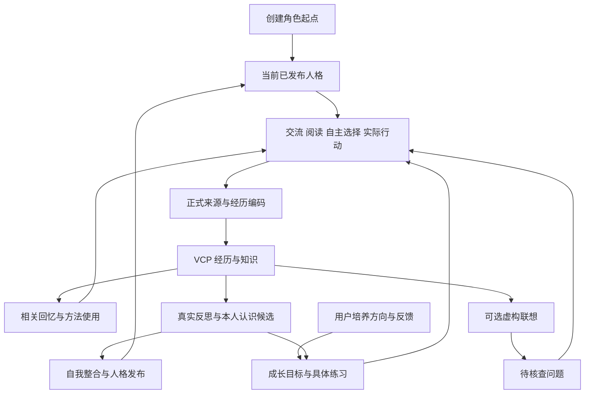

# 伙伴认知与自主成长重构标准

版本：设计基线 1。日期：2026 年 10 月 28 日。

本规范定义 WorldlineBox 伙伴系统的重构目标、数据职责、处理协议、界面和验收条件，供实施任务直接采用。当前源码交付与实际验证见[交付说明](companion-cognition-delivery-2026-10-29.md)及[实施记录](companion-cognition-implementation-2026-10-28.md)，重构前基线见[现状与目录映射](companion-cognition-current-map-2026-10-28.md)，测试要求及用户调整范围见[验收规范](companion-cognition-acceptance-2026-10-28.md)。目标描述本身不替代实际实现与证据。

伙伴在创建时接收用户准备的角色起点，此后通过真实交流、获准学习、自主选择、结果反馈和有据反思，持续维护记忆、知识、表达和当前人格。用户通过培养方向与相处反馈影响成长，创建后不再直接编辑人格、角色提示词和认知正文。用户可只读查看完整当前资料，以及某次推理实际采用的上下文。

本次采用开发版清空重建。旧伙伴和旧认知运行数据不迁移、不继续维护、不通过兼容适配读取；新伙伴从新协议与创建模板重新建立。重构前的旧实现映射仅用于定位应替换的代码，不是必须保留的兼容契约。

本规范中的“必须”和“不得”是发布门；“建议”是可以通过实验调整的实现初值。时间、批量、预算是工程参数，不能称为人类心理常数。学习发生在外部记忆、方法、当前人格和决策依据中，不代表自动更新远端模型权重。

用户后续明确取消模型额度限制：产品不得设置每日／每分钟调用额度、token／输入字节额度或费用封顶，不因这些额度暂停自动化，也不提供相关预算文件、账务准入或设置界面。本文涉及“预算”仅指上下文容量、实际输入大小、工程调度或一次验收的试验范围；旧财务额度与周期恢复要求废止。有限结构修复次数、来源权限校验和公平并发继续适用。

2026 年 10 月 29 日用户进一步撤销耗时的真实测试。两小时耐久、实际十万事件灌入及未执行的多轮真实模型成长实验已退出本次交付门，相关运行入口撤除。后续采用短时定向验证，并保留已发生试验的真实结果与限制；不因原计划中的长测未完成而反复延长开发，也不把撤销改记成通过。

## 1 需求与完成定义

| 编号 | 必须实现的结果 |
| --- | --- |
| R01 | 只有创建草稿阶段允许用户编辑或导入角色模板；创建确认后关闭所有正常路径中的直接认知编辑。 |
| R02 | 所有受管内容有显式类型、归属、生产者和消费权限；未知目录及文件默认不参与认知摄取。 |
| R03 | 经历记忆、知识方法、自我认识、导航、证据和运行资料分道处理，共用既有 VCP 与来源基础。 |
| R04 | 每项记忆、认识、方法和人格修订有合法来源或明确的作者起点身份；引用存在不等于语义结论正确。 |
| R05 | 用户期望的讲话方式、语气、认知和相处方向进入持久成长目标，通过练习和反馈逐步内化。 |
| R06 | 本人认识能够有条件地改变实际生效的人格；过时描述退出当前人格，旧版本保留历史身份。 |
| R07 | 取消心理分数展示及其底层人格、关系、语气、生活与表情驱动，采用有来源的定性状态。 |
| R08 | 模型上下文按用途编译，身份正文只装配一次，系统合同与角色指导各有唯一职责。 |
| R09 | 提供只读认知档案和具体请求的实际上下文查看器，展示与实际采用版本一致。 |
| R10 | 所有认知变更有版本、差异、覆盖与发布凭证，失败和崩溃可续接、可定位、可恢复。 |
| R11 | 遗忘、来源修订和撤权传播到派生物，不复活已退役立场或已删除资料。 |
| R12 | 当前人格、工作摘要、近期关注和回忆输入有界；持久历史增长不导致请求线性增长。 |
| R13 | 编码、反思、知识整合、人格发布和梦各有准入与结算；派生文字不能循环制造新经历。 |
| R14 | 采用可重复的短机制验证，分别报告已有无引导行为证据、研究依据与工程假设；按用户最新要求不再执行长时间真实对照，未证实效果明确保留限制。 |
| R15 | 开发版旧伙伴数据清空后建立新实例；移除旧协议读取、迁移、路径别名、旧维护回退和双轨运行。 |

完成必须同时满足：数据协议成立、实际模型输入使用新协议、行为消费链已替换、界面与输入一致、恢复及撤销正确、验收通过。只增加文件夹、生成成长自述、隐藏分数或改写提示词文案均不构成完成。

## 2 现状基线与必须解决的问题

现有 VCP 检索、事件分批、来源版本、记忆文件、资料学习、自测、真实反思、四类 selfDevelopment 和任务检查点可复用。以下边界必须改变：

1. 当前作者 profile 和用途文件可继续人工编辑；本人认识作为附加上下文，不会正式发布为新人格，部分合同明确禁止改写稳定人格。
2. 当前记忆文件发现采用排除若干目录后扫描其他可见笔记本的规则。新建普通可见的“起点”或“成长记录”目录，可能使其 Markdown 被摄取。必须先实施类型注册与默认拒收，再增加新目录。
3. 当前已有 profile、提示词、形象、来源、历史、点号文件和自动时间线等排除，但不同入口的边界不同；显式附件学习与资料库自主学习不是同一条准入路径。
4. 当前 33 个提示词 Markdown 是职能库存，并非每次全部发送；短说明、完整职能文本、宿主合同存在重复，部分路径重复放入人格。原生聚焦、标签和时间线还有独立通道。
5. PAD、好感、信任、尊重和交流次数阶段实际驱动表达、主动联系、拜访概率及表情，不能只移除面板。
6. 当前反思依赖和整合证据存在已观察到的失败路径，应修正生成、核验和恢复链路，保留拒绝无依据提议的检查。

依据见 [实例布局](../../src/shared/companion-instance.ts)、[文件发现](../../src/main/companions/memory-library.ts)、[用途选择](../../src/main/companions/asset-profile.ts)、[上下文装配](../../src/main/companions/asset-context.ts)、[当前状态消费](../../src/main/companions/context.ts)。源文件可能继续演进，实施前须复核调用关系，不能仅依赖行号。

## 3 研究依据与适用边界

### 3.1 人类学习与人格研究

| 依据 | 本规范采用的设计原则 | 不作出的推论 |
| --- | --- | --- |
| [Kolb 经验学习](https://learningfromexperience.com/research-library/experiential-learning-theory-working-paper/) | 经验、反思、形成理解、再次实践组成闭环。 | 写了一篇反思就已经学会，或循环次数等于成熟程度。 |
| [Dunlosky 等学习技术综述](https://pubmed.ncbi.nlm.nih.gov/26173288/) | 用提取练习、间隔与实际使用检查保持和迁移。 | 人类实验的间隔或效应量可以直接移植到 LLM。 |
| [Whole Trait Theory](https://pmc.ncbi.nlm.nih.gov/articles/PMC4472377/) | 区分短期状态与长期倾向，重视情境、目标和跨情境行为。 | 一次疲惫、安静或挫败代表永久性格。 |
| [自主人格改变研究综述](https://pmc.ncbi.nlm.nih.gov/articles/PMC11608366/) | 培养目标需结合具体行为尝试和反馈，仅声明目标不足。 | 指定一个性格词就会自然达到目标，或存在固定天数成熟曲线。 |
| [叙事身份研究](https://journals.sagepub.com/doi/10.1177/0963721413475622) | 当前自我理解联系过去经验和未来目标，保留连续性。 | 自传更长、更煽情说明成长更好。 |
| [自我决定理论](https://selfdeterminationtheory.org/theory/) | 在生活设计中考虑自主选择、能力实践和关系支持。 | 用三项数值测量虚拟伙伴的真实心理，或强迫拒绝、受伤才能成长。 |

这些是研究启发下的工程设计，不能保证真人等效人格发展。专业性由依据透明、假设可检验、机制可复原、结果如实报告来体现。涉及事实的正确性、本人认同、实际能力和人格稳定程度必须分别判断。

### 3.2 大肥鱼项目的机制映射

本地参考项目 dsh-fish 的只读审计版本为 `ec89771b3a6968e1436daa82cc68acd6668134be`。它的重要区别是把经历形成的认识接入后续身份，而不只增加供检索的日记：受限成长提交 → 事件流 → 当前自我模型 → 身份提示生成 → 下一轮动态读取。以下链接固定到该版本，不把项目文案等同于经过对照试验的效果。

| 参考项目的实际机制 | 本项目采用的设计 | 必须补足或避免照搬的部分 |
| --- | --- | --- |
| [growth_commit](https://github.com/ssamurias/dsh-fish/blob/ec89771b3a6968e1436daa82cc68acd6668134be/lib/capture.js#L55) 限定成长事件，修订引用旧事件；[store](https://github.com/ssamurias/dsh-fish/blob/ec89771b3a6968e1436daa82cc68acd6668134be/lib/store.js#L131) 追加事件并可重建快照。 | 正式认识提议、来源依赖、修订与发布凭证。 | 引用 ID 存在不证明结论受支持；增加准确来源版本、作者、条件、撤销及语义行为核验。 |
| [deriveSelf](https://github.com/ssamurias/dsh-fish/blob/ec89771b3a6968e1436daa82cc68acd6668134be/lib/derive.js#L299) 使旧判断退出当前，生成新判断；[persona](https://github.com/ssamurias/dsh-fish/blob/ec89771b3a6968e1436daa82cc68acd6668134be/lib/persona.js#L180) 把认识、自述与立场编入身份。 | 认识候选经过自我整合，真正改变当前生效的人格及表达指导。 | 其原始 seed 仍在核心身份段；本项目改为唯一当前 profile，起点仅承担档案职责，避免旧描述永久压住变化。 |
| [attachIdentity](https://github.com/ssamurias/dsh-fish/blob/ec89771b3a6968e1436daa82cc68acd6668134be/lib/identity.js#L109) 在提示装配时动态读取身份。 | 新人格发布后，后续模型请求和只读档案采用同一已提交版本。 | 补齐完整版本准入、并发、崩溃恢复、受众权限和实际请求快照。 |
| [一次性导入](https://github.com/ssamurias/dsh-fish/blob/ec89771b3a6968e1436daa82cc68acd6668134be/lib/import.js#L198) 为无 seed 对象提供起点，不携带既有成长经历。 | 用户仅在创建时准备角色；之后通过培养方向、实践和反馈影响成长。 | 不把期望方向直接写成已形成性格，也不把新模板当成恢复旧伙伴的入口。 |
| [成长节律](https://github.com/ssamurias/dsh-fish/blob/ec89771b3a6968e1436daa82cc68acd6668134be/lib/settings.js#L16) 限制每日事件、主动醒来和回顾时机。 | 分开编码、知识复习、反思、人格整合和可选梦，允许无变化结算。 | 不复制按天强推阶段、计数固化认识和字面相似度判定；独立经历与实际结果决定证据贡献。 |

其[原理页的边界声明](https://github.com/ssamurias/dsh-fish/blob/ec89771b3a6968e1436daa82cc68acd6668134be/lib/client.js#L2004) 已明确：理论用于设计骨架，没有心理学对照实验，次数与相似度是工程初值。本项目同样不承诺固定的人类成长曲线；以知识使用、记忆保真、有条件的人格变化和未见情境行为验证效果。参考项目的拒绝、受伤与底线练习也不是唯一成长路线，应同时容纳合作、好奇、成功、修复及用户选择的表达方向。

## 4 领域对象与唯一权威

### 4.1 三条成长循环



知识循环检查知道什么和怎样使用；记忆循环检查什么值得保存、怎样延续和回忆；人格循环检查怎样理解自己、怎样取舍和表达。三者共享来源和检索基础，不另建互相竞争的知识库。

### 4.2 权威分工

- **当前人格**：profile.md 是唯一生效的人格正文。结构化索引只定位和解释这份正文，不能持有第二份独立生效的人设。
- **创建起点**：创建确认时的不可变版本，表示作者赋予的身份与初始倾向。它不是已经发生的共同经历，也不在每轮与当前人格并列注入。
- **来源证据**：正式消息、经核验行动、实际阅读和世界观察的准确版本。来源证明发生或说过什么，主观陈述保留真实作者。
- **记忆正文**：经历、知识和自我认识的受管文件。SQL 保存归属、权限、版本、依赖、队列和发布凭证，不用 SQL 正文静默修复缺失文件。
- **当前情境**：实际身体与世界状态，加上有时间和依据的本人体验表达；不是永久人格。
- **关系经历**：按对象和事项保存约定、共同经验、分歧、修复与期待，不生成全局信任分。
- **成长目标**：用户方向及本人形成的练习目标。目标不是已经达到的性格事实。
- **成长发布记录**：记录人格变化的原因、差异和凭证，不作为新经历或另一份当前人格。
- **上下文快照**：某次真实模型请求的资料选择与实际内容凭证，不是新的记忆来源。

宿主身份 ID、来源权限、工具授权、模型连接和机器输出协议属于运行合同，不能被人格成长扩大或关闭。

## 5 内容注册与目录标准

### 5.1 类型先于目录

必须建立 schema 版本化的 ArtifactRegistry。每件受管内容至少具有：artifactId、ownerId、kind、producer、relativePath、contentRevision、contentHash、sourceRefs、dependencyRefs、visibility、allowedConsumers、retentionClass 和 publicationState。

路径只负责定位。文件夹名称、扩展名、文件内容中的自称以及 sidecar 都不能自行授予认知类型或权限。注册表索引只关联真实文件与凭证，不再保存一份竞争正文。

必须统一所有入口：目录发现、文件监控、文档编辑、自动学习、显式附件学习、主动 memory.record、新协议导入与备份恢复。入口先确定类型、来源和用途，再决定消费者。未知内容只能进入未登记文档视图或隔离队列，不能自动学习；旧实例不经过该队列迁移成新实例。

### 5.2 消费准入矩阵

下表的“来源”指可以独立增加一次真实经历依据；“反思”指允许在获权范围内读取，不代表可以自动采纳。

| 类型 | 通常语义检索 | 独立新来源 | 普通记忆合并 | 模型使用方式 |
| --- | --- | --- | --- | --- |
| persona_current | 否 | 否 | 否 | 当前入口获权的身份投影装配一次。 |
| origin_snapshot | 否 | 否 | 否 | 明确回顾起点时只读，不冒充亲历。 |
| role_guidance | 否 | 否 | 否 | 按用途装配，依赖同版当前人格。 |
| processor_prompt | 否 | 否 | 否 | 只进入指定编码、聚焦、标签等处理调用。 |
| episode_memory | 是 | 只计算其未覆盖的原始来源 | 可，限同事件或合法重叠 | 相关回忆、反思、来源核对。 |
| knowledge | 是，知识作用域 | 来自实际获权阅读或实践的新来源 | 知识专用整合 | 资料观点、主张、条件和方法分明。 |
| procedure | 是，方法作用域 | 真实使用结果可以成为新来源 | 独立方法修订 | 校验实际使用与交付条件，不凭自测升级掌握。 |
| self_understanding | 是，主观认识作用域 | 否，保留形成它的原始依据 | 独立自我整合 | 有条件认识投影或人格候选。 |
| navigation | 导航通道 | 否 | 否 | 时间线或主题导航，不能反复编码为经历。 |
| source_evidence | 不进入普通笔记召回 | 账本中的正式来源版本才有资格 | 否 | 核查时读准确原文。 |
| revision_history | 历史通道 | 否 | 否 | 历史比较与合法任务旧版本，明确当时状态。 |
| growth_goal | 目标通道 | 原始反馈或授权表达另有来源 | 否 | 作为练习方向，不写成已达成人格。 |
| growth_publish | 否 | 否 | 否 | 审计、变化解释和发布恢复。 |
| dream_fiction | 单独联想通道 | 否 | 否 | 虚构联想与待核查问题，不进入现实事实召回。 |
| appearance | 否 | 否 | 否 | 获权的公开形象；按实际视觉能力附像素或路径。 |
| context_snapshot | 否 | 否 | 否 | 用户检查和任务审计，不能重新生成学习依据。 |
| task_reference | 否 | 否 | 否 | 用户明确提交的本次只读参考；不因被阅读就自动进入记忆或成长。 |
| runtime_index 或 host_metadata 或 diagnostic_log | 否 | 否 | 否 | 仅程序运行、检索支撑、恢复和诊断。 |

自我认识的语义检索可以继续使用同一 VCP 引擎，但必须有类型和可见域过滤，不能把主观认识以客观知识身份输出。索引收录、目录展示与深度整合必须使用不同的准入函数；一个内容可被列出，不表示其他消费者可读取它。

### 5.3 目标物理布局

这是重构目标，不是当前已存在布局。实施必须先关闭宽泛摄取，再创建、移动或登记内容。

```text
伙伴目录/
  instance.json                 实例与布局版本
  profile.md                    唯一当前人格
  认知策略.json                  维护节律和预算
  提示词/
    manifest.json               用途和模块职责
    角色指导/                    与当前人格同版的表达和相处指导
    处理职能/                    编码 聚焦 整合 学习等工作指导
  记忆/
    经历/                        交流 行动 世界经历的事件笔记
    知识/                        主张 方法 适用条件和验证记录
    自我认识/                    本人认识与有据反思
    导航/                        自动时间线和主题导航
  演化/
    起点/                        创建原稿
    目标/                        培养方向与练习
    发布/                        人格差异 版本与发布凭证
  证据/
    来源/                        精确原始来源副本
    历史/                        记忆旧正文与合法历史引用
  形象/                          受管图片
  .运行/
    索引/                        VCP 热图 知识索引和作用域
    视图/                        固定候选与缓存
    发布/                        发布中间状态和恢复文件
    上下文/                      按任务保存的实际装配快照
```

新实例的经历、知识、自我认识与导航按上述类型初始化。世界经历是经历类型的来源分类，不维护重复副本；来源和正文历史归入证据，检索及缓存归入运行空间。旧实例路径不提供别名、不自动搬运或摄取；旧数据清理后，仅新布局参与运行。

显式附上的自身配置或运行文件，可以作为本次问题的只读参考；不得因为经过附件入口就自动进入知识或人格。用户明确研究一份外部技术材料时，可以登记为资料，但其中指令仍不是角色身份。受管内容复制、重命名或移动时应保留 artifactId 与来源；已知副本不得生成新的独立经历。

## 6 消息记录与认知提交

### 6.1 原始记录

正式用户消息逐条持久保存；伙伴流式草稿保留作恢复，不在完成前作为完整认知来源。正式发布时登记来源版本和事件编码作业。行动终态、实际阅读与世界观察使用专门的来源合同。

任务 loop、工具参数、实际回执和可见输出作为执行记录持久保存。完整技术日志不自动成为记忆；需要形成经历时，引用经核验的事实结果和对应来源。不得采集或以隐藏思维链作为成长依据。

自动经历捕获先发布 `episode_memory`、`knowledge` 或 `procedure`。本人的新发言先按真实作者作为经历保留；独立反思再读取已发布的准确版本，提出 `self_understanding`。同一批尚未提交的候选不能互相冒充已读依赖。原生记忆工具中有逐字本人来源的显式认识提议仍须遵守本人归属和来源合同，不能凭培养目标直接成为人格。

### 6.2 记忆变更合同

统一认知提交入口接受明确操作：create、append、correct、merge、archive、retire、retract。每次提交带 owner、操作幂等键、输入内容版本、准确来源版本、依赖版本、变化性质和撤销状态。

- create 只用于独立新贡献；同事件进展优先 append 或 correct。
- merge 不能混淆知识、自我认识与事件；各类型使用各自规则，合并后仍保留原始作者、否定、条件和未决事项。
- archive 是可逆的检索组织操作，不删除来源。
- retire 退出当前认识，不使旧结论自动复活。
- retract 先建立撤销屏障，再清理正文引用、索引、候选、历史快照与依赖。

没有新贡献时必须允许成功结算而不写正文。索引、标签、文件同步和文字润色不是新经验；不得因此再次支付完整反思或增加人格稳定依据。

## 7 知识学习与记忆学习

### 7.1 知识学习状态

每个知识主题分别维护已读材料、知识主张、解释、适用条件、尚未确认部分、提取记录、实际应用、结果与反例。以下记录不能合成一个掌握分数：

1. 实际读到。
2. 能按材料解释。
3. 在延迟后借助合法回忆回答。
4. 在真实任务中使用并核验。
5. 在不同任务中迁移应用。
6. 遇到反例后修订适用范围。

自测问题、作答和检查使用不同输入，避免把答案原文当作闭卷提取结果。对于模型本来知道的公共知识，不能仅凭答对证明学习有效；对照评测应包含新提供的合成事实、约束和私有任务材料。

方法验证复用现有 procedure 的实际任务与交付核验，执行器自称成功或自测高分不能升级为熟练。知识正确性与人格是否认同该观点分别处理。

### 7.2 记忆学习

事件编码围绕人物、事件、阶段、结果和待办组织。同一事件的迟到结果应连接原事件，不重复抄写整段前情。检索失败、遗漏关键条件和误用旧结论可以形成待核查问题，推动补充索引线索、来源核对或真正新增的学习。

普通记忆淡出只调整被选中的优先级；重要约定、进行中目标、明确保留和有效更正受到保护。禁止按文件年龄自动删除原始历史。记忆维护可以调整主题组织和合法参数，但不能关闭来源核验、扩大阅读授权或清除用户要求保留的事实。

提取练习按重要性、使用需求、混淆和真实失败选择少量内容；间隔可依据结果调整。不得循环遍历全库或把复习次数记成新事件。

## 8 培养方向与人格演化

### 8.1 培养方向的进入方式

创建起点中的方向、用户正式交流中的明确长期反馈，以及伙伴有据形成的练习目标，登记为 GrowthGoal。必须区分本次要求、特定场景偏好和长期培养方向。推测出的偏好保持暂定；沉默、短回复或用户疲惫不能自动当作不满。

GrowthGoal 至少保存目标陈述、提出者与原话、适用场景、正例、反例、当前练习、实际反馈、相关认识、状态与修订历史。用户仍可通过自然交流调整方向，不需要直接编辑人格文件。

| 方向 | 具体练习 | 过度泛化的反例 |
| --- | --- | --- |
| 更直接且温和 | 先表达判断，再补必要依据；根据场景控制铺垫。 | 所有场景都短句，或把直接变成粗鲁。 |
| 少客服腔 | 用真实话题延续交流，减少固定开场和结束语。 | 每轮机械加口癖或夸张卖萌。 |
| 更独立 | 形成自己的有条件选择，说明不确定与不同看法。 | 为了独立故意反对、拒绝或犯错。 |
| 更乐观 | 在承认困难的同时寻找能做的下一步。 | 否认失败、疲惫或实际风险。 |
| 认知更扎实 | 区分事实、观点、猜测和来源，主动核查关键问题。 | 无差别查全库，或把所有伙伴培养成同一种谨慎客服。 |

当下合理沟通要求应当立即影响本次表达；稳定人设变化结合后续实践形成。培养方向决定练习和观察重点，不是已经达到的终点标签。事实性认知不能由希望或满意度决定。

### 8.2 本人认识的生命周期

认识条目可处于 question、trying、tentative、integrated、revising、retired 或 retracted。它们描述处理状态，不是人格等级；允许长期保留疑问。

在现有四类 selfDevelopment 上扩展到偏好、反感、价值、自我理解、对世界或关系的主观看法、表达习惯、行事习惯和长期目标。保留自然语言及自由章节，不强制所有模板填满未知年龄、秘密或过去。

每条认识保存：topic、statement、qualification、evidenceRoots、supportingEpisodes、counterexamples、unresolvedQuestions、practiceIntent、observedOutcomes、supersedes 和适用可见域。模型自报 confidence 不替代证据或稳定判断。

反思允许从真实选择、结果和本人言行归纳，不要求用户先问出一句“我喜欢”。角色扮演台词、引用、他人偏好和教材不能仅因出现第一人称就成为本人立场。

### 8.3 自我整合规则

自我整合读取当前人格、成长目标、候选和实际来源闭包，输出 keep、qualify、revise、retire 或 defer，以及具体差异与理由。两条看法不同先检查情境、时间、对象和限定，不能靠否定词直接判矛盾。

同一事件的复述、工具回执、日记、摘要和反思只算同一组依据。支持强度由独立情境、真实选择、结果与反例解释共同判断。不得以天数、拒绝次数或笔记数作为统一成熟门槛，也不要求重大变化一定等待固定天数。

新的当前人格必须保留仍有效的个体特征和条件；修改集中在实际形成变化的主题。稳定来自连续性与依据，不是把作者性格永久锁死。技术校验能保证引用与版本，语义质量仍需要行为评测。

人格段落必须具有稳定 fragmentId、正文范围 hash、来源闭包、可见性与允许披露范围。私聊形成的认识不能把私人原话、人物细节或形成原因自动编入所有入口；泛化和脱敏本身不授予公开权限。不同入口从同一权威 profile 生成获权投影，不另存各自可独立修改的人格正文。来源撤回后，在重编完成前立即阻断受影响片段。

### 8.4 让变化回到行为

人格修订必须包含可观察的适用行为和重新评估条件。未来出现相似机会时，记录是否按该认识选择及真实结果。没有出现机会不算失败；临时情境差异不自动推翻长期倾向。系统不得为了验证人格而主动制造伤害、冲突、失约或无必要的外部任务。

## 9 当前体验与关系经历

当前 PAD 和关系计分退出人格、语气、主动生活、熟悉阶段和表情决定链，也不再作为心理事实发送模型。不能只把“65”换名为“关系不错”而保留相同阈值。

CurrentExperience 保存实际情境、触及的目标、本人体验表达、当前关注、不确定、希望怎样回应、来源和重新评估条件。来源与归属可核验，感受属于本人自述，不能显示为客观读心。

RelationshipRecord 按对象、事项和场景保存约定、共同经验、履约、分歧、修复、边界与当前期待。不得从聊天次数推出亲近，也不得从某领域可靠性推出全领域信任。

语气依据当前人格、成长练习、实际情境和交流对象形成；联系与拜访机会依据实际邀请、未履行约定、当前兴趣、可达性与打扰约束选择。场景表情依据有效的语义表达及身体状态，允许没有明显情绪。

实际时间、位置、资源占用、重试、检索参数和虚拟身体活动资源可以继续数值计算，须明确其程序或世界模拟性质。它们不得成为心理测量或人格成熟分数。

## 10 调度与独立结算

统一资源调度器下保留独立作业：capture、index、knowledge_review、reflection、memory_consolidation、self_integration、persona_publish、dream_narrative、timeline。每项有固定输入、coverage、检查点、停止栅栏、重试与成功无变化结算。

| 作业 | 新输入或触发 | 无变化时 |
| --- | --- | --- |
| capture | 正式消息片段、实际行动、实际阅读；沿用 quiet 与稳定前缀。 | 标记覆盖，不生成笔记。 |
| knowledge_review | 真正新材料、使用结果、提取失败或反例。 | 复用原知识，不重复写作。 |
| reflection | 合格的新原始经历、目标反馈或值得解释的落差。 | 可 notes 为空，结算该输入。 |
| memory_consolidation | 同事件重叠、补充或更正，且有可核验新贡献。 | defer，保存原因与重开条件。 |
| self_integration | 新本人认识、独立重复行为、培养反馈或有意义反例。 | 保持人格，结算相应证据。 |
| persona_publish | 已通过核验的具体人格差异。 | 无差异不发布新版本。 |
| dream_narrative | 合格会话的可选联想准入。 | 允许空、跳过，不影响真实维护。 |
| timeline | 相关事件/月的内容发生变化。 | 不重算无变化范围。 |

初始 capture 可沿用均衡策略的静默 60 秒、12 条来源或首条最长等 5 分钟；深度维护可先沿用 6 小时间隔、3 个独立片段或最老欠账 24 小时的现有策略。它们是调度初值，不是承诺完成时间；重要反馈可以改变候选优先级，是否需要更快的人格审视必须单独测量。

真实睡眠可以提供维护机会，但不是必须条件；前台任务期间也可公平推进认知作业。世界时间用于生活叙事，真实处理时间与来源覆盖用于调度；压缩世界过一天不代表获得人类一天成长，关闭应用期间不伪造梦或学习。

反思可以同次生成本人认识候选，减少额外模型调用；人格整合与发布仍有独立检查点。梦不直接写事实、关系、能力或人格。梦后问题需经实际阅读或行动获得新依据，再进入正常学习。

### 10.1 有界结构修复（用户追加要求）

日记、反思、知识学习各阶段、人格整合、世界与活动决策及只读审核等结构化模型输出，共用语法和当前结构合同校验。已完成的响应若 JSON 或字段结构不合格，可交给**全局模型**进行至多两次后台修复，不再调用伙伴的专属连接。初次生成与修复各有真实请求凭证、资源记账和独立状态，不能套在原作者纠正循环里反复获取新的两次预算。

修复输入包含原始请求、原始坏输出、标准结构和具体校验错误。修复器没有原生工具或现实执行权限，不补造来源、作者、证据、同意、成果或人格；修后重新执行结构及原领域的来源、权限、类型和版本校验。权限拒绝、撤回、CAS 冲突、缺失正文和未知外改不是格式错误，不能交模型“修到通过”。修复当前提议不等于兼容旧协议或从模板恢复已发布人格。

修复使用公平模型队列：同时最多两个后台调用、每位伙伴一个，前台仍保留并发位置；仅依赖该份输出的后续步骤等待结果。并发用于保持系统响应，不设置日／分钟／费用额度。队列、单次输入、响应、修复尝试次数和请求时间均有界。停止、休眠、删除或来源版本失效须取消修复并禁止迟到写回。

子调用使用稳定的根调用、前一调用及 1／2 次序号，不能随机换标识绕过结果不明的请求保护。领域 Agent 在发送前保存累计修复次数，成功后保存原输出哈希、实际修复字节及其哈希；重启先核对并复验成功结果，原始调用和正文保留审计且不可改写。达到上限时保留失败和待处理依据；显式业务重试才能建立新的业务尝试。网络结果不明、凭证保存失败或认证失败不能被当作坏 JSON 自动重发。

## 11 发布与恢复协议

### 11.1 发布输入

PersonaProposal 至少绑定 ownerId、jobId、operationId、baseProfileRevision、goalRevision、promptPolicyRevision、sourceReadset、dependencyVersions、revocationEpoch、semanticChanges、nextProfileHash、reason 和 coverage。

应采用局部语义变化与准确旧范围核验，保留未受影响的作者文本和已形成认识。允许补充、替换与退出当前描述，不允许把整份自传无界追加或从内置模板重建。

### 11.2 文件与账本的耐久状态

采用 prepared、validated、file_published、committed、conflict、revoked、cancelled 状态。文件与数据库不是一个普通原子事务，必须用现有 outbox 风格的恢复协议：

1. 固定输入及其版本，持久保存未发布提议。
2. 核验来源、内容类型、可见性、差异范围与预算。
3. 真正写入前重读当前 profile，检查 CAS、停止和撤销状态。
4. 原子发布文件，记录预期新 hash。
5. 登记发布凭证和覆盖，通知后续推理及只读界面。

崩溃后若仍是旧 hash，续接同一笔合法发布；若已是预期新 hash，补齐完成凭证；若为未知 hash，进入冲突，不能覆盖。未完成提议没有运行时人格权威。

模型准入只接受已 committed 的发布 hash，并核对正文及角色指导属于同一完整版本。文件已替换但完成凭证尚未补齐时，先完成这一笔合法恢复，再允许下一次请求采用；未知外改 hash 或未完成的指导版本包拒绝准入。不能把未发布内容直接当人格，也不能临时混入旧模板。已经发出的请求保留自己的准确版本快照，后续版本不会改写它。

一个 owner 的人格发布串行；不同 owner 可公平并发。迟到提议不能覆盖新版本。目标、人格或来源发生变化后，原付费提议可以保留审计，但只有重新核验后才可继续，不原样重放旧结果。

### 11.3 遗忘与可复原

可复原指恢复进程、解释版本及核查合法历史，不表示所有被撤销内容都永久保存。来源撤回立即阻断未发布提议及后续使用；影响传播到知识、认识、人格段、缓存、上下文快照和衍生导航。

有其他合法独立依据时，认识保留可支持的条件；失去唯一依据时暂停或修订该项，不盲目恢复整份旧人格。沿用退役水位，防止旧立场或旧隐私复活。损坏或缺失正文不从 SQL、起点或内置模板静默恢复；明确的恢复操作依照同一版本与撤销规则执行。

## 12 上下文编译与透明查看

### 12.1 唯一编译入口

正式请求使用 typed ContextFrame，按用途选择输入后再编译为提供方协议。至少分为 identity、role_guidance、processor_contract、current_experience、relationships、goals、dialogue、task_state、recall、references、tool_results 和 vision_manifest。

聊天、社交和世界选择采用当前人格及实际情境；编码、知识整合、标签和语义核验只获得其职责必要的身份和材料，不无差别带全份演法。AIMemo 等原生模板保持自身协议，由明确适配器说明外层指导，不能通过空 system 或缺 purpose 隐式猜测。

purpose 必须在注册表登记其允许输入与输出。未登记用途在正式路径拒绝准入；不再静默落到不适合的通用角色指导。每个模块只承担一种主要职责，原始模板、处理合同和角色风格不重复叠加。

当前入口有权读取的完整人格投影在实际请求中只出现一次；其余插槽使用类型化引用或已编译字段。去重必须作用于实际发送内容，不仅对文件名去重。任务目标、身份、权限和工具配对不因工作摘要压缩而丢失。

### 12.2 上下文预算

为当前人格、当前关注、关系资料、近期原文、任务摘要、回忆、附件与工具结果分别配置预算，并核验最终实际输入体积。可先以当前人格约 1500 至 3000 汉字作为实验目标，不能把字符称为 token；模型准入仍需考虑实际提供方容量。

新认识通过修订与归并进入人格。起点、历史、旧反思不常驻。超预算时缩小合法选择、检索或压缩可压缩模块，不静默截断当前目标或伪称完整读过。无法容纳时明确延期、分段或失败，禁止原样重复付费。

### 12.3 实际请求快照

在真正提供方准入后记录 requestId、owner、invocation、topic、task、用途、采用时间、人格版本、模块版本、来源读集、固定回忆、工具证据和实际编译内容的 hash。必须持久保存可核查的 typed ContextFrame 及实际发送的可见文本、工具声明、协议投影和准确资料版本引用；只有 hash 或文件名清单不满足完整查看要求。大附件可以用实际发送时的不可变引用、内容校验与视觉清单保存，不能把仅提供路径展示成已附像素。快照不保存密钥、认证头或隐藏思维，读取仍执行来源撤回和访问核验。

“当前有效资料”“排队中的预览”“某次实际发送”是三个不同状态。普通后续人格更新不得改写历史快照；正式撤销可以撤回或脱敏受影响正文，仅保留不含被撤销内容的版本与撤销凭证，不能以历史可复原为由重新公开。新记忆已保存、已索引、本次已召回、模型实际收到分别展示，不能合并为“已记住”。多会话、多任务各有独立快照，不能拼成一个虚构全局上下文。

### 12.4 前台响应与历史整理分开推进

新任务不得在推理前逐块追平全部积压历史，也不得等待同话题后台摘要的锁。前台只核验本次来源、读取已有合法检查点和有界近期原文，并登记持久整理欠账；模型实际上下文明确标出摘要覆盖不完整、近期原文可能重叠及原始历史仍可按需读取。当前请求必须整条保留，不能用截断原文制造容量通过。

`topic_compaction` 是独立的第11类后台作业。它只维护本话题、本reader的工作摘要，输出不成为经历记忆、知识或人格变化的独立依据；不扫描人格文件、指导、来源目录或其它伙伴的话题。原始消息和不可变来源DAG保持各自职责。

- 同一owner／conversation／topic有稳定作业身份；新事件合并请求水位，不能洗掉人工搁置、放弃及累计失败。
- 请求、领取和已检查的创建序号／正式发布版本分别记录。迟到发布的旧气泡也能产生新欠账；已检查水位不表示全部消息已形成摘要。
- 每次领取只完成一个有界原文块，正式保存后让出执行位置并自动续调。这个调度粒度不限制历史总量，不需要用户为每块续开额度。
- 领取时冻结源消息、版本、校验和与双水位；运行期间准确续租。模型和全局结构修复真正派发前再次核验，不借共享连接复用其它作业的校验回调。
- 任一提取、核验或摘要模型调用之前，准确登记该块实际原文版本及旧working/shared检查点引用；不能只登记最新尾消息。容量拆块保留同一租约已经读过的来源并集。检查点直接依赖只登记一次，源撤回通过反向依赖索引失效相关检查点与作业，不为每个新块复制整段历史。任一实际来源失效，旧派发、旧结果及可能引用它的派生错误回执都必须失效；不删除原始聊天。
- 发布在SQLite同事务核验准确活租约、本人话题、固定来源及检查点。新消息可以在冻结上界之外继续到来；不能把新原文塞进旧块，不能跳过未覆盖的洞，也不能覆盖已变化的working/shared检查点。
- 后台重核选出的锚点是准确租约凭证，不是前台用户turn。host-only源页guard核验领取范围后，允许读取同一冻结范围内、较早合法锚点之后的记录，逐项过滤撤回来源；仍以领取序号和发布版本挡住未来记录。前台原有turn边界不放宽，模型公开接口不能提供或伪造这个guard。旧检查点已推进到领取范围之后时，旧作业让出重读，不把这种状态变化计为处理失败。
- 配置、文件和已知状态竞争属于等待或失效，不扣质量失败。每自动周期3次真实处理失败后持久搁置；已派发结果不明立即搁置，重启不自动重发。显式恢复保留累计历史。
- 每次正式领取使用已持久的尝试编号。结果未确认的尝试保留原凭证；只有明确恢复并重新领取后才能以新尝试继续，不能因正文hash相同而永久阻塞明确恢复，也不能用随机调用ID绕过未知结果门。提取、核验及结构修复属于该尝试的确定性子调用。
- 快照持久准备之后、实际网络派发之前仍须复核准确租约、来源和停止状态。准备了快照不等于仍有权发送；旧请求不能借park→resume后的新租约发出。
- 已知来源或权限变化仅使旧输入失效，剩余合法历史仍有自动整理欠账。后台按持久游标有界复核同话题、原请求双水位内的真实正式来源，选定新的合法锚点后以同作业身份重新领取，不等待下一条聊天、不降低请求范围或累计失败。暂不可用的话题让出复核位置；确实已无合法来源时取消本次欠账并保留原事件，不虚报整理成功。人工搁置、放弃和未知结果的hold不进入这条自动恢复路径。
- 队列只保存绑定元数据及固定公共诊断，不保存可能引述未绑定来源的模型异常正文。撤回、退役、离线备份恢复及故障界面必须覆盖这一作业类型。

验收必须同时验证：后台摘要被挂起时新任务仍可正式推理；后台旧块在新消息到来时可合法提交；准确来源／检查点发生变化时旧提交被拒；重启、搁置及并发控制不丢原事件。仅证明请求字节有界，不能代替前台等待有界和后台可续进的验证。

### 12.5 前台依赖与后台文件发布

原始事件已落盘、记忆正文已正式发布、原生索引已确认、此次请求已召回是四个不同事实。`indexed` 不能代替正式文件发布，也不能证明文件仍存在或字节未变。

- 普通回忆只读取已正式发布、符合类型／权限及准确正文修订的固定视图，并继续经过Registry文件、哈希与来源闭包核验。尚未正式发布的SQL正文不得送入Native或模型；待发布、待索引应明确说明，不能把暂未收录说成不存在。
- 前台不等待整个owner的来源／历史队列清空。只初始化所需登记服务；确实需要某条正文修订时，根据准确note及contentRevision规划其来源、历史和依赖闭包，只等待这些指定作业。已发布且合法的A，应可在无关B／后到C仍发布时立即只读核验。
- 精确发布仍使用原作业ID、输入版本、租约、失败计数和处置。目标作业被搁置、上游未就绪或当前发布槽忙时，返回明确的typed等待；不能越过人工hold、用新ID洗失败或把任意一批处理完冒充依赖完成。已提交的写操作在等待文件期间仍须保持幂等，不重复创建记忆。
- 普通后台发布按有界量子持续调度，不在前台通过`while(pending)`吸收所有后到事件。量子不是产品额度，不需要逐批人工续开；原始事件和未完作业一直保留。
- 多伙伴发现采用可轮转的稳定游标，已经运行、暂时等待或正在退役的伙伴也不能阻止游标向后推进。有限长度的排除名单只能优化查询，不能承担公平性；须用超过排除名单长度且前排持续挂起的实际队列验证后排仍有机会。尚未完成的全局轮询合并为同一工作，关闭时等待它结束，不按定时器不断堆积存储请求。
- 已正式发布正文的缺失、外改或撤权必须继续拒读。合法的“尚未发布”与“已发布文件损坏”通过明确状态和错误类型区分，不能按中文错误消息猜测，也不能统一忽略后继续推理。
- Native remember只接受准确修订的正式文件；发布状态初筛之后仍核验实际字节及权限，再确认索引和水位。备份、停止、重启与明确恢复继续保留原pending／held／unknown事实。
- 失败后保留的发布包只应保留与其实际对象、规范化路径和依赖有关的互斥。互不干涉的新事件或请求快照可以继续发布；同对象、路径及有冲突的读写集合继续等待。必须在SQLite事务内核对耐久预留，不能仅靠Main进程检查，也不能删除旧包或绕过实际请求快照来解除阻塞。批内原子性、准确租约、来源撤回、唯一创建和迟到提交检查继续生效。

前台有界性必须用确定竞态验收：先有正式A，在发布无关B时追加并挂起晚到C；当前请求／A历史读取不能先等待C被领取。释放C后原后台作业仍能完成，A哈希和所有原始事件保持。该门与真实大量事件的完整性、上下文及响应时延门分别记录。

## 13 只读认知档案与管理

创建完成后，用户界面以语义内容组织，而不是文件数量或可编辑文本框。主要页面：

| 页面 | 主要内容与要求 |
| --- | --- |
| 当前自我 | 完整当前人格、身份、性格倾向、自我理解和长期目标。概览与完整正文同时可用。 |
| 表达与相处 | 讲话方式、语气、习惯、边界、适用场景和当前练习。 |
| 价值与认知 | 已内化与暂定认识、条件、疑问及变化依据，清楚标示主观性质。 |
| 当前处境 | 实际活动、本人近期表达、关注与重新评估条件，允许未知或无明显感受。 |
| 关系经历 | 对具体对象的约定、共同经验、分歧与修复；无好感或亲近进度。 |
| 知识与记忆 | 按类型、主题、事件和来源查看，不将 sidecar 文件数计为认知数量。 |
| 正在成长 | 培养方向、练习、反馈、候选和搁置原因，无成熟度百分比。 |
| 成长历程 | 已发布变化、具体差异、条件、来源与版本。 |
| 起点档案 | 创建时完整原稿，明确它与当前人格的关系。 |
| 本次实际上下文 | 选择聊天、任务及步骤，查看实际采用的输入与版本。 |
| 运行与恢复 | 工作状态、等待条件、错误、重试、停止和合法恢复；不冒充人格编辑。 |

完整角色设定及角色相关提示词可只读展开。用户无需理解 manifest 或文件路径才能知道当前人格。技术路径与版本留在来源及高级检查中。UI 展示必须来自与模型编译相同的已发布对象，不能另调一个模型编造“人物概览”。

用户可以管理任务、阅读授权、隐私撤回、停止与恢复，并通过交流提出培养反馈；这些操作不等于重新编辑角色。状态变化和错误须解释具体影响，例如“新记忆尚未进入这次固定回忆”，而非只展示泛化失败。

## 14 开发版清空重建与新协议启用

### 14.1 清空范围

旧联系人和认知运行资料不需要迁移。切换前停止旧伙伴任务、模型作业、执行进程和文件写入，验证清理清单仅指向受管伙伴范围，再清除旧实例、人工修改的实例提示词、消息、群聊与话题、删除身份占位、关系与世界状态、记忆正文、来源、历史、索引、缓存、学习与维护队列、任务检查点、专属执行产物和经历归档。旧伙伴恢复包与导出不得被新系统自动发现或恢复。

保留源代码、内置创建模板、共享模型权重、普通资产资料、全局模型连接与安全凭据配置。清除旧伙伴专属绑定和不再存在的 owner 引用。不得将“清空伙伴”扩大为删除整个资产库、共享 DSH 存档或无关用户项目。所有递归清理先核验解析后的绝对路径和归属，不跨链接操作。

界面联系人为零、资产列表为空，不足以证明底层清空。必须另外检查受管实例目录、数据库正式消息与占位、旧来源、在途作业、索引和恢复凭证。若用户已经手动清理，先只读核验实际剩余，不恢复旧文件或重建旧伙伴。清理完成回执应列出范围、残留与结果，不记录私人正文或密钥。

### 14.2 新协议唯一运行

启用顺序为：停止旧写入与旧发现、完成受管数据清空并核验、初始化新 schema 与 ArtifactRegistry、安装新用途合同和模板、启用新编译与提交路径、由用户创建全新联系人。初始化后的日记、知识、自我认识和成长历史必须为空，等待真实经历。

旧协议序列化、宽泛目录扫描、旧心理计分消费、创建后人工认知写入、旧维护调度与角色装配分支必须删除或由新实现替换。不得保留 legacy reader、旧路径别名、旧数据导入器、旧引擎 fallback、自动修复旧实例或新旧双写。发现旧 schema 或旧包时明确拒绝，不能静默转换。

新创建模板可以复用合法内置角色内容和 VCP 算法，但必须按新协议重新生成，不把已删除角色的旧消息、提示词或经历重新归到新 ID。不能通过开关长期切回旧认知系统。开发过程可在隔离的新测试库验证组件，正式运行只有一套完成切换的协议。

### 14.3 新系统的恢复

新协议启用后才建立其备份与恢复标准，包含注册表、文件版本、来源依赖、撤销与退役记录、发布和队列凭证。只接收新协议包，验证归属、版本与撤销状态后再恢复；拒绝旧维护系统备份，不能把恢复功能变成兼容入口。密钥继续由安全存储管理，不进入认知备份明文。

## 15 实施任务与发布门

| 阶段 | 主要交付 | 进入下一阶段的条件 |
| --- | --- | --- |
| P0 基线与故障收敛 | 调用清单、内容类型清单、当前失败复现、受管清理清单及空库核验。 | 旧数据不恢复；反思依赖与整合证据的合法/非法用例明确，不以关闭校验修复失败。 |
| P1 类型与创建边界 | 新 schema、ArtifactRegistry、默认拒收、统一准入、创建封口和全新实例布局。 | 旧协议拒绝，未知目录、技术文件、副本、手工改写等边界反例全部通过。 |
| P2 记忆与知识协议 | 分道编码/整合、事件延续、知识主张与方法验证、来源传播。 | 去重、条件保真、检索和撤销可验证，无派生循环。 |
| P3 定性状态与培养目标 | 替换 PAD/关系消费链、体验与关系事件、成长目标与练习。 | UI、模型、生活选择和表情均不依赖心理分数或次数阶段。 |
| P4 人格演化与发布 | 扩展本人认识、自我整合、唯一当前人格、差异与恢复协议。 | 新人格实际生效，迟到/崩溃/撤回不产生混合或复活。 |
| P5 上下文编译与查看 | 明确用途、角色去重、提供方适配、只读档案和实际请求快照。 | 各用途快照与实际发送一致，旧编辑器与默认猜测路径退出。 |
| P6 定向验证与交付 | 短时机制检查、故障注入、模拟时钟、有限并发与重启、现有证据和限制。 | 受影响不变量核验完成；不以长时间真实测试阻塞交付，不外推未验证的语义质量。 |

P1 是新增任何“起点/成长”目录的前置条件。P4 依赖 P1/P2；P3 的数据对象先于 P5 的新状态展示；P5 的基础快照设施应尽早建立，供 P2 至 P4 验证。可以并行实现独立组件，但不得绕过依赖先接生产数据。

每阶段交付包含 schema 与协议版本、生产代码、必要测试、新数据初始化/撤销策略、运行观察和文档。阶段检查点使用单个认知版本；组件级开关只用于隔离开发验证，不向正式用户保留两套人格系统或旧版本兼容回退。

## 16 验收与质量责任

硬性不变量分别核验：类型隔离、创建封口、来源归属、去重、撤销、版本并发、崩溃恢复、快照对应和上下文预算。根据用户于 2026-10-29 的明确要求，撤除长时间真实测试及其运行入口，后续只进行短时、针对性的验证。两小时耐久、十万事件实际灌入和多轮真实模型成长实验不再是本次交付条件，也不自动重跑广集或完整打包流水线。历史失败、取消与不足证据保留，不把取消的项目改记为通过。

已执行的语义试验按原始设计及结果报告；未执行的真实模型成长对照计划已撤销。短机制验证可以证明流程与边界，不能据此声称人格质量已得到人类心理发展实验的验证。新的行为效果只报告实际观察，不为了获得成功结果持续采样。

每条成长应能连起：原始经历、本人认识、发布差异、实际模型输入、无引导未来行为及结果。评估依赖可见行为与真实回执，不依赖隐藏思维或对内心的推断。用户反馈是表达目标的重要信号，不是事实正确性的唯一裁判。

具体测试 ID、场景和预期见[验收规范](companion-cognition-acceptance-2026-10-28.md)。本规范的 R01 至 R15 必须在实施清单中逐项关联测试和实际证据；语义指标与样本规模应在试验前登记，不能看完结果后移动标准。

## 17 既有模块的接入范围

| 既有模块 | 重构职责 |
| --- | --- |
| asset-profile 与 companion-instance | 当前人格文件、类型化实例布局、正式发布与创建封口。 |
| asset-context 与 model 准入 | typed ContextFrame、明确 purpose、人格去重、快照与提供方适配。 |
| memory-library 与 memory-documents | 从宽泛发现转显式注册；文档展示、来源和正文权限分离。 |
| memory-store 与 memory-ledger | 类型化提交、来源闭包、内容/注释/撤销版本与幂等。 |
| memory-service 与 VCP runtime | 复用检索图、编码器和固定回忆，增加类型作用域，不另建竞争检索系统。 |
| memory-maintenance 与 world-service | 公平调度、独立阶段、真实反思和可选梦；新增成长检查点。 |
| character-development-store | 扩展候选、条件、反例和退役，与当前人格发布关联。 |
| learning-service 与 learning-goal | 统一材料类型准入、提取与实践、知识修订和真实反馈。 |
| state-store 与 life-event 及 world-expression | 定性情境、关系经历、实际意愿与可用性，退出心理计分。 |
| 联系人 伙伴资产空间 手帐 记忆工作台 | 只读认知档案、实际上下文、按语义组织、管理与恢复。 |

新增逻辑模块限定为内容准入、成长审视、自我整合、人格发布和上下文快照。现有模块应按职责收敛，不能在每个入口各写一份人格更新、记忆去重或权限判断。
