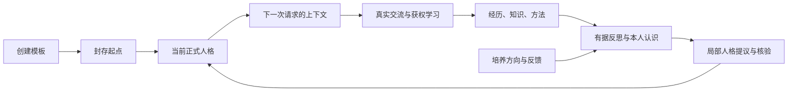

# 新伙伴系统运行与管理说明

本文对应当前新协议源码。重构前的[目录审计](companion-cognition-current-map-2026-10-28.md)保留作历史对照；当前实现及验证边界见[交付记录](companion-cognition-implementation-2026-10-28.md)。

## 人格从哪里来

创建联系人时，用户编辑或导入角色模板，确认后封存起点。`profile.md` 保存当前正式人格，后续由系统的成长发布流程维护。封存起点不再每轮并列注入，也不会在当前人格撤回时自动恢复成旧人格。

用户希望培养的语气、讲话方式、判断习惯和相处方向进入培养目标。目标可以调整、暂停或结束；它表示接下来怎样练习，不表示伙伴已经具备相应性格。变化需经过实际交流、本人认识、来源核验和正式发布。新请求采用已提交的新人格，正在运行的任务仍遵守其准确输入、来源与撤销凭据。

这套学习改变外部记忆、知识、方法和当前人格，不训练远端大模型权重。研究提供经验—反思—实践、情境化倾向及叙事连续性的设计依据；系统不使用“好感增加几分”或“经过几天就成熟”来冒充人格发展。

## 每类文件负责什么

文件位于伙伴专属目录，但目录位置本身不授予模型读取或记忆摄取权限。注册表还要核验类型、生产者、归属、版本、来源和本次受众。未知文件默认不参与处理。

| 路径 | 职责 | 怎样进入模型 |
| --- | --- | --- |
| `profile.md` | 唯一当前人格正文 | 作为身份装配一次；发布后采用新版本 |
| `profile.fragments.json` | 人格片段、依据、适用受众及撤回映射 | 宿主核验与投影，不作为第二份人格全文 |
| `提示词/角色指导/` | 扮演与交互职能指导 | 按本次用途选择；采用当前人格 |
| `提示词/处理职能/` | 日记、反思、知识整理、修复等处理合同 | 仅相应处理任务使用 |
| `提示词/manifest.json`、`instance.json`、`认知策略.json` | 用途选择、固定布局和调度配置 | 宿主读取；不是经历记忆 |
| `记忆/经历/` | 真实交流和实际经历的笔记 | 按需事实回忆、反思和记忆整合 |
| `记忆/知识/` | 获权学习得到的知识与方法 | 按需知识回忆、复习及使用；不等于亲身经历 |
| `记忆/自我认识/` | 带条件、作者和依据的本人认识 | 自我回忆、反思和人格整合；不混入普通事实召回 |
| `记忆/导航/` | 时间线与摘要导航 | 帮助定位；不能当作新的原始经历 |
| `演化/起点/` | 创建时确认的封存原稿 | 只读审计；不反复作为当前身份注入 |
| `演化/目标/` | 培养方向、练习与反馈版本 | 按相关任务使用，明确标为未来方向 |
| `演化/发布/` | 人格变化、差异及发布凭据 | 历史审计；不全量加入后续上下文 |
| `演化/联想/` | 可选梦境与联想 | 明确虚构；不能作为现实经历的证据 |
| `证据/来源/`、`证据/历史/` | 准确原文、版本与历史正文 | 按权限核查或合法历史读取；不自动重新编码成记忆 |
| `形象/` | 头像和设定图 | 界面展示；附带真实像素时才参与视觉输入 |
| `.运行/索引/`、`.运行/视图/`、`.运行/发布/` | 检索索引、缓存和发布恢复资料 | 宿主管理；不作为人格或记忆正文 |
| `.运行/上下文/`、`.运行/诊断/` | 实际请求快照与诊断 | 按权限只读审计；不重新摄取为经历 |

目录和消费者的权威定义是 [companion-instance.ts](../../src/shared/companion-instance.ts) 与 [companion-artifact.ts](../../src/shared/companion-artifact.ts)。SQLite 保存正式事件、类型、来源关系、作业和发布账本；正式认知文件保留可核验正文。两者不能互相绕过准入。

## 日记、整合、反思与梦什么时候发生

| 环节 | 实际触发与结果 |
| --- | --- |
| 原始记录 | 正式消息或实际事件先持久保存；它与日记是两种记录 |
| 日记捕获 | 允许记忆的正式来源进入队列，达到静默窗口或最长等待后分批领取，再判断内容是否值得记录；不是每条回复结束必写一篇 |
| 文件发布与索引 | 笔记保存或修订后，来源、历史与当前正文经耐久发布；正式可用版本再进入向量和 VCP 索引，保存不等于已可召回 |
| 记忆整合 | 已有真实笔记形成维护欠账；按维护策略、证据量、间隔和当前可运行条件独立处理，不等于必须先做梦 |
| 反思与本人认识 | 在获权记忆和准确来源上提出有条件认识；无新认识、无变化都是合法结果 |
| 人格整合 | 新的本人认识或培养反馈产生持久检查欠账；后台检查后提出局部变更，核验来源、版本和条件后才发布 |
| 梦境 | 维护流程另行判断概率、冷却及运行条件，允许不做梦；梦境失败不抹掉已经完成的真实整理与反思 |

默认平衡策略的日记静默窗口是 60 秒、最长等待为 5 分钟；持续交流、分批来源、失败恢复及允许的空产出，会使用户观察到“有时不写、有时连续写”。这些是调度参数，不是心理成长曲线，也不是保证执行时间。界面的处理状态会区分尚未到条件、排队、实际执行、文件待发布、索引、搁置及完成。

触发说明见 [companion-memory-processing.ts](../../src/shared/companion-memory-processing.ts)，策略见 [companion-memory-policy.ts](../../src/shared/companion-memory-policy.ts)。应用关闭时不会假称后台仍在执行；重启从已保存阶段续接。

## 上下文与错误处理

每次调用按用途编译：当前获权人格、必要职能指导、当前任务、有界近期原文／合法摘要和按需回忆。持久聊天和历史可以增长，请求不会因此全量追加整个伙伴目录。长任务使用检查点续接；新任务重新装配自己的上下文，不继承另一个任务的全部模型消息。

结构不合格的模型输出可交全局模型后台修复，每个结构化操作最多两次修复；修复不能伪造来源、删除原有有效内容或改写明确拒绝来取得通过。不同独立任务可以并行，准确相同依赖仍须串行核验。

作业在一个周期内三次真实处理失败后持久搁置。用户可核对原事件后明确恢复或放弃；恢复开启新周期但保留累计失败，放弃保留原事件与处理历史。模型配置不可用、来源失效、正常取消及等待文件不冒充内容质量失败。已经发送但结果未知的请求不自动重发，已保存成功结果不重新生成。

坏事件、搁置作业和无关未完成发布不能一直挡住后续独立任务；来源撤回和正文损坏仍须严格拒绝。恢复后的旧资料不会覆盖新的撤回屏障。备份恢复是完整新协议核验，不支持旧维护系统导入。

## 用户在哪里查看和管理

认知档案按当前自我、表达与相处、价值与认识、当前处境、关系经历、知识与记忆、培养方向、成长历程、起点、职能指导及实际上下文组织。正文只读；头像、连接与运行设置独立管理。档案展示当前生效内容和形成依据，具体请求页展示该次实际发送版本，二者含义明确区分。

故障管理按伙伴、种类和状态分页；详情核对来源与准确作业，操作使用版本与幂等凭据。不要用手改文件代替恢复、撤回或成长发布。

后续验证采用 `npm run test:companion:quick` 及受影响模块的短用例。用户已撤销长时间真实测试；现有试验结果按实际范围保留，不声称已证明人类等效人格或任意规模质量。
