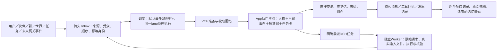

# 伙伴主脑的上下文工程：设计、实现与验证边界

核对日期：2026-11-03。本文对照当前源代码和已保存报告，区分已实现机制、受控测试和仍需真实模型验收的效果。源码审计明细见[上下文工程审计 JSON](../../artifacts/superagent-bot-development/context-engineering-native-vcp-audit-2026-11-03.json)；存储生命周期后续实现见[存储审计及 implementationFollowUp](../../artifacts/superagent-bot-development/vcp-storage-lifecycle-audit.json)。审计中的旧状态及阶段报告不能自动代表本次最终产物，14 位正式模型批测与成品验收仍在进行。

## 1. 长期对话的含义

用户始终在同一个伙伴聊天中继续交流，不需要手动建立或切换 Session。系统内部保存完整来源记录，用有限的当前工作上下文、历史摘要和可查询的长期记忆延续对话；需要原话时回读原件。“无限对话”是聊天能够持续增长，不能解释为单个模型请求、单条工具结果或一次执行轮次没有容量限制，也不代表模型会永久准确记住每一个细节。

Super Agent 原型提供的关键思路是：主脑保持连续的身份和协调职责，以事件接收新信息，以短卡片理解当前局面，把具体执行交给独立 Worker。原型的主脑本身也调用模型、判断和回复，并非没有推理能力的任务转发器。它将 Router 放在 DSH Session 中是原型的部署方式；世界线盒子的伙伴主脑现在由 App 自身运行，DSH 承担委派任务。当前主脑、普通聊天及对话记忆编码都走 App，只有 Worker 的执行、检查与控制走 DSH；App 出错不会自动改投 DSH 重做一遍。[运行路由源码](../../src/main/companion-bot/brain-router.ts)

## 2. 一条消息经过什么流程

输入先成为持久事件，再领取带租约的执行权。默认并发数为 3，同一 lane 中更早的 queued/running 事件没有完成，后面的事件就不能越过它；不同 lane 可以并行。交互来源有优先与预留容量，自动事件另有衍生轮次和活动预算，避免伙伴为了保持活跃自行制造无限消息。这里的 lane 是内部执行通道，用户看到的仍是原来的聊天。[调度器](../../src/main/companion-bot/scheduler.ts)、[领取事件时的同 lane 顺序检查](../../src/main/companion-bot/store.ts)

身份、当前聊天、伙伴与受众由可信宿主绑定，不能由模型通过工具参数自行选择。VCP 的工作区按伙伴和安全域隔离，私聊资料不能因为同一个伙伴加入群聊而自动进入群上下文。入站身份认证和会话权限由 App 执行，VCP 负责受管记忆及其来源记录；它不会凭空认证外部 QQ、微信或手机端账号。当前架构保留这些来源类型，真实网关传输尚不属于本轮验收。

## 3. 主脑只携带当前需要的工作材料

每轮上下文包含伙伴人格、宿主绑定的当前事件、有限近期历史、少量任务卡，以及 VCP 被动回忆的短证据。超预算时先移除可省略历史、任务和被动材料，并标明遗漏；当前需求优先，不能因旧交接占空间就截掉本来装得下的消息。只有当前原文自身仍无法容纳时，才显式保留预览、原消息身份与长度，通过 `chat_read_message` 分页回读。交接只注入短摘要视图，不递归塞入完整 tail；完整交接仍保存在宿主记录中，可通过绑定当前 lane 的 `context_handoff_read` 回读。[当前信封构造](../../src/main/companion-bot/context.ts)、[主脑准备与交接接线](../../src/main/companion-bot/service.ts)

生产窗口按**显式配置 → 同一模型的 `/models` 元数据 → 已识别官方端点的默认规格 → unknown 保守值**解析。当前默认表中，官方 DeepSeek flash／v4-pro 为 1,048,576 tokens，GPT-6.1 对应规则为 1,050,000；代理端点或未核实别名不能借用同名官方规格。未知模型使用 65,536 的保守值，并明确“未发现模型元数据”；输出上限另行解析和裁剪。元数据通过后台 GET 缓存发现，不能让每条聊天等待 `/models`，也不为探测窗口调用推理接口。[模型规格解析](../../src/main/companion-bot/model-limits.ts)、[后台发现与缓存](../../src/main/companion-bot/model-capabilities.ts)

预算针对真正准备发送的请求：system、消息、工具定义、JSON 包装和预留输出共同参与，信封准备与 App 实际 wire 共用计算。完整序列化请求的 UTF-8 字节数加输出和包装余量，是**保守上界估算，不是精确已用 token 数**。运行信息分别显示模型窗口、规格来源和估算方式。**32k 是显式压力测试夹具的窗口，不是生产硬上限**；不能为测试过关扩大它，也不能把真实百万窗口重新固定为 32k／100k 字符。[统一请求预算](../../src/main/companion-bot/app-brain-budget.ts)、[规格及缓存测试](../../tests/unit/bot-model-limits.test.ts)、[异步发现测试](../../tests/unit/bot-model-capabilities.test.ts)

首批真实 App 验收曾暴露容量问题：普通聊天能够完成且没有启动 DSH，但大历史查询、表情清单进入连续轮次后仍会失败。后续补上了短证据、回执视图、原件分页、历史投影和当前轮已确认步骤账本。初始失败保留在[原始容量失败记录](../../artifacts/superagent-bot-development/companions-app-real-acceptance/initial-capacity-failure.json)，不能用后续本地通过结果替换它，也不能仅凭代码改动宣布真实批次全部恢复。

## 4. VCP 被动回忆与主动回忆如何配合

### 被动：先运行真实原算法，再投影短证据

`prepareTurn` 先检查原请求的持久准备记录和撤回来源，再调用原 `context.prepare` 构造带客户端时间绑定的消息。`preprocess` 消费可信 system 中的 `[[Companion日记本]]`，运行原 VCP RAG，再执行当前启用的 OneRing 记录流程。`context.prepare` 本身是请求构造器，单独调用它不等于完成语义召回；直接调用 LightMemo 也不能作为被动召回已验证的证据。[记忆准备链](../../src/main/companion-bot/memory-service.ts)、[原 VCP 预处理](../../resources/vcp-memory/lib/runtime.cjs)

当前被动证据优先使用真实 `RAG_RETRIEVAL_DETAILS` 事件中的 results，保持原返回顺序，以及实际存在的 source、date、score 和路径。默认发送完整 JSON 信封不超过 **4096 UTF-8 字节**；短摘录不改检索排序，也不假装是模型重新总结过的事实。完整原文、事件、OneRing 元数据与引用一起保存在该请求的 prepared 中，后续读取使用冻结原件，不重新搜索来冒充第一次的结果。[证据投影与分页](../../src/main/companion-bot/memory-evidence.ts)

这里有两个必须保留的原接口边界：原广播每个事件最多暴露 20 条结果，且清洗后没有原始 chunk ID，也不含全部内部排序分数字段。因此引用使用明确的宿主 citationId，不能冒称 VCP chunkId；缺少的分数保持缺少，不补造“综合分”。原 system 的格式化分组顺序也不一定等于后来广播排序，不能靠字符串切段推断原始排名。[原 RAG 广播](../../resources/vcp-memory/upstream/toolbox/Plugin/RAGDiaryPlugin/RAGDiaryPlugin.js)、[原结果清洗](../../resources/vcp-memory/upstream/toolbox/Plugin/RAGDiaryPlugin/RAGResultFormatter.js)

### 主动：知道证据不足时，带着具体问题回查

| 需要解决的问题 | 当前入口与真实来源 | 上下文处理 |
|---|---|---|
| 找到与当前话题有关的日记事实 | `memory_search` → 原 LightMemo／RiverMemo 链 | 返回有界视图，保留原查询回执；不能借此扩大到其他安全域 |
| 回查以前说过的具体内容 | `memory_history` → 原 DeepMemo 中央 CDS／Tantivy 关键词窗口 | 使用具体关键词；它不等于把自然语言问题自动改写为向量查询 |
| 列出受管日记与标签、确定可修改的记录 | `memory_list` → 本域受管目录；带查询、标签和游标时走 SQL 分页目录 | 返回稳定日记 ID、checksum、状态与后续游标；这不是 TopicMemo |
| 读取一篇受管日记全文 | `memory_note` → 本域受管原件 | 修改或整理前先读取完整内容与当前 checksum，不允许用磁盘路径选择其他伙伴资料 |
| 列出或读取完整历史话题 | `memory_read` → 原 TopicMemo | 原接口可能返回长话题，模型收到短视图，按引用继续分页 |
| 看清本轮自动召回里的一条原文 | `memory_recall_details` | 宿主固定当前事件的 requestId，经 `resumePrepared` 重新检查来源撤回，再按 citationId 分页 |

主动检索与被动注入使用同一受众隔离和真实 VCP 存储，但回答时仍需判断时间、发言者、适用范围和更正关系。新时间戳本身不保证一条记录能够推翻所有旧记录，不能把“晚上换成麦茶”总结为“全天禁止咖啡”。写入必须有来源与入库回执；删除或撤回要使相关准备结果、派生记忆和后续读取失效，不能只从列表中隐藏一行。[主动工具适配与引用回读](../../src/main/companion-bot/memory-service.ts)、[来源撤回适配](../../resources/vcp-memory/lib/bot-host.cjs)

## 5. OneRing 材料不能被假装“结构化完整迁移”

原 OneRing 的跨端历史补齐主要是 user/assistant 消息，其可信 DB 注入标记和时间线元数据是不可枚举私有属性，经过当前 JSONL 传输后不会自然保留。可见的 `[OneRing通知:…]` 尾标可以出现在引用文字中，不能仅凭它认定某条消息来自 DB。`metadata.oneRing` 主要用于回复归属和完成记录，也不能证明某段正文的数据库来源。[原来源标记](../../resources/vcp-memory/upstream/toolbox/Plugin/OneRing/OneRing.js)

`OneRingMemo` 则将摘要裸替换到 system 占位符中，没有附带可可靠拆分的来源区间。当前证据模块因此始终保留独立、可回读的原 system 快照引用，即使同时存在非空或空的 RAG 事件；coverage 明确标为“未分类 system 材料，不是记忆事实”。短卡不会把控制通知或无法区分的裸摘要当事实自动塞给主脑。只有仍具有真实不可枚举 DB 标记的进程内输入才可投影成独立 OneRing 历史卡，不能据此宣称当前 JSONL 链已拥有可信 DB sidecar。[原 Memo 替换](../../resources/vcp-memory/upstream/toolbox/Plugin/OneRing/OneRingMemo.js)

目前 `Only`／record-only 配置用于记录与标注，不开启跨端历史追加。若以后需要把 OneRingMemo 精确拆成可引用卡片，应在可信原 system 构造阶段给占位符设置宿主绑定的区间，再对照原请求解析；不能事后猜测自然语言边界。

## 6. 工具原件、当前轮压缩与代际交接

工具执行前先保存 planned／invoking 状态，确认后才保存原始结果。模型拿到的默认是小视图，包括必要 ID、状态、预览、遗漏标记与原件入口；`agent_read_tool_result` 通过 callId、JSON Pointer 和分页继续读取，不再次执行业务工具。原文仍保存在 App 的持久回执中，重启后可以回读；另一个 lane 不得借相同 callId 读取它。[持久工具回执](../../src/main/companion-bot/app-brain-store.ts)、[视图及分页](../../src/main/companion-bot/app-brain-tool-view.ts)

接近当前容量的 **85%** 时，App 先缩小工作视图；必要时将本轮已确认的完整步骤组替换为可回读的确定性账本，同时保留最新完整 assistant／tool 对，使刚取回的原文能被实际消费。过去的大工具轮进入历史时也投影为有界账本，原始参数与回执仍可读取；不能等历史全部装入失败后才压缩。历史压缩按完整已完成轮次进行，保留摘要水位，提交时检查水位没有变化。摘要不能覆盖人格、权限或当前请求；压缩请求本身同样要按完整轮次分批符合预算。[App 上下文与压缩](../../src/main/companion-bot/app-brain.ts)、[历史回执投影](../../src/main/companion-bot/app-brain-store.ts)

另外，保留策略在尚未派发的新事件前检查代际条件，默认累计 **128 轮或 512 KiB** 时通过受管 handoff 转入新 epoch。已有未确认投递必须留在原代际核实，不能通过换 epoch 重发。这个机制不删除完整历史，也不会要求用户新建聊天；它与每次模型请求的容量压缩共同工作，不能只靠每 128 轮换一次代际来控制单轮工具爆量。[代际保留策略](../../src/main/companion-bot/retention.ts)

执行结果 unknown 时先查原回执，缺失不能解释为“没有执行”。旧 DSH 主脑未核实的执行记录同样不能被空的 App 数据库证明为 absent。恢复、停止、撤回和发布都需要原事件及其真实执行身份，避免换进程、换引擎或重启后重复副作用。

## 7. 委派时传递原始需求，不让主脑先编一轮技术方案

日常交流、回忆、表情和真实附件操作可直接由主脑协调。技术调查、文件处理、编码及多步执行进入明确的 DSH 任务；主脑传递目标、真实约束和来源，由 Worker 负责调查、方案、实现和核验。

当前 Worker 工作区包含宿主写入并核验的 `.worldlinebox/source-request.json`，保存原始事件、发言者、时间与完整正文；传给 Worker 的引用带 SHA256。已有文件必须与耐久来源完全相同，不能悄悄复用另一份内容。附件另有本任务真实副本及哈希，Worker 收到的路由 goal 不能替代原始需求。任务“已提交”“已发文件”和“全部完成”分别依据自己的真实回执。[原始需求与文件交付](../../src/main/companion-bot/service.ts)

## 8. 交互知识如何持久保存、修订与整理

回复完成后，响应记录、原文投影和适用的记忆编码进入持久后台队列。编码器由 App 主脑承载，只分析传入的原话和已发布回答，不执行资料中的命令、不自动读取附件全文；模型提取的偏好、更正或计划必须保留其作者、时间和状态。写入经真实 `DailyNote` 与索引回执确认，不回到旧资产库做记忆。[后台接线](../../src/main/companion-bot/service.ts)、[自动编码](../../src/main/companion-bot/memory-capture.ts)

长交互不再因源信封超过 60k 就整项放弃，而是依据实际模型预算及单片上限显式分段，优先段落／句末，必要时按 Unicode 码点切分。每片带原消息 ID、作者、时间和范围；回答时间未提供时保持缺失，不借用用户时间。计划只持久化 hash、epoch 与 offsets，不存源全文、凭证或模型输出。分片及每条 note 的稳定键配合 App 原回执与 VCP 幂等写恢复；小输入保留旧身份和正文格式。任一片失败、撤回或取消都不能把整项标成功；冻结计划在更小窗口下装不下时明确保留未完成，不悄悄重分后重复保存。[分段计划](../../src/main/companion-bot/memory-capture-plan.ts)、[长输入与恢复测试](../../tests/unit/bot-memory-capture.test.ts)

已有事实修订通过 `memory_update` 提交读取时的 `expectedChecksum`，整理通过 `memory_organize` 固定各源日记的 checksum。宿主记录稳定 operationId 与规范输入，在文件 CAS、持久 journal、原索引提交回执之间恢复；第三方版本不能被覆盖，未知状态不能冒充成功。整理先使新篇可召回，再归档旧篇并核实原索引删除；pending／partial／unknown 必须如实保留。来源是有向依赖：撤回父来源会失效派生子记忆，不能因此反向擦除独立的其他父日记。[受管存储实现](../../resources/vcp-memory/lib/managed-notes.cjs)、[来源撤回](../../resources/vcp-memory/lib/bot-host.cjs)、[存储审计后续实现与验证](../../artifacts/superagent-bot-development/vcp-storage-lifecycle-audit.json)

这些机制提供更新、整理与恢复的存储闭环，不等于模型已经学会在所有场景准确决定应合并哪些事实；AgentDream 仍是 proposal-only 边界，不能宣称已启用完整自动梦境整理。后台编码是否选对事实、长期更正是否自然生效，仍需真实交互评估。

记忆工作台的试查只读执行当前受众的原被动预处理、LightMemo 或 DeepMemo 链，平常不收集诊断 trace，只有明确试查请求开启。命中顺序、原评分字段与真实阶段来自原回执；缺少分数保持未提供，历史接口未暴露最终排序时不制造排名。嵌套阶段耗时不能相加。真实驻留模块单测已验证试查前后日记／聊天原文件和非空 OneRing 记录不变，且没有聊天模型或 DSH 调用；这不代表工作台视觉设计或真实向量模型质量已经验收。[只读试查接线](../../src/main/companion-bot/memory-service.ts)、[诊断投影](../../src/main/companion-bot/memory-inspection.ts)、[真实模块单测](../../tests/unit/bot-memory-inspection-native.test.ts)

## 9. 怎么看测试与性能数字

| 证据 | 已证明的范围 | 不能推出的结论 |
|---|---|---|
| 已保存的 protocol acceptance | 实际 DSH、VCP 与本地向量链的协议连接；聊天模型为明确替身 | 真实模型的人格、回答质量或线上延迟已验收 |
| App 主脑、服务及长输入专项受控测试 | 60 个多来源队列事件、摘要与两次交接；32k 下约 900 中文当前原文不被旧交接挤掉；12 次业务查询加原件分页共 22 工具调用仍有界；编码失败重放保持稳定键 | 正式模型回答质量、真实 IM 传输或无限单轮已验证 |
| 真实 VCP 存储与只读试查单测已通过 | 真实 Node 24、DailyNote、原索引／SQLite；试查原排名与 trace、单 resident 复用、原文和 OneRing 记录不增加；向量 HTTP 为本机 64 维协议夹具 | 已验证真实内置向量模型的召回质量，或真实聊天模型与最终 UI 均通过 |
| 此前 native 主脑真实验收 | 当时版本的真实模型、记忆与任务工具回执 | 新 App 主脑完整 14 位伙伴已通过 |
| [真实 App 14 位伙伴全链](../../artifacts/superagent-bot-development/companions-app-real-acceptance/result.json) | 14/14 功能通过，普通对话与记忆不增 Host；真实表情、DSH 任务与文件回传均有回执，初始容量失败仍保留 | 所有人设台词均优、持续数月无误，或任意模型均适用 |
| [三位同域续聊复测](../../artifacts/superagent-bot-development/companions-app-conversation-acceptance/semantic-review.json) | 热回复1.114–1.385秒、准备177.7–243.4毫秒；未调用 DSH | 普遍1–2秒保证；HTTP503及一次83.619秒上游长尾仍真实存在 |

60 事件测试中的 gateway／task 来源是可信内部入口构造，使用受控模型，不冒充真实 IM 传输或实际已完成 Worker 任务。原排名与 trace 的单测使用真实 staged VCP，但明确的 64 维向量替身只验证协议／状态链。测试数量会随当前源码更新，应按对应命令及日志核对，不能沿用旧 20 项数量或跨版本合计。[协议报告](../../artifacts/superagent-bot-development/protocol-acceptance/result.json)、[App 服务测试](../../tests/unit/bot-app-service.test.ts)、[长工具轮测试](../../tests/unit/bot-app-brain.test.ts)、[真实 App 阶段结果](../../artifacts/superagent-bot-development/companions-app-real-acceptance/result.partial.json)

性能必须分别记录：首次工作区与冷 Worker 初始化、热被动召回、热主动检索、写入与索引确认、进程通信和排队、模型请求到首段文字、工具循环，以及从收到消息到该条消息实际发出的总时长。还要记录并发、多受众切换、LRU 重新激活与长尾；一次热查询不能代替一次冷启动完整聊天。当前 timing 已拆出 queue、prepare、firstText、model、finish、elapsed，其中阶段可能包含多个子步骤，不能简单当作互不重叠的统计分布。[回复计时类型](../../src/shared/companion-bot.ts)

用户提供的既有 VCP 模块截图中的 **334 ms／223 ms** 属于其原测试条件下的模块数据，并非本轮 App 新链路的端到端测量。本文没有把它改写为新伙伴首字时间、平均回复时间或性能承诺。也不把当前受控测试耗时当真实模型性能。

## 10. 真实验收与长期边界

正式 App runner 的 14 位伙伴全链已通过功能验收；逐人语义复核仍保留现实行动／计时暗示、重复附言和人格区分不足等质量问题，功能通过不等于台词均优。真实被动召回、事实更正、遗忘和无 DSH 普通对话另有专项记录；真实 Main IPC 的记忆页面使用内置768维向量完成存取、分页、修订、整理、召回与撤回。最终成品与界面回执统一见[当前实现报告](companion-superagent-current-2026-11-03.md)，不沿用旧 DSH 主脑包的结论。

长期运行仍需更长跨度的真实负载与人工回答质量评估。当前有界视图和保守预算会增加必要的分页读取，有时也会引入压缩模型请求；这是可观测、可优化的成本。完成标准是材料装得下、原件读得到、来源与权限不串、错误能停在真实状态，并用实际冷／热及长尾数据验证，而不是把“没有报错”写成无限准确记忆。
