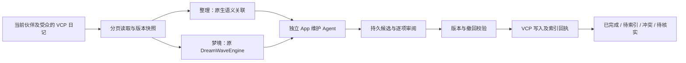

# 伙伴记忆整理与梦境

本功能延续 App 主脑 + VCP Memory + 独立 DSH 执行器的边界。原始实现的触发时机、日记与摘要区别见[冻结源码研究](companion-memory-source-research-2026-11-03.md)。本文描述用户后续授权后已经实装的项目适配；机制测试与最终成品、真实模型语义验收分别记录，不能相互替代。

## 流程与职责

梦境实接保留的 `DreamWaveEngine.generateDreamWave`，复用已有向量与原 RiverMemo 联想。适配层把可读数据限制在当前物理 home 内已验证的受管日记批次，保留原角色及评分字段；这些数值不表示事实正确率。它不直接运行原插件的长模型循环：原生检索短调用结束后，模型规划在独立 App Agent 上运行，期间不占着聊天召回的 VCP FIFO，也不启动 DSH。

每次最多扫描 24 篇，按模型容量纳入完整原文；超出容量、索引待确认或暂时不可读的记录明确列为待重访，已归档、已撤回的非维护对象跳过。快照先持久化，随后才向模型发送。模型没有文件或写入工具，只能提出带逐来源原话引用的结构化候选；未知来源、无法对照的引用和互相覆盖的改写会被拒绝。

## 候选及生效条件

| 候选 | 批准后的作用 | 不可混淆的边界 |
|---|---|---|
| 合并整理 | VCP 新记录索引确认后归档源记录 | 部分写入或待索引不能显示完成。 |
| 更新日记 | 校验原 checksum 后更新 | 新事实必须保留更正经过与来源。 |
| 梦境感悟 | 创建强制标注“非用户事实”的派生日记 | 叙事、猜测不自动写成用户经历或偏好。 |
| 归档冗余日记 | 移出召回索引，保留可读原件 | 对应原 DiaryDelete 的恢复性适配，不调用“忘记事实”。 |

梦境叙事及未批准候选保存在维护账本中，不直接注入记忆索引。模型不能批准自己的候选。用户可以逐项批准或驳回；批准绑定具体候选版本，不能由渲染端替换成其他正文。

新派生日记通过父日记依赖保留来源，不能把多个父源的消息 ID 直接摊平为共同所有权。这样，撤回 A 可阻断其派生，却不会反向撤回独立 B。归档也不等同于撤回来源，同一消息中的其他事实应继续可用。

## 后台触发与恢复

默认周期策略为空闲时生成待审整理方案：首次登记冷却 24 小时、本域闲置 15 分钟、至少 12 篇实际可用的日记，并且没有捕获任务或待审方案。自动计划每日最多一项；设置可关闭、切换为梦境或调整条件。手动运行不需要等待周期，仍按批次执行。跨批次游标持续保存；本轮任一页存在待重访日记，末页也不将整库标为已覆盖，下一周期从头重访，仍受费用门禁约束。不能把一批 24 篇显示为全库已完成。

周期检查先查本地任务条件，达到条件后才做一次有界 VCP 目录查询；不在启动时扫描所有伙伴，也不在每秒轮询中加载整个记忆库。自动维护遇到新的用户消息会退让，聊天与新记忆捕获优先。

默认改写均需审阅。可选的自动无损模式只对完整原文拼接的合并使用确定性正文与原标签，不自动采用模型改写，也不自动保存梦感悟或单独归档。周期设置、候选和诊断在页面中可见。

任务、快照、计划、审批、操作 ID 与实际回执分别持久保存。恢复复用同一操作；超时或断线不能当作“没有写入”而新建另一份。待索引可以继续核实，冲突要重新读取，未知保持待核实。来源撤回会停止旧维护、阻断旧候选，并清除维护页面中的旧正文；原始操作证明仍保留。审批后至实际写入之间还有 VCP 内部版本及撤回校验。

来源版本过期后不重放旧计划的文件或索引写入；只观察实际文件与原生索引回执，证据完整才核实既有结果，证据不足继续阻断召回并保留旧账本。相关来源的真实清理完成后，旧操作才可标为已撤回并解除对应阻断。感悟可以引用同版本的已归档原件，仍受父来源撤回约束。

## 页面和主脑能力

“整理与梦境”采用紧凑两栏：左侧集中生成操作、维护任务及按需展开的周期设置，右侧从顶部展示所选任务状态、候选和诊断正文。两栏分别滚动，展开设置不挤占右侧正文高度。操作反馈使用不占正文布局的浮层提示；任务状态、来源状态和实际回执仍是结果依据。

记忆工作台的“整理与梦境”页采用任务 20 条、候选 12 条、诊断 20 条的分页；候选、源全文及长诊断按需读取。源内容与方案快照已不同会明确提示，不能把当前新正文冒充当时的原文引用。状态、耗时、下一批范围和索引结果都使用真实记录。

主脑可以通过 `memory_maintenance` 提交方案或查看进展；这不意味着日记已经改写。正常事实仍可及时使用已有的 VCP 存取工具，后台自动提炼提供补充保障，不需要用户反复强调“记住”。

## 验证记录

已完成的定向机制检查包括核心单测 23 项、真实临时文件与 SQLite 的宿主测试 12 项，以及原 VCP/Rust 索引原生测试 1 项；对应[核心测试](../../tests/unit/bot-memory-maintenance.test.ts)、[宿主测试](../../tests/unit/bot-memory-maintenance-host.test.ts)、[原生测试](../../tests/unit/bot-memory-maintenance-native.test.ts)。原生测试使用本机 HTTP 64 维向量协议，覆盖原 DreamWave 编排、真实索引回执、CAS、部分提交恢复与撤回，不涉及付费聊天模型。

最终两栏界面的相关完整回归已有 544 项通过、6 项按既有条件跳过；两处截图发现的局部样式修正后，43 项界面用例再次通过。主工程／扩展 TypeScript、定向 ESLint 与 Windows CRLF 感知的空白检查通过；五个 VCP 宿主文件的 Node 语法检查通过。[完整单测](../../artifacts/superagent-bot-development/maintenance-layout-final-units.log)

成品测试暴露过一个真实集成缺口：App 主脑在已确认 HTTP 503 失败后抛出宿主终态回执，维护运行时最初没有把它转换为可人工重试状态，导致重试仍复用失败请求。现已用真实 AppBrain、实际 SQLite 任务和本机 HTTP 503→200 服务补回归：显式重试发出新请求，冻结来源完全不变；未知投递仍保留旧请求身份。宿主终态失败确认不表示提供方绝无计费，也没有把明确失败与未知写入混为一谈。

### 正式模型及 768 维实接

使用正式 DeepSeek Flash、真实内置 CPU 768 维向量和 VCP 服务，共 3 次模型请求，原始响应、逐源引用、诊断与完整日记原件均留存。每次是隔离库中经公开写入 API 保存的 8 篇明确人编测试日记，不是自动聊天提炼的数据，不修改生产设置，也不启动 DSH。

| 运行 | 真实观察 | 判定与证据 |
|---|---|---|
| 首次整理 | 约 9.639 秒，模型对同一来源提重复整理／归档，还提了整理模式禁用的感悟。 | 被严格阻断；保留失败，未写日记。[原结果](../../artifacts/superagent-bot-development/maintenance-real-2026-11-03T13-51-32-704Z/result.json) |
| 首次梦境 | 约 6.748 秒，真实原 DreamWave 联想产生 seeds/L1/L2/deep 原评分；2 项整理与 1 项感悟进入待审。 | 两项整理保持最新计划、否定条件；叙事和感悟却存在“用户已拍照／伙伴未看过”歧义，因此未批准，不能以格式通过认定内容全优。[人工复核](../../artifacts/superagent-bot-development/maintenance-real-2026-11-03T13-51-32-704Z/semantic-review.json) |
| 修正后整理 | 约 5.232 秒，生成 2 项待审合并，4 条逐源原话匹配，无重复动作或非法感悟；真实驳回 API 生效。 | 通过这次有限规划复验；源文件及索引未变。[原结果](../../artifacts/superagent-bot-development/maintenance-real-2026-11-03T13-57-08-830Z/result.json)、[人工复核](../../artifacts/superagent-bot-development/maintenance-real-2026-11-03T13-57-08-830Z/semantic-review.json) |

修正后的提示词明确模式允许动作、合并自带归档和作者／行动状态区别；没有额外重跑梦境来声称新提示词已解决其全部语义问题。上述时间是后台完整计划耗时，不能当普通聊天首字延迟，也不保证每次相同。正式模型运行没有批准改写，实际写入／索引／归档的界面闭环须单独引用成品协议验收。

### 成品验收

Windows 成品完成完整 Forge 构建和发布检查，再以正式 Vite／Forge 配置重编译最后两处界面修正。官方 ASAR API 重封逐项确认 27,389 个非界面条目、330 个 unpacked 文件与可执行文件不变，随后完整 `verify-package` 通过。[重封回执](../../artifacts/superagent-bot-development/renderer-repackage/051e5e91-78a0-4c59-9fe0-64e9b9c3e809.json)、[最终成品指纹](../../artifacts/superagent-bot-development/app-router-package-fingerprint.json)

同一最终 ASAR 的维护页两项与既有聊天／媒体／记忆／世界／视觉五项均通过。维护页以本机 HTTP 夹具控制模型输出；审批、真实日记、内置 CPU 768 维向量、原 Rust 索引和回执均实际运行。第一项验证感悟索引、可读原件归档、合并、驳回及同源独立事实保留；第二项验证 HTTP 503 后人工重试、来源版本冲突、受众越权拒绝与撤回后的旧正文退场。[维护页完整日志](../../artifacts/superagent-bot-development/maintenance-layout-packaged-final-complete.log)、[其余五项](../../artifacts/superagent-bot-development/maintenance-layout-existing-final-e2e.log)、[原生回执与完整证据](../../artifacts/superagent-bot-development/maintenance-layout-final-evidence.json)

布局实测为原生隐藏 offscreen 窗口且确有 paint。1440px 窗口下，标签栏底边和两栏顶边同为 y=160px，左栏 242px；提示出现／消失及周期设置展开／收起时，左右面板坐标与高度都不变。850px 窗口中按钮改为单列，左右仍独立滚动；1,528px 长正文位于 298px 内部滚动区，无横向溢出。提示避开可见操作按钮。以上是实际几何与像素检查，不是持续帧率或数月运行结论。[亮色](../../artifacts/superagent-bot-development/ui/memory-maintenance-light.png)、[深色](../../artifacts/superagent-bot-development/ui/memory-maintenance-dark.png)、[窄窗长正文](../../artifacts/superagent-bot-development/ui/memory-maintenance-narrow-dark.png)

首次协议模式错误、宿主终态重试缺口、归档目录断言错误，以及预检截图中的遮挡和窄窗断字均保留原始记录。首轮最终成品两项虽通过，但成功附件因测试配置路径错误缺失一份，已在不改产品的情况下复跑两项补全并保留原件；没有将丢失材料冒称为已留存。详细历史边界见上述完整证据 JSON。
