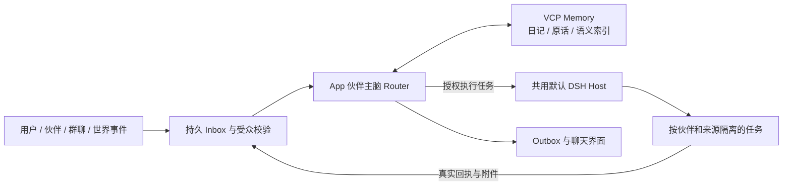

# 伙伴 Super Agent 与 VCP Memory：当前实现

更新：2026-11-04。本文说明 App 主脑重构及验证边界。当前附件、群聊、任务摘要与主脑上下文检查以[聊天界面与实时摘要验收清单](../../artifacts/superagent-bot-development/chat-ui-summary-final-acceptance.json)为准。较早的[生命周期与伙伴状态](../../artifacts/superagent-bot-development/task-lifecycle-presence-final-acceptance.json)、[任务反馈验收](../../artifacts/superagent-bot-development/task-feedback-final-acceptance.json)、[框架验收](../../artifacts/superagent-bot-development/framework-acceptance.json)和下方 594 项／9 项等记录均是对应版本的历史检查点。

## 2026-11-04 任务动态入口替换自动浮层

移除伙伴任务的自动浮层、关闭按钮、浮层队列与自动消失计时。真实状态点、消息流任务卡、右侧最近动态继续保留；新事件只在当前聊天顶部任务入口显示聚合计数，按任务去重，打开任务工作台即读取当前聊天。计数的会话范围与水位规则见下方生命周期说明。

新版 `out/companion-task-updates` 经官方 Forge 完整打包；ASAR 为 `f0b64393f6dacf747f9bf6dcfd528c6879393906853e9396f9b4b7c421c86595`。相关 90 项 UI 单测、TypeScript、ESLint，以及两项隔离原生成品测试通过。真实 Main IPC 并发取消验证明暗主题下本群两任务聚合为 2、其他私聊保留 1、读取互不干扰且刷新不反弹；850 像素窄群聊、8 套现有皮肤及两个实际 MP4 壁纸也通过。测试使用受控任务进度，不调用真实聊天模型或实际执行 DSH，不能用来判断模型语义质量或前台帧率。验证细节与原图见[本次验收记录](../../artifacts/superagent-bot-development/task-updates-final-acceptance.json)。

## 2026-11-04 聊天气泡与实时摘要

`BotMessageBody` 将正文与附件摘要放进同一气泡；非表情包附件（含单图、多图）默认折叠，展开才挂载媒体引用和附件合集，收起卸载。只有附件也有完整摘要入口，不渲染空正文。表情包直接显示，保留斗图体验。双方消息及展开文件卡统一背景、边框和阴影，不按 sender 再叠加单独底色；左右排列和镜像圆角保留。现有预览、文件名搜索、分页、保存和系统打开仍由原媒体组件执行。

右栏压缩人物资料，删除装饰性的重复记忆卡，使用收起／展开侧栏控件。`state.taskSummary` 通过只读 SQL 投影提供当前房间准确未结束数量、纯排队数量及最多五项元数据；停止、暂停待核实优先于普通排队，待办按提交顺序排序。`startedAt` 仅使用真实首次运行记录，旧任务无记录不补造时间；不从任务报告加载全文。

App 主脑在实际 HTTP 序列化请求处报告 `context_metrics`，持久化每个通道当前 epoch 最近一次请求的数值证据。`state.brainContexts` 最多投影当前群内 16 位伙伴，受当前房间成员、ACL、epoch 和事件状态约束。模型窗口来源沿用解析来源，不将回退容量伪称用户显式配置。输入字节上界、预留输出与服务方返回的 usage 分开保留；不能将此值解释为精确 tokenizer 结果、累计消耗或 DSH 会话占用。已处理轮次包含已有终态账的失败和取消；整理次数是实际尝试次数，不代表成功压缩次数。

摘要读取不启动 DSH、记忆服务或新模型请求，不读提示词、历史摘要和原生执行报告；最近事件只显示当前房间的三项。切换聊天时先清空旧摘要，避免请求返回前显示上一个房间的数据。聊天列表、标题和右栏群头像均按同一 `memberIds` 顺序最多显示前九张真实画像，不保留 `+N` 替代格，也不在拼贴格内放状态点。

群聊顶部入口明确命名为「群任务」。`task.list` 与 `task.queue.control` 的可选 `companionId` 在当前 `conversationId` 范围内生效；SQL 目录、总数、进行中、排队与已结束计数共用相同伙伴范围。每行与详情使用只读伙伴名和头像轻投影，历史退群任务保留真实名字。批量操作的冻结 ID 与范围指纹包含所选伙伴，状态和关键词仅控制浏览；router 的 `dsh_task_control` 列表与批控强制绑定当前事件自己的伙伴，不能借 UI 参数扩展范围。

任务面板以实际 state 快照变更为刷新依据，250ms 合并目录与详情读取，不因最近 30 条投影不包含旧任务而漏更新；流式文字本身不触发该读取。伙伴筛选变化同步失效旧目录及详情请求，迟到响应再次校验 room 与 owner。

群聊右栏分为群资料和主脑与任务两页。公告使用独立 metadata 小记录持久保存，群主硬绑定为当前用户，受成员及解散状态校验；`expectedUpdatedAt` 为比较并交换版本，冲突只在编辑区显示，不覆盖草稿。清除保留小型时间墓碑以保证单调时戳。群公告只加入当前群的 host room 用户资料，不升级指令或工具权限；App 历史信封视图移除旧公告，完整原件仍可按需回读，避免反复注入过期公告。公告预览固定三行，长正文使用独立纯文本阅读窗、焦点限定和恢复；UI 折叠不改变保存内容或模型上下文。轻量群聊参与判断也携带当前公告，并以公告更新时间水位隔离缓存和迟到决策；若预算节选会明确标记。保存公告不触发新模型调用。两伙伴通过本地实际 HTTP 捕获验证完整 4000 字公告、替换、清空、草稿和其他房间隔离，属于请求链路证明，不代表真实付费模型理解质量。

成员速览最多七行、按姓名搜索、页内操作复用原群管理和私聊入口。群资料栏分页控件固定在整栏底部，公告与成员内容各自滚动；单页同样保留禁用的翻页控件，避免搜索结果或页内人数变化引起跳动。聊天正文和聊天记录均按真实 createdAt 显示到秒（24 小时制 HH:mm:ss），悬停保留完整日期时间。

伙伴配色取现有主题语义 token，壁纸仍只有 `ThemeBackground` 一个全局所有者。背景仅按既有开关、面板透明度透出；未启用面板背景时保留实色阅读面板。不添加模糊或主题动画。动态皮肤测试使用隔离窗口、真实内置 MP4 解码及受控焦点事件；不将该功能验证解释为实际前台硬件帧率结果。

## 2026-11-04 附件阅读与群聊管理增补

附件入口独立于资产库。图片、动图、音频、视频与纯文本的应用内预览统一上限为 200 MiB，等于上限可用；Word、Excel 等二进制文档只走系统默认应用。聊天附件以紧凑卡片呈现，点击才打开独立阅读／媒体窗；普通图片打开原件，缩略图仅用于卡片，音视频按需取流且不自动播放。超限对象只保存受约束的外部引用，不哈希、复制、解码原件或授予 worker 分析权限。

同一消息的 3 个及以上附件由 `BotAttachmentBundle` 聚合，数量、字节总和与类型分布均来自原始附件引用；不改变 sender、事件时序或授权。拼贴仅挂载前六项及剩余数入口，展开后按完整文件名与类型本地筛选、十项分页，复用单文件预览／保存／系统打开。没有读取正文生成缩略内容，也没有虚构波形、时长、进度或打包下载接口。静态半透明表层与主题色线条不使用实时背景模糊；现有明暗主题仍适用。

`BotMessageBody` 将真实正文与附件汇总置于同一气泡。普通文件默认折叠，只展示元数据；点击展开后才挂载行卡或 Bundle，收起时卸载。附件消息无需伪造正文占位；表情直接展示；单张或多张普通图片与其他文件一致默认折叠，展开后显示安全缩略，超过预览限额的图片仅允许系统打开。折叠状态按真实 conversation/message ID 隔离，不跨消息沿用。

独立表情超过 4 MiB 时只自动展示已有小缩略，原动画须点击后读取；这只是展示策略，不修改 200 MiB 的应用内预览上限。91 张内置表情均低于该自动展示阈值，既有内置动画表现保留。

`media.text.read` 在原会话授权、真实路径、登记大小及 managed hash 校验后，通过 byte cursor 读取一页。默认 64 KiB，单页最大 256 KiB；UTF-8 与带 BOM 的 UTF-16 LE／BE 保持字符边界，游标包含原件 BOM 字节。后缀白名单之外的文档不进入文本解析；二进制签名、非法 UTF、NUL 和危险控制字节拒绝。页面仅保留当前片段，Markdown 复用现有安全的 CommonMark/GFM 与 Mermaid 渲染器，提供原文切换，并明确跨页结构可能不完整；不拼接整个大文档。HTML 不执行，Markdown 网络图片不自动读取，外链需要明确点击。支持的容器不等于保证所有编解码器可播放，失败保留系统打开入口。

私聊、普通群及伙伴交流统一使用「聊天」列表。群标题展示实际成员数；输入 `@` 的候选仅来自当前成员并提供所有人，支持名称搜索、键盘和鼠标，IME composition 不截获 Enter。成员管理弹窗不渲染人格正文，40 条一页并支持搜索；用户固定为群主，可提交 1 至 16 位有效伙伴或经二次确认解散群聊。成员改动递增 ACL revision 并撤销旧轮次能力，对旧回复发出取消、旧任务请求停止核实；解散撤销成员访问并从普通列表隐藏，不宣称物理擦除原始历史与 DSH 日志。

`createGroup` 按完整成员集合复用已有未解散群，保留原标题和参与策略，不合并其他受众的历史。普通群管理请求的作用域由后端校验，direct／peer／world 不开放群管理。前端按 conversation ID 隔离草稿和异步回执，解散成功后切到合法会话，不再刷新已撤权原群。解散后群主仍能读取任务的最小停止状态并再次请求核实停止，不开放恢复执行、原文、媒体或完整任务结果。

## 2026-11-04 私聊目的地与执行反馈增补

`companion_contact` 要求明确的 `destination: user | peer` 和最小必要 `message`。`user` 投递到目标伙伴已有的用户私聊；来源仍是真实伙伴，不能伪装用户或把转达者加为该 direct 成员。`peer` 使用独立 `kind=peer`、固定双方和稳定 pair key，不再自动建立群。`userRole=observer` 仅供本机用户旁观：state/history 和已有附件读取可用，发消息、取消回复、任务控制、记忆变更及附件导入被后端拒绝。`conversation.peer.join` 另外创建或复用正常用户群，不转换或复制原私聊。已有历史群和旧 receipt 不改写为私聊，恢复旧投递返回 `legacy-group`，不会补发。

存储兼容版本为 17，防止旧版把 peer 当作普通可写房间；来源桥接、撤回、事件预算、独立记忆域继续生效。工具回执携带实际目的地与会话 ID。新目的地和历史成员隔离经真实 localhost HTTP 的 AppBrain→工具回调→目标主脑请求验证；模型回答为本地脚本，不代表付费模型的语义质量。

任务通知从真实任务记录轻投影负责人 ID、姓名、短标题和状态，记录不在最近任务快照中时仍可归属；不从执行器原文猜姓名。消息流保留左侧身份与紧凑任务卡；自动通知浮层已移除，改在当前聊天的任务入口聚合「新动态」计数，不遮挡聊天或资料栏，也不自动打开面板。真实 world 事件域继续保存物理目击和因果链，前端不再提供任意新建 world 的重复聊天入口。

本轮复核修正较早的记忆退避验收结论：正常内置 768 维模型的成品写入、整理、主动／被动召回通过；但编码器返回 503 的独立故障回归仍出现 6 次 flush 超过 5 次预算。宿主仅触发一次 kick，上游 watcher 与 repair timer 可能形成两条重试链。未提高测试阈值，也未修改 vendor；不能宣称所有异常重试场景已通过。慢 HTTP 下观察者取消的边界也列为待覆盖项。[独立故障证据与后续修复建议](../../artifacts/superagent-bot-development/peer-routing-memory-sync-backoff-analysis.json)

所有来源的伙伴新任务采用官方 `danger-full-access` Session preset（sandbox 与 `approval=never` 一起设置），继续复用默认 Host。旧的未结束 scoped 任务先持久保存单调升级意图，再通过认证的 `/bot/lanes/:id/access` 沿原 Session 解除旧工具目录和路径限制，逐个保存已存活子 Agent 的权限。升级回执丢失时保持 pending 并重核，禁止降级、变更身份或提前发送答案；不恢复不存在的 Agent，不重新投递任务。冷恢复的问题答案仅进入 inbox 时，按实际 Agent 状态继续既有原 Session 恢复分支，不能把“答案已排入”误当作“执行已运行”。已完成任务只保留历史。原始目标、约束、暂停／取消与未知外部效果核验继续生效。

原生冷热升级实测确认原始输入与先前文件操作各一次、工作区外产物实际写入并读回、禁止降级和认知主脑隔离。子 Agent 权限升级有对应代码路径，本轮没有单独构造存活子 Agent 再升级的原生场景，不把该分支当作实测结论。[旧任务同会话升级回执](../../artifacts/superagent-bot-development/dsh-legacy-access-native/worldlinebox-bot-host-B3wrTQ/receipt.json)

自动群聊采用确定性快速接入与轻量语义判断两条路径。明确 @ 或自然呼叫直接交给实际成员；其余公开消息创建内部候选，并在 VCP 与完整主脑准备前共用一次 App 引擎判断，可选择零、一或多位。判断不含工具、不访问其他私聊，输出受真实模型上限和输入窗口校验约束；输入与结果耐久保存。同一消息其他收件人复用原决策，不按哈希随机挑一个发言者。被忽略的候选不产生空气泡、聊天回复或新的记忆作业。

伙伴的成功公开回复引用同一原消息进入其他同群伙伴的候选队列，不把原文复制为一条新聊天。ACL、源撤回和旧 lease 都有栅栏；自动接话受原活动预算及最多六跳约束，新的用户消息开启新活动。局部候选取消不取消其他人的共享判断。真实 App 引擎与本地协议 provider 的有限回归，以及独立安全回归分别见 `group-attention-app-service.log` 与 `group-attention-safety-final.log`；这些验证状态、作用域和协议行为，不把脚本化模型选择当成正式模型的语义质量评估。

独立的真实文件系统回归覆盖 1 MiB 以上文本逐页精确重组、UTF/BOM 边界、错误编码和伪二进制、超限、跨会话及篡改拒绝；组件回归覆盖当前页替换、原文／安全 Markdown、迟到回执、播放器按需加载、系统打开和群管理权限／确认流程。这些是本地契约与组件验证，不代替最终成品界面或真实模型交互验收。

## 2026-11-04 当前增补：任务生命周期、伙伴状态与原生分组

新任务在共享默认 DSH Host 中使用一个以伙伴姓名命名的原生工作区；工作区内的 Session 使用任务短标题。同一伙伴的 Session header 使用同一伙伴项目目录，原生 working-directory 投影分别指向各自任务目录，文件与工具权限仍按任务隔离。标题在 Agent 已进入 Session store 后命名。旧版任务的 header 不可变：可修正名称并保留原工作区，但不改写原执行日志，不能声称所有旧 Session 已完整合并到新工作区。

伙伴头像的圆形状态点、状态文字和并行计数来自 SQL 元数据投影，汇总其不同聊天的主脑 Inbox 与任务。正在回复、执行、排队、暂停、等待用户和待核实分别保留计数；计数可以重叠，不能相加当成任务总数。有工作时不会仅因模型配置暂不可用就显示为未配置。活动导航与最近事件只公开当前用户在场的聊天，私人世界活动不泄露标题或正文。SQL 最近事件最多八项，任务入口的新动态按聊天与任务去重，最多保留本次打开后观察到的最新 128 项；首次快照只建立基线，不补播历史。持久事件序号防止清理后露出的旧记录被误认作更新，同毫秒真正新增的事件仍可计入。任意入口真正打开当前聊天的任务工作台即清除其标记，面板打开时的新事件同步已读；切换聊天、关闭面板和快照刷新不会重新累计已读事件。它是有界会话内计数，不是跨重启持久未读账本。最新失败的错误色有十分钟期限，旧失败不会永久标红。

| 用户动作 | 持久语义 |
| --- | --- |
| 取消排队 | 从未投递的任务本地取消，不为取消启动模型或 worker。已尝试投递的任务先核实原生 admission，不能把连接失败当作未执行。 |
| 暂停 | 未投递任务本地进入 `paused`；已尝试投递的任务需要原生 `accepted + paused + sessionId + eventId` 回执。仅收到请求不等于暂停成功。 |
| 继续暂停任务 | 需要用户明确请求，沿用原 task、原 event、Session 和工作目录；不新建任务或重投原始要求。未确认外部效果仍先核实，不因继续而绕过。 |
| 终止／停止 | 保存请求后等待原生终态或从未投递的证明。若执行器已经成功或失败，保留真实终态；已发生的文件等外部效果不会自动撤销。 |
| 移除记录／清理已结束 | 仅处理成功、失败、已取消的任务，清理目录中的长要求、摘要和控制材料；保留最小幂等标记、效果身份及结果。文件、媒体授权与 DSH 原生日志保留。 |

暂停和停止各自连续三次仍无确认时，进入明确的待核实状态并暂停自动重试；界面提供原因与重新核实入口。`pause-unconfirmed` 不是 `paused`，`stop-unconfirmed` 不是已取消。新的明确用户请求可重新核实，首次请求时间继续保留。原生实际终态优先于暂停或停止的愿望。

任务工作台固定标题、概览／执行记录／任务详情标签与底部操作区，正文独立滚动；目录有界分页，长目标和完整回执按需读取。移除当前项后回退到邻项或有效末页。批量清理先冻结本次目标集合，每批最多十六项，以异步让出事件循环；剩余目标、进度和回执持久保存，重启后可恢复。同一请求精确重放复用原回执，后来新结束的任务不加入旧清理；移除标记阻止原任务因重复投递复活。

记忆适配层另修复了失败索引的热循环：同步仅首次触发一次 ingestion，随后以有上限的退避检查真实回执，修复重试交还原 VCP 调度，不再每 25ms 强制 flush。超时仍保留 `pending` 和错误；日记 checksum、向量与 tags 完整后才标记已索引。没有修改移植核心的检索或评分算法。[只读故障审计](../../artifacts/superagent-bot-development/memory-indexing-hotloop-audit.json)、[真实 VCP／Rust 退避契约](../../artifacts/superagent-bot-development/memory-sync-backoff-native.json)

本次真实原生 Host 已分别完成取消两项、伙伴分组一项和暂停一项契约验收，使用本地 provider 输出夹具，无付费模型调用。分组验收真实写入两项任务的独立目录，并跨重启核对标题和注册；暂停验收恢复原 Session／event，不重投原输入。记忆退避验收使用真实 VCP ingestion 与 Rust 索引，向量为本地 64 维协议夹具，不能作为真实内置 768 维推理或召回性能结论。这些有限契约测试不证明自然语言模型质量或数月运行稳定性。[取消](../../artifacts/superagent-bot-development/native-cancel-recovery.json)、[分组](../../artifacts/superagent-bot-development/workspace-grouping-native/evidence.json)、[暂停](../../artifacts/superagent-bot-development/native-pause-recovery.json)

另外用真实 Host 复现并修复了输出检查点经过冷暂停后无法继续的问题：精确检查点恢复可解除暂停，过期检查点和已取消任务仍不能继续；重复恢复不会新增模型调用。[检查点冷恢复](../../artifacts/superagent-bot-development/native-pause-checkpoint-recovery.json)保留对应的先失败、后修复日志。完整回归还发现旧工具步骤预览会挤掉最新读回页，现优先将较早步骤换成可回读索引，保留最新完整工具调用与结果配对；原 Unicode 分页完整性和跨聊天拒绝断言保持不变。

## 2026-11-04 较早任务反馈与伙伴交流检查点（历史）

该检查点修正了 DSH worker 未注册原生工作区、单次输出达到 4096 后直接结束任务、执行阶段没有回传，以及详情将长提示与原始回执堆进聊天的问题。当时曾注册伙伴父目录工作区和「伙伴 · 任务」独立任务工作区，每个 Session 加入任务 cwd 对应工作区；这是历史方案，已由上方的伙伴命名工作区＋任务命名 Session 方案替代。旧 header 的兼容边界仍保留，后台注册测试不代替原生界面截图验收。

worker 使用已知模型的输出能力，单次输出受 provider 上限约束；在同一 Session、同一任务 event 内用耐久续段通知继续，不重新投递原始任务。自动续段要求工具调用／结果配对完整且没有待核实的外部效果；连续无工具进展的截断达到保护条件后保留检查点，等待显式继续。已有工具进展会重置连续计数，因此它不是整个任务的固定总轮数限制。未知外部效果保留待核实状态，不自动重放。上下文压缩仍由原生 DSH 执行，不把模型窗口或任务总长度改成一个小常量；这些机制也不保证任意模型永不重复发出语义相似的操作。

任务工作台支持 SQL 分页、筛选、搜索、并行阶段与耗时、按需详情、单项停止和批量队列控制。完整长结果不再丢弃，目录和主脑上下文在 SQL 层只读取短投影；SQL 截取的摘要保留 `summaryIsPreview` 标记，完整结果通过 `dsh_task_result_read` 分页读取。伙伴的自然结果发出后隐藏重复系统提示，原始日志仍保存。跨伙伴联系投递到独立可见的共享聊天，目标使用自己的 App 主脑，用户可观看和参与；宿主转发本轮明确联系内容，不自动附带原私聊历史或附件授权。受众与能力隔离有对应回归测试，有限测试不等于所有自然语言转述场景的无泄漏证明。

首次记忆启用仍有冷启动成本。新增当前选中私聊的单域预热，不预热所有伙伴，也不启动 DSH；并发预热和下一轮共用同域 FIFO 与常驻 worker。常驻域受容量限制，域被淘汰、进程退出或应用重启后仍可能再次冷启动。完整性校验凭证只在本次应用生命周期内复用；再次启用时重新核对清单、真实路径与文件元数据指纹，变化使凭证失效，原生健康检查、同步及撤回修复仍实际执行。这不是跨受众缓存召回证据，也不是持续监视所有磁盘变化或防御任意本地篡改的声明。界面分别显示记忆启动、校验、索引同步和实际召回。双域隔离探针的预热约 4 秒、后续召回约 0.5 秒，使用本地向量协议替身，不能当作真实内置向量推理或模型端到端响应保证。

该历史检查点的相关完整单元集为 **594 项通过、7 项跳过，74 个文件通过、7 个文件跳过，120.12 秒**；见[历史发布单元日志](../../artifacts/superagent-bot-development/task-feedback-release-units.log)。当时的主工程 TypeScript 检查通过，见[历史类型检查](../../artifacts/superagent-bot-development/task-feedback-final-source-tsc.log)。当时批量通知、长结果分页与摘要预览标记联合复验为 **3 文件、34 项通过**，见[历史定向日志](../../artifacts/superagent-bot-development/task-feedback-final-projection-tests.log)。这些数量不覆盖本次新增生命周期与伙伴状态代码。

该历史版本的完整记录见[任务反馈检查点](../../artifacts/superagent-bot-development/task-feedback-final-acceptance.json)。当前最终状态使用本文顶部的生命周期与伙伴状态验收清单。

该历史版本的完整 Forge 成品及发布资源检查通过。同一 ASAR 上的任务工作台、伙伴交流、聊天、媒体、世界场景、视觉、VCP 记忆及两项维护流程共 **9 项独立界面用例通过**。初轮记忆测试的隐藏普通窗口点击超时，以及补测中额外首载重载超时，均保留原始失败材料；当时最终使用实际离屏绘制、普通点击完成真实 768 维存取与召回复验，未以强制点击或业务替身替代。伙伴交流的界面截图使用人工固定消息，正式模型联系与独立回复的有限语义验收另列，截图中的毫秒数不能作为 AI 响应性能。[历史包指纹](../../artifacts/superagent-bot-development/app-router-package-fingerprint.json)、[历史任务工作台](../../artifacts/superagent-bot-development/task-ui-package-final.log)、[历史伙伴交流](../../artifacts/superagent-bot-development/peer-ui-final-packaged.log)、[历史记忆复验](../../artifacts/superagent-bot-development/memory-ui-final-ready.log)、[历史其余页面](../../artifacts/superagent-bot-development/task-feedback-existing-package-final.log)

本次失败测试新增的一个临时目录删除被自动审批以策略阻止，未绕过；连同此前 13 个拒绝目标，共保留 14 个。其余本轮成功界面测试的独立资料目录已按测试清理流程移除。[新增拒绝回执](../../artifacts/superagent-bot-development/memory-ui-offscreen-cleanup-rejected.json)

## 2026-11-03 记忆维护增补

已加入独立的后台整理与梦境运行时、周期策略、持久计划和逐项审阅界面，详见[实现与验收指南](companion-memory-maintenance-2026-11-03.md)；原版的真实触发方式与本产品适配边界见[固定源码研究](companion-memory-source-research-2026-11-03.md)。它与回复后的自动日记提炼分别工作，均使用 VCP 存储与内置 768 维向量服务，不启动 DSH。

同时修正了旧提炼策略对实质交互记录过于保守的问题，并增加后台捕获进展、空提炼计数和有界旧任务补提炼。主脑即使已经输出部分文本，当前阶段、工具与耗时仍保持可见；其能力说明现在明确包括把用户授权的本地只读任务交给 DSH。

此前截图中的退出发生于记忆准备阶段、模型和 DSH 调用之前。已补退出诊断与安全只读重连，但原生退出的底层原因仍没有足够证据确认，不能宣称根因已消除。[事件证据](../../artifacts/superagent-bot-development/memory-reliability-investigation.json)

## 主脑归属于世界线盒子

每位伙伴的主脑由 App Agent 运行时承载，负责理解消息、自然交流、记忆存取和任务协调。DSH 是共用的执行器；只有实际委派的工作才使用它。原型将 Router 放进 DSH，是其部署方式，不是本产品必须复制的边界。

普通对话、回忆、表情和日记操作不依赖 DSH 已经启动。执行任务复用默认实例；用户停止后，下一次真实委派才重新连接／启动该实例。任务保存原始请求与约束，Router 不先做一轮技术研究再把臆造方案转交执行器。

消息、来源、事件租约、模型步骤与工具计划分别耐久保存。已确认回执复用；写操作投递后缺乏效果证明时保持未知，不能当作未执行来重做。日记更新与整理还可从 VCP 操作账本恢复效果，恢复查询本身不会再次写入。

## 持续对话与上下文

UI 会话一直保留。主脑工作上下文按所用模型的真实规格控制，优先显式配置，其次匹配的模型元数据、已核实官方默认；未知连接明确采用保守估计。32k 是压力测试用例，已不作为生产通用窗口。

当前问题、人格和受众优先进入工作上下文；旧信封不反复堆入以前的记忆卡和任务快照。过去完整轮次按预算摘要，原话继续保留。较大的工具结果先给短视图和稳定引用，需要细节再分页读取原件。摘要、摘录和缺省字段都显式标记，不能伪装成完整事实。

跨越长期的记忆只由 VCP 提供。App 的摘要与运行账本不是第二套长期语义库，也不接旧资产库记忆路径。

## 记忆存取闭环

| 环节 | 当前行为 |
| --- | --- |
| 原话留存 | 持久消息与 VCP 有界 episode 投影保留真实作者、时间和来源 ID；封存不等待额外编码模型。 |
| 自动记录 | 回复之后由后台作业选择性提取事实、偏好、决定、更正、承诺、知识与实质互动。寒暄不制造日记；模型推测不写成用户事实。 |
| 长源编码 | 按实际预算分段，冻结完整码点范围、来源与幂等键；中途失败不能冒称整个作业已成功。 |
| 显式写入 | 主脑工具和“新日记”直接使用受管 VCP 写入；写入文件与完成索引是分开的真实状态。 |
| 更新 | 先读取 owned ID 与 checksum，再做 CAS 更新；第三版本或未知结果不会被覆盖。 |
| 整理 | 先保存耐久计划，确认新日记向量／标签索引后归档旧篇并核删除旧索引。部分完成可沿同一操作恢复。 |
| 梦境 | 原 DreamWave 做受众范围内的记忆联想，独立 App Agent 提出待审候选；感悟标注非用户事实，未批准叙事不进召回索引。 |
| 被动回忆 | 原 `context.prepare` 与 RAG 预处理先真实运行，再将结果投影成短证据，保留来源、原序与已有评分。 |
| 主动回忆 | LightMemo 语义查询、DeepMemo 原话关键词、TopicMemo 话题读取，以及本轮证据原件分页互补。 |
| 遗忘 | 撤回来源及其派生材料、索引、准备结果与活动上下文。依赖有方向，忘记 A 不会反向忘掉独立 B。 |

检索与评分仍由移植的 VCP 原模块处理，使用应用内置的 768 维向量服务。受管适配层补充身份、来源、幂等、CAS 和恢复证明；没有直接暴露旧日记更新中的全库扫描回退。梦境实接原 DreamWave 联想与 RiverMemo 索引，模型规划和审批由 App 独立维护；没有直接开启原插件在共享 VCP 调用中运行的整套长模型循环。

同一伙伴有统一身份，私聊、群聊和世界来源仍遵守受众授权。OneRing 的连续性目标不能作为跨群公开私人正文的权限。

## 面向用户的记忆工作区

日记目录通过 SQL keyset 分页查询，全文点击后读取，标签可筛选；归档保留阅读。可以新建、编辑、整理与忘记，未确认的回执不会显示为保存完成。

新增“整理与梦境”页展示后台任务、候选、来源原文、原话引用、真实阶段与索引回执。默认空闲生成待审方案；可切换整理／梦境、调整周期或关闭。可选无损自动整理只拼接完整原文，不自动采用模型改写、感悟或单独归档。每批最多 24 篇，暂不可处理的记录保留待后续重访，不能把一批完成称为全库完成。

召回试查直接走同域的真实被动／主动 VCP 链路，不生成聊天回复、不把试查问题写成新记忆。界面展示原始返回顺序、原量纲分数、实际阶段耗时及缺失信息；没有人为计算“综合正确率”。阶段可能嵌套，不能相加。最近试查是有界运营记录，不参与语义召回，更新或撤回会使相关旧诊断失效。

工作区采用稳定的大面板和独立滚动区，真实圆形头像、明暗主题和统一输入／按钮状态。伙伴多行输入统一为保留原生 IME／撤销行为的字段组件，取消拖拽角；保存等主操作采用可读的明暗／悬停／禁用状态。编辑伙伴的草稿与实时聊天隔离，避免每个字符带动数百条聊天重绘。

背景效果由实际 GPU 合成与栅格能力选择：两者均为硬件加速才保留毛玻璃，软件渲染或能力未知时全局关闭实时背景模糊、保留半透明遮罩。这同样覆盖全局模型设置页；设置页不再用1.2秒过渡逐帧改变整窗模糊半径，仅保留160ms背景色过渡，并遵循减少动画偏好。图片的艺术滤镜不受这一降级影响。

性能对比区分软件、硬件渲染和可见／离屏测量。先前仅把 backdrop 模糊改成静态兄弟层模糊的离屏测试没有证明软件合成改善，因此没有将它宣传成最终优化；最终采用的是明确的渲染能力降级和草稿状态隔离。

最终还修正了两处实际问题：窗口关闭监听不再读取已销毁的原生窗口属性；生产 CSS 的标准降级声明排在厂商前缀之后，避免优化器仅留下 Chromium 不支持的前缀属性。发布校验现在检查编译后的标准属性，旧错误产物会被拒绝。[编译产物负／正对照](../../artifacts/superagent-bot-development/ui/renderer-prefix-gate-regression.json)、[窗口自然退出](../../artifacts/superagent-bot-development/packaged-shutdown-diagnostic/final-fixed.json)

## 2026-11-03 历史界面性能实测

以下是前一界面优化检查点在同一工作站、1440×903、DPR 1、400条人工聊天、原生隐藏 offscreen 且确有 paint 的结果；不作为本次新增维护页的独立性能结论。角色设定约24k字符，召回输入约4k字符；每组12次输入、24次程序滚动。数值为中位数，不是模型调用时间或实屏呈现延迟。

| 软件渲染测量 | 旧版 | 11 月 3 日界面检查点 |
| --- | ---: | ---: |
| 长角色设定输入事件处理 | 34.3 ms | 1.5 ms |
| 长角色设定输入到下一 rAF | 49.9 ms | 25.6 ms |
| 长角色设定滚动到下一 rAF | 39.5 ms | 16.8 ms |
| 召回输入到下一 rAF | 27.4 ms | 16.8 ms |
| 召回滚动到下一 rAF | 28.6 ms | 16.4 ms |

该历史检查点的设置页输入事件处理约2.1／2.2ms，输入到下一帧约16.3／16.9ms，滚动约16.8ms（软件／硬件）。软件路径实际禁用模糊且保留图片艺术滤镜；硬件路径实际保留毛玻璃。12次设定输入引起的聊天日期重算由4800次降为0，24,000 UTF-16长度、含 emoji 的设定保存后逐字相同。亮暗主题主按钮正常对比度至少6.08:1、悬停至少7.44:1，圆形发送按钮仍为32×32。

长设定的下一帧仍有约44–57ms长尾，不能宣传为所有24k输入均稳定60fps。旧开发包与新成品是组合改动比较；新设置页没有同环境旧版基线。没有将早先2160像素可见窗口数据混入此表，也没有把 rAF 当完整实屏绘制。[完整性能数据与边界](../../artifacts/superagent-bot-development/ui/editor-performance-final-summary.json)

## 2026-11-03 历史成品验证

11 月 3 日该历史检查点的伙伴、主脑、记忆与默认实例相关完整集共 544 项通过、6 项按既有条件跳过（68 个文件通过、6 个文件跳过）；当时的主工程和扩展 TypeScript、定向 ESLint 通过。额外两处视觉收口后，43 项界面用例再次通过。以下构建、重封和 E2E 记录均属于该历史版本，不是 11 月 4 日任务反馈改动的新成品验收。[历史单测](../../artifacts/superagent-bot-development/maintenance-layout-final-units.log)、[历史主工程类型检查](../../artifacts/superagent-bot-development/maintenance-layout-final-tsc.log)、[历史扩展类型检查](../../artifacts/superagent-bot-development/maintenance-layout-final-extension-tsc.log)、[历史定向代码检查](../../artifacts/superagent-bot-development/maintenance-layout-final-eslint.log)

Windows x64 成品完成完整 Forge 构建及发布检查后，用同一正式 Vite／Forge 界面配置编译窄窗按钮及浮层避让的最后修正，通过官方 ASAR 流式 API 重封。27,389 个非界面条目、330 个 unpacked 文件和可执行文件逐项内容校验保持一致，完整 `verify-package` 再次通过；主脑当前规划约束与终态重试分支均从最终 Main 入口实际可达。[完整构建日志](../../artifacts/superagent-bot-development/maintenance-layout-final-package.log)、[重封与校验回执](../../artifacts/superagent-bot-development/renderer-repackage/051e5e91-78a0-4c59-9fe0-64e9b9c3e809.json)、[最终指纹](../../artifacts/superagent-bot-development/app-router-package-fingerprint.json)

同一最终成品的聊天、媒体、场景、视觉与真实 VCP 工作区 5 项均通过（57.1 秒），新增整理／梦境与失败恢复 2 项也通过。后台维护的模型输出使用本机协议夹具，存取、索引、归档、审批和冲突处理则走实际 Main IPC、VCP、原 Rust 和内置 768 维服务；正式模型的有限语义验收另列，不能混作同一项证明。[既有页面最终复验](../../artifacts/superagent-bot-development/maintenance-layout-existing-final-e2e.log)、[维护页成品复验及完整原件](../../artifacts/superagent-bot-development/maintenance-layout-packaged-final-complete.log)、[证据与边界汇总](../../artifacts/superagent-bot-development/maintenance-layout-final-evidence.json)

维护页在 1440px 窗口中直接从记忆标签栏下方展开两栏，左侧 242px，右侧顶端始终为 y=160px：提示出现／消失、设置展开／收起均不改变正文坐标；850px 窗口中使用单列按钮，左右独立滚动、长文不横向溢出。浮层会避开可见操作按钮。测试采用原生隐藏 offscreen 且确有 paint 的窗口，这些几何与像素检查不等同于持续帧率测量。[真实回执及布局数据](../../artifacts/superagent-bot-development/ui/memory-maintenance-native-evidence.json)

先前 436 项检查点、软／硬件性能 2 项及其原始失败材料保留为历史记录；没有把旧包截图或性能数值当作新版维护页的独立性能证据。

## 已获得的证据与限制

- [新版自动提炼与冷启动回忆](../../artifacts/superagent-bot-development/auto-capture-v2-real-2026-11-03T12-49-27-045Z/human-review.json)：四轮真实交流经后台自动提炼产生五篇真实索引日记，冷启动的被动证据与主动回忆回答能保留最新计划、否定条件和时间来源。有限样本记忆目标通过，但人物归属、模糊提醒措辞及提前说“记下”等台词仍有质量边界；没有声称所有语言表达已无误。
- [授权本地任务的真实 DSH 复验](../../artifacts/superagent-bot-development/dsh-app-capability-acceptance/human-review.json)：两项隔离目录读取任务均由 App Router 实际委派，复用同一 Host、产生不同原生会话和真实文件结果；模型额外描述文件元数据属于已保留的质量限制。
- [正式模型整理与梦境复验](companion-memory-maintenance-2026-11-03.md)：共三次真实规划请求；首次非法整理被拦截，修正后整理通过有限复验。梦境仍存在作者与行动状态表述歧义，未批准写入；不是“格式正确即内容全优”。
- [App 主脑 14 位真实全链](../../artifacts/superagent-bot-development/companions-app-real-acceptance/result.json)：14/14 功能通过，实际表情、原话回查、唯一任务和结果16文件均有回执；普通互动及后台记忆不调用 DSH。
- [逐人语义与延迟复核](../../artifacts/superagent-bot-development/companions-app-real-acceptance/semantic-review.json)：仍有现实行动／计时暗示、人设差异和重复附言等质量边界，不能仅以工具通过认定台词全优。
- [三位同域普通续聊](../../artifacts/superagent-bot-development/companions-app-conversation-acceptance/semantic-review.json)：热回复约1.11–1.39秒、准备178–243ms；同时保留 HTTP503 失败及一次83.619秒上游流式异常，不能保证所有回复都在1–2秒内结束。
- [VCP 原始存储与生命周期审计](../../artifacts/superagent-bot-development/vcp-storage-lifecycle-audit.json)：CAS、整理、父来源撤回、真实 VCP/Rust 索引与进程中断恢复有对应测试。
- [真实 App 记忆页面](../../artifacts/superagent-bot-development/ui/memory-workspace-app-evidence.json)：隔离配置下通过 Main IPC 与内置向量完成存取、索引、分页、编辑、整理、召回及遗忘；不是只看渲染夹具。
- [上下文工程与原接口边界](companion-context-engineering-2026-11-03.md)：记录原 OneRing 广播／元数据缺口和长线验证边界。

本轮没有接入真实 QQ／微信／手机网关，也没有用有限样本替代数月连续运行证明。成品功能 E2E 使用独立配置目录和明确标注的原生离屏窗口，不冒充生产配置启动验收，也未重放生产待处理消息。

被自动审批拒绝删除的8个旧临时目标与本轮失败 E2E 的5个独立目录均继续保留，共13个目标，未绕过清理限制；相关回执位于 [清理重试](../../artifacts/superagent-bot-development/temp-cleanup-retry-2026-11-03.json)、[探针拒绝](../../artifacts/superagent-bot-development/dsh-cold-probe-cleanup-rejection.json) 与 [本轮5项目录拒绝](../../artifacts/superagent-bot-development/initial-packaged-shutdown-failure/cleanup-rejection.json)。

来源研究：[Super Agent 原文](https://www.bilibili.com/opus/1265361021143351318)、[VCP 官方白皮书](https://www.vcptoolbox.com/learn-vcp)，均与本地固定源码核对。研究过程与具体实现证据分别保存，没有把白皮书设想当成已经运行的功能。
