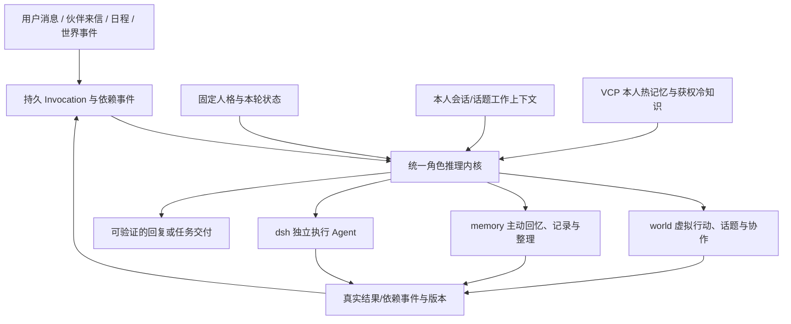
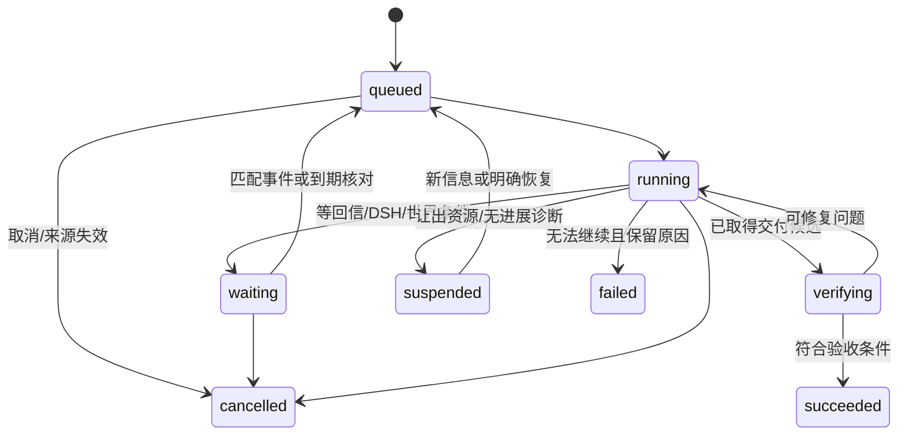

# 虚拟伙伴统一认知、话题、VCP 与执行系统升级方案

日期：2026-10-23。阶段：已获用户后续开发授权，正在实施和验收。

**阅读顺序：** 第 1–15 节保留最初研究方案及其当时基线，不代表最新开发状态。第 16 节维护实施进展和未通过的验收。当前长期目标必须以源码与重新运行的结果闭环，不能由本文件的状态替代。

## 1. 设计结论

保留用户确定的方向：**伙伴是具有稳定身份的角色主脑；VCP 提供本人长期记忆；不同会话、话题和任务提供可切换工作上下文；DSH 是按次装配、独立运行的现实执行 Agent。**

本次升级应以现有实现为基础，统一持久推理与上下文契约，补齐 VCP 重要能力，并以真实内容验收判断完成。无需再引入第二套 VCP 对话服务器或把 DSH 的整个框架塞进伙伴主脑。

可行性分三档：

- **已有源码与测试基础：** 本人长期记忆、话题与参与者隔离、话题压缩、原生 DSH TaskSpec/会话/温宿主池、持久聊天与长期目标循环。适合整理为统一运行路径。
- **原版接口支持、需要受控适配：** 冷知识库、完整 DreamWave、通用日记合并、可选检索模式。可以进入实施前的隔离接口验证，但不能承诺不经适配逐行复制就正确。
- **需要效果验证：** 自然多人组局、长游戏连续性、真实记忆准确率、长期自我成长。专业 Agent Loop 能控制恢复与作用范围，不能保证模型永不误解或遗漏，必须以固定场景反复检验。

## 2. 本轮范围与基准

| 对象 | 核实基准 |
| --- | --- |
| WorldlineBox | HEAD `93384d8bd9115678ab2db1fe07eb9584eea30887`，本轮开始时工作区干净 |
| 本地 VCPToolBox | `7ceecd48c46caac8168b909ade5febbc4a254e42`；继续以实际源码为准 |
| 本地 deepseek-harness | `639ed015397290b3745d163aafe02ffee4aa3f84`；源码与已安装 `0.2.1-rc.2` 运行包分别看待 |
| 用户历史需求 | 已读取引用 chat `01a163ec-5209-7412-b75d-fb4d43923a25` 的全部十个返回 turn，抽取用户要求并核对最后状态 |
| 上轮 VCP 审计 | `vcp-port-parity-audit-2026-10-23.md`；旧结论在当前 HEAD 重新核查，不把它当当前状态的自动证明 |

初始研究阶段只读源码、历史工件和官方技术资料，并执行隔离机制验证。用户随后明确要求建立长期目标并彻底完成开发，因此实施阶段已经修改业务源码、使用隔离临时存档调用实际配置模型，并开展打包验证。旧研究阶段的限制不覆盖这次后续授权；用户正式存档不作为测试夹具。

历史需求优先级以用户后续修正为准：插件归启动器管理；伙伴选工具与技能；话题按每位参与者独立选择；话题支持删除而非强制归档；主脑每次重建上下文，不增加任意的全局 token 总配额。

## 3. 当前实现必须正确继承

最新代码已经具备：

1. `Invocation`、固定 self/实际 speaker、独立消息端口和授权来源，统一上下文装配。
2. 本人 VCP 跨入口长期记忆，当前消息窗口按会话/话题收窄。
3. 每位读者自己的 topic 选择、加入/退出、暂停、工作私态和摘要；群成员不是自动加入话题或游戏玩家。
4. 近期消息默认 7 日/256 条/480000 字符，尽量至少保留 32 条；任务历史已有摘要和原始凭证保存。
5. 聊天、长期工作有持久 checkpoint；超过 64 步只是让出调度，不是任务必停。
6. DSH native/PTC、tools、skills、managed/existing workspace、new/resume、结果与审计引用；温宿主与独立 session 分离。
7. 最新社交认识/联系人/建群、稳定发件 ID、回信持续目标、部分已决动作等待和恢复。

这些能力应复用并统一，不重新宣称尚未存在。主要缺口是它们的持久状态和调用约定仍分散，覆盖面和效果证据不一致。

**历史验收须分层解释：** 早期长游戏报告使用脚本裁判/初始邀请等 fixture；引用 chat 最后的交付明确“完整狼人杀对局尚未验收完成”。最新自然组局的部分报告仍为 failed，不能将其与旧夹具场景合并为完整通过。原失败报告应保留，后续结果绑定精确源码与数据版本。

## 4. 需求追踪与完成定义

| ID | 用户要求/审计问题 | 当前状态 | 目标验收 |
| --- | --- | --- | --- |
| R01 | 角色稳定，玩家/伙伴/游戏角色不混淆 | 有身份投影及校验 | 全入口固定真实 ID，称呼不改身份；复制/误认、同名和引用用例通过 |
| R02 | 私聊、群聊、伙伴交流、任务消息不串线 | 已有隔离 | 在并发、续接、压缩、撤回后 wire canary 零串入 |
| R03 | 话题按个人参加、切换、暂停与继续 | 已有基础 | 一人切换不影响别人；长活动恢复旧状态且不污染日常 |
| R04 | 长话题可压缩且保留精确关键状态 | 已有摘要 | 多次压缩后规则/阶段/数字/私态/否定/来源仍准确；原始消息可查 |
| R05 | 全部角色行为使用一致 Agent 范式 | 共享装配，循环仍分散 | 角色推理共用持久内核，领域只提供工具和最终输出契约 |
| R06 | 等回信、等执行不陷入重复推理 | 有局部修复 | 无新依赖事件时不请求模型；事件发生仅续接一次 |
| R07 | DSH 可动态配置并独立上下文 | 已实现主要能力 | 工具实际装配、session 归属、复杂约束、交付验证持续有效 |
| R08 | 主脑不接 DSH 整个原始 session | 已有简短回执 | 按需读详细记录，完整日志留 DSH，主脑只得任务所需结果 |
| R09 | 长日记/长查询合法但底层拒绝 | 当前仍可复现 | 4096/4097/16000/65536 边界与跨 chunk 实检通过 |
| R10 | 搜索列表和实际回忆正文筛选不同 | 当前仍可复现 | 标签/日期/本子/分页对候选、正文和引用执行相同契约 |
| R11 | 冷知识库完整接入 | 未接 | 原 TDBKnowledge 运行、持久、撤回、重启和模型检索通过 |
| R12 | 原 DreamWave 多阶段联想 | 未完整接 | 多种子 L1/L2 与跨时间桶实际运行，严格控制来源与时间 |
| R13 | 通用日记整合/归档/演进 | 普通 organize 仅标签 | 有读集的合并/替代/归档、历史追溯及撤回闭环 |
| R14 | 时间/语义组/扩展/重排等重要模式 | 入口/配置不完整 | 功能注册表可确认存在、启用、实际运行和成本；不全量默认开启 |
| R15 | 去重和生成参数保真 | 宿主有明确变化 | 对差异逐项记录与 A/B 验证，不用源码 SHA 代替行为证明 |
| R16 | 认识朋友、拉群、协作做任务 | 最新已有基础 | 一条自然目标自主完成认识/邀约/分工/交付，失败可解释恢复 |
| R17 | 拟真生活与本人记忆相互影响 | 已有宿主闭环 | 多日实际事件流、学习/反思/关系和状态具来源，不捏造离线经历 |
| R18 | 简洁话题 UI、查询和性能 | 已有最新调整 | 顶部入口、分页搜索、发送目标清晰，冷打开与索引进度真实 |
| R19 | 记忆检索和最终回答可验证 | 有分离候选诊断 | 真实正文来源/版本可追溯，候选分数不冒充最终引用 |
| R20 | 话题压缩绕过遗忘并重复同一前缀 | 本轮新复现 | 已遗忘原文零进入摘要输入；有效水位与扫描游标可推进，重复输入不再收费循环 |

## 5. 统一架构与职责

只保留三类主脑能力根：memory、world、dsh；稳定身份、情绪、话题、社交、日程按已有子能力归入，而不是另添一批不一致的公开工具。

角色推理共用内核，并不意味着全部模型调用都变成通用 Agent。摘要、日记提取、重排、授权含义核验等是受限处理器：无外部副作用、严格输出契约、固定输入与有限纠错。角色决策可以调用它们，但它们不获得另一个角色身份或共享短期消息。

### 5.1 对 VCP/DSH 的取舍

| 机制 | 方案 |
| --- | --- |
| VCP 原生记忆数学与索引 | 保留固定上游版本与完整依赖校验；扩展通过明确适配边界，不重写简化打分算法 |
| VCP RAG、Timeline、冷库、DreamWave、DailyNoteManager | 保留算法/阶段/来源正文，补齐受控宿主契约，记录必要差异 |
| VCP OneRing | 借来源/作者/时间、真实发言过滤和精确更新；不引入跨所有入口混合的短期时间线 |
| VCP AgentAssistant/服务器工具循环 | 借完成/停止/失败约定；不取代现有 SQLite 持久任务和每话题状态 |
| DSH 原生执行循环、session、压缩、subagent | 继续由官方运行包负责；宿主只创建/恢复、约束、监听、取消和校验交付 |
| DSH 压缩思想 | 借持久 source/surface、call/result 配对、取消传递、提交失败不推进；不复制它的整套会话存储 |
| 新第三方 Agent 框架 | 当前无必要引入；先统一已有持久基础，避免第二套任务/授权/session 权威 |

VCP OneRing 自述实验性质，汇聚每个 Agent 的跨前端近期时间线；AgentAssistant 有内存上下文、TTL、数组裁剪与锁。它们并不天然更适合本项目“个人长期连续、短期按入口隔离”的要求。

## 6. 上下文契约

以下字段为拟定契约，实施时与现有类型归并，而非建立平行副本。

`InvocationBinding` 至少绑定 owner、conversation、topic（或日常空值）、invocation/task、source revision、participant epoch、授权来源、父任务和当前模型/运行实例身份。

`ContextSnapshot` 记录本轮实际读集：消息 ID/版本与截止序号、本人话题状态版本、共享公开状态版本、记忆 ID/版本及失效代际、世界观测时间、执行回执/约束来源。模型返回时根据变更性质决定是否重读或重新推理。

每轮装配：

1. 完整稳定人格和真实身份、实际对话对象。
2. 本次目标、约束、入口、实际可用工具与依赖状态。
3. 本轮新读的世界/情绪/生活状态，按可见范围投影。
4. 本人有效 VCP 聚焦回忆，附真实来源版本；允许主动 search/read。
5. 当前话题的共享公开状态、本人私态、已验证摘要和近期原文；日常则用当前会话窗口。
6. 本次任务的工作状态、近期配对工具步骤与按需证据目录。

跨入口信息必须走本人长期记忆或显式任务交接，不能因为同 owner 就拼接所有原始消息。邀请、参加话题、报名游戏、抽到身份、实际在场分别记录。游戏角色/小说角色不能改变伙伴本人或玩家身份。

不另设任意的主脑总 token 配额。已有窗口先保留，实施期按真实 provider 的上下文能力、输入估算和溢出反馈驱动压缩；不假定所有模型都支持一百万 token。超长当前消息/不可拆工具对提供受控分段读取或附件引用，不能截掉关键约束。

动态状态用语义读集判断新鲜度，不让每次世界时钟跳动都废弃一轮已完成推理；身份、权限、来源撤回必须立即失效，纯无关天气或别的房间新消息不应导致循环重算。

## 7. 统一持久 Agent 状态机

`waiting` 必须有 wait reason、依赖 ID、观察版本、最早下次核对时间或唤醒条件；落库后释放模型和工作槽。调度 tick 可以廉价核对依赖，但没有新事件不再次问模型。未知等待不是 succeeded，发出邀请不是组局完成，DSH idle 不是业务交付通过。

给每次作用建立稳定 effect ID 与状态：planned → dispatched → confirmed；崩溃时外部结果不明进入 reconciling，先读回核对，不盲目重复执行。不承诺任意外部系统都支持 exactly-once；借实际回执和可用幂等键把重复影响降至可验证范围。

无进展检测比较工具规范参数、读集版本和成果变化。连续同一无变化读取只返回已有结果/提示下一动作；等待交由依赖事件，不占推理轮次。模型合理读取不同证据、DSH 真实运行和目标有进展不算死循环。不设置“总共 32/64 步就放弃”来掩盖长任务问题。

社交、世界行动、学习角色决策通过同一持久内核；领域保留自己的结果 schema、接收者选择和工具许可。将现有聊天/runGoal 的 checkpoint、原子工具槽与摘要能力抽成公共实现，逐条迁移调用者，最后删除被替代的内存短循环，不长期维持两套脑。

当前 structured agent 的 32 步上限与 activity 整个任务的 32 次规划上限是两种不同限制（`structured-agent.ts:84`；`companion-activity-task.ts:31`、`activity-task-store.ts:356`）。迁移时分别改为一次调度切片与长期里程碑；保留重复失败/取消/资源约束，不能让合法的长期目标因累计 32 次规划自动结束。身体行动互斥、消息认知、等待回信和 DSH 容量分别管理，避免第一项等待回信占住所有后续活动。

恢复后重建当前身份、scope、约束和有效状态，保留同一任务的 pending 调用槽及真实结果；不重新执行已经确认的外部动作。暂停和取消的迟到回信不得复活已结束目标。

## 8. 话题与长期活动

话题是 room 中共享可引用的活动标识，当前选择与工作状态属于 reader：`room + topic + reader`。不同成员可以同时谈不同话题，用户查看历史不会自动更改所有人的发送目标。

三层状态：

- **公开事件与共享状态：** 已公开规则、报名、投票、阶段、公共作品设定，带来源与 revision。
- **本人私态：** 自己收到的角色/线索、推断、计划和私有笔记，禁止其他读者读取。
- **压缩摘要与近期原文：** 摘要负责恢复线索，精确状态与原文承担关键事实，不靠模型摘要重新猜牌、算票或决定某步骤是否完成。

压缩器必须使用与推理相同的获权消息快照，不能重新按 room/topic 读取绕开本人已失效来源。累计摘要须保留前代摘要的传递依赖，再加新片段；撤回一条旧来源时，所有受影响摘要和引用都要失效。提交绑定 reader/topic、来源版本和旧 checkpoint revision；摘要失败或竞争不推进覆盖水位。

物理扫描游标与有效摘要水位必须分开：跳过不可见消息也能推进扫描；摘要被拒绝后不能原封不动再次收费。依赖采用版本 DAG/范围索引与分页，不能把所有历史 ID 不断 union 到当前最多 256 项的 topic source 数组。旧摘要依赖遗漏目前是静态审查风险，已遗忘原文再次进入摘要与三次重复则已有本轮实证。

活动内部增加 episode/round 与阶段标识，第二局不沿用第一局私牌；暂停后新开日常任务不清空旧活动。通用活动协议支持规则、参与者、已确认事件、下一步及终止条件，不为通过狼人杀测试硬编码角色台词或整套专用产品引擎。

话题结束后保留有据的实际参与体验。虚构正文、秘密和角色扮演不写成现实事实；可索引话题标题/标签/本人状态以便日后寻找，但须明确这是活动引用。删除撤回正文与派生摘要，保留必要不可复活凭证，不将“删除”降为隐藏或强制归档。

## 9. VCP 完整能力补齐

### 9.1 先修契约缺陷

- 分开 ID、日记正文和 query 长度校验；与上层合法值一致，保留原分块与逐字来源，不以静默截断解决。
- 建立一次查询的强约束：owner/source 权限、日记本、标签、日期、排序、K、游标、scope revision；候选页、实际 LightMemo/AIMemo 正文和引用用同一约束。
- 不采用“先全库 top100、再过滤，空结果就说没有”的方案。优先使用原生支持的候选约束；不支持时在查询前建立受约束的物理投影视图，并明确该语料上的图与排名语义。保留原引擎排序，不另造混合分数。
- 检索未完成/索引建设中/故障与确实无匹配分别返回。用户回忆工具与伙伴入口共用契约，聊天历史差异明确显示。

### 9.2 热记忆、冷知识与统一来源

热记忆处理经历/日记，冷库处理获权且较稳定的大资料；统一 source ID、版本和 owner 授权，分别用原版服务。资产 sqlite-vec 检索不冒充 TDBKnowledge 已接入。

冷库以受控 worker 加载原 `TDBKnowledge.js` 和 `triviumdb` 依赖，桥接同一全局 embedding。进程隔离及读写所有权单独设计；保留原 JS/原生依赖所需的工作路径，不能假定只复制文件即可打包。共享文件可以复用不可变编码缓存，关系图与可见语料仍按授权投影隔离。

新增/修改/撤回通过统一 outbox 与代际水位，来源撤回立即使返回不可用，再清理冷/热索引与缓存。查询结束后复核 epoch，禁止“旧索引还没删完”成为返回失效正文的理由。摄取/检索/重开/取消/删除/打包闭包全部过关才宣称冷库完成。

冷库依赖应冻结上游锁文件的 `triviumdb 0.8.5`，不能与热核内联 crate 描述的 0.8.9 混写。本轮尚未安装/验证其 Electron 原生产物。必须额外处理部分 chunk 缺向量时禁止整篇冒称 ready、SQLite 与 TriviumDB 跨存储发布崩溃恢复、Expand 读取文本版本与向量版本一致，以及禁止伙伴用自由 TQL mutation 绕过受控来源账本。

### 9.3 DreamWave

保留原多种子、L1 共振桥、L2 级联、中期和深远联想流程，复用当前 Rust 向量和 RiverMemo API。通过授权适配器提供日记列表、种子向量、候选查询与来源读取；不把原版目录名启发式或公共目录当作本项目权限依据。

跨经历联想以“本人有权读取且证据性质相容”为范围，不再无条件限制同一个 sourceConversationId；保留群聊/私聊的发布可见性边界。梦境可以联想本人不同经历，不能把私密材料泄露到公开梦叙述或他人上下文。

对近期/中期/深远桶执行明确的事件时间谓词；原模块注释/日志不能代替检索硬条件。睡眠抽签、冷却、并发和取消仍由宿主真实阶段管理。虚构梦与有来源 Insight 分开，梦不能升级为现实经历、执行权限或客观掌握。

### 9.4 通用合并、演进和遗忘

新增语义明确的 consolidate/merge/archive 操作，现有 organize 明确为标签/本子整理。合并计划包含读过的 note ID/version、保留的原始来源、冲突/限定、结果正文及 supersedes/derivedFrom；宿主校验后可自动可逆提交，不添加所有整理都需要用户逐项确认的流程。

先提交权威记忆与依赖关系，再经 outbox 发布原版日记和索引；文件阶段可恢复。旧记录退出当前召回但仍可追溯，原文归档不丢失。来源失效沿依赖传播；不能反复摘要摘要以掩盖证据不足。显式用户遗忘与自然降低召回权重是两回事，后者不能擅自物理删除历史或复活被遗忘来源。

schema 必须把“来源仍有效”与“是否参与默认召回”分开。当前只有 queued/indexed/forgotten/invalid，不能把被合并旧条目标为 invalid，否则依赖它的新合并条目也会失效；归档/被替代的有效版本应可追溯，真实来源被撤回才级联失效。长链来源超过当前单篇 100 项时保留版本依赖与分页，不截断出处。

### 9.5 可选模式与行为保真

制作能力注册表，分别记录实现存在、资源齐备、已启用、本次实际执行。时间检索/衰减、语义组、扩展联想、额外重排、元思考按用途启用，不把所有后缀加到每轮。

保持自动 Tag 图与人工语义组的区别；两边语义组只有 example，不宣称搬丢了已运行分组。元思考链配置确实缺失则纳入资源闭包。外部 rerank 配置可选，缺少模型时不谎称已经运行。

三项去重调参与仍为 0.92 的原生去重分别验证。AIMemo/Timeline 的输出额度、temperature、分批大小和聊天网关透传形成明确契约，受实际 provider 支持校验；不能继续称“源码原样所以运行参数完全相同”。

每次回忆留下同一 request ID 的输入范围、候选诊断、实际聚焦正文、来源 ID/version 和阶段耗时。原版没有提供的逐边解释保持未知；最终答案只在实际引用/读集支持范围建立证据，不捏造完整“思考路径”。

## 10. DSH、复杂任务与合作

保留现有 TaskSpec 工厂和官方 CLI 启动路径，主脑可动态选 native/PTC、工具、技能、显式上下文、工作目录与会话策略。插件安装/启停/删除继续由启动器管理。实际工具目录与 dispatch 双重落实，不仅在 prompt 里写限制。

session 绑定扩展到 task/invocation、topic、来源与约束版本；同 room 不自动等于同工作 session。明确继续同一任务可以 resume；换目标/工具组合/实例/模式/cwd 或转移话题时按支持情况新建并显式 handoff。原生 fork/preset 切换不能当现有宿主接口已保证支持；先按实际安装运行包能力表决定。

同时保存解析后的 effective tool/schema digest、preset/config generation、技能版本与来源；只记录显式 tools/skills、不记录默认集合时，实例插件变化可能使旧 session 恢复得到另一套实际能力。worker generation 失效不等于旧 session 的实际能力已被固定。跨 topic resume 是否已被所有上层拦截仍是待验证风险，不据此宣称已发生泄漏。

复杂限制建立持久 ConstraintLedger：原话、适用对象/步骤、明确含义、来源版本、状态；当前否定短语 regex 只作辅助，不能作为完整语义授权。恢复、子任务和交付都带有效约束；避免跨阶段漏掉只读、不删除、保留文件名等要求。

默认 workspace 继续位于资产库 `.worldlinebox/companions/dsh-tasks/<owner>/<YYYY-MM-DD>/session-<id>/`；恢复旧 session 保留原 cwd，跨日不移动。协作通过明确交付与窄共享输入，不把所有人的工作目录或执行历史合并。

`ExecutionReceipt` 返回 status、task/session、成果文件及 hash、验收证据、未完成项、详细记录游标。原始 DSH session 留执行域；主脑按需读取。根 Agent idle 后仍检查子 Agent、输入修订及交付稳定；原生退出码零不直接等于任务成功。

协作由持久 parent/child task 和明确共享范围组织，各角色独立消息端口与 DSH session。取消、来源撤回和约束变化沿任务树传播。收取他人结果后先核验内容再汇总，不把“伙伴说完成”当外部工作事实。

## 11. 性能与产品呈现

前台聊天、主动查询、后台 capture/Timeline/梦/学习分别调度但共用有界资源。等待释放槽；持续后台任务不得饿死消息。共享 embedding 队列增加查询优先及后台可让出批次，保持单一全局语义空间。

区分首次安装/依赖准入、模型冷启动、索引首建、worker 冷启动、温检索、模型首 token 和完整交付。温 DSH 约 160ms 的历史数据不能套给完整任务；冷库开得快也不等于全部内容已被索引。

主窗口提供实际状态：在思考、等待谁/什么结果、已有交付、下一次核对。只展示可验证进展，不把每个内部 schema/类名暴露给用户。话题继续采用顶部一致图标与独立管理面板，支持分页/模糊搜索/标签/改名/删除；列表、查看历史与实际发送目标清晰区分。

首屏内容使用分页派生 catalogue，不为打开记忆工作台等待全 VCP 建库。同步、撤回与当前范围仍要正确。当前 400 文件冷打开历史工件是服务已预激活的局部指标，保留该条件。

## 12. 实施阶段与可行性门

| 阶段 | 范围与产物 | 进入下一阶段的条件 |
| --- | --- | --- |
| P0：冻结契约和试验 | 需求矩阵、版本/hash；当前 DSH rc.2 官方 profile、冷库依赖/ABI、DreamWave adapter、事件等待的隔离研究探针 | 当前 DSH 隔离启动/能力发现/释放通过；冷库可原生加载并基本持久读搜；梦阶段范围可强制。未通过不开始大改 |
| P1：修复已证缺陷 | 压缩遗忘/重复、长度、筛选、生成参数、来源一致性和最小复现回归 | 所有合法边界一致；实际正文不越查询范围；不可见内容不入摘要；旧成功路径保留 |
| P2：统一推理和话题状态 | 抽取持久 kernel，迁移社交/世界/学习角色决策，等待事件、摘要依赖、参与/局次状态 | 中断续接无重复副作用；不同 port 零串线；旧短循环退出生产路径 |
| P3：补齐检索和冷知识 | TDBKnowledge、统一来源与代际、可选模式、同请求证据链 | 冷/热撤回和重启正确；真实模型同库检索与成对基线有结果 |
| P4：梦与记忆整合 | 完整 DreamWave、跨经历受控读取、通用合并归档/演进 | 多阶段确实运行且时间桶正确；冲突/合并/遗忘可追溯恢复 |
| P5：任务与群体闭环 | DSH 约束/session 绑定、协作、联系人/建群、长期活动与 UI 状态 | 自然单目标组局、独立/合作现实任务、取消恢复内容通过 |
| P6：综合内容与规模验收 | 长游戏/小说、VCP A/B、多伙伴长期事件、性能、最终打包闭包检查 | 未通过项闭环，失败证据保留；代码、机制、内容、UI 分别报告 |

P1 与部分 P0 可先做；P3/P4 基于 P1 的来源与查询契约；P5 依赖 P2。每阶段拆成可独立审查的改动，运行对应回归后再合并下一段，不用一次大重写替代验证。

只保留一个新生产脑和一个权威来源账本。必要的数据库迁移、失效凭证和恢复日志属于数据正确性，不是长期维护旧引擎回退。不开新旧记忆双引擎；实施不默认删除现有存档，测试使用独立临时库。

## 13. 验收设计

| 层次 | 场景 | 硬性判断 |
| --- | --- | --- |
| 契约 | 正文/查询边界、强筛选、当前/历史事实、生成参数 | 接受/拒绝一致，无静默截断；候选/正文同 scope |
| 隔离 | 两个私聊、两个群、同群三个话题、学习与日程并发 | self/speaker/addressee 固定；他人私态、错误话题/任务 canary 零进入 wire |
| 持久与故障 | 工具前/后、回执前、摘要前/后、消息发布前崩溃；重复/乱序事件 | 不复发已确认作用；未知作用先核对；取消不复活；水位原子推进 |
| 话题 | 长小说与游戏多次暂停、切换、重开；迟加入/退出 | 阶段/关键标识/本局状态不丢；本人私态隔离，跨局不沿用秘密 |
| 检索 | 固定同语料/模型/Tag 顺序/序列化的上游与宿主 A/B | 分开候选召回、实际聚焦覆盖、最终回答、更正、无答案；不只看相似度 |
| 梦与合并 | 跨日/跨入口种子、受限资料、近重复矛盾、旧源撤回 | 阶段/时间桶及读集正确；梦不当事实；合并不抹否定和历史 |
| 现实任务 | 简单文件、中等分析、复杂多阶段修订；两伙伴独立复核与共同交付 | 真实 DSH、实际文件/hash/内容；只读/不删等约束保持 |
| 自主群体 | 一条普通自然目标，角色自行发现/介绍/邀约/建群/继续 | 工具和发言由模型选择；报名/主持/人数一致，无提示词代演过程 |
| UI/性能 | 记忆首屏、万级话题分页、冷/温任务、多人竞争 | 实测分位数、取消释放、首屏进度真实、长标题/明暗窄宽不溢出 |

长游戏分两条证据：

1. **机制压力轨道：** 显式测试裁判，6/8/12 位不同角色，多局、至少十次强制压缩、途中切日常任务与重启；核验规则、投票、阶段、私牌和来源。它证明长状态机制，不称完全自主组局。
2. **自然行为轨道：** 从单条用户请求开始，不能由 fixture 预建群、代发邀请或指定每步工具。实际参与者可拒绝或沉默，不能凭空凑数。完整对局/活动必须真到终态；失败保留为失败，不以“群已建好”替代。

长小说另验人物设定、时间线、伏笔与修改要求，避免只在游戏一种状态结构上成功。先用少量真实模型试验校准，再按至少三个独立运行/固定数据集报告分布；不能挑一条成功轨迹当普遍保证。

模型内容验收分别看事实、身份、限制、阶段、任务完成和人设表达；格式错误、工具选择错误、检索漏召回和纯措辞假阴性单独归因。人工复核绑定报告 SHA，必要时独立评审，不把同一模型自评分当客观正确率。

## 14. 本轮已完成的可行性核查

本轮现有六个 context/topic/structured/SQLite 用例文件 **34 项通过、0 失败、0 跳过**。这证明当前隔离、读者私态和压缩基础可继续利用，不是拟议重构已经实施或真实内容验收已通过。

DSH TaskSpec Broker 与温宿主池两个文件 **8 项通过**。另有两个历史原生 fixture 启动探针未通过：alpha.2 启动超时、alpha.3 官方 CLI profile 的 worker 意外退出。它们不代表当前运行包存在相同缺陷，但不能算原生复验成功。

为进一步核查，主任务使用独立 Node 24.15.0 对本机确切 `0.2.1-rc.2` 运行包执行现有 capability discovery 用例：临时 profile、官方 CLI 路径、本机禁止真实模型请求的传输；**该用例同样失败**，在取得能力目录前返回 `DshTaskError: The DSH task could not complete in its selected environment`。当前未定位底层启动/适配原因，不能据此断言正常应用所有 DSH 调用都失效，也不能沿用旧报告说本轮 rc.2 原生生命周期已经通过。原始 JSON 独立保留；这是 P0 的真实待解决项，不在本轮擅自改代码修复。

当前 HEAD 下重新复现长度和筛选缺陷：4097/16000 字符仍被底层拒绝；筛标签和日期后候选页仅含合格文档，工具正文仍可含不合格 fixture。没有调用真实模型、访问真实用户数据或修改业务代码。

新增真实临时 SQLite＋实际压缩器探针确认：可见来源已经不含 forgotten sentinel，summarizer 却连续三次收到它；摘要被按无效来源隐藏，有效 coverage 归零后重复同一前缀。探针第三次主动停止，exit 1 是诊断性中止，不是声称普通单测失败。生产该循环没有相同输入/无水位推进护栏。

原 DreamWave 实际阶段编排＋合成 KB 端口探针完成四次查询，近期结果进入标称 >90 天的 deep 阶段。它证明该阶段没有硬时间过滤，不证明真实排名效果或跨角色泄漏。

**可行性结论的精确边界：** 统一身份/话题/持久状态、上下文与任务工厂有明确现存实现和局部回归基础，方案不依赖模型“自己记得”等不可验证假设。冷库原生产物尚未安装验证，当前 DSH 隔离发现探针未通过，完整梦/合并尚未在宿主运行；因此路线具备源码级可实施依据，仍须先通过 P0 技术门，不能宣称全部集成可行性已在运行层证明。

完整证据、后续研究探针与源码 hash 见同日期 `companion-unified-upgrade-plan-...` 工件。实施阶段的上线指标和大规模质量门仍待真实基线测量，不能从本轮小回归推定性能/效果目标已经满足。

本轮工件目录为 `artifacts/vcp-validation/`：

- `companion-unified-upgrade-plan-baseline-2026-10-23-tests.json`：34 项原始结果。
- `companion-unified-upgrade-plan-dsh-baseline-2026-10-23-tests.json`：8 项通过及历史 fixture 启动失败摘要。
- `companion-unified-upgrade-plan-dsh-native-profile-2026-10-23-tests.json`：历史 alpha.3 原始失败结果。
- `companion-unified-upgrade-plan-dsh-current-capability-2026-10-23-tests.json`：当前 rc.2 原始失败结果。
- `companion-topic-compaction-withdrawal-probe-2026-10-23.cjs` / `.json`：本轮真实 SQLite 压缩/遗忘复现。脚本可重跑，原结果不会被覆盖；脚本源码另作语法检查，未重复运行本实验。
- `upgrade-plan-dreamwave-time-contract-probe-2026-10-23.cjs` / `.json`：原 DreamWave 的阶段时间契约探针。
- `companion-unified-upgrade-plan-evidence-2026-10-23.json`：提取时源码 hash、测试边界与工件摘要。

研究环境残留：自动审批拒绝删除旧探针临时目录 `C:/Users/hp/AppData/Local/Temp/worldlinebox-loop-research-nD54Qu`，只返回 `blocked by policy`，没有更多原因。未改走其他方式删除，该目录仍保留合成 fixture；可重跑工件不依赖它，真实用户业务数据未改动。

## 15. 技术参考与证据入口

- 当前上下文/循环：`src/main/companions/invocation-context.ts:36`、`structured-agent.ts:80`、`service.ts:1120,1306`、`loop-continuity.ts:8`。
- 当前话题：`topic-compaction.ts:61`、`topic-participation-context.ts:7`、`src/companions/topic-store.ts` 与 `topic-recall.ts:7`。
- VCP 差异：前一轮 `vcp-port-parity-audit-2026-10-23.md`，当前重新核查，不把历史测试结论自动继承到新提交。
- DSH 现状：`companion-upgrade-dsh-memory-acceptance-2026-10-23.md`，对应原生代码与运行包分别验证。
- 官方[上下文工程说明](https://www.anthropic.com/research/effective-context-engineering-for-ai-agents)：压缩、结构化笔记和独立子任务可帮助长任务连续性；大窗口仍需管理相关性。本方案据此选择摘要加精确状态与来源，而不是只扩大消息窗口。
- 官方[长期 Agent harness 研究](https://www.anthropic.com/research/effective-harnesses-for-long-running-agents)：持久进展记录与实际端到端测试有助于验证真实完成；本方案将机制、自然行为、内容分别验收。
- 官方[持久状态说明](https://docs.langchain.com/oss/javascript/langgraph/persistence)及[中断与幂等说明](https://docs.langchain.com/oss/javascript/langgraph/interrupts)：单线程 checkpoint 与跨线程长期数据职责不同，恢复可能重跑作用。本方案只借这些原则，不引入 LangGraph 作为额外框架。

本方案是可实施的架构与验收约定，不是已经开发完成的声明。未满足可行性门或真实内容门的部分必须保持显式待验证，不能以模块存在、原生调用成功或历史截图代替。

## 16. 实施台账（持续更新）

开发分支：`codex/companion-unified-upgrade-2026-10-23`。所有业务修改仍在工作区，尚未提交或推送。长期目标保持 active。

| 范围 | 已落地源码 | 当前证据与待办 |
| --- | --- | --- |
| R01–R06：持久主脑、上下文和话题 | chat、独立 goal、structured 共用持久内核；稳定 effect 槽位；副作用未知结果不盲重放；CAS 日志；完整工具对；真实容量反馈压缩；同证据只读循环 needs-attention；新局 create/恢复 reopen/分支 fork；跨群显式 roomId 管理仍守成员与来源 | 75 步内核、35 步活动重启/分页、6/8/12 人十次以上压缩及长小说机制均通过。真实模型由测试主持推进的两局八人游戏完整结束：134次调用、41次压缩、两局独立topic、SQLite重启/私密状态隔离通过；未冒称完整自然自主对局 |
| R07–R08：DSH | 工具/技能实际装配摘要、native session 归属与恢复 proof、完整原用户约束账本、交付 JSON/文件 hash 验证；派生执行读集冻结、原生记录摘要绑定、工具读取和普通回复的传递来源保护 | 当前已安装 rc.2 生命周期正向通过。主服务/语义社交/来源专项100项通过；真实自主分工验收104秒通过：同一真人请求触发独立接受、两位伙伴不同工作区的DSH分析/复核/最终handoff，真实合计18430分；首轮误用普通message失败完整保留 |
| R09–R10、R15、R19：VCP 热检索 | 65536 文本/16000 查询；原 TextChunker 和原分块平均算法；物理 scope 先于 topK；本子/标签/日期/分页统一正文范围；独立候选榜与聚焦正文引用角色；全局 chat 参数与代际绑定；默认被动召回自动时间策略正在最终回归 | 原生长文、筛选、A/B、真实引用及raw-active returned引用已复验通过。默认RiverMemo/AIMemo自动执行原TimeDecay180/0，无需用户选mode；等相关性的新旧日记重排、重要旧资料保护、显式时间旧事豁免有原生证据。此策略不硬删除记忆，不把候选榜冒称正文聚焦顺序 |
| R11：冷知识 | 锁定 triviumdb 0.8.5；原 TDBKnowledge；独立 owner/immutable generation；摄取/检索/Expand/撤回/重启；真实学习 grant+asset 桥；源文件变更和撤权立即生效 | 原生冷库、真实授权资料长文尾段、staged热冷生产依赖闭包均通过；链接安全卸除已修复，包内/界面再验收进行中 |
| R12：DreamWave | 冻结原始 DreamWave；原多种子 L1/L2 编排及 Rust Topology V3 路径；按宿主真实时间桶过滤；跨入口反思仅本人私有，梦意象与真实事实分离；job lease/源版本/禁记校验 | 真实原生远期非空 deep、跨域来源及 dream host 契约通过；不把原版 stage 标签当硬时间保证 |
| R13：日记整合 | 准确 id/version 合并；新索引 ready 后原文归档；原始版本图可追溯；撤回派生与恢复仍合法原文；传递 forget；真实sleep lease自动生成并原子提交consolidations计划，禁止跨域、丢原始来源、合并梦境或成长档案 | 真实 SQLite 索引发布、故障/重启、历史追踪、纠正/撤回通过。真实模型普通聊天→自动journal→原生索引→实际睡眠→自动整合→原生索引发布→来源撤回通过，0次手动memory.record/consolidate；独立质量核验无遗漏/编造。向量端点为明确标识的确定性fixture，不能据此宣称编码器质量已验证 |
| R14：原检索模式 | 严格有界 retrievalOptions 与运行能力目录；原 Time/TimeDecay/Expand/Associate 正向；group/meta/rerank 按实际配置与维度声明可用性；有用途才启用相应路径 | 宿主到原 Rust/RAG 的真实调用通过；缺配置明确原因并拒绝。局部dayjs ALS适配注入宿主世界时钟，冻结上游字节不变；暂停/加速/未提供clock原行为有确定性与原生对照。原::Time前缀也匹配::TimeDecay的既有行为显式保留并验证 |
| R16：自主社交 | 修复已建玩家群后误入同成员隐藏群；本次 invocation 的真实建群回执可重用；活动保留目标群/topic；本目标出站链回信 progress 读取与上下文实时刷新；实时事实变化不消耗提供方失败次数；草案限定与事实核验 | qualified-report真实自然模型验收通过：认识/联系、实际群/topic、成员独立回复及持久后续推进，独立内容判定通过。此前过时汇报、并发回信、无效核验/事实草稿失败均保留，不以一次通过宣称所有模型都不会出错 |
| R17：持续生活 | Dream/反思来源闭环；长期活动解除 32 步终身上限，按里程碑预算；等待任务释放同 owner lane；内核停滞/不可压缩容量错误在 world/social/activity 落终态且不按时钟重试 | 世界/社交/通知终态跨重启及下一真实睡眠 episode 重新开始的实库回归通过。三位伙伴真实 Main、58 次模型调用、约 479 秒跨三个合法加速世界日期的自主成长与条件修订通过，实际源撤回、重启及跨 owner 不可见通过；该场景不替代原生文件撤回测试 |
| R18、R20：界面、来源和全量集成 | 活动历史分页、撤回隐藏缓存、切 owner 忽略迟到响应；压缩前/发布前双重来源校验、扫描游标和有效水位分开、传递 DAG/CAS | renderer 分页 6 项通过；遗忘/压缩/长活动回归通过；全仓、UI/性能和完整包检查待最后收敛后重新完成 |

### 16.1 重要失败和环境事件

- `unified-real-role-content-2026-10-23-tests.json`：实际模型身份内容验收通过，但它不证明自主组局或完整游戏完成。
- `unified-real-social-initiation-2026-10-23.json`：认识、邀请和独立回应成功；内容判定失败，暴露已有报名仍称未确认及两条群路由。
- `unified-real-social-initiation-after-routing-2026-10-23.json`：群路由已一致；发布前读信护栏仍失败，保留原结果。
- `unified-real-social-initiation-live-goal-evidence-2026-10-23.json`：识别出推理期间持续到信被误记为三次提供方失败；已改为同一决策槽位按真实新事件重建，待复验。
- 后续 `unified-real-social-initiation-qualified-report-2026-10-23.json`：88.7秒通过独立内容核验与真实组局初始阶段断言；不证明完整自然自主对局已结束。
- `unified-real-autonomous-collaboration-2026-10-23.json`：首轮仅发普通消息失败，修明确协作路径及回执后，真实独立DSH分工/核对/交付通过；attempt1保留。
- `unified-automatic-memory-content-2026-10-23.json`：166.9秒通过。三段普通聊天的书籍修复经历自动记忆并在实际睡眠合并，保留缺页/颜色/3毫米针距/抽屉/未完成及计划限定；独立质量判定无遗漏、无编造。attempt1为夹具误把作息配置日记纳入三条业务来源集合，失败保留，未改业务绕过。
- 全仓曾出现 root `node_modules` 多包缺失，独立canary确认Electron 43.1的同步递归rm会跟随Windows junction删除真实目标内容。已将测试指向真实依赖的junction改为少量本地复制，并统一原生热冷宿主关闭/退出时先unlink；按锁定依赖重装并恢复验证ABI148/FTS5/Rust二进制，锁文件内容未因恢复改变。此后有效全仓9058项：8907过、61失败、90跳过，无再次丢包。缺包期的结果不算业务结论。
- 在精确原HEAD独立worktree复验，document-catalog、folder-custom-cover、find-similar、protocol及windows setup旧断言均同症失败；纯Node依赖安装类测试误在Electron运行导致的失败，正确Node24环境60项通过。当前相关业务失败逐项修复及复验，保留全仓原始报告，不声称9058项全绿。基线worktree已先安全unlink共享依赖后交由app archive。
- 正常用户群曾被社交索引误当peer-only专属群，阻止编辑或reset时删掉其它作者；已修并新增实际SQLite对照。100k reset有效分批性能门通过，总准备/执行耗时超过旧120秒fixture限制，已调整总时限240秒，不降低开始/单批延迟门。

### 16.2 完成门

剩余完成门包括：所有本次相关内容失败收敛，明确列出可在原HEAD重现的无关失败；最终源码构建、staging、包内 native/worker 运行与真实UI验证；完整自然长期活动和三组长篇内容；最终冻结源码的联合回归、需求逐项交付和版本记录。默认时间策略、独立自动维护、真实多日成长及来源撤回已有正向证据，最终仍核对其接线没有被后续修改破坏。源级实现、机制测试、实际模型效果、打包就绪四者分别报告。无法满足的外部条件必须明确记录，不能将未通过的自然活动改名为机制成功后宣布长期目标完成。

### 16.3 用户补充的自动运行完成条件

用户明确要求衰减、遗忘与自动整合必须在普通使用中实际发挥作用。验收不止于模块存在、可选接口或手动工具调用：正常被动recall须实际触发时间策略；实际睡眠后台须自行提出/核验/提交值得整合的准确读集；发布前后与来源撤回须验证原生索引和派生内容。自动衰减是召回权重变化，不代表后台按年龄永久删除原始历史；重要资料及明确旧事查询要保留可达性。合并允许无有价值方案时返回空计划，避免强制重复摘要或为制造自动效果损失信息。

### 16.4 后续联合验证与新发现（2026-10-23，继续实施）

- **真实编码器冷热质量：** `unified-real-encoder-memory-quality-ab-2026-10-23-attempt3.json`，实际 bundled EmbeddingGemma、原生 Rust/RAG/AIMemo 和原 TDBKnowledge，3 组固定独立语料，各自保持标签顺序、序列化和查询相同；上游、宿主及冷库各 18 个查询，共 90 次实际模型调用，121.9 秒。候选 recall@5、查询事实覆盖、最终正向回答和无答案判断在这组数据均为 100%；冷库源撤回与重启后旧结果不可读。它是固定语料验收，不是普遍准确率保证。attempt1 的错误本子 marker 和 attempt2 的否定/自然措辞评分误判原件保留。
- **正式事实证明：** `stable-source-dependencies-final-2026-10-23.json` 23 项与 `unified-permanent-memory-parent-main-2026-10-23-tests.json` 14 项通过。新增无关日记、从旧合法回复派生日记、切换模型 profile 或跨日不再撤回旧正式回复；实际父笔记修订/遗忘仍传递撤回。实时推理继续检查当前全库、模型和民用日期的新鲜度；永久证明绑定准确读入版本。原生 outbox 已租赁失效 remember 的结算与后续 forget 已验证，避免清理队列被遗留租约卡住。
- **时间契约：** 世界时区投影、跨月 timeline、date-only 全日边界、夏令时 23/25 小时日已接入热检索和无查询 browse；显式 ISO offset 保留原时间点。局部时钟适配不修改冻结上游文件。`world-calendar-hot-memory-final-2026-10-23.json` 与对应 SQLite 重试报告保留夹具错误和修正链。
- **目录与话题规模：** `unified-catalog-and-10k-topic-2026-10-23-tests.json` 通过。真实 3000 文件首屏 85.9ms 返回当前初始 9 项，完成扫描 5.73 秒，稳定搜索约 2–3ms 且不重扫；旧测试误将 limit=64 当冷扫描必须凑满的下界，已改为先验证有界首屏、索引完成后再验证完整 64 项。10000 真实 SQLite 话题的分页、模糊查询和标签过滤约 90ms。
- **完整自然游戏仍失败：** `unified-real-natural-werewolf-2026-10-23.json` 165 次模型调用、284.9 秒，确有独立参与者，但未到终局，且首张私牌被公开。暴露后台活动缺少原生话题私态操作的能力缺口；已增加真实来源绑定的 gamePort 和 activity topic 操作接线，继续测试与修复。不得将这一失败改称完整自然对局通过。
- **长篇内容仍失败：** `long-novel-real-north_gate-2026-10-23-worldlinebox-real-main-bZR2yQ.json` 显示初始精确时间约束在第一次摘要中仍完整存在，后续正文擅改时间，第二次摘要又将矛盾正文升级为当前事实。正在补通用话题连续性审核与有界修订，随后重新执行三个独立长篇、十次以上压缩及暂停/重启内容验收。
- **真实当前版本 DSH 分工：** `unified-real-autonomous-collaboration-current-source-2026-10-23.json` 在当前源码重新通过，约 206.5 秒。一个真人请求触发真实独立接受、不同工作区内的分析/复核/交付三个执行，实际 CSV 四行合计 18430 分，独立模型验收和私人背景隔离均通过；不以退出码零单独判定完成。
- **多日自主成长：** `multiday-growth-real-main-2026-10-23-worldlinebox-real-main-5laq9J.json` 约 479 秒、58 次真实模型调用。产品允许的五分钟/世界日时钟实际经过 10 月 23、24、25 日，三位伙伴自行产生有来源的个人认识，第二日按新证据作条件修订并归档旧版，第三日进程重启后仍保持当前记忆和原人格。撤回修订原文后档案不复活，其他 owner 无权读取；独立内容核验未发现编造。此场景验证 SQLite 访问和成长投影，原生 read 的物理删除另由自动记忆场景覆盖。
- **世界读取准确版本：** `world-exact-source-readset-confirmed-2026-10-23.json` 53 项通过。世界事件和拜访理由/回复在写入时保存来源 id、房间及 SHA；Main 捕获保留原 SHA 并向当前真实原文核对，同 id 正式内容更新也会判定旧证明失效。无从证明来源的历史引用隐藏；纯物理状态保留。实际源离开短消息窗口后撤回仍能传递生效。
- **宿主记忆分类：** `host-memory-classification-complete-2026-10-23.json` 94 项通过。普通记录、修订、capture 及自由 metadata 不能伪装成自动整合、睡眠反思或真实世界 job；只有准确宿主租约和实际合并事务可生成这些分类。同内容去重复用也会保留可信分类。梦境/模拟仍不冒充现实，旧摘要不会被重新当成新原始经历反复合并。
- **新暴露的自然游戏竞态：** 后续真实 peer-delivery 对局 342 秒、207 次调用仍失败：Main 与本人 peer 对同一请求并发创建了两个实际游戏话题。正在把同目标的 pending outbox 与已落地副作用纳入同一实库事务 reservation，重入返回真实原回执；不同目标成员不得静默扩大，合法结束旧局后仍可开启下一局。活动结构化结果校验也正在移到持久提交之前，避免格式错被永久重放。
- **自动整合当前复验失败：** `unified-automatic-memory-final-classification-2026-10-23.json` 216.5 秒，三篇 QL-27 同次事件原始日记均真实自动产生、索引且进入睡眠种子，但模型仅返回空个人反思，未提出可选整合，任务合法结束后本睡眠 episode 不会反复重试。正在把维护判断从个人反思中独立出来：符合条件的准确种子必做一次有理由的 merge/defer 判断，无价值不强并，模型故障不伪装 defer，已有租约、来源版本、禁记及索引 ready 后可逆归档约束保留。该失败不能由早先一次成功报告覆盖。
- **话题约束与时间连续性：** 独立精确用户约束、来源 SHA 与保留字段保护的 47 项机制、7 项真实双向边界通过；后续真实正文又暴露同一段内 22:07→21:58 的倒流，被第二模型错误放行。当前增加宿主对已分类当前叙事时刻的范围、端点及单调顺序计算，显式回忆/未来/假设另行分类；跨篇尾时刻将与实际正式消息在同一 SQLite 提交事务保存，支持重启和来源撤回。三组长篇须在这些修复后重新完成。
- **共享依赖图性能修复：** 真实长篇第八段出现 CPU 卡顿，原 SQLite 图为 29 节点、77 边且无环，共享祖先被不同路径反复验证。Main 单次异步校验、SQLite 来源可见性和笔记依赖校验均增加请求内 completed memo；保留当前路径环拒绝，绑定 owner/room/cursor/版本/原文字节，读中 mutation 清缓存，不跨请求保存。笔记 DAG 的 25/49 节点原先均触发 10001 SQL 快速失败门，修复后降至 542/998 SQL、约 6/12ms；来源 DAG 49 节点为 1981 SQL、约 21ms。Main 104 项及 SQLite 76 项相关回归通过，原预算失败保留。
- **真实安全自动恢复：** 发现已持久化的纯推理工作重启后仅标 interrupted，未自动重新入队。现以宿主 shutdown/crash 标记恢复仍有效的原请求与同一气泡，未确认工具副作用、取消、终态失败、撤回来源均保持停止；117 项联合回归通过。北门小说原 source8 已从保存的 SQLite 经真正 restoreQueue 自动正式完成，首个模型调用约 6.3 秒、审核约 2.7 秒，未手动 resume、未新造 source、未重写原七段。后续第九段压缩 critic 自身 JSON/逐字引用格式失败仍在修复，不能将恢复成功冒称三组内容全部通过。
- **长会话组装性能再次修复：** 北门真实轨迹已到18章、8次压缩，但模型之间出现超过100秒CPU等待；保留source19及一致SQLite备份后有序暂停。发现一次topic.state的多个checkpoint各自重新开启来源校验，Main又逐proof重复跨进程展开同一依赖图。现同一同步存储命令共享已有校验会话，并由worker对真实不可变readset提供准确摘要证明；Main只有同次读取、摘要一致且mutation代际未变才省去重复SQLite查询，文件字节、冷库、模型上下文和action授权仍按原逻辑检查。入口/游标/离群ACL、原文修改、撤回、环和读中修改的91项回归通过。最新18章存档40消息、19份证明、0误撤，实际两次RPC、9584条SQL、约197ms；源级性能证明不等于剩余小说内容已通过。Main 113项及游戏审前不输出草稿的1项通过，全仓typecheck和本轮Root ESLint通过。
- **自然活动的共享及正文隐私缺口：** 后续真实对局确实完成独立私发身份、第一夜、实际发言/投票、第二夜及胜负消息，但出现完整身份表写入shared、公开点名秘密角色、夜间动作正文实际群发。各次失败与实际已提交资料均保留，不能因到终局而算通过。现所有游戏公开checkpoint/标题/标签与公开正文共用实际受众语义审查，Main、peer和后台活动都接入提交前核验，拒绝允许同槽修订；私密动作仍须由本人使用真实单独消息能力完成，正文自称“私发”不改变实际投递。Main游戏草稿在审核前不向UI发送非空流文本。完整目标的真实终局状态与话题结束还在补核验，邀请或建群目标不强制整局；新自然完整轨迹仍待通过。
- **长篇完整轨迹的内容失败：** 北门24章、11次压缩及末尾固定事实召回已跑完，但独立审查指出许岚第1–5章用“他”、第6章起改“她”，实际原文确认这是真连续性缺陷，不能靠末尾事实全对宣布通过。另两组全新轨迹第2章在三次作者预算内持续倒退或越过既定时窗，被宿主正确拦截，仍是作者实际完成能力未过。正在补来源绑定的写作焦点，明确已正式尾时刻、合法窗口、当前请求、最近正式正文和既定人物称谓；不自动改正文、不加重试、不降低数学检查。独立审查同时存在把合理配角创作、同一分钟延续误判的项目，逐条核原文并保留原判；真实代词漂移须修复后重新跑三个独立完整场景。

长期目标仍为 active。独立自动记忆维护的真实正向及defer均已通过；完整自然对局、三组长篇压缩后的内容连续性、当前最终生产源码的打包/包内原生/UI 与最终全仓检查尚未共同通过；本节不替代逐项完成门。

### 16.5 整理方式与睡眠触发的区别

按用户最新追问核对固定上游 SHA，VCP 并非只有做梦：DailyNote 写入/更新，DailyNoteManager 的 list→读取→associate→organize→原文归档，以及 VCPTimeLine 月度时间线/摘要，都是独立能力。AgentDream 原版的 DiaryMerge/DiaryDelete/DreamInsight 写成 pending_review 日志，并非梦后自动执行所有删除/合并；原版时间窗口、概率与冷却也不认识本产品的小人实体。

本产品的日常来源 capture→journal 和后台空闲 timeline 不要求睡觉。睡眠任务绑定小人实际 sleeping、无移动/工作占用及真实 episode；醒来取消未完成睡眠推理。真实反思、独立维护判断、DreamWave 虚构叙述彼此分开，入梦概率失败不禁用合格记忆维护。自动去重合并当前主要由睡眠维护触发，尚不宣称另有默认白天周期合并任务；普通 Agent 工具整理能力与宿主自动触发时机不能混为一谈。

独立维护修复后的 `unified-automatic-memory-independent-maintenance-2026-10-23.json` 已实际通过，130.9 秒、零手动记忆写入/合并命令：普通聊天自动记日记，实际睡眠产生有理由的 merge 判断及准确审阅版本，合并正文独立核验无关键遗漏/编造，原生发布可读，源撤回后原生不可读。`real-independent-maintenance-defer-2026-10-23.json` 验证无关经历明确 defer、保留原文和理由、不在下一次睡眠为同批已审材料反复付费。原失败报告继续保留。时间线并发遇到来源变化时拒绝发布并保留诊断，不将其算成成功时间线。

### 16.6 实际私信与同局状态的闭包补全

真实自然活动暴露了另一条能力断点：在私聊收到身份的伙伴，下一次私聊任务不能仅凭标题、成员或最近活动猜测对应游戏，也不能获得原委托人的私聊正文。现由实际租约、入站消息原文字节和已有来源图解析唯一同局引用；当前查询还核验真实活动、参与关系和原委托有效性，仅返回公共状态与读者本人的私态。发送和正式回复在同一事务保存准确读集，多跳私信沿已有来源闭包继承局次，不把游戏通信变成新的真人授权或 DSH 权限。

游戏/故事来源经私聊继续传播时，仍属于虚构经历，不会因为消息没有直接 topicId 就自动写进现实日记。观察权限仍限于真实私聊成员。结束活动不抹去合法历史；撤回原委托、实际私牌来源或其他真实依赖才沿来源图撤回派生内容。同一来源 id 的两个不同读时 hash 明确拒绝，不能后一个覆盖前一个。

当前证据包括 `social-game-context-duplicate-versions-final-2026-10-23-tests.json` 的 51 项实际 SQLite/既有社交回归，以及 `unified-main-fiction-source-bridge-regression-2026-10-23-tests.json` 的 188 项 Main/SQLite 来源、私态、连续性、整合和依赖图回归。Main 随后补齐新 socialGameContext 的 checkpoint 来源遍历，确保冷文件字节与 grant 等仍经过原 Main 递归核验；该补丁另行回归。机制通过不代表完整自然对局已经通过，下一轮必须仍从单一普通用户目标开始。

长篇独立审查确认一个污染源：用户原话没有人物性别，模型生成的 canon.rule 却自行加入“她”，随后被当作精确用户约束反复注入。新条目直接保留原引句，各模型视图排除旧条目的自由解释；历史存档与合法 fork 的原始条目仍保持可验证。当前真实重放仍有作者沿旧摘要改变指代的失败，正在校准来源明确、遇歧义弃权的人物指代焦点，尚未宣称三组完整长篇内容验收通过。

### 16.7 跨步骤发布与真正的后台执行权（2026-10-24）

整段小说跨工具步骤发布时，原先只审核每次新正文、最终只核最后一段审批，可能让“正式尾09:15→待发布第一段09:20→待发布第二段09:19”分别通过。现 Main 对 story 的全部已接受正文及当前候选按实际气泡格式合并审核，审批明确标记 full_reply，SQLite 在同一发布事务校验完整正文 SHA 后更新尾锚。最后一段没有钟面也不会丢失前段的尾时刻；超过65536字符的累计正文明确拒绝并回滚，不再静默截断。

另以真实 SQLite 复现了两个 pending 请求的旧回复晚完成、覆盖已发布新用户修订的问题，原失败为 `unified-story-late-canon-before-2026-10-23-tests.json`。新宿主审批绑定实际 canon.entries 与正式尾的语义摘要；Main 发布前重读变化后刷新同一决策槽，SQLite 事务再检查一次，旧约束不能覆盖新修订。摘要更新时间及没有新增约束的扫描水位不当作剧情变化，准确重复发布仍可幂等重放。`unified-whole-story-reply-cas-2026-10-23-tests.json` 的12项新增回归通过，完整联合回归另行确认。

自然活动最新190次调用轨迹在发牌前失败：只返回 planningState 的空 continue 被持久接收，随后存储层才判无可执行动作。现 schema 在原结构化同槽纠错内要求 continue 给出实际 action、memory、topic 或真实 wait，计划不等于执行。257次调用轨迹又暴露 Main 与 peer 缺少 Activity 已有的实际人数边界，主聊天持续发送邀约并占用执行通道，后台活动一次规划机会也未得到。该轮按无原局实质进展有序研究停止，原用户来源及 waiting 活动、一致 SQLite 备份和76份不可变消息证明保留，未新造用户目标或复活失败任务。

资源视图现统一提供真实 active 容量、实际群成员、受邀与真正加入的区别；主持与真人是否参局不靠人数推定。同源持续目标交给实际有效的后台活动后，Main 通过宿主只读 handoff 读取真实进展并释放通道，不再继续作为第二个虚拟活动规划者。相同稳定 effect 的真实回执仍可重放，改变参数不能冒认旧作用；新的真人来源、查询、现实 DSH 及协作授权不被这个交接门替代。`unified-resource-handoff-main-final-2026-10-23-tests.json` 为193项通过，`activity-handoff-worker-final-2026-10-23-tests.json` 为93项通过。仍须通过原来源自动恢复及完整自然对局，机制通过不等于内容完成。

### 16.8 后续真实运行再次发现的缺口（2026-10-24，未完成）

原257次调用活动没有另造用户目标，正常 startup 已自动接手原 waiting14。第一次恢复在合法长 topic.read 回执被直接写进最大2000字符的 stage 时失败，持久 journal 的真实成功回执随后被重复重放。stage 现只保存有界展示，原文 SHA、真实 topic/checkpoint/event 引用及可查询来源保留；完整历史预览与完整原始回执明确区分。长回执相关63项联合回归及6项来源边界通过。第二次仍沿原来源恢复，确实推进到 waiting19，55次实际调用、181.7秒、40项相关源码 SHA 未变；但模型在14份真实 activity frame 都已给出准确人数边界的情况下，仍将自选“6玩家”写成 constraints，发普通私信后继续把群外角色当作可加入候选。该次按无实质进展有序停止，不能算自然对局通过。下一修复须在同一决策槽核验实际可行性，区分原用户要求、模型可修改假设、普通消息、实际邀请及实际加入，不能仅增加提示或替模型报名。

另一份实际 SQLite 探针确认，16.7 的 CAS 只覆盖用户约束和钟面尾锚：新的正式正文若没有时刻，已发生动作变化不会改变该摘要；候选正文没有当前时刻时也没有审批回调。旧候选因此仍可能晚发布并倒退行动。这是仍未解决的发布缺口，必须增加独立完整正文审批与真实正式发布版本，不靠虚构时间锚代替。

新冻结版本的北门长篇在15章、6次真实压缩时再次失败。摘要逐轮累加用户续写要求和逐章梗概，膨胀到约11367字，实际审核 payload 约73249字符；同源修复摘要两次均被提供方以 length 截断。请求间没有旧有百秒 CPU 空转，因而这是摘要收敛失败。该轨迹及 SQLite 保留，三组验收有序停止；需实现有实际输出预算和事实保留核验的重整压缩后重新验证，不能靠提高摘要上限或把截断结果提交来通过。

### 16.9 发布版本与摘要收敛的后续修复（2026-10-24，仍未全量完成）

clockless 发布缺口现增加独立完整正文审批，绑定实际 owner/room/topic、完整正文 SHA、当前 canon/time 语义版本及宿主正式发布计数；钟面审批只记录真实时刻，不为没有时刻的正文造尾锚。计数与最后一条实际发布引用保存在已有 topic JSON，同事务更新；空草稿、摘要维护和准确重复提交不增，用户更正、新正式正文及同 id 正文修订会增。实际发布顺序独立于消息创建 sequence，较早 pending 晚完成也会更新引用。不可见、改字或撤回来源只给不可读状态，不暴露其引用正文。

Main 在写作与审核时读准确获权的最新正式来源，将其作为独立话题资料，而非另一项真人请求或混入近期对话；发布前重读版本，SQLite 事务再检一次。当前端口以外的新 user/system 输入或不可读的新来源明确停止并保留进度，不能只刷新数字假装读过新语义。`unified-publication-summary-main-final-2026-10-24-tests.json` 的7文件188项通过；`unified-publication-cross-source-main-2026-10-24-tests.json` 的2项实际同源/跨源并发回归通过，其余93项仅为该筛选报告的未选项。源闭包、实际最新指针及旧消息创建顺序的反例已覆盖；完整全仓及最终包另行验收。

topic/loop 的压缩现对独立 summary/stage 工作模块检查实际预算与替换体积，原消息、原步骤、人格、当前目标、授权与精确 canon 不截断。摘要合计最多3000字符且须减少被替换内容的 JSON 字符和 UTF8 字节；超额与提供方截断仍在原3次槽内修订，不提高8192输出上限，不携带整份被拒稿反复膨胀输入。保存的 north15 副本已真实从9055字符工作摘要压到1335字符，水位与原文 SHA 保护、10项精确事实召回通过；但独立人工复核发现新摘要把“总共3把、第2把未找到”写成“实际带着3把”。原 `39GHjB` 测试通过 JSON 保留，另标语义核验不成立；索引合法和16项模型判断 true 不能作为整份摘要无编造的证明。正追加摘要对精确用户约束的逐项语义核验，尚不能宣布长篇三组通过。

### 16.10 自动恢复与摘要真实性的进一步验收（2026-10-24，继续实施）

摘要数量核验现从实际用户原文提取有逐字数字跨度的总集合与缺失序号，再从摘要的实际子句提取当前持有数量/成员。宿主计算可持有上限；独立语法复核仅看该子句、必要段落与数字跨度，不预先提供缺失规则或预期结论，避免审查器为了迎合约束把“带着3把”解释成“带着2把”。不同人、不同集合、将来计划与引用发言另行分类；不明确时弃权，不把这种临时源绑定检查伪装为永久物品账本。`topic-summary-canon-cold-roles-final-real-2026-10-24-tests.json` 的11组真实双向控制通过，保留此前误放数量、括号中缺失序号误当持有成员等失败。随后收紧“明确members却无成员索引”的格式门，先保存机制失败，再取得8文件96项默认回归通过；该格式分支没有新增实际模型验收，不混入11组内容效果结论。

`pMgx28` 从原北门15章SQLite副本实际压缩得到约1500字符摘要，独立人工逐源核对未发现数量或场景矛盾，但首次召回因中文问题与英文输出key不一致失败，原件保留。后来沿已保存的同一副本恢复尾部验收，没有重写摘要、再次压缩或修改原文：`topic-summary-persisted-resume-final-real-2026-10-24-tests.json` 8次真实调用，当前语义审查、10项独立精确召回及独立全内容判断通过；摘要字节、水位和全部来源SHA均未变。它是有失败历史的持久结果复验，不能称为三份从零开始、全程当前源码的24章验收。另一份 `rWpcyB` 曾被机械召回判绿，但存在无据摆放动作和地点未知后缀，仍列为内容局限，不借后一次通过抹去。

原自然对局正常恢复后确已自主改成实际可用的3玩家，并得到两位真实伙伴独立同意；后续因把Activity的topic字段写成world工具包装而在原3次格式槽内失败，未到终局，原任务不复活。接口反馈现提供实际schema路径和类型。新目标又实际暴露可选memory/topic/planningState输出null被当成非法操作，现将可选null解释为没有该项提案，非空字段仍严格校验，空continue仍拒绝。随后发现没有新planningState时plan.save会把既有整体计划覆成一步summary，已通过实际两步实库反例修正为保留整体计划；这不是模型自己更新计划的证据。Activity最新8文件113项通过。新的 `u4toHx` 存档因共同Main迁移修复有序停止，原用户来源与waiting1任务、不可变消息证明保留，仍须由正常startup恢复并完整结束自然对局。

真实SQLite和正常Main启动另复现升级兼容缺口：旧版已缓存、尚未正式发布的最终回复会跳过新infer审核，0次writer/critic即可覆盖较新的正式剧情。现恢复前重新读取真实话题和最新获权正式来源；不合规旧final原字节保留为不可移除的宿主拒绝审计，从正文、模型历史和消息segments排除；已确认调用与回执不删除、不重放。旧合法final只重新审核，不要求重写；已done任务第二次重启不调用模型。审核期间出现新的正式发布时，旧审批先被原CAS安全拦住但任务会失败，该真实反例保留；已补同一决策槽按真实新进展重新读取和审核。4个正常启动故事案例已通过，完整Main与游戏缓存边界仍在联合验收。

同类旧缓存游戏正文现按实际受众和完整待发布气泡重新进行隐私审核，审核期间精确资料变化则重新核验；没有另造缓存allow布尔值。首轮真实Main测试曾出现“正文已安全但segments仍带旧私牌”的1过1败，已修分段投影且保留失败报告。正在追加已有工具文字含秘密、修订尾句为空的边界，防止只检查新尾句而遗漏完整气泡。原生包、完整自然游戏、三组新长篇与最终全量交付门尚未通过，不能宣称长期目标完成。

后续空尾句反例确实使旧工具文字被正式发布，现game与story均按完整气泡是否有正文进入审核；不能因为新尾句为空跳过原正文。另一个真实反例在隐私审核中途撤回原请求，虽然上下文已清空、本人私态消失，缓存仍被第二次审核放行。恢复现直接核对原请求的当前可读性与原字节；Main正式发布还把原请求的精确SHA保留在既有typed executionReadset，不能因上下文刷新为空而漏掉。`unified-game-legacy-withdraw-atomic-current-2026-10-24-tests.json` 两项实际Main通过，分别验证审核中途撤回和最终SQLite提交前撤回；后者由原提交事务回滚，不能只以一次模型审核成功当许可。完整104项Main仍待本轮确认。

独立SQLite探针 `late-publication-compaction-probe-2026-10-24.json` 实际确认另一处时序缺口：摘要已覆盖创建序号5时，较早draft3才正式发布；它先成为最新正式引用，后来正式8覆盖尾指针。下一压缩按after5读取，直接漏掉3中的独有事实，尽管原文仍能获权查询。这不是删除或ACL失效，而是创建顺序不足以代表实际发布时间；正在补真实发布进度的压缩覆盖，不能依赖尾指针只保护一轮。

### 16.11 正式发布顺序与长任务压缩的联合修复（2026-10-24，待真实内容与包验收）

正式发布计数现用于story/game/discussion，在已有metadata为每条消息保留其最新实际发布序号与正文SHA，不新增第二套事件日志。宿主专用分页按该序号读未覆盖原文，由实际reader/room/topic权限、正式状态、当前来源和SHA再次投影；Main的派生来源验证也覆盖新分页正文。原稿创建序号只用于旧数据的有界校准，不再冒充发布顺序。旧摘要没有新游标时按实际原始压缩事件的sourceDigest与精确已摘要ID识别已吃来源；复制旧continuity的普通状态事件不能冒认新正文已经压缩，无法证明的旧发布时间明确未知。当前请求之后的其他新输入构成真实端口边界，留给下一请求，不扫描越过后永久丢掉。

压缩覆盖分别保存实际发布游标、legacy扫描游标及单一受保护原请求。当前请求始终逐字保留，其后的合法晚稿和同源回信仍可在高压时进入摘要；切到下一真实请求后，旧受保护请求经获权重读实际消费一次，避免永久卡在当前请求前或重复收费。摘要的真实source集合、未摘要的获权原文及source/clock/canon职责分开，精确DAG和原文SHA继续校验；来源撤回或审批期间并发变化不得推进旧水位。写作焦点通过宿主实际未摘要ID+SHA识别正文，v2不再以最大创建序号推断完整前缀。

当前离线证据包括：`topic-publication-pagination-protected-confirmed-2026-10-24-tests.json` 13项真实SQLite；`unified-topic-late-publication-worker-frozen-final-2026-10-24-tests.json` 124项联合；`unified-publication-migration-final-affected-2026-10-24-tests.json` 16文件220项；`unified-topic-publication-reset-full-2026-10-24-tests.json` 全11项含10万消息/10万来源记忆、原开始与单批延迟门；新的发布索引随本人实际消息清除，他人记录保留。Main完整104项已在发布顺序与焦点接线后通过，原失败报告及中间仅fixture错误均保留并分别说明。全仓ESLint退出0，0错误；7条hooks警告来自本轮未修改的4个renderer文件，不称零警告。主项目与extension类型检查通过，最终opt-in测试停机接线仍需最后校验。

这些结果证明持久状态、来源、分页、恢复与提交机制，不替代真实内容效果。三份全新24章作品、完整自然对局及最终冻结源码的原生包/界面验证仍是完成门，当前长期目标继续保持未完成。

### 16.12 新一轮真实内容与自动推进反例（2026-10-24，继续修复）

三份全新作品以351个实际源码/配置输入的SHA冻结启动，118次真实调用后有序停止：北门4章、1次压缩、40次调用；潮汐5章、1次压缩、38次调用；轨道5章、1次压缩、40次调用。北门第4章中男子的“他没有看她的表”被误绑定为许岚的身份，第一阶段同源同名first-wins又丢掉正确“许岚……她抬眼”的候选；独立审查误认错误锚，随后三次作者正确使用“她”反被阻止。原失败、原文、模型结果、精确span及独立来源审计均保留。其他两份是研究停止，原模型NETWORK包装错误与实际AbortSignal中止原因分别记录，不冒充内容通过。必须修复后再从零验收三份，不能续完这份含错身份锚的旧作品算全程通过。

同轮逐源复核发现北门第1章“口袋里的三把钥匙”与同段“第二把却始终没有找到”存在实际当前数量矛盾。此前仅审查摘要数量，通用正文critic未阻止该句；原完整作品因此不能作为内容通过证据。正在把已有精确用户原文、逐字数量span、独立冷语法和宿主数学检查接到story完整正文，区分总数、当前持有、序号成员、过去库存、他人发言和计划。每次真实控制失败均保留，未用词表直接代写正文，未增加作者三次预算。

原自然任务u4toHx正常恢复共新增24次、累计32次真实调用，零新增用户指令，由waiting1推进waiting2，但仍未完成游戏。只有妹妹的一条真实邀请；另外四次Main工具返回activityHandoff且newVirtualActionDispatched=false，Main却在带工具前文和最终正文中声称已经向四人发出介绍或邀请。核验现投影同一原任务内的typed native sent/not_dispatched/proposed回执及实际收件人，在接受带工具正文和派发当前提案之前审核，最终仍审核整个气泡。普通私聊重启时的未提交final也重新核验，可复用原字节不可移除的拒绝记录让原作者修订，真实工具回执不删、不重放；已正式完成的历史不重开。

`social-progress-native-real-controls-2026-10-24.json` 的4次真实配对审查使用同一失败现场回执：完整原错误气泡和虚报四人发送段均被拒，只有妹妹实际发信、其他人待后台安排的真实表述与明确未来提案均通过，原报告SHA未变。`social-native-whole-main-first-2026-10-24.json` 的4项Main/SQLite回归覆盖预派发拒绝、旧私聊final自动修订、空尾句仍审完整气泡、旧带工具虚报无法由谨慎尾句掩盖；已确认邀请始终只有一条。后者旧工具错误前文保留并拒绝正式发布，不能隐去实际工具历史。

同一自然任务还暴露lost-wake：模型在18:50:36给出“未见回信”的wait，妹妹实际回信在38秒、45秒到达；Main忙而延迟提交后，新租约仍重用旧final，却把等待游标抬到作者未读的17，导致再次等待已经收到的消息。原journal与时间线审计保存。正在将Activity未提交final绑定实际交付的回信指纹，变化时在原三槽中校准；等待游标只取作者实际观察到的消息，不取commit瞬间最新序号。真实SQLite race、已确认作用不重发和原预算边界另行验收。

本次候选打包也已中止：Vite输出34个实际文件保留字节和SHA，未形成最终app.asar，包内原生、真实Gemma和UI步骤未运行；报告明确aborted_content_failure。不能将编译完成或之前版本机制通过算本轮最终交付。长篇、自然完整对局、最终源码冻结与原生包/UI仍为未完成门。

后续社交真实控制曾把“目前没有他们的实际发信回执”误解为全世界全部历史都没有发送，合法证据边界表述被拒；该失败另存`social-progress-native-real-current-controls-2026-10-24.json`。核验补清本次可见凭据与无范围世界否定的区别，并使用原loop实际已读回信；`social-progress-native-real-evidence-boundary-controls-2026-10-24.json`四组重新通过，6个相关实际输入文件SHA前后相同。默认完整Main108、进度单元14及实际社交SQLite27合计149项通过；首轮6个旧fixture因新增正文数量审查purpose没有返回对应空集合而失败，已补其无物品数量的明确fixture，不删除正式数量门。

Activity lost-wake修复的9文件133项联合回归通过，全仓类型检查与所改文件lint通过。实际final→busy defer→新回信→新租约流程只追加一次作者判读并真实提交下一动作；原邀请及已确认工具回执不重放。还覆盖不变输入零新增模型、同id正文修改、来源撤回/租约变化/取消拒绝、原三次预算跨重启保持。该机制结论不代替完整自然游戏结果。

正文数量检查的真实控制先后暴露warm把当前携带误标总数、cold把过去库存当当前、将成员序号当基数、把“缺第2把”的序号当持有成员；4份失败保留。最终将断言性质与数字角色拆轴，独立冷读只有逐字实际句段与数字索引，不接收用户上界或预期结论，只有明确当前肯定持有才由宿主计算。`topic-reply-quantity-real-2026-10-24-worldlinebox-real-main-W1tiPm.json` 8组、17次真实调用通过；原摘要11组相同预期在新协议下重验，`topic-summary-canon-real-2026-10-24-worldlinebox-real-main-3ZPl8Z.json`33次调用通过，均无来源漂移。这是有限实际样本的效果证据，不宣称所有语义永不误判。

原研究库的虚假正式自述已被自动整理成queued日记`note_c30478f67aaff1eb018a8e592e1bcfd2a84dc868d82da85f`，其来源与原文SHA仍合法，却把四次未发信当成自己完成的经历。只读审计`unified-natural-legacy-false-progress-derived-note-2026-10-24.json`保留原错链，不删除历史掩盖问题。新发布前完整回执核验阻断同类未来错误来源；原来源继续验收时必须由真实outbox/history判断已执行动作，旧自述和派生日记不能代替消息回执，独立终局审查将明确核对这一点。

### 16.13 再次冻结的联合门（2026-10-24，真实长程与最终包正在运行）

话题读取现从已有发布索引分别派生最近正式用户/系统输入和最近正式角色正文。新用户输入不能盖掉较早创建、较晚正式发布的正文尾；晚到角色正文也不能遮住旧请求尚未处理的新用户输入。两者保留实际发布版本及精确原文SHA，不新增事件日志、不以消息创建顺序猜尾。Main的资料读取、writer焦点、critic及最终typed executionReadset均接到同一实际角色正文；全无可靠旧发布顺序时明确unknown，首次没有历史角色正文时仍可正常写作。

新权限探针实际复现后来入群/入话题者raw filter为空，但三个发布指针仍露出原消息ID与SHA。现原文发布投影使用独立严格raw授权回调，共享checkpoint的历史读取权限不能冒充原文权限；最高记录不可见时只返回unavailable，不回退旧尾、不泄漏引用。原始失败及修复后相同SQLite反例保留。默认新view11项含共享摘要仍可读、旧原文仍不可读、原读者正常、重启、撤回、同ID改字与顺序未知等对照。

`unified-vcp-final-mechanisms-confirmed-2026-10-24-tests.json`：35文件605项全过，零pending；`unified-vcp-final-checks-confirmed-2026-10-24-run.json`：主工程与extension类型检查退出0，全仓ESLint退出0（0错误、7条既有警告）。两轮对全部src/tests及实际配置/测试runner的前后SHA校验均无漂移。首轮604/605的唯一失败是旧non_narrative用例仍禁止本次已授权的普通真人私聊final重新核验，已改为non_player：普通伙伴来信不得冒用真人任务的校准权限；既有已正式完成、工具原文、hash及不可移除拒绝记录等反向门保留。原失败与旧用例退休轨迹不删除。

在此基础上才启动新的三份从零长篇、原u4任务的正常恢复以及唯一一份新package。共同构建输入冻结为`unified-final-package-2026-10-23T19-55-02-349Z-ff8211c0-before-build-source-sha256.json`，3871项、清单SHA256 `bfb906f29a58c68d22de6b02c8b5baeaec272506301c88e24b7dea5a504129a7`；小说另捕351项实际依赖闭包。自然局保留原source/task、累计32次调用与旧错误日记，独立终局审查新增进度声明必须由真实回执支持的完成门。以上是正在运行的验收，尚不表示三份内容、完整自然局或包内原生/UI已经通过。

自动触发的源码复核未发现新的仅工具占位：Main启动记忆调度并在实际推理前自动recall，默认被动RiverMemo::TimeDecay180/0::AIMemo+；world轮询领取真实睡眠episode并执行独立merge/defer维护。可选rerank、semantic_group、meta_thinking仍要求各自真实服务/向量/链配置，遵守R14不全量默认开启，不能宣称无配置也已运行。软时间衰减、明确来源遗忘与永久物理按龄删除继续区分。

本轮重新长跑仍未通过：`long-novel-final-three-1792785305174-failure-audit.json`保存47次真实调用，north Wg24cp首章0正式/15次，另两份13/19次因研究停止；三份正常关闭后的SQLite及精确源码指纹保留。9份warm数量分类都是完整JSON且实际片段覆盖完整，但反复返回“第一/第二/第三”原文span，而宿主纯数字格式只认“一/二/三”，三次格式反馈未解决，合法稿也被阻止。`fresh-north-ordinal-format-causal-audit-1792785305174.json`保留3份作者原稿与9份实际返回；这3稿在数量维度都应允许，不得误套上轮tZEkeV“口袋3把”的真实矛盾。此为可用性失败，不能以未发出错误正文冒称场景完成。

该轮自然活动尚未启动，新增0次调用、原waiting2/累计32保持；preflight的3871项输入与63项实际闭包均相同。包则在19:57:16先自然发生GitHub连接ETIMEDOUT而退出，没有执行taskkill；同时候选因上述内容失败作废。原网络失败报告另存，764个部分输出/174720790字节及逐项SHA保留，未形成最终ASAR、未做包内原生/UI。下一修复只解冻数量解析合同：由宿主枚举真实完整数字span，语义模型选择已有索引，避免自由quote格式阻断合法行为；保持独立冷语义与宿主数学、原三次槽。其余生产路径保持冻结，最终完成门仍未满足。

### 16.14 数量来源合同的可用性修复（2026-10-24，真实复验中）

数字由宿主从每条实际原句完整枚举，包含UTF-16起止、原文、出现次数、可计算值和显式序号标记；模型只选择本句索引，不再自由生成数字quote。非法、越界和重复索引继续拒绝。实际存在但无法可靠换算的“两三”、小数、分组逗号或科学记数保留完整未知值，不猜数字、不截取可计算前缀；只有被数学判断实际选中的未知前提才弃权，同句无关未知数字不能豁免已知违规数量，“全部持有”也不依赖数字而逃过核验。

独立只读反例还发现冷核缺少目标物品，会把“三把钥匙和两张卡”的卡数量代入钥匙上界。现冷输入包含实际拟稿字面物品名及精确名词span，仍不提供用户规则、持有上界或预期结论。它是语义合同修复，不能声称模型永不会选错；必须补真实双向控制。完整原句的所有数字均供冷核，不允许warm遗漏外层数量来隐藏矛盾。“第1、3”末项没有机械序号标记的语义边界保留并明确提示，未扩展成宿主猜测持有关系的规则引擎。

`quantity-host-index-frozen-contract-2026-10-24.json`绑定helper SHA256 `2bc8a339737f3ad5b80771268b6a8f8e6af020cdad64a173ca4417774343cdb3`。当前默认53项通过、3项真实验收默认跳过；这是机制证据。正在按原预算复验3份Wg合法数量原稿、原8组正文、原11组摘要及新增2组混合集合，不增加作者重试次数，不修改旧预期。真实结果通过后仍须再次冻结联合回归，重开三份从零长篇和原自然任务，最终完成包内原生与UI验收。

安装包的网络问题采用现有Forge离线ZIP入口处理：预先核对现存Electron 43.1.0 ZIP的实际SHA与安装包官方checksums一致，只有package阶段传入既有目录，不关闭校验、不下载替代文件。prepare-only报告`unified-final-package-2026-10-23T20-16-32-148Z-ed575db8.json`不表示已经构建或验收通过；下一最终构建仍待新的完整冻结。

该合同真实复验的Wg原3稿全部数量允许（6次模型调用、没有新writer），原正文8组也全部符合原预期（17次调用，原tZE真实持3矛盾仍拒）。Root同源码35文件622项、主工程/extension类型与全仓lint通过且无漂移。但摘要11组首案`topic-summary-canon-real-2026-10-24-worldlinebox-real-main-nqhCKo.json`仍实际误放：warm正确保留外层当前3和括号成员1/3，cold对同句两个候选却都改选成员1/3，承认“带3把”仍把3误认总数。原4次调用和失败预期完整保留，未通过的后10组没有冒称执行；混合集合真实2组尚未启动。长篇、自然局和包仍未GO。下一步先研究逐数字固定目标的冷语义覆盖，防止用同句另一个数字回答当前数字断言；未获验证前不宣布数量闭环完成。

### 16.15 数量冷核逐项覆盖（2026-10-24，真实内容门待复验）

`summary-nqhCKo-relation-coverage-readonly-audit-2026-10-24.json`保留真实失败的四份完整模型返回，区分原报告`checks.rejected`的预期值与实际没有correction的误放。冷核现按实际clause+set去重，每个宿主数字索引都须有唯一判断，固定该数字自己的断言/语法角色，不能再返回可任意换选的currentNumberIndexes。宿主逐项计算已确认当前基数、当前成员及全部持有；未知数只使该项数学弃权，不能抵消另一项已知矛盾。

“全部持有”有独立整句分支。新的实际机械反例证实“她在1号门把钥匙全部带齐”会因唯一数字1在安全范围而被旧numeric预筛跳过；原RED保留。现所有warm已确定同一主体/集合且含实际物品字面的非ambiguous候选均进入一次去重cold，不以warm时间标签或小数字豁免。这增加一次既有batch中的候选，不增加处理phase、原三次格式槽或作者三次预算。无相关集合及真正主体/集合歧义仍弃权，宿主没有新增持有语义词表。

`quantity-per-number-frozen-contract-2026-10-24.json`绑定helper SHA256 `4a5f7c4a1385a2739c2ef61927366c740617a61b421e19c672139cdf00168f11`及5个专属源码/测试输入。默认61项通过、4项真实opt-in默认skip；独立actual helper/zod的32项合同边界通过，另外明确展示1项“模型把目标基数本身误标总数”仍无法由宿主数学识别的语义局限，不能把33个预期匹配当成真实模型准确率。产品严格拒绝旧role schema；只有测试fixture转换旧预设，不存在运行时旧格式豁免。

Root最终`unified-vcp-final-per-number-final-mechanisms-2026-10-24-tests.json`35文件630项通过、零pending；`unified-vcp-final-per-number-final-checks-2026-10-24-run.json`主工程与extension类型检查退出0、全仓ESLint退出0（7条既有警告），源码、测试及配置清单前后无漂移。prepare-only共同输入`unified-final-package-2026-10-23T20-40-51-872Z-aa149659-prepare-only-source-sha256.json`3876项、清单SHA256 `bc2fc42354c85e4e20eb4d8f6e39efe147eb90cf17a28c6f21678112cf623bc1`。真实复验按原摘要11组先行，全部通过后才复验原Wg3稿、正文8组、混合物品2组及无数字all双向控制；尚未开放新长篇、原自然局和最终构建。

逐数字版真实首案`topic-summary-canon-real-2026-10-24-worldlinebox-real-main-WsC1dX.json`依然误放，6次调用后停止所有后续真实门。第一次role输出把其它物品写成assertion=unrelated而触发格式重试，第二次合法完整覆盖仍把外层3读成total。原reason出现“未明确叙述者当前持有”“未明确全部持有”，暴露合同将事实叙述、句中角色本人、场景时间和全部集合混用的歧义。`quantity-per-number-actual-summary-semantic-failure-2026-10-24.json`保存原件及4388字符首cold输入、后续格式修正成本；没有将630项机制成功冒充语义质量通过。下一步只研究这些语义轴的最小澄清，保留原预期和更早回忆正控，未再启动长程或构建。

### 16.16 场景语义合同的真实复验（2026-10-24，联合门收尾）

内部cold枚举改为scene_possession、earlier_history及合法unrelated；scene_all独立。scene_possession明确指事实叙述中句中角色在该场景时间持有，不要求叙述者/作者本人持有、不要求“当前”字样或全部带齐。摘要回顾已完成进展仍属于所叙场景，earlier_history只用于明确更早的回忆库存。collection_total须原句确实只述集合规模，不能因数字是基数或旁边有成员列表就将实际携带改读成总数；not_scene_all不否定数字自己的持有关系。warm枚举名保留，定义同步澄清；没有更改调用者、Store、预算或原预期。

`quantity-scene-contract-consistent-frozen-2026-10-24.json`绑定helper SHA256 `43cb7cca3a48c255bf5a6e5c45c2115c054f2b1ff3addea9680888ddacceb146`及5个专属输入。默认62项通过、4项真实opt-in默认skip。独立37项匹配明确分为36个结构/数学边界及1个残余语义误标示范；最后仅两段“过去”措辞一致性修正，经AST字符串原span替换能逐字重构最终源码，其余字节完全相同，不将其伪称为又一次模型效果验收。

最终场景合同在`topic-summary-canon-real-2026-10-24-worldlinebox-real-main-IvpgbX.json`取得原11组实际预期全部通过，共32次模型调用。首项实际坏摘要被拒，合法成员子集、对白、另一组物品、未来计划和明确更早经历仍允许；原nqh与Ws误放证据保留。源码指纹无漂移；原Wg3稿、正文8组、混合物品2组和无数字all双向门仍在按相同冻结源复验。Root随后启动本版最终35文件与全类型/lint；完整长程与最终包仍待这些门全部收尾后开放。

该版Root35文件631项及主/extension类型、全仓lint均退出0，指纹无漂移；但原Wg重放`topic-reply-quantity-replay-real-2026-10-24-worldlinebox-real-main-CqXASA.json`首稿3次调用即实际误拦，后续raw/mixed/all未运行。两个被拒句分别是A17明示对白中的三把及“钥匙开什么”的疑问；cold的reason虽承认说话/问句，单一scene_possession却覆盖其声部与关系性质。摘要11组绿与631机制绿均不能抵消这次合法原稿被拒。所有真实长程与包继续暂停，下一改动仅把事实声部、时间层、持有关系与数字语法分轴：只有叙述事实、所叙场景及肯定持有三前提同时成立才入数学；引号内名词仍可能由外部叙述谓词支配，不新增“凡引号都豁免”的规则。

### 16.17 分轴判读与独立语义分歧（2026-10-24，继续修复）

数字和all现各自独立返回voice、time、relation，宿主仅将narrated_fact、scene、affirmed_holding（all为affirmed_all）合取后的项送入数学；对白里的持有命题可为合法结构但不升级为旁白事实。单句不同数字可以有不同声部，名词短语引号不能豁免外部实际携带谓词。`quantity-orthogonal-final-freeze-2026-10-24.json`绑定helper SHA256 `0c9d3f7a6a7c05942e502699acc4c55be26d3f1aae773e1ede725951827cfcb0`；默认76项通过、4项opt-in默认skip，类型与lint通过。独立direct验证明确分为48项结构/算式控制和1项完整误分类残余风险示范，不把49个预期匹配伪称模型准确率。

该版原Wg三稿在`topic-reply-quantity-replay-real-2026-10-24-worldlinebox-real-main-lQiFGp.json`全部数量允许，共7次模型调用；原文与原来源SHA逐项相同，没有新writer或正式发布，Cq对白/问句的真实误拦已关闭。但`topic-summary-canon-real-2026-10-24-worldlinebox-real-main-5OdqJZ.json`首案仍误放：cold已承认fact与scene，却把外层3归为collection_size，仍以“不必然全部持有”解释实际携带。5次调用后停止后续raw/mixed/all，不将Wg通过当整个闭环通过。

下一最小门保留同源同数字的独立分歧：warm明确current_possessed_count、同host index为已知非显式序数且超上界，cold同index亦认fact/scene/count，却判collection_size时，返回“数量关系未决，请生成器澄清总数与场景携带量”，原正文/水位不提交。这不是让warm覆盖cold或伪称数学已证。对白、疑问、明确更早经历、未来、missing、其它实体、成员序数、合法2及未知数不强开该门；members/all本轮不扩展此规则。原三次作者预算不增加，cold仍看不到warm结论或用户上界，真实双向预期保持。

另行只读核R11发现证据缺口：既有真实encoder冷库A/B及packaged E2E均由测试直接调用冷API，再由模型读入结果；多日Main报告无自主cold轨迹，真实Main夹具缺getCold转接。产品Main本身已有原生知识工具与readset验证接线，因此不能据此判产品缺功能，也不能冒称已经证明自主使用。`r11-autonomous-cold-evidence-and-isolated-acceptance-design-2026-10-24.json`记录边界。已批准在artifact内准备隔离自然持久查询任务的test/fixture草稿，暂不改src/tests或运行付费，等待当前数量门收尾后再证明Main自行选sources/ingest/search/read、真实TDB执行及最终来源闭环；不人为隐藏其它合法工具来凑冷库调用。

### 16.18 数量门的真实回归与未决放行修复（2026-10-24，尚未通过）

16.17的5OdqJZ因果复读补正：第一次cold实际已认出外层持有量，但B-204无关数字的voice=unrelated不在旧schema，整份结构被拒；格式重试后才漂移成collection_size。随后只允许数字项使用voice=unrelated，且relation/kind也必须为unrelated，all仍不允许此声部。窄分歧门与该修正版本在6dnVw2取得原Wg三稿全部允许（6次调用），YrGwbF取得原摘要11组预期全部通过（37次）；首坏摘要实际以数学矛盾被拒，不能把它冒称窄分歧门的模型效果证明。

同版原正文8组首项xezsdc仍误放（3次调用）：tZE原稿“她想起口袋里的三把钥匙，冰冷的金属贴在大腿外侧”被cold仅因想起判为earlier_history。增加前后各一条真实邻句，只帮助focus声部、指代与状态时间；邻句不产生新的省略名词数量target。d55cec版本USvtJk首项仍误放（3次）：time已修为scene，但warm/cold同时把贴身口袋中的实体数读成抽象collection_size；没有独立分歧，旧窄门按设计未触发。原失败证据和预期不变。

继而仅澄清两段提示中的物理携带定义：随身容器内的物品位置及贴身接触也能断言实际携带，不限于“拿、带”谓词，认知动作不自动抹掉对象的物理状态。helper SHA256为1d34d6274479ec40e3ce56c02ea02c27c4803a8fd334822a7bf1fb11eb8ac61b；105个默认机制通过、5个opt-in默认skip，类型及lint通过。独立AST/字节复读确认只有两段字符串改变，不能将此前的独立机制执行伪称本版重跑。

该版原正文复测YFgrrb仍RED（3次调用），其原因不同：第一次warm只返回26/27而没有完整41条，尽管26已正确标为current_possessed_count，仍触发完整coverage格式修复；第二次补全后把26改为ambiguous。旧分支跳过ambiguous，27又没有实际物品名词，因此cold调用为0，原坏稿被放过。`quantity-physical-definition-warm-coverage-abstention-failure-2026-10-24.json`保存完整因果；不能把这次结果说成独立cold已否定或证明物理定义。physical2、Wg3、summary11、mixed2、all2在本版均未继续运行，长程、原自然游戏和包保持未开放。

当前获准的最小修复是移除warm ambiguous免冷审路径，保实际set索引、逐字名词边界及候选去重；独立cold须区分明确同名异组与真正不能确定的主体/集合。只有原事实、场景及持有前提成立才做数学；可触数学风险但实际前提未决时给独立未决诊断，不冒称已证明矛盾。对白、明确历史/未来、纯集合总数、明确异组、低于上界和未知数各自保留实际边界，并以原合法对照复测。此修复尚在开发，尚无真实通过结论；warm完全漏报quantities的残余也须诚实记录，不能由一次绿宣称普遍完备。

另只读核到structured调用对官方DeepSeek显式禁用thinking；官方当前文档支持同一deepseek-flash的thinking及JSON输出。该发现仅是待评估的推理配置因素，尚未改变公共transport、模型或作者调用预算，不将开启thinking本身当可靠性证明。格式错误反馈目前直接使用Zod error.message，受控0付费实验能回显未知key并大幅膨胀；同helper已获准改成受控、有界、仅最新一份的结构错误反馈，原3槽不增加，不截断用户事实资料。

R11已在ignored artifact准备四份夹具/测试草稿，仍未应用到src/tests，也未付费验收。草稿要求普通Main自主完成整批两资产的持久索引，并证明真实cold搜索/读取回执进入后续作者的原生工具消息及typed readset；合法直接读取路线只记为cold未被使用，不能据此判产品缺功能，也不能冒称已证明自主cold。最终全量类型/lint与35文件机制冻结待数量门及该test-only证据门收尾后统一执行，旧631项历史绿不代表当前源码最终绿。

### 16.19 实际目标完整覆盖与R11测试接线（2026-10-24，进入共同冻结）

16.18同根审查发现，只移除ambiguous早退仍会让warm通过quantities=[]完全漏掉目标。现由宿主依据真实原句中的逐字物品名词列requiredPairs(clauseIndex,setIndex)，warm必须覆盖每个pair，允许用ambiguous与空数字索引表示尚无明确命题；无目标名词的空行不再强制生成，旧完整41行仍可合法返回。伪造、重复clause或漏目标set仍按原3槽拒绝，不替模型补行或锁定旧语义。所有合法literal pair均进入同一现有独立cold阶段，名词命中仅说明需要核查，不证明同一主体/集合。没有名词的省略句依旧不凭宿主猜测生成新数量target。

事实/场景/持有前提完整时照原数学门计算；已知有数量风险但前提含ambiguous时给未决诊断。明确对白、历史、未来、纯总数、异组、not_affirmed_all不因此变成数学矛盾。null数字仅对自身弃权；all只在其自身关系未决且来源有缺失时澄清，不由无关数字继承。source_sets原80集合上限保持，同句quantities上限对齐80以容纳每个实际set，冷审仍限1000，超容量明确INVALID_RESPONSE而不静默截候选。格式反馈现仅受控错误码/白名单schema路径和固定宿主文案，最多1500字符、仅最新一份，原始坏JSON不回喂；用户事实正文不按此反馈上限裁剪。

`quantity-host-target-coverage-final-freeze-2026-10-24.json`绑定helper SHA256 82112f4bfb5fb573799ac5ba5feff37a76cefb559467e94ab2ab0e9dd8661d59；最终默认148项通过、5项真实opt-in默认skip，5文件lint与diff检查通过。首轮3个新邻句fixture因漏另一真实名词target而被拒，原失败报告保留，随后补其真实目标响应，不改原业务预期。12/80集合、1001冷审超容量、空quantities绕过、无数字all、warm不确定仍冷审、异组及未决非数学均有默认机制控制。本版尚无真实短门通过；两次语义读取仍可能共同误判，完整结构覆盖不等于语义准确率。

R11四份草稿在无真实推理运行期间获准按SHA守卫应用，仅改两夹具并新增两测试。`r11-cold-agent-zero-paid-confirmed-2026-10-24-tests.json`实际5项通过、1项真实验收默认skip；覆盖无encoder早拒、Main重启时同一cold实例重绑权限/最终只关闭一次、实际provider原生tool.content原文SHA传递及既有研究停止门。四文件lint及诊断main类型通过，独立guard复读drift=[]，尚未执行真实Main/Gemma/TDB自主cold验收。真实门明确承认合法热索引或直接读取路线，冷库未覆盖不自动等于整批未完成或虚报。

src/tests此时共同冻结。Root已启动原35文件加新增R11/默认opt-in守卫的联合机制及全main/extension类型、全仓lint；完成与独立源码审查后，才开放本冻结版本的原正文8组、非钥匙物理对照2组、Wg原三稿、摘要11组、混合物品2组和all2组，以及隔离R11真实自主cold任务。长篇、原自然活动及最终包仍未开放，长期目标继续未完成。

推理配置研究的当前官方依据为[DeepSeek Thinking Mode](https://api-docs.deepseek.com/guides/thinking_mode/)与[Chat Completions API](https://api-docs.deepseek.com/api/create-chat-completion/)。仅准备了同模型冷读隔离对照设计，未改公共transport、未开thinking付费探测，不能据文档宣称实际质量已改善。

### 16.20 整组未决一致性与真实门启动（2026-10-24）

16.19共同冻结的Root联合默认结果为720通过、6真实opt-in默认skip、0失败（726项），主/extension类型与全仓lint退出0，所有源码指纹无漂移。全仓lint的7个warning均在4个未修改的renderer文件，原有警告保留。这是`unified-vcp-final-host-target-final-mechanisms-2026-10-24-tests.json`及同阶段checks的实际范围，不是全仓全部测试重跑或真实内容验收。

独审随后指出整组all的voice/time未知而relation=affirmed_all时仍被允许，与数值项风险未决不一致。只再次改同一all条件和相应unit：只要关系为affirmed_all或ambiguous、声部为fact或ambiguous、时间为scene或ambiguous，且至少一轴未决、来源有缺失，就要求澄清；三前提完整仍直接数学拒，not_affirmed_all和明确对白/问句/假设/历史/未来仍保护。helper SHA256 882e3c2e6749b15393d517cdbcae1da4ebdff108a5e5c68401e3b804526a1ce8；独立字节重构确认相对82112f只改该条件，其余逻辑、提示与schema未变。

`quantity-host-uncertain-all-final-freeze-2026-10-24.json`对应默认155通过、5真实opt-in默认skip，main类型及两变动文件lint退出0，独立164项机制预期匹配、漂移=[]。60个all轴组合中恰3个旧允许分支改成未决；不把结构机制次数称为模型准确率。9个旧all矩阵名称随合同修订更名、用例保留并新增7项控制，后续全仓覆盖汇总须明确其名称退休记录，不能静默抹掉旧报告。

新的共同构建输入prepare-only清单为`unified-final-package-2026-10-23T22-06-16-803Z-a6ef152e-prepare-only-source-sha256.json`，3878项，清单SHA256 8916bbc3ae49dfd46810009f294c0a01b4f780802696bf48b065af14bf1bb2f2；本步骤未构建。原自然活动的63文件闭包及同一3878清单、原任务/来源/8条既有human/32次历史调用已只读复核，`unified-game-u4-prepare-only-63-3878-2026-10-24.json`退出0；仍未恢复游戏。

已据此开放两个互不写源的真实门：数量线按原正文8→非钥匙物理2→Wg3→摘要11→混合2→all2顺序复测，任RED立即停止后续本线付费；R11线仅运行一次已审的隔离Main/Gemma/原TDB自主建库检索任务。src/tests全冻结，失败不边跑边改、不补作者提示或伪造冷调用。此时二者尚在运行；新长篇、自然游戏、最终包仍未开放，长期目标尚未完成。

### 16.21 集合身份与原生资料能力发现的真实缺口（2026-10-24，继续开发）

882e3冻结真实数量线实际50次调用后停止。CaijSG原正文8组全部符合预期（18次），首1062字tZE坏稿实以数学矛盾拒绝，其余改2、合法成员、对白、未来、明确过去、他人另一组及缺失对照允许；独立复核原文、真实human、canon及预期均未变。future项一次cold因多余all.kind而同槽修格式，未增加预算。Pst1MR非钥匙衣袋卡片2组符合预期（5次），zmLpGN原Wg三稿全部数量允许（7次），均无源码漂移，不冒称完整章节质量通过。

原摘要11组0dSDNm只运行前6组（20次），第6合法“张明带着3把备用钥匙，那是另一组备用器材，与本组不是同一组”误拦。warm已为ambiguous、cold实际持有3本身为真，且同份all.reason明确承认另一组，但host仍套来源本组3减缺失1的上界2。前5组符合及前三条短门的绿不能抵消它，mixed/all未运行。`quantity-host-uncertain-all-real-current-ledger-2026-10-24.json`保存完整50次边界。

此处根因是数学缺少正向集合身份前提，不能再只修holding/total措辞。已批准每个cold数字项与all各自必填collection=same/different/ambiguous：同组才做数学，明确不同组不能套本组算式或被warm覆盖，身份不明且存在可计算持有风险时独立未决。为使独立读确实有目标身份参照，宿主从真实set.quote按原数词span及受控Unicode/财务数字字形掩去可检测数值，保留其余原字与quote SHA，不生成主体摘要，也不传上界或warm结论。遮罩同形不证明身份，身份因遮罩不足时须未决；不能声称任意语言的数义均已消失。schema缺字段严格拒，生产不得默认same，仍3阶段各3格式槽/原作者3槽。本改动正在实现，尚未复验。

R11真实单次7BkJ5D只有3次模型调用、原生cold事件和knowledge调用均为0，状态capability_not_exercised。Main选择DSH去查找资料，实际失败回执为未配置DSH实例，随后声称不能读任何文件并让用户恢复环境；没有合法热索引或直接读取完成的证据，也没有虚报已完成。这既不是冷库准确率失败，也不能算自主冷库能力通过。该DSH缺配置在生产真实可达，不能简单归因测试未接DSH。

独立wire叶SHA确认memory完整原生工具说明确实发给了作者；但DSH说明仍称“唯一行动能力”，上下文只有dshCapabilities:null，实际已授权library/folder/grant元数据没有投影。现获准研究并补分域可用性、本人有效授权目录与通用路径区分：外部电脑执行依赖DSH，已有原生授权资料的读取/索引独立；单一路径失败不能推出所有资料不可读。不得隐藏DSH、让测试代调用cold或为本题强塞工具序列。

R11还发现测试夹具waitReply按创建顺序findLast会拿到更晚action回执，而非done checkpoint.messageId指向的正式text。本次真正正式text已从SQLite核对，与模型最终turn一致，仍是上述未继续读取的结论，故失败归因不变；后续语义judge/readset必须改按真实正式消息，并补SQLite反例。原报告和数据库保留，既有成功报告的answer归因正在只读复核，不能用夹具修复洗掉旧证据问题。

两条真实线此时均已自然结束、无在途推理；再次只开放互不重叠的集合前提和资料能力发现/夹具修复，所有新增真实付费、长篇、自然活动及包仍等待新的共同冻结和验收。

### 16.22 集合前提与能力分域实现完成，整合回归中（2026-10-24）

集合前提已进入严格生产schema：每个数字和all各自必须返回same/different/ambiguous，缺失或非法值仍按原3槽拒绝，生产不补same。不同组优先排除数学、旧warm分歧门和未决；同组才计算；未知组仅在既有可计算持有风险下澄清。sourceIdentityReference由原quote完整数词跨度及受控Unicode/财务数字掩码生成，保其余原字与原quote SHA，实际focus/邻句不改。SHA不是同组语义证明，数值身份遮罩碰撞和未覆盖的语言数义仍是明确边界。

`quantity-collection-binding-final-freeze-2026-10-24.json`绑定helper SHA256 fcc4612d9defaeedf5e842a37874b47f4b28904e8734d51ee53ddc1b625940a8，默认177通过、5真实opt-in默认skip，main/extension类型及5文件lint通过。独立368项机制预期匹配包含3种collection乘60种all组合、原64回归、混合同名集合和reference掩码边界；5源前后无漂移。0dSDNm原真实异组误拦仍保留，当前集合版尚无真实内容通过结果，不将368项称为实模语义样本。

能力分域完成8个生产文件及4个测试/夹具变更，最终清单为`r11-capability-domain-readiness-final-feedback-2026-10-24.json`（SHA256 51366ee7a57f7d76fd271cd1cd76069427aab10ab24327e7435ddcb903ccac3d）。宿主区分dsh.run实例/预热状态、无需选中执行实例的原生文件感知，以及原生知识接口；绑定存在不声称encoder/index已就绪。cold/warming/failed预热观察不禁止合法run申请宿主自动准备或排队，ready还须实际选中实例存在。专用structured入口与空语料自救使用同一effectiveTools生成实际provider和能力列表，只汇报action结果的无工具入口则明确bound=[]，不额外派发能力。

普通Main、恢复和独立持久goal在每次推理前重装当前owner/room的授权目录元数据，最多一页20项且有total/hasMore/cursor，不读取正文或启动冷库。持久授权库未在界面打开时，describe复用既有ensure按准确libraryPath/libraryId/folderId自动重开并核当前名称，不新建或扩大授权；名称属于资料而非指令。目录前后完整授权向量不一致则明确变化，由Main投影unknown，不将旧页与新总数拼为当前完整页。实际摄取/读取仍走原source/grant/file校验与typed readset，目录不是授权或索引完成证明。observedAt也不计入内核进展指纹，不以时钟更新制造进展。

本线最终默认27项通过、main类型和12文件lint通过，涵盖实际Main受控多轮更名/撤回/重启、持久goal每步刷新、真实LibraryService闭库恢复/路径身份拒绝、目录撤回/插入race、effectiveTools、action feedback实际provider零tools和精确正式消息选择。独立终审绑定全部14个生产/测试/原R11路径与报告SHA，前后无漂移，未见新的可达合同硬阻。它们均为0付费机制，不等于真实主脑已自主建库。

既有验收消息归因另核26份报告/158对answer与checkpoint，ID均相同且为text；139条有可读原SQLite复核，19条原DB已清理，只保留报告证据。3日成长7样本一致，DSH交付与自动维护judge使用的输入不依赖错误selector，未发现旧通过因此失效。R11的较晚action误选原件单独保留。

全src/tests重新共同停写。Root已启动`collection-capability-final-mechanisms`联合当前默认及此前缺记录的两项真实opt-in守卫，并并行全main/extension类型和全仓lint；源审完成后仍要新完整构建输入清单及原两条真实验收。三篇完整长程、原自然活动、最终包和长期目标均尚未完成。

### 16.23 整合回归与实时能力快照的测试对照修正（2026-10-24）

`unified-vcp-final-collection-capability-final-mechanisms-2026-10-24-tests.json`实际769项，759通过、2失败、8个真实opt-in默认skip，源码漂移为空。全main/extension类型及全仓lint退出0，仍仅有4个未修改renderer文件的7个既有warning。两条失败均在`companion-service.test.ts`的旧来源冻结比较；2条真实bubble、各自正确结果、任务终结与来源隔离断言此前已通过，不能把该报告说成少发了回复。

精确before复现唯一差异为新增host域`capabilityAvailability.observedAt`由02:00:00.050变为02:00:01.200。这个域按当前能力每次推理刷新本就是生产合同，不能为旧deepEqual把它固定。仅修改unit的来源比较helper排除该实时域，另独立完整比较其除时间以外全部字段，显式验证owner/room/bound tools、两来源各恰好两次推理且每次时间更新、恢复后观察时间更晚。原history、invocation、authority及其它来源整对象deepEqual不变，生产未改。

最小修复unit SHA256为2035d11143c533e7f87f3766dcb1ad4171343dfcb8d4cd603dc5af906d3fd963；所选两门实际2通过、108未选，lint通过。独立复核记录`r11-capability-source-context-independent-contract-review-2026-10-24.json`（SHA256 8c2390f4d9a7746702a73d9416991d1067a427e6ba401066b84bd4922226caaf）确认before因果、新断言及原14个能力路径无漂移。原RED不删除。完整110项Main文件在`r11-full-main-service-final-zero-paid-2026-10-24-tests.json`实际110通过、0失败/skip，15路径起始/监测/结束漂移均空；与原769报告按实际文件和同名用例覆盖汇总，不冒称一次性全仓全绿。

新完整构建输入prepare-only清单`unified-final-package-2026-10-23T22-54-15-461Z-4bc603d6-prepare-only-source-sha256.json`包含3881项，含上述unit修复；尚未构建。完整Main通过后开放原序数量短门和单次R11真实任务，两者只读同一冻结源码。量纲原序短门、单次R11、三篇长程、原自然活动及最终包仍须各自实际通过。

### 16.24 自主冷知识真实闭环通过；数量声部仍有漏检（2026-10-24）

R11单次L0AiG7实际12次模型调用、23.118秒，controller退出0，3288个受监测输入无漂移。原普通任务、两资料授权及三个核对问题与7BkJ5D完全相同；没有测试代摄取、直接送答案或隐藏DSH。伙伴自行完成8次knowledge调用：查询授权目录与资产、分别摄取两份原文、读取两个准确版本、检查状态并搜索。原TDBKnowledge实际初始化，两次build中最终同一generation含两个真实资产版本，search实际执行。第二次验收不是通过恢复DSH来绕开原缺陷。

4517字手册的完整冷读SHA256为33a018开头，与实际文件及进入后续provider wire的完整回执一致；作者最初输入不含答案，读取后才得到KM-4826、东柜第四层、当班保管员。正式消息b04228dc-77cb-4e08-b9b9-12aacbe0c990与done checkpoint精确对应，原SQLite正文和存储typed readset含两资产、授权revision及版本，独立judge三项引文逐字匹配。`r11-L0AiG7-independent-actual-causality-review-2026-10-24.json`（SHA256 72c2886d3b666757a9df0f2ed8cab7ee9dd007868f025a1770a69f8adbd9ca64）作独立原始证据复核。该任务确实证明自主建冷库、完整冷读、原生搜索和回答闭环；搜索发生在读取答案之后，query含已知答案、hit前500字不含尾部事实，不能把它称为盲检索准确率证明。盲检索效果仍参考此前单独真实encoder A/B的有限语料范围。

同一冻结版数量原序短门在MtCY72首项仍误放，实际3次调用后自然保存并停止，后5组均未启动，3881输入前后无漂移。source_sets与warm都正确；cold承认贴身实体、affirmed_holding与scene，但把“她想起……”支配的数量归为attributed_claim，并保留collection=ambiguous，因此既未做数学、也因明确非事实voice排除了未决。这是语义声部错误，不能说成数学比较、requiredPairs或格式重试失败；原1062字坏稿、来源、预期和原报告全部保留。

只开放最后一轮最小cold声部定义澄清：factive觉察/想起对象的旁白物理事实不自动成为人物声称；实际对白、不可靠信念、嵌套声称和明确更早库存仍各有边界。不得宿主覆盖voice、强行same或把身份未决冒称数学已证。先默认机制和独审，再同一原序及新增真实豁免控制；如仍同因果失败，停止继续逐例修提示，转为同一payload、同模型的thinking配置隔离研究。除数量既有5文件外src/tests保持冻结，当前无在途或后续真实付费；长程、原自然活动和最终包仍未开放。

### 16.25 数量原序及真实豁免对照通过（2026-10-24，长程仍待）

最小修复helper SHA256 ca9ad42b13bfccd74089274d4d947e46e0588988fac725ca03e7e192b5289c38，独审确认相对fcc完整原字节只变第214行一个cold提示字符串内的声部定义。schema、字面数值、集合遮罩、数学/未决计算、全部预算及其它字节均未改。原177通过和5默认skip逐用例保留，新增4个明确非语义准确率的数据流控制、1个含两真实豁免的opt-in，最终181通过/6默认skip，main类型及5文件lint通过，漂移=[]。独审`quantity-factive-voice-independent-final-review-2026-10-24.json`（SHA256 1319c1afa5ee07a7f5c41b89cec7e931bf61d03947883eec8cb6a47062e77405）确认此边界。

新共同prepare-only为f5513a7d的3881输入清单，SHA256 f9932f47fcb9ce2b76a0800bc942a9ef17f545588d12d42d21e70d1827e5f81a，尚非最终包。`quantity-collection-short-sequence-1792796798462.json`实际7组/30case全部符合原预期，总82次模型调用、15次完整3881输入检查无漂移：原正文zkvdK4 8组/17calls、非钥匙physical xaBDyB 2组/5calls、原Wg三稿gmCmg6 3组/7calls、摘要94KeP1 11组/37calls、混合8HtD6U 2组/5calls、all mzJODg 2组/6calls、新belief与嵌套转述rqUMar 2组/5calls。未增加作者、改变原稿/设定或正式发布。

原raw与physical坏稿本版返回unresolved_holding_relation，因为collection仍ambiguous，不能将其称为已证明同组的数学矛盾；合法的2、成员1/3、对白/问句、历史/未来、他组、抽象总数和未确认信念等各按原预期允许。原失败MtCY72和此前所有失败保留。本轮对照全绿尚不能外推任意语义输入永不误分，三独立24章长程及原自然活动仍必须实际验收。

controller旧汇总对summary11误按text字段取SHA而得到空串SHA；原报告完整summary/stage均保留、实际输入和断言未错。独审和新ledger须直接核实际summary与stage字段、原报告SHA及原始预期，不使用那个空hash作正文保真证据。此处是证据汇总字段修正，不重跑付费或改历史原件。当前等待该实际源审，之后才能开放三长篇、原游戏及最终包。

### 16.26 完整场景发现的源前提与通知发布缺口（2026-10-24，未完成）

16.25实际源审已通过：`quantity-ca9-seven-groups-independent-actual-review-2026-10-24.json`（SHA256 2bf756c5656f0d1a1b1a8fd4989e5194363ee41e6c54b108dc470a98917b48ea）核原始输入与预期逐字一致，30case分为22允许、6持有关系未决、1数学矛盾及1实际使用语义纠错；两次格式修复均在原槽内。新ledger b0e6bb3852822731fd438c0d9236efd15ae38cbc5465a47be6ce43cd81cfaae7直接核summary/stage而修正空textHash的测量不足。

随后开放三fresh长篇、原u4活动和离线最终包。三篇controller1792797222495实际38calls后正常结束：north新root1章/0压缩/16calls，tidal ULA6xj 0章/0压缩/13calls为首真实失败，orbital 0章/0压缩/9calls因peer研究停止。所有3290受监测输入无漂移，三份数据库均正常关闭保存；不是完整长程通过，不自动重开采样。

tidal源约束为“盒内有7张照片，第5张背面的名字仍不可辨认，不得补造”。source_sets却把5抽成照片缺失序号，造成错误upper=6并跨三作者缓存。三份作者都正确叙述7张照片；第1稿被数量未决拦、第2稿warm无数字count及非法enum耗完3格式槽，第3稿cold正确判定实物7张后仍被错误上界数学拒。未知的是现存照片上的名字，照片本体未缺失；不能用真实number span或原quote SHA证明这个语义前提。后续必须核实物体未取得与属性未知/损坏的区别，不能再只给当前句补提示。

原u4在其它线首fail后按stopfile正常保存：本次26calls/111.6秒，加32历史calls共58；原同task为waiting第8步，0新human/0任务复活，原8条human、旧错误formal/note字节不变。lost-wake这次确实推进，新增Gugu介绍及真实回信，但尚未建群或完成游戏。实际新formal17ccefd1开头却说6人配置“已经先告诉她们了”；原DB只有旧Flash邀约与新增Gugu介绍，两正文均无该配置，而含配置的4人message提案实际因不认识被拒。`natural-u4-f551-orderly-stop-and-actual-effects-audit-2026-10-24.json`（SHA256 851d5994eee9bcb7dc680040253c6deaaf869ba89d308c168a9d4310f51f39a7）保留完整正文、实际回执及来源SHA。

只读定位通知的独立发布出口：world-service.processNotification→social-notification-model→social.notification.complete未接既有social-progress审核，structured入口未传validateOutput/observeReadset，worker append亦未带executionReadset；该新formal实际无typed proof。普通chat的既有审查还只有送达元数据，判断某段配置是否已告知需要实际自身outbound正文与获权来源，不能拿失败proposal作凭证。后续须把通知也接当前证据审核、准确readset及原子发布/撤回闭包，保留真实游戏策略对白的边界。

当前停止全部后续付费；各代理只读研究上述两缺口，src/tests继续冻结。已运行的离线包runner无阶段stop接口、没有付费模型调用，因此让它自然收尾保存这一精确版本，不能强杀丢证据，也不能用包通过抵消长程/活动失败。若后续改源，需新版本包验收。长期目标未完成。

### 16.27 源前提设计、包内实测与稳定语义空间修复（2026-10-24）

source-only同模型A/B研究只执行5次请求后按预注册停止，不补采样。原tidal属性未知和原钥匙未取得的两完整配对中，thinking disabled/enabled low都正确分类；未观察到开启thinking的语义收益。第5个显式缺照片对照的disabled分类正确，却给出超原文长度的evidenceEnd，触发格式失败，enabled及破损对照未执行。原件和posthoc审计（SHA256 101824d5开头）保留，完整pair的4条引文覆盖对应host number span，但其中一条没有完整谓词，范围合法本身不证明语义。正式新源前提应让模型选择宿主枚举的原句证据，不再自由数字符偏移；公共transport及角色模型thinking设置未改。

已批准源前提独立复核的实际成本：cache miss正常由3次变4次，四阶段各最多3格式槽、最坏12次；原作者仍3槽。独立source-only输入不含拟稿、暖判或宿主上界，需核total所指本体及每个缺失谓词是物体未取得、属性未知、已存在但损坏还是关系未决。confirmedMissing才进入数学；属性/在场/非当前等明确否定先剔除；unresolvedMissing不充数学公理，只在实际存在潜在冲突时给独立未决诊断，安全低数量及明确豁免不应全部被阻塞。旧单抽取缓存不认证，使用新协议的来源/模型/owner绑定缓存。此实现正在开发，尚未通过。

旧f551包已在新源改动前显式取消“最终验收”资格，supersession工件保留。其实际runner4f67f57c仍正常收尾，package及精确资源校验均退出0，无源码漂移；包内2项E2E为1通过、1失败。普通对话真实自动capture→journal→原生index→查询/过期编辑拒绝→遗忘跨重启的流程通过（对话provider为明确本地fixture，embedding为真实bundled Gemma）；library项在旧profile仅等于基础embedding的断言失败，尚未运行到本项cold部分。不能将此说成2项通过或新修复包通过。

进一步只读发现实际语义空间问题：VCP runtime同时将本地网关临时端口与已绑定真实全局provider的sourceSignature计入语义profile，重启后端口无关变化会旋转索引namespace。现有非空sourceSignature时，语义key只用该稳定真实provider身份与focus model，port/token仍留在完整connectionSignature中触发client刷新；缺失/空签名的外部focus URL仍参与语义。行为profile、River开关及context adapter仍参与，cold原本独立embedding空间不变。历史随机port namespace升级后首次会进入新的稳定key，原SQLite日记仍保留并可重放，不承诺复用旧随机root。

Root仅改runtime、其unit及library E2E三文件。新增3个机制控制，最终9项Electron unit全通过、三文件lint退出0、七个相关路径起终无漂移。library E2E改为验证准确基础embedding加20位hex语义签名，并增加重启后新资料真实search命中与profile不变；尚须新app/新包执行。独审`gateway-stable-profile-independent-source-review-2026-10-24.json`（SHA256 89d5fc19c4f5ad64d51975479dac80ac85c1c12511463f718d0738c64fca52df）确认源、测试范围及无其它生产改动。

当前三条开发线互不重叠：源前提准入、通知/终态报告的实际进度与typed发布闭包、上述网关稳定身份。前两条仍在实现，全部长篇/游戏/后续付费等待下一共同冻结；完整目标仍未完成。

### 16.28 源前提机制冻结与自动报告的延后执行核验（2026-10-24，等待共同验收）

源前提新协议的七个专属文件已冻结。`quantity-source-premise-final-freeze-2026-10-24.json`（SHA256 069270fb87a1f87ac7c16daf15f6aa3800f90b5e02ee828abfb40fcb46f13d50）绑定224项默认通过、7项真实门默认skip、main类型与七文件lint退出0，独审2eebcb59开头；原181项通过及6项skip逐名保留。宿主枚举实际原句与数字目标，独立source-only复核选择原句索引；已确认实物未取得才形成数学缺失，属性未知、在场损坏、非当前和转述不混入上界，实际前提未决保持独立诊断。v4缓存绑定来源、范围、模型与复核收据，旧单次抽取缓存不继承权威。224项机制通过尚不证明新协议的真实语义质量；原tidal三份完整稿加三个物理反向控制、原七组30case仍待共同源码冻结后执行，未新增付费。

通知及持续活动的进度审查已接实际同目标本人出站正文；失败/待发提案不能支持“已经告知具体配置”。通知原始私聊正文不额外暴露，宿主仅将其真实权限来源另行绑定；模型只对实际消费的event、dialogue及已授权linked出站建立readset。Activity当前记忆查询使用实际当前范围，不再把旧human的sequence错误当作后来新增记忆的时间边界；Main接稳定的memory.contextValid核验，避免世界时钟桶变化被误当成资料撤回。

目前九个相关文件的阶段报告`social-notification-closure-final-confirmed-2026-10-24-tests.json`为180通过、1项真实门默认skip，main类型与19个专属文件lint退出0。该报告先于随后独审发现的pending terminal report撤回race，不能冒称最终冻结。新的实际SQLite审计正在核实：报告复核后等待发布时，所依据的额外来源被遗忘，不应反复原子提交失败而堵住整个自动队列；延后正文必须在真正发布时由Main再次核对当前来源与实际进度。已确认作用不可重放，终态不可为了补报告复活。旧错误formal17cce及其后来派生日记与更早错误记录均按原文SHA保留，不通过删历史制造通过。

完整仓库默认覆盖汇总仍是早先f551的9673通过、3个原HEAD已复现的无关失败、115默认skip，属于分时覆盖证据。新源前提、通知闭包和网关修复尚须统一受影响文件默认回归、main/extension类型、全仓lint及完整构建输入指纹。旧包二项中的一项失败与新E2E未运行状态不变；全部长程、原58calls/waiting第8步的自然任务及新包仍待后续实际验收，长期目标未完成。

### 16.29 实际进度读证正路与共同冻结（2026-10-24）

终态报告撤回race已由独立真实SQLite复现，旧报告5100e73d开头保留；新`companion-activity-report-source-closure.test.ts`覆盖terminal pending、continue提交前、deferred提交前的额外本人出站来源撤回。最终报告`unified-activity-extra-ownsent-source-closure-final-2026-10-24-tests.json`三项通过，随后Activity小组11个完整文件联合再次包含这三项，得到202通过、1个真实模型门默认skip、零失败；30条专属路径前后漂移为空。固定legacy、取消和失败状态仍可由宿主报告；已审核的模型正文须走同一任务表的report租约，Main在真正发布时核当前完整依赖和实际进度，worker最终原子CAS。失效来源隐藏旧stage并停止旧报告；复核拒绝只给真实宿主状态，不复活终态、不重放已确认作用。新三个report命令只在storage内部，renderer/workspace/actor公开schema均拒绝。

独审另外确认普通Main的空凭据早退：新userMessage.id追问旧目标，或旧任务已经terminal时，当前goalSocialProgress为空；缓存恢复和正常正文两出口都会跳过社交事实核验。现两处真人来源、非proactive的非story候选强制执行同一窄审，无当前活动或新native action也不能凭旧自述认证具体已告知。它只审伙伴本人的真实社交作用，明确引用、转述、假设、情绪和小说人物对白不当成实际发信；story仍走原话题连续性门，若有真实社交native action原门仍保留。没有修改主动发言出口，不能称本次已另行证明所有proactive语句的事实准确性。

严格门同时保留合法查询正路：伙伴可按确切旧task ID调用activity.progress，读取该任务当前获权、同origin且实际送达的本人出站正文与真实收件人。只有当前Invocation实际读到的typed tool回执才进入verifiedOutbound与正式消息readset；历史凭据带原message ID/createdAt，不当成本轮新发送，不扫描全owner其它私聊。失败提案、错call/task、外部lookalike和其它作者不获得证明力。来源守卫刷新时如出站正文失效，舍弃整份进度凭据，不把遮蔽占位或旧observation当成送达正文。

Main新增八项默认控制：旧waiting/terminal目标的新追问两项、实际旧送达读取正控、无tool缓存final恢复、普通聊天/限定引用/第三方归因三项及明确story一项。真实SQLite正控自行经过social.send与job.claim、当前作者真实读取tool结果、核验准确正文/收件人、正式readset保存原sent SHA；本轮没有新send，旧送达只有一次。完整Main文件118/118通过；捕获范围中只有同期新来源守卫修复出现已知漂移，因此仍由Root共同门重新收口，不把该118独立报告当成最终全部源码冻结。

成本明确增加：此前空任务/空native的普通真人回复候选现在也有一次窄社交核验，作者仍用原三个槽，未增加无限重试。通知和Activity终态候选同样核验，延后模型报告真正发布时另有必要当前复核；正常无新依赖的等待仍不调用模型。包内普通记忆E2E的本地provider夹具显式支持并记录这个新phase，断言两条原普通回复实际经过空facts/native审查；它仅证明应用接线，真实语义效果须由单独真实模型门验收。

全src/tests/config已共同停写。Root联合60个完整受影响文件运行默认回归，并行运行main、extension类型及全仓lint，均捕获完整前后源码清单；当前结果待收。后续必须新完整构建输入清单，再依次开放原tidal六控制、原七组30case、精确通知反向控制和单次普通Main冷库任务，全部通过才进入三篇fresh完整长程、原自然任务及最终新包。此时尚无新增付费或新包成功，长期目标未完成。

### 16.30 当前整合回归、原版字节及真实短门（2026-10-24）

Root完整60文件报告为1011通过、1失败、11默认skip，源码无漂移；唯一失败是已有cold-options本地provider未处理新增social review请求而返回旧作者JSON。仅该测试新增独立phase spy与准确拟稿/facts断言，首轮和重启后的两次真人Main均各审一次；原目录rename/revoke、冷服务与材料期待不变，完整七项通过。另将自然任务风险脚本兼容旧/combined两格式，新增十项默认控制；独审发现旧retainedRisk.note恢复引用遗漏，实际main类型检查也报错，该失败和候选清单保留，未启动付费。修正后保留原legacy根来源绑定，并逐两份note实际library.read核owner/SHA；risk资料只进入judge和报告，不进入actor目标或输入，原八条human、同task与七个终局门不变。

Root最终`automatic-progress-confirmed-test-closures`三个完整测试文件为20通过、1默认skip；`automatic-progress-confirmed-checks`main、extension类型与全仓lint退出0，全部src/tests/config前后漂移为空。精确按file/fullName/occurrence替换原完整cold文件并加入两个自然验收文件后，受影响范围为62文件、1037项：1025通过、12默认skip、零剩余失败。这是保留原RED的分时完整文件覆盖，不称一次性全仓绿；全仓旧baseline三项失败仍另列。唯一当前完整prepare-only清单为83dbc85e的3885项，SHA256 42b2db080ee295157d591f190876abad45e770b99593752b851d5d51b5391614；acced888、d977仅为已失效候选，未进行实际构建或付费。

提交前额外核对上游原文件与真实Git暂存blob：两份历史Rust文件的暂存换行曾不同于正确工作区，按现有vendor -text重新暂存，仅改变index字节，未改工作区或上游源码。最终129/129与指定本地上游、工作区和实际Git副本逐字节一致，工件`current-staged-original-vcp-byte-parity-2026-10-24.json`，SHA256 df1a9d86391e4f989d879b08bd16b6aa1b55a3d6f80a1ccba9946e6f137a9edf；不重排或去掉上游原CRLF/空白，也不声称独立Rust可复现编译。本批实现保存为本地提交d6af22e，验收目标仍未完成。

该共同版本已开放三项单次真实短门。tidal6实际VR8l8Q六项符合原预期，共11次模型调用：原三份完整合法稿分别2/0/0，首次源核后属性未知形成有效否定缓存；显式实物缺失却声称持7张实际数学拒4次，合法六成员允许2次，实物在场但破损7张允许3次。没有新增作者稿或替换原预期，3297个受监测来源无漂移。它证明这六项数量前提分辨，不等于整章或完整长篇已通过。

通知正反控制实际2次请求、零重试，完整3885输入无漂移：原17cce的具体配置已告知断言被拒，因两份真实邀请正文没有该配置；独立实际投递两份配置的控制被允许。负例自由correction还包含对某些发送状态不精确的附带描述，原件保留；核心正文依据正确不代表理由句句正确，更不代表已通过完整通知重写或自然终局。当前R11单次自主冷库正在执行，原七组30case等待tidal实际源审后开放；三篇fresh完整长程、原58calls/waiting8任务及最终新包均尚未通过。

### 16.31 真实短门的新边界与不同集合豁免修复（2026-10-24）

R11当前v1wRrK单次实际15calls结束：伙伴自主发现目录、纠正将assetId当grantId的两次错误参数，完成两份真实原生cold索引、读取两版本完整资料，并给出三项正确事实；正式消息与done checkpoint相同且保存完整来源proof。其后尝试借DSH写Markdown失败，最终如实报告没有写出文件。该run没有调用knowledge.search，故预注册严格验收仍是capability_not_exercised，不改预期、不补采样、不将read成功冒称本次search成功。旧L0AiG7实际search仅保留其旧Main版本范围；最终新包还须独立真实native cold search。

原七组30case在第一组第一份原1062字坏稿停止，实际4次模型请求均stop且格式合法，其余29case没有派发。来源抽取与独立源前提均正确识别共三把、第二把未取得；实际稿却声称口袋三把。cold正确识别当前叙述事实、已持有、count，但无正面证据判成different，宿主将其当成已证明另一组，绕过原数学与未决关系门。原稿SHA及期望未改，真实RED、四份原始回答及两份独立因果审计保留；不能把该漏检归因于source-premise或材料漂移。

为判断是否只是thinking问题，只运行预注册有限A/B的4次请求后停止。第一pair disabled本次判same，用1.77秒/190completion；enabled-low判ambiguous，用40.73秒/6583completion（含6388reasoning）。第二pair的enabled在原8192预算以length结束，后两pair未请求，零重试。精确pair消息/schema相同，但旧历史wire未保存，仅重建长度相符，不能声称重建字节等于历史。该不完整研究不支持普遍语义收益，正式transport、角色thinking与token预算均未改；原RED也未被本次随机same结果洗掉。

已批准最小结构修复：保留原cold schema与四阶段，different只作豁免提议。宿主只在忽略collection时实际存在数学、持有关系未决或源前提未决风险的目标，增加一次独立身份复核。其输入只含当前目标、实际邻句和sourceIdentityReference，双方使用既有数字lexer遮数，不带旧理由、数量上界、期望结论或坏稿标签。只有独立positive_disjoint及宿主实际句证据同时成立才保留豁免；缺证据、分歧、数字身份遮数损失均保持ambiguous及原未决诊断，不强行判same或数学矛盾。原cold答复和投影收据分别保留，引用存在本身不等于语义正确。

新条件phase一次批量、最多原三个格式槽，不增加作者三个槽，不建立跨稿waiver缓存。普通无风险仍4次，触发后正常至5次，最坏初始格式上界12至15；v4已核来源缓存不含cold决定，继续保留。World仅在quantity专属文件实现，Topic独立审查，原224通过/7默认skip的身份与原所有实际失败保留。当前所有付费长程、自然活动和新包仍暂停，待默认/type/lint、独审与新冻结后的真实短门通过才继续；83dbc85e只代表修复前历史版本，长期目标尚未完成。

### 16.32 独立异组准入、真实reader对照与终态报告等待（2026-10-24）

最小异组准入已实现并冻结。原cold schema逐字保留，原source-premise模块194f2b40开头及v4缓存不变；实际数字目标用原lexer的UTF16 span映射至遮数后的专用marker和位置，不靠同句marker计数猜目标。新reader分别覆盖数字和all，只有独立positive_disjoint与实际有界句证据同时具备才保留different；否定或分歧只投影为ambiguous，原回答不改，也不伪造same或数学证明。超过1000个风险target在构造请求前明确容量拒绝，实际1002目标默认控制确认新API调用为0。引用存在仍只是来源证据，不保证模型的语义判断永远正确。

最终七个完整quantity/canon/continuity文件实际292通过、7个真实门默认skip、零失败，13输入前后无漂移；原224通过及7skip逐file/fullName/occurrence全保。早先默认候选因一个旧异组case未注入新增独立phase而尝试synthetic endpoint，RED原样保留，之后只为该原明确异组语义补独立fixture并加unexpected-fetch fail-fast。新增容量case第一次的“另一人”还含额外字面数词“一”，mock漏数字先撞原完整coverage门；仅新case改为张明以实际形成1002目标，保留该RED，不放宽原门。冻结4757c52f开头，独审c400b4a5开头。

自然活动验收另发现test harness收尾race：实际activity.commit先使task succeeded，随后才异步审核和发布报告，旧脚本会提前shutdown打断。零付费真实SQLite+正常ActivityService的held-review控制已先复现旧RED：task确实succeeded但formal为0。脚本现对成功任务等待同task精确activity_result_<id>真实消息索引，再经当前获权memory.sources.filter读取，核同owner/room/root reply、formal sent及非draft；失败/取消仍立即停止，不读内部pending/lease也不把stage当报告。释放真实review后才认正式送达，错task/room/source、queued或草稿都不算。三个完整文件46通过、1个真实门默认skip，独审ccc881da开头；原20分钟、600调用预算、七终局门、actor与历史未改，未修改生产Activity逻辑。

Root第一次共同检查三个phase均退出0，但捕获期间上述新容量case文案更正导致一个test-only漂移，该原报告保留。重新冻结后的共同main、extension类型和全仓lint全部退出0、源码漂移为空，只有七项既有renderer warning；两组十个完整文件合计338通过、8默认skip。当前全输入902a8045清单3887项，SHA256 274ef5b782da0f3b63c1436e555909e1f18f684315ca92080b2e3fb0078c99c3，完整复hash无漂移；与83只差本次两份quantity生产文件和七份相关测试/辅助文件。收口902a-common-source-closure工件SHA256 53dab4ce7ce81cbd882515f81214959fa07529b7bb4a9e3e4057cbe7422231aa；它仍是prepare-only输入证明，不是新包通过。

新增真实reader小门仅执行唯一e474a917开头预注册的三次请求，零重试、零writer、无源码漂移：固定回放原9a四个前置实际JSON（其中cold仍different），真实新reader判unresolved，宿主给holding pending而非数学矛盾；原明确另一套库存正控真实positive_disjoint及实际句证据被允许；第三例只将注入源收据的availability受控改为ambiguous，实际新reader仍unresolved，原source pending保留。前四phase是透明回放，不称本次新模型源分类；三项请求共3490tokens，原始回答均stop。该结果只认证新reader在这三个有限输入上的作用，原七组30case、新长篇、原自然终局与最终包仍须后续实际验收，长期目标未完成。

### 16.33 遮数与不可计算的指令隔离、基数及库存锚点（2026-10-24，仍在收口）

902a原六份tidal再次真实跑完，GFbelu的六个原布尔期待符合、10calls、3887输入无漂移；但逐原始JSON发现两个totalBinding因“已遮蔽value=null无法换算”被判ambiguous。source-only输入实际上只有opaque numberReferences，没有value字段；通用infer仍附上原数值抽取阶段的null/不可建set约束，仅对waiver排除，导致两个任务的指令串用。此为真实接线缺口，不把最终允许三稿冒称总量语义全正确。source-only阶段现也仅用自己的独立system，明确它核物品集合计数的语法而非换算整数；真实lexer值不可计算仍在宿主预过滤，原schema、数学门及三个格式槽不改。

该窄修只改quantity主helper、source-premise末尾system常量及现有source unit。新增reply/summary实际provider callback核五阶段隔离和真实null总数不进入独审，共三个默认控制；原292通过/7skip及source43身份全保，七完整文件295通过、7skip。缓存只是一份模块私有Map，不存在旧跨部署磁盘收据风险；正常重启本就清空，为标识新合同将内存key从v4升v5，无DB迁移。独审f73299cb开头确认源接线及schema/admission不变。

ec88全输入3887清单SHA256 fa12bf0c408d8cf27ac4f5f94d3a8c5b837c9783146ef2e1c28da0061c28e19f，共同main、extension类型和全仓lint退出0、无漂移。旧三次waiver不补采样：同一runner对新parent只做零付费prepare，逐例完整context、provider body、原前置JSON、文本/期待及旧实际bodySHA全部相同，桥d1c4710c开头只复用这一未变phase，绝不说旧完整helper已在新版本重测。

ec88的原tidal六例FL8el6实际10calls后，六份原文/canon/布尔期待仍全符合、3887无漂移，但新增三项source诊断按预注册仍为1通过/2失败，外层exit1原样保留。未知姓名例已有supported+member_attribute，availability=not_stated而非预注册present；破损例为physical_member+present，同样合法不扣缺物，但其totalBinding=not_supported是真错误，理由同时承认候选A表示照片总数又否认它给成员B提供同集合基数。源指令已不再出现旧null误导，不能归因成旧接线未修。两份独立实际审计dfcf6f6e、ab139ae7开头记录细节；七组未启动，无重试补采，原strict RED不改为通过。

零付费反事实用实际exported lexer/build/admit核12个组合：unknown属性的present/not_stated、damaged的physical+present或attribute均按原政策不形成缺物；真缺物只有current_direct才计missing，outside/attributed排除，ambiguous仅形成unresolved。工件17250e81开头证明这些安全枚举粒度不同不等于实际错误扣数，不给错误totalBinding洗成正确。

当前最小通用修复将两个职责拆清：totalBinding仅核totalReference是否对actualEntityQuote物品本体集合计数，不把总数与member序号比较，也不要求总数是某一个成员自身的数量。applicability必须相对于该total所计的实际库存及适用时点；明确不同独立库存、较早库存或人物条件归因依原分支排除，关系不明仍ambiguous。换保管人、换容器本身不足以证明另份库存，共管或同组转盒仍可能是current_direct，必须有实际独立库存证据。仍不改schema、宿主数值/admission、waiver或预算，只标内存合同v6并补受控边界。首版八个新控制后303通过/7skip；Topic指出保管人/容器措辞歧义后又窄修并加两控制，待最终独审与共同检查，不冒称已完成。67a18fc8等prepare-only候选不代表实际新包。

后续真实源诊断将按原admit的安全谓词检查unknown/damaged不充缺物，而不强制唯一安全枚举；总量计数语法和真缺物三轴仍需真实证明。旧strict诊断失败与原六份布尔期待均保留，不改原36份材料或原数量期待。全部后续七组、三组fresh长上下文、原自然任务及最终包仍待新冻结和明确阶段GO；长期目标未完成。

### 16.34 相对库存合同冻结及正确早退的真实验证（2026-10-24）

最后同类审查补齐total计数库存这一侧的归因/条件及时点：current_direct要求计数库存和member状态双方都适用同一实际当前库存，任一侧仅人物声称/条件/计划不形成已证上界。新增共管、转盒与total归因/条件控制后，原七个完整文件最终307通过、7真实门默认skip，原295通过/7skip及source46身份全保；source unit现58。final freeze aedf4797开头，独审3a849047开头，原schema、host admission、数值门及waiver仍逐字不变，内存keyv6。没有新增生产phase、作者尝试或格式预算。

共同最终main、extension类型和全仓lint均退出0、源码无漂移；完整bdc0f180清单3887项SHA256 91f17e2339ff55fb052d90bc440364d9b6733efbc86f3be509867b8ec2d3112e，Root复hash亦无漂移，closure工件af55cc5a开头。先前67a18fc8的共同检查实际也无漂移，属于较早合同版本，不能把预期中的漂移写成真实发生；后续最后两侧归因修复已由本次重新收口。仍未进行新的实际package构建。

bdc0原六例只运行一次，实际8bUOAz、SHA256 2a703d55a25586c0629cdf2c80b9cb5cf376cb7a24ef1283f8ff3e233fe2777f，10calls、3887无漂移、六份原材料/布尔结果全符合。名字未知源的总量supported、attribute/not_stated经真实admit为空；真缺照片源supported+physical/not_possessed/current，真实admit为总7缺5，持7稿本次实际数学拒。第一份source_sets曾多type键，原严格schema在原格式槽内纠正一次，全部真实调用均入账。

最后破损且全部在场源实际首层source_sets=[]，只花1call正确早退；该层本来只应收总数与明确未得到成员，不应为了显示后续phase执行而强迫生造提案。因此新外层严格诊断如实为2通过/1not_exercised，仍exit1，不改标；这次没有原FL总量误判复发的实际回答，也不能声称新source reader已在此例触发。审计b80bacb4开头区分原六行为通过和额外覆盖未触发。

为单独覆盖这条潜在防线，下一步只准备一次条件回放：保原破损源/正文，固定回放档案中真实历史错误source_sets定位，只让新source-only phase实际请求一次；期待总量supported且真实admit为空，无writer、无后续实际claims、无重试补采。它只证明首层误提案时的潜在防线，不冒称本次自动六例触发了该phase。当前七组30、完整长上下文、原58calls/wait8自然任务及最终新包仍未完成，长期目标保持active。

### 16.35 条件防线验证与非事实豁免的再次漏检（2026-10-24，停止后续付费）

上述破损源条件回放只执行一次真实source-only请求，工件`quantity-damaged-source-conditional-registration-1792809433929-actual.json`，SHA256 82f2b537f3edf3b68c8f52c68ae920b4132febb28609bdeafb915a7d1d50ca1a。总量语法supported，属性损坏未被认作缺失实物，实际生产admit=[]；没有后续真实claims、作者或重试，3296项受监测输入无漂移。固定的首层提案来自FL8历史真实错误回答，透明标注为条件，不是本轮新自动生成。独立审计485c44be开头核实际1447tokens、1.846秒、请求body与预注册一致；自动六例原来的深层not_exercised状态仍保留。

随后唯一七组原序successor在首例hRi217实际4calls后停止，未请求其余29例。原1062字正文及原预期未改，正文SHA256 c030da6f969ecd7ad4688594e3702bc3ed84321beda984bd80f39bf8e6ae8d44；source_sets及独立source-only均正确确认总3和实物成员2尚未找到，warm正确抽出当前持有基数。cold也承认口袋贴身物理状态、scene/affirmed_holding/count，却因“她想起”将voice标为attributed_claim，collection=ambiguous。现行明确非事实voice分支因而跳过数学与未决，错误允许；different专属reader未触发符合它的现有范围，不能声称它解决了此类豁免。

实际原件`topic-reply-quantity-real-2026-10-24-worldlinebox-real-main-hRi217.json`，SHA256 736d56bd2c1807e3e8706ea9dcaab82aeca928f39d0ed791c1b882cfb549d88d；因果审计e1350f6f开头，完整3887输入无漂移。controller保存了原8例中的首例便停止，所以materialMatchesOriginal=false指报告未齐，不是已执行的正文或预期改变。此前同类语义失败、ca9有限样本通过和本次失败均保留，不将旧成功外推为稳定准确。

全部后续付费、三长程、原自然任务和最终包继续暂停。下一步转为结构设计：将条件单批reader泛化为风险数量的正向语义豁免准入，覆盖异组、归因、问句/假设、历史/未来、非持有及无关编号/成员角色等可能放过潜在冲突的轴。没有正向证据或独立判断分歧只产生独立未决，不把冷判强改成same、旁白事实或实际持有，更不制造数学矛盾。需先证明风险选择、真实豁免正控及预算可行，再实现和有限实测；本段记录的是待审设计方向，不是已完成的生产功能。长期目标仍active。

### 16.36 统一语义豁免准入及真正自动执行的调度修复（2026-10-24，等待新真实验收）

统一防线已在原conditional模块中实现，different仍为实际运行的basis分支，没有留下并行死模块。原cold已确定数学矛盾或既有未决时直接拒绝；原本将允许的目标才按宿主count/member风险并集及每个真实名词候选独立all构建一次批量复核。任何旧cold安全轴都不能单独跳过选择。新reader仍看遮数后的实际目标与前后邻句，不见旧reason、数值上界或期待；无focus原句依据、明确相反正断言或角色残余风险未消除均产生独立unresolved_semantic_exemption，不改原cold轴、不伪造数学结论。ambiguous是未知，可得到独立正证支持；no_all_assertion只核本all目标，不借另一数字结论。

完整七文件357通过、7真实门默认skip。原314身份中274精确保留、40逐项替换（39条旧different-only协议合同、1条低count2同时可能是缺失member2的真实政策变化）；当前364由274加90构成，净增50。第一轮331通过/22失败/7skip保留，21项为显式fixture协议适配、1项为上述真实政策变化。独审c1b3aac8开头核原source v6、cold schema与system、数字解析及原数学/未决区块语义未改。源文件换行归一与后续unit单行as const类型收窄均单列，后者emit JS逐字相同、完整99项再通过，不冒称新七文件单次重跑。统一协议会让多数有效来源的安全句也进入第五phase；cache miss常为5次、每phase仍3格式槽、最坏15，作者仍3槽。没有以低费承诺保留all单轴漏门。

自动执行冷读发现两条真实饥饿：原capture固定前32 active伙伴，原timeline保留前256 owner占位；产品没有对应伙伴总上限。真实SQLite旧实现分别复现尾部pending不被claim及合法隐藏入口不参与后台检查，原报告保留；可见第257位容量后来用独立公共pin反例分离，不将最初混合反例冒称已隔离证明。现capture先轮转完整active目录再限每轮32个尝试，blocked、缺配置和无job也推进；timeline以独立游标补有界256队列，已审槽释放，当前hidden真实成员入口也可重入。原idle并发2、busy每轮1、每月阶段预算、冷却、lease和来源校验保留。

公平专项11项实际SQLite/真实定时器编排通过，五完整文件最终56通过。另完整Main记忆unit暴露旧provider没有分流新social_progress_review的17项fixture失败，已补精确purpose响应和可观察断言，生产未因mock改动；原39通过/17失败报告保留。补测六个Main消费者完整162通过、无源码漂移，避免只以单个主服务文件代表所有调用入口。两处worker optional字段类型修正另行完整11项再验；误用裸Node造成的ABI不匹配报告也保留，真正结论来自项目Electron runner，不重建依赖或冒称其已执行业务。

新授权资料默认自主阅读已落workspace schema及添加表单，添加前可取消勾选；既有持久autonomous=false不迁移。后台原有真实领取、逐文件读取、UTF16安全分片、去重、撤权/lease和自动capture链不变，未扩大owner/library/folder权限。六个完整学习文件63项通过，实际SQLite+LearningService验证不派发run命令也产生读取证据并排入记忆capture，既有手动来源仍保持不读。UI包内测试已改为激活后自动读两份真实文件、不点击“读一轮”，目前尚未执行；读取证据不等于内容已学会，当前模型/睡醒空闲等门槛仍真实存在。

共同main、extension类型及全仓lint最终均退出0、无源码漂移，仍仅七项既有renderer warning；首轮三条测试类型错误及后续精确修正均留档。14能力的自动执行矩阵工件27f30eba开头将真实callsite、前提、既有实际报告范围和未验收场景分开。新统一phase八次有限实模目前仅不可执行草稿，原30、新鲜长程、原58calls/wait8自然任务以及含自动阅读的新包仍待共同输入冻结后的实际验证。上述机制通过不代表整体开发目标完成，长期目标继续active。

共同检查后另静态确认七份旧E2E有真实普通human→Main入口、其本地provider却未响应新增审核phase。仅给这七份test provider添加exactpurpose中性schema与独立socialReviews日志/可观察断言；原writer计数、工具、副作用、取消、恢复和每个旧expect表达式保留，移除新增块可逐字恢复旧内容。七文件lint及main类型再核退出0、3077输入无漂移，生产未改；这不是七份UI已实际运行的报告。最终包原ordinary/native热冷及冷开/activity门保留，并新增授权后无run点击的自动阅读UI门；原固定名学习证据会先复制并校验SHA保存。全仓lint的既有共同结果与七文件最新lint按精确变更范围组合，不冒称修改七份测试后又做过一次完整同源全仓运行。

### 16.37 整套断言与部分持有的实际误拦（2026-10-24，结构修复中）

本地提交825b25f保存上述自动调度、学习默认值和统一语义门。共同prepare-only输入f225共3888项，清单SHA256 022fd85830bc6c099ae6c33a01456b11cc7bfddb2839ac9ece580b9b894fc414；它不是新包或长程通过。唯一八例phase门实际执行三次便因第三例失败停止，余五例没有请求；报告quantity-semantic-exemption-eight-registration-1792814485762-actual.json，SHA256 223a0470ae2504127acd9141a8794c13913395ccfd9da21912aa0f972703bcb6。三次均stop、格式有效，共6297tokens、7.479秒，七次完整输入检查无漂移。前四阶段是标明来源的固定实际/控制回放，只有第五reader是本轮真实请求，不冒称五阶段全自动实模。

首例原hRi错误count未获正面豁免，独立number pending生效；第二例未确认信念与实物缺员合法允许。第三例的“她实际只有第1和第3把钥匙，第2把仍未找到。”被误拦：原cold的not_affirmed_all正确，实际归因数字和缺员数字也均被正确准入，唯一失败是reader把真实部分持有理解成不能排除整套持有，返回no_exemption。不是宿主拒绝了一份正确正证，也不是数字或source分类失败。三份独立审计00d25a7c、76fada1f、4a93ffe7开头分别绑定实际原件和宿主重算，原失败保持RED。

批准的结构方案3a68d056开头保留同一次第五批，按target.kind分派任务：number继续核该精确数量命题的安全豁免；all须单独投影完整focus是否断言目标来源整套持有。新增affirmative_whole_set、explicit_not_all、no_whole_set_assertion、ambiguous及真实focus/有界字面见证，明确局部集合的“全带上”、成员列表与目标来源全集不是同一量词范围。没有整套断言不要求证明世界中不可能持齐；数字比较仍只由原宿主完成。实际肯定整套不能借no_all或数字role消除，同focus冲突不挑一段否定放行，未知保持独立pending。字面引用只证明出处，语义投影仍可能出错。

此段记录批准实施的合同，尚非实现完成或真实效果通过。两生产模块与完整受影响默认文件完成、独审和新共同冻结后，仅准备原第三合法文本加现有明确全集的透明raw-not-all反控两次请求，零writer、零重试、首败即停；不重跑旧八例以挑选成功。随后原七组30、新鲜长程、原58calls/wait8自然任务和最终原生包仍是独立完成门，当前全部付费停止。长期目标保持active。

### 16.38 部分持有合同的本地落实与跨睡眠整理缺口（2026-10-24，等待共同检查）

整套投影已落实，receipt升quantity_semantic_exemption_v3；number禁止投影，all必须绑定完整实际focus及有界字面出处。独审另用原明确全集材料真实宿主重算，发现affirmative_whole_set却配unrelated_target仍可被准入；748a4254和64536eda开头两份零网络RED保留。现肯定整套只允许不同库存、三种声部和两种时点的六个既有安全依据继续接受原raw兼容核验，不接受本体无关或数字角色抵消该肯定命题。完整七文件380通过、7个真实门默认skip；原364身份/status全保，新增23、零替换。最终专属冻结f5a1f42a、身份台账984776d8开头，原source v6、cold schema、数字风险与原数学/未决区块未改；这仍是默认机制证明，新两例实模尚未执行。

自动可达复核发现另一个真实缺口：一个睡眠episode只产生一条原子日记A，完成反思后A被watermark；后来新增B，下一睡眠只选择B，尚无旧合并摘要可补，两次独立维护都因不足两条没有执行。实际SQLite复现1f804728开头使用正常自动capture/index与合法作息醒睡，两次均未入梦，A+B最终均indexed且未归档；纯维护函数对A+B本会接受。该复现不是两个完整自然日的生活验收，也不是新修复通过。

已批准分开反思与维护读集：仅新原始经历触发，在同实际来源域内为维护补仍合法、已审且未归档的旧原子；反思与watermark仍只结算原种子。维护须通过原world版本、来源、租约、禁记与memory-store第二层整合校验，新索引ready后才归档。旧job无新字段回退旧种子合同，不迁移或复活旧终态。补旧保原每批12上限并按owner/来源域持久轮转，实际扫描无效来源也推进，不越过未入读集的有效条目；无新原始来源不单独唤醒或重复付费。当前实现与完整world/maintenance回归仍在收口，不将新字段存在当作修好。

最终包装wrapper另增加七个已适配UI完整文件的九个原案例实际运行步骤，使用当前development build及其明确本地模型/执行夹具；与原真实ASAR热冷及三个包内UI门分开记。旧固定名证据先以wx和SHA保存，首败停止新UI组，不删除旧报告。wrapper当前e1b3283c、独审ba5227da开头；目前只有语法及源码审查，没有执行打包或这九项UI。所有真实短门、长程与新包继续等待上述共同源码冻结。

### 16.39 独立维护的完整机制回归与真实修订号（2026-10-24，等待最终共同检查）

维护双读集四份生产文件已经落实，19个完整默认文件首轮145通过、2真实门默认skip，原138通过/2skip身份全保，新增7项。两种真实WorldService路径分别返回受控merge/defer：第一睡只有A且不维护，新增B后的第二睡反思输入只有B、维护实际读到A+B，第三睡无新原文零额外模型调用；merge经过实际world.complete及memory-store第二层准入，受控索引成功回执前不归档、后才归档，defer保留原文。这里的模型与索引回执为明确的本地夹具，不把它们冒称本次新增实模维护质量或真实原生编码器验收。旧130秒自动维护实测仍保持它自己的版本与范围。

Root第一次共同main类型检查发现候选引用了公开CompanionMessage不存在的revision；即便绕过类型检查，默认成1也会漏掉合法版本2以上的旧日记。extension及全仓lint当时退出0，完整来源无漂移，原main失败保留。现修订号直接在同事务读取实际messages表，并与来源引用、真实房间及正文SHA一起核验；未扩公开消息schema、未用cast掩盖。新增合法同文revision2存量夹具后，经真实capture/index与睡眠读集的正控通过，过期reference999反控仍排除。

后继冻结fb23f95c开头、完整19文件146通过/2skip、精确旧身份不变，累计新增8项。重复使用输出前缀的操作已披露：先保存的旧报告按原字节恢复到1127原引用路径，本次真实新报告与run原字节另存唯一revision-confirmed路径，SHA分别5254e3fa、d9cea945开头；没有重跑挑选结果。旧无时间、无独立SHA绑定的before-source字典仅从真实旧run.before确定性重建，明确区分重建与原件。当前src/tests全部停写，Root正在重新运行共同main、extension和全仓lint；全量输入清单、两例实模、原30与长程/游戏/包均还未通过。

### 16.40 共同冻结、默认证据收口及来源约束污染的真实边界（2026-10-24）

第二次共同main、extension类型和全仓lint均退出0，全src/tests/config前后漂移为空；原七项renderer warning保持。唯一07a5 prepare-only清单3889项，SHA256 a257c55e16694346190555e02cd7be560558d7b79a49999ff450022c21212f9b；与共同检查相交的3079个输入逐字吻合，收口16bc1186开头。它相对f225新增一个maintenance worker、改变11项，其余输入不变；没有执行新包。

26个完整默认文件的本轮覆盖为526通过、9真实门默认skip，新增31身份、零删除/状态改写。独立逐名核验及完整输入增删/hash守卫后，时间分离的全仓默认汇总正式更新为1226文件、10034项：9914通过、3项原HEAD无关baseline失败、117默认skip，77条既有退休映射逐字保留。旧99a06a3d汇总原字节另存，不能称一次性全仓全绿。Root只读预合并首轮还暴露脚本未统一处理历史skipped标签，未写汇总便停止；实际原控制器/失败和未变base已保存，仅修统计normal调用后才通过并采纳，不是删除skip或改测试期待。

唯一新两例实模共2请求、5360tokens，耗时2.382与1.788秒，六次3889完整输入核验无漂移，零重试。原legal partial所有数字及all实际准入，部分持有投影explicit_not_all，第一例通过。第二例的“她把钥匙全部带在身上。”被reader借来源“第2未找到”解释为“已取得子集的全部”，投影explicit_not_all并引用source_identity。新宿主禁止用来源canon作拟稿强见证的门确实给all_projection_unwitnessed pending，未放行、未伪造数学；但预注册要求真实affirmative_whole_set投影仍未满足，严格状态保持一过一败。实际2e48de2e、因果审cd7cb787开头保留。第一例被引用人物的普通数量也曾被reader误标whole，归因豁免使实际允许正确，不能据此宣称全部量词语义正确。

当前所有后续实模、原30、三篇新长程、原u4和最终包再次停止；原自然58calls/wait8只重做零付费07a5准备，目标、八条human和四条旧错误风险未改。源码核查发现旧warm actual_claims也发送完整quote、total、missing和unresolved，因此并非真正盲读。下一步仅批准结构研究：优先比较复用此既有请求为真正来源状态隔离的拟稿断言抽取，将库存身份与约束比较保留在现cold/安全豁免层；不靠追加示例、不裁坏身份来源、不弱化本次严格RED，也不先增加第六phase。此为设计研究，尚未批准写入生产。长期目标仍active。

### 16.41 来源状态盲投影落地与跨睡眠真实原生闭环（2026-10-24）

上述结构研究经cc1fdb09方案及独审批准后已经实现。复用第三actual_claims整条请求为真正盲视图，仅发送名词与不透明setIndex、完整实际拟稿、实际clause和数字位置；不再发送来源原文、总量、缺员、canonIndex或来源receipt。每个实际clause/set对独立返回完整focus的allProjections，宿主绑定原文字面见证、逻辑pair、phase及本次输入/解析输出SHA。第五请求完全取消量词投影权限，all仅保留不同库存、三种声部与两个时点的六个安全依据；盲投影没有全集断言时只解除all责任，不能代替独立数字验证。原数学矛盾、原pending优先，原source v6、cold schema与数字风险/兼容规则保持，未知见证不伪装成格式失败反复采样。协议为quantity_semantic_exemption_v4，没有新增phase或作者尝试。

完整七文件389通过、7真实门默认skip，原380通过与7skip逐项身份和状态全部保留，新增9项控制。冻结246a8b29、独审de1af616开头。Root共同main/extension类型及全仓lint均退出0，源码前后无漂移，七项既有renderer warning不变。33783aca完整prepare-only清单3889项，SHA256 9f432123737bccdb9f7d06f8de904868c37e2364a074912f83a8f10cbe7a834a；3079共同检查输入吻合，收口8bf67a5c开头。相对07a5仅六项数量生产/测试输入改变，无增删；没有构建新包。

默认覆盖经40926ba5独审后正式时间分离合并为1226文件、10043项：9923通过、3项原HEAD无关baseline失败、117默认skip，77退休映射保持。新增仅上述9项通过，19个未变memory文件沿用其原完整实际报告，phase不重复登记；原f70b142b汇总已按原字节保存，不冒称一次全仓全绿。

唯一四请求上限的实际门在首份原材料两次请求后严格失败并停止，第二份全集反控未请求。原件quantity-blind-warm-all-four-registration-1792820371838-actual.json，SHA256 112fc0f36d1facfc73933976b94a43c2291cacf345655b67fd8c143d8ba7575f。新盲投影实际将被引述的普通数量判no_whole_set_assertion、合法部分持有判explicit_not_all，两对宿主safeAbsence均成立，先前本例all误判没有复发。但第五数词reader将实际“第2把仍未找到”要求成“从未持有”，返回no_exemption；原cold正确missing/member，宿主因缺正证产生独立number pending，故合法文本仍被误拦。实际3720tokens、2.471和1.641秒，五次3889完整输入检查无漂移；没有格式失败、补采或作者请求。不以子功能变好改写整体RED，第二全集仍为not_exercised，下一步先研究当前断言与世界中不可能持有之间的责任区别。

跨睡眠维护另补真实bundled Gemma和VCP原生索引验收，首两次失败原件和临时profile完整保留：第一夹具误把routine设置来源也记成业务日记；第二真实完成两次睡眠、合并、索引与归档，却在同步world.complete时用仅返回indexed的snapshot等待queued新稿，测试观察时机错误。执行前独审又发现尾部B仍可见断言与现有完整lineage遗忘合同冲突，未执行的e47候选亦原字节保留；改成明确A+B闭包禁记，并以前后同一真实routine配置来源作为无关正控，不改生产语义。

第三唯一实际验收16.504秒通过，原件singleton-maintenance-real-gemma-native-lineage-observed-once-2026-10-24.json，SHA256 7f3da4ded4e054a1f722182f5e2c9d7c5323bf62ae884ff4037514cfe43ec3e4，因果审计68711090开头。两条普通来源经真实MemoryService后台自动日记、实际Gemma编码与native outbox确认；两睡反思分别只读A、B，独立维护读A+B，实际world.complete产生合并稿，真实索引ready前旧稿未归档、之后归档；原生read正文精确、真实RiverMemo搜索命中合并稿。无新经历的第三睡零新增反思/维护；明确调用实际来源遗忘后原生read为null、实际搜索为空，合并完整A+B来源退出召回，无关routine来源原样可读。关闭后只读数据库核8项outbox全done、2项world job.done，八个依赖SHA前后不变。

该原生测试零付费，日记/反思/merge语义由明确本地JSON夹具提供，不冒称实际模型整理质量或自然两日生活；实际遗忘由测试直接调用真实store API，不能说角色自主决定删除。完整lineage禁记也不等于精确只删除A。三条未配置全局chat gateway的timeline重试日志如实保留，本项不验收时间线模型。原30、新鲜长上下文、原u4自然任务和最终包继续待独立通过，长期目标保持active。

### 16.42 数字命题的盲投影、容量边界与新的全称误判（2026-10-24）

当前数字误拦按e64aa1b7方案和a5b0d53b独审落实B：复用第三来源状态盲请求，为每个实际clause/set/number occurrence独立返回肯定持有、明确非持有、没有持有断言或未知。枚举包含不可计算数字与重复出现，不按来源风险筛选；宿主绑定完整数词、真实UTF16位置、每条实际引文的所有匹配和覆盖本目标的位置。target_scope必须在本focus覆盖该数字，支配的肯定/否定谓词可在真实相邻一句；没有强见证为正常语义未证，不能以格式重试强求肯定。原数学和既有pending仍先返回；与原肯定分类相反的盲否定只对实际有风险的数字形成独立pending，安全数字或value=null不凭无关分歧新增阻断。数字与all互不代证。

第五数字复核只保不同库存、三类声部、两个时点和两个独立数量角色；count/member仍须宿主剩余风险为零。negative_or_missing、pure_collection_total、unrelated_target等旧枚举保持结构可读，但不再有重新解释作者命题的准入权。新receipt为quantity_semantic_exemption_v5，数字作者receipt独立绑定逻辑triple及同一次盲输入/解析全文输出SHA；没有新增phase、作者尝试、DB或库存持久结构。现有all盲投影机制仍独立使用。

新增明确容量政策：一批all pairs加全部numeric targets合计最多32，超过在warm请求前返回容量未决，不截断、不制造数学矛盾。这个上限缩小了旧理论结构容量，不承诺所有长且数字密集的合法文本都能一次认证，也不保证32行在任何长引文下必然装进8192输出tokens。原30材料用真实splitter/lexer及已标明的旧source_sets与组内缓存提名逐项零请求重算，共46个all与107个numeric目标、单例最高18；bc618eb9与878e3301独立一致。该统计不等于新source语义或实际30通过。

完整七文件最终409通过、7真实门默认skip，原396个身份/status全保，新增20项。ddb3a502台账逐项标明九条容量、旧第五basis及调用职责变化，首两默认失败报告保留，不笼统称mock修复。第一次共同main暴露三处unit访问两类receipt未收窄，extension及全仓lint当时为0、无漂移；修正只加两个错误分支必throw的property-in guard，逆变换可逐字还原旧unit，无cast或跳过断言。新完整七文件409/7、报告7602fb04和run f27c1820，最终冻结c0d2bd82、独审9c2838d5开头。

最终共同main、extension和全仓lint均退出0，无源码漂移，原七项renderer warning不变；run SHA256 2e4e319229aaeb010382553ab45b2fbfa6ff00e8be943fd95c61a9413319a2ca。6030a368完整prepare-only清单3889项，SHA256 bdc807b56f0b4711f67f551a9befcfb59b92404f8eaf9b74cb5312a280dbfc30，与3079共同输入吻合，收口1f95f97b开头。默认覆盖经015a935d独审正式合并为1226文件、10063项：9943通过、3项旧无关baseline失败、117默认skip，77退休映射不变；19个未变memory报告继续沿用且不重复登记执行phase。旧BB0汇总按原字节保存，不称一次全仓全绿。

唯一新四请求门在首warm实际一次后严格失败停止，原件quantity-blind-numeric-four-registration-1792823510886-actual.json，SHA256 c8c53e0bdf40f62099e9fbf6337be82c662fa829b624f311d76f8d70ad6f6c88。实际3865tokens、4.438秒、finish stop，完整输入四次核验无漂移，schema与原字绑定合法。四个数字投影确实分别为引用数量、两个实际成员的肯定，以及第2把的明确非持有，实际negative_scope见证正确；partial all也正确。唯一严格错误是把引用中的普通“三把钥匙”再次标为affirmative_whole_set，使用“三把钥匙”本身作whole_set_quantifier_or_collective_domain。没有来源状态泄漏，不能把本次错误归因于旧canon污染；这是实际同一盲请求中的量词误判。

实际第五与第二全集反控均未请求，不能声称本次已最终误拦、已放行或第二例已通过。83fd2312因果审计只做透明零请求宿主重算：该错误投影会多选引用all目标，修正一个投影则只剩引用数字，未伪造第五回答或最终allow。四数字的改进不能将整门RED改成通过。下一步仅研究把真正全覆盖/穷尽算子与普通名词集合域分开，避免当前role把两者以OR混义；不加固定全称词表，不用隐藏数字相等推all。此为结构研究，尚未批准新生产修改。

自动维护另已准备真实global journal/reflection/maintenance加真实Gemma的有限质量验收：实际模型自主处理包括routine audit在内的完整获权批次，不按业务ID替代生成结果；同一账本限制12个HTTP尝试，含native chat、格式重试和1个独立质量核验，330秒生成加30秒收尾。核验将检查原事实、否定、未完成与计划时态，以及实际返回回忆正文；合法defer、旧原子读集未触发和真实合并分别记，不能强求产出或以夹具代模型。当前仍是待独审的候选，未请求该场景模型。原30、三长程、自然u4与最终包仍未完成，长期目标继续active。

### 16.43 真实模型维护的实际效果与评审错误分离（2026-10-24）

上述真实模型维护已唯一执行：实际global deepseek-flash日记/反思/维护，真实bundled Gemma768与原版VCP原生索引，不替换模型输出。原件`singleton-maintenance-real-global-quality-v3-final-6030a368-registration-2026-10-24-actual.json`，SHA256 32beb320c87593ff6b9bfdda70a7d412476f66723c91ec07a1869cca491d2b9e；11个实际HTTP dispatch、51.699秒，3889完整输入及312静态闭包前后无漂移，正常关闭全部完成。执行前两份未执行候选和第三版关闭失败保全修复各自留档，没有用重采样挑选内容。

本次实际走到了新增双读集：第二睡反思与维护的HTTP正文逐字核对真实读取回执，旧业务原子A不重入反思，A+B实际进入独立维护。首次维护因业务与作息无关而合理defer；第二次真实模型自主分成作息与BN-42两个合并计划。真实native索引成功前旧稿未归档，确认后才归档；业务合并可被native.read和实际RiverMemo/LightMemo召回。随后明确来源遗忘经真实forget outbox完成、native.read为null，非空语料的第二次真实River检索不再返回业务合并，保留作息来源。不是用户手动记录或合并；遗忘测试仍是明确调用真实API，不能说模型自主决定删除。两次合法作息睡眠是加速场景，不是两个自然夜晚。

原模型评审输出passed=false/unsupported，Vitest在一致性断言处exit1，严格RED原样保留，不重新请求judge。a9b948f0开头因果审计与闭库只读快照逐项发现评审事实错误：最后一条作息原日记note3214确已indexed、未归档且remember outbox done，只是BN-42定向查询未选入；该记忆也不在第二维护实际五条reviewed读集中。不能把本次未召回等同丢失，更不能称该维护漏掉一个尚未读入的新条目。评审对第17页状态延续的推论也没有正文支持：业务合并明确分开“当时”与“随后02:00:48”，并保留指示、缺页、尚未开始、上半部完成、余线位置、周六计划和尚未完成，未直接声称后续又确认缺页。Root另独立对照六份原文、原日记与实际合并，支持这份业务合并的有限忠实性；这不是任意材料的质量保证。

验收脚本的judgeConsistency无条件要求supported_merge，未按合同仅对passed=true约束，因而把负面质量结论也标为inconsistent；即使修正这个诊断，原passed=false仍应是RED，不能据此改绿。实际检索还暴露业务查询混入一篇作息的相关性噪声，原始返回与时间线来源变化日志保留。本次可以确认真实自动链路和所核目标内容产生了效果，不能说严格模型评审、最终包、长期自然生活或所有检索准确性已通过。

数量门下一步经1c7e7532合同与独立可行性核对，已批准最小all IR实施：集合域、同一持有命题的穷尽覆盖、持有关系及相关相反断言分别声明，宿主唯一派生原四态；普通名词数量不再与穷尽算子合并为一个role，全称属性不能与附近普通数量持有拼接。当前只是开发中，不冒称默认或实模通过。原numeric v5、source v6、数学及既有pending优先顺序、五阶段与作者预算保持；原30、新鲜长程、原u4自然终局和新包仍是完成门，长期目标继续active。

### 16.44 全称IR的机制验收与负证规则过约束（2026-10-24，继续修正）

上述IR已作为本地提交c130c0c保存：模型只返回domainScope、同一持有命题的exhaustivity、holding和相关opposition，宿主唯一派生旧四态。普通名词域、穷尽算子、持有谓词、负/限制证据和子域限制分别作真实引文角色，旧自由statement和collective-domain混合role退出实际schema；量化属性不能与另一普通数量持有拼接。相关正反与真实声明冲突先未决，子域须独立正向限制见证。mixed receipt v6、all作者receipt v2；数字v1、source v6、原cold、数学/原pending优先和单批32、五阶段/15格式槽/3作者尝试保持。该版本完整七默认427通过、7真实门默认skip，原416身份/status全保，新增18。首共同main发现一处unit联合类型未收窄；仅加projection存在及statement property-in的错误分支必throw后，完整七文件427/7重新通过，原报告保留，无cast或跳过断言。

最终冻结572ae350、默认fc0740ff、独审5e23eedf开头。Root共同main/extension类型和全仓lint全部退出0，无源码漂移，仍只有七项既有renderer warning；run SHA256 3bbd06b9dea5e862fdff3db3ba39d433759046f221085cb8f31719e7dde7994d。49a5e8cf完整prepare-only输入3889项，SHA256 b1cd7eb199d55b571a719c9cc5121f69385ecdc1b630e193d84a041de734d49d，3079共同交集吻合，完整重枚举与复hash无增删改，收口c6c8e8b3开头。Root首次静态收口脚本把VM来源的空数组直接deepStrictEqual，与宿主数组原型不同而失败；没有写入收口或改源，原错误另存，显式Array.from归一后才完成。经79421458独审正式时间分离合并为1226文件、10081项：9961通过、3项既有无关baseline失败、117默认skip；原77退休映射及旧BD1D汇总原字节保留，未变19个memory报告不重复登记执行。不是一次性全仓绿或新包成功。

唯一新4请求上限实模仅首warm一次后失败停止：`quantity-all-ir-four-registration-1792826421952-actual.json`，SHA256 1a6ca2f9faf91bc020a97838f42b086eb95868aaea74a75f2d1b559001f3224d；4754tokens、5.077秒、finish stop，实际provider body与预注册1749213c一致，全部3889守卫无漂移。引用的普通“三把钥匙”实际IR为not_asserted/affirmed/none，宿主正确派生no_whole；四个数字也均正确，包含第2把明确非持有。partial实际IR同为not_asserted/affirmed/none，却带真实“第2把仍未找到”的negative_or_limited_scope引文，命中宿主not_asserted与negative角色并存的矛盾守卫。外层validateWarm因该派生态未达旧双safe预期便中止，checks为空；没有真实第五、第二全集或最终业务correction，不能声称已最终放行/拒绝整稿。原strict RED保持，2f05bd6e因果审计仅做透明零请求宿主重算。

Root及独审此前接受了这条negative-only守卫，本次实际揭示该合同过约束：没有穷尽肯定持有断言，可以同时有成员未得或有限持有的负证；负证不是相反的肯定全集断言，不能为了格式一致性要求作者改选唯一更强的explicit_not_exhaustive。现批准最小修复只移除此组合的矛盾判定并同步system定义，保not_asserted与真正positive operator、holding缺席与持有强role、相关opposition和明确穷尽肯定与负证的其它守卫。混合协议拟升v7以标明语义修正，数字/source与all IR结构不变；旧negative-only错误测试将显式退役并由实际partial的宿主及完整production正控替代，精确身份/责任台账须保留，不为统计伪换fixture。当前修复尚未完成最终检查或实模，全部原30、三长程、原u4和最终包继续停止，长期目标仍active。

### 16.45 负证兼容修正与自动格式修复的真实验证边界（2026-10-24）

最小修正已作为本地提交825abd3保存，混合receipt升v7，all IR结构仍v2、数字v1/sourcev6不变。源码只删除not_asserted分支的negative操作数，同步三处system定义与协议标签；其它相反断言、正向算子、持有缺席、子域和数学守卫保留。新真实partial声明同时经纯宿主派生与完整production函数正确允许，独立数字仍各自校验。七完整默认427通过/7skip、13输入前后无漂移，三文件lint0；433旧身份/status精确保留，唯一过约束negative-only旧断言显式退役并由新partial正控替代，1d8afefc职责台账列明原名/报告/替代/理由。最终冻结58b8d179、独审2dc4c206开头，没有靠换fixture隐瞒政策变化。

Root共同main/extension类型与全仓lint均退出0，无源码漂移；run SHA256 2e418c77e2d5160ac1fd0d0d29198d2077875e45aa2c658c700f65a14e7de87f。86241654全3889输入清单SHA256 003e0ab5d6d1460cc354f6b3bcb30fbb3a89b214e0bf97f7cc88b65acde2db5f，3079共同交集及完整重枚举/hash吻合，收口f109d24b开头，相对49a5仅三路径改变。Root完整独读c47fc365汇总helper及prepared后正式采纳时间分离overlay：1226文件/10081项仍为9961通过、3原baseline失败、117默认skip；10080旧身份/status保留及唯一passed替换，旧77退休映射原序不变，追加本项为78。871a原汇总另存、19个memory报告不重复执行或登记phase；不是一次全仓绿。

唯一v7四请求门再次首warm一次后严格停止：`quantity-all-ir-v7-four-registration-1792827892518-actual.json`，SHA256 2d33da82802ff354d55197fa12eac0265b71108ce4ef7bae16eac0c3ff63ba28。实际4192tokens、4.280秒、HTTP200/finish stop，全部3889守卫无漂移。两份all IR的真实引文和v7纯派生均满足原no_whole期待；唯一失败为数字第1项的target_scope写成“第1把钥匙”，原文连续文本却是“第1和第3把钥匙”。展开并列省略不等于逐字引文，宿主literal validator正确拒绝；另三数字引文有效。该记录的大桶errorCode含TRANSPORT_SCHEMA_OR_LENGTH，真实原因是source-binding，不是网络或截断。外层check为空、无真实第五/第二材料或最终allow；原strict RED保持。1669dbf6独立因果审计没有新请求或把语义相近当字面相同。

当前不为这一格式错误再改生产。原infer本来允许每phase三个有限格式槽，会通过quantityFormatFeedback自动生成清理后的formatCorrection；严格小门故意零重试，因此其失败不能证明产品自动纠正也失败。下一项仅准备条件验收：第一槽固定回放2d33真实坏引文JSON，必须由当前生产validator实际拒绝、原infer自产第二槽请求，不手拼反馈；仅第二槽允许一次真实repair，格式/来源合格后才独立核原语义期待，语义失败立即abort，不使用第三槽。随后可原条件第五与原第二全集warm/第五，总新HTTP最多4、零writer。原来源/cold回放及所有正文/期待明确保留；它若成功只证明条件下原自动格式修复生效，不改写首轮零重试RED。当前尚未执行该repair验收，原30、长程、自然u4及新包仍未通过，长期目标保持active。

### 16.46 自动格式纠正实际生效，但语义效果未通过（2026-10-24）

上述条件门已执行一次并严格停止，actual为`quantity-v7-format-repair-four-registration-1792828852740-actual.json`，SHA256 675632cf51c7fcb97e97f41b135a8aa6fdd1a5f0d7062614e94643c8e3e2b680。固定的2d33坏引文先真正进入生产infer第一槽并由原validator拒绝，宿主自产既有白名单feedback，第二槽才发出唯一新增HTTP；body SHA256 8eeb7ded0003dcbdcd858a9bbdebfc467d6874855468b260d2e7f141634efa91与预登记一致。实际4209tokens、3.688秒、HTTP200/stop，全3889输入无漂移。模型已把第1项引用改成真实连续的“第1和第3把钥匙”，此次schema及全部literal/occurrence在独立重算均通过，证明原有限自动格式修复确实可达。

内容效果仍为RED：模型同时把引述普通数量的all标为可能冲突，实际partial也标成相反整体持有竞争，宿主按现有opposition门正确派生两项ambiguous；引述的“三”数字命题还从肯定改为ambiguous。runtime在首quoted-all原有heldout期待失败处已abort；partial及数字的额外漂移由后验独审揭示，不能冒称运行时逐项都已审过。checks为空，0第三槽、0第五阶段、0第二材料、0最终业务allow/correction。原2d33失败原字节及判定均保留，不能因引文修正成功就宣布内容通过。独审`quantity-v7-format-repair-four-first-independent-actual-review-2026-10-24.json`，SHA256 dc3fae1951e250ab21fe3c747e301f1c517dc212fc6651649628fe0fe55d2944。

当前停止继续同样的付费重采样，转查结构性修复：宿主已经精确拥有的数字目标位置不应要求模型再次自由抄写；格式错误若迫使完整重判，其它原合法语义也可能漂移。相关opposition保护不能为这次样本直接删除。后续原30与u4模板仍硬禁执行；独立静态审计c737335e开头另列五项正式化阻断，涉及条件repair精确绑定、必须先决验收、真实成功状态、summary11实际correction观测及独审所消费原件绑定。当前尚无新的生产改动或付费准入，长期目标保持active。

### 16.47 中性目标定位与可选梦境故障隔离（2026-10-24，实际效果继续验收）

数字定位已作为本地提交acd78fd保存。模型不再生成数字target_scope角色；宿主从实际完整数词span生成独立hostTargetBinding，保存真实focus SHA、逻辑triple、UTF16位置、数词及occurrence。模型仍须精确回显目标数词/occurrence，affirmative与negative仍各需逐字的实际谓词/负证；no_possession仍是模型核完整focus的独立声明，宿主中性位置不能造出持有或缺席。all/opposition、sourcev6、数学/旧pending、角色/时点和原有限预算均未改。number receipt升v2、mixed升v8，all仍v2。完整七文件437通过/7真实门默认skip，434旧身份与状态全保、新增10、无退休；旧中性复制责任明确迁移到宿主定位，伪造语义引文仍按原三槽拒绝。冻单bdca082e、责任账ccd156e7、独审4e88f429开头。首次两个新增夹具误保留删见证前的已验证locations，修正为重新调用原validator后重跑全部七文件；初始RED保留，未改生产或期待。

另经源码核查确认可选DreamWave/梦叙述异常会在独立维护之前抛出，耗尽同episode重试可能让准确种子始终没有维护判断。已作为047c8a9窄修：仅在明确的runtime.get/原生dreamWave调用边界把已知运营故障转为typed optional错误，分类前重核generation、完整来源快照与owner；原生完整性/来源/布局/输入拒绝、未知有定义code、取消及返回的owner/时间/版本凭证仍硬失败。世界服务仅隔离该typed故障或非取消的虚构梦模型故障，不发布梦，报告并随成功的正常回顾持久保存固定host诊断，继续真实反思与维护。诊断不冒充maintenance defer。真实reflection或maintenance失败仍走原job.fail，不能用空notes替代；原seed watermark、概率、冷却、重试、最终原子来源校验及索引ACK后归档均保持。

本线20完整默认208通过/2真实门默认skip，旧175身份/状态全保、新增35、无退休；含真实SQLite中wave与narrative故障后的准确合并/ACK前后归档、醒来/取消/撤回硬停止、反思失败零水位和原生错误分类反控。模型与index ACK明确为受控机制，不能当作新实模或原生质量结果。Root第一次共同main发现五处新增unit的Database类型为unknown；仅按既有CompanionConnection构造声明修正五行，生产五文件不变，完整20重跑208/2。原20绿报告、首次lint及共同main RED均保留。最终冻单9cffbc7e、报告fe6964cd、责任账6aeb749e、独审95d37d57开头；实际监测30输入，无漂移。

两线重新停写后，Root共同main/extension类型及全仓lint全部退出0，仍仅七项既有renderer warning，run SHA256 ee09ada29d03f9d5248a71959d099e520ac06724bad04d3c75bfe8a57ea7668b。a7fbd207完整prepare-only清单3890项，SHA256 38bc276ea42dfb3912fd8b6d150f9c7fe833c0c6f238a1f14c2d1ddbe0dd3afe；3080共同交集、两冻单及全输入重枚举/hash吻合，收口f5e40abe开头。旧3c19类型未确认的清单及零付费预登记留作历史，未运行。当前27完整文件合计645通过/9skip，不等于全仓一次性通过；全仓时间分离汇总待单独正式采纳。仅开放a7f绑定的v8原两材料四请求小门，实际结果尚待；没有据此启动原30、三长程、原u4或新包，长期目标保持active。

### 16.48 全称证据坐标的实际失败与配置隔离研究（2026-10-24）

v8唯一门实际仍首warm一次后停止：`quantity-host-number-target-v8-four-registration-1792832004594-actual.json`，SHA256 c5ac719bc5b153eac74864380c23467185add777b83ee78d0aa276f6f8c5948e。4230tokens、3.535秒、HTTP200/stop，全3890增删改/哈希守卫无漂移。首错是all clause0的negative/limited见证指向实际clause2，却写view=focus，且距离2超出原±1允许范围，现有逐字与出处校验正确拒绝。新增failureMessage已保留准确原因，不把大桶TRANSPORT_SCHEMA_OR_LENGTH当作网络或截断。四项数字的schema/literal/hostTargetBinding后验均有效；quoted数字仍被模型写成ambiguous，partial另有错误whole/exhaustive/opposition。runtime先在all字面出处失败，未到数字后验、cold/第五/第二材料/完整业务结果；businessEvaluationCompleted=false，checks为空。0补采/0writer，原strict RED保持。独立实际审计4ad7d6fe、责任因果63d84d9d开头；准备纸面39002641封制晚于GO，事前已完成的完整冷读另有消息记录，不冒称纸面先于实测。

当前停止同模式逐例改提示再采样。结构审查确认warm同时看全篇proposed与all actualClauses，却为每个目标只接受focus±1见证，模型容易借全篇另一命题解释本目标的opposition；证据坐标、引文和多轴语义同时自由生成也造成负担。后续候选包括host预先绑定不透明evidenceId、仅允许模型声明语义role，以及把局部命题与跨句反对关系分清；尚未批准这些all结构变化，不能直接扩大所有scope或删除opposition保护。只读设计940df673开头，原业务期待不变。

另查本地model.ts的DeepSeek openai_chat请求无条件thinking.disabled。[DeepSeek官方思考模式文档](https://api-docs.deepseek.com/guides/thinking_mode/)及[Chat Completions参数](https://api-docs.deepseek.com/api/create-chat-completion/)当前支持同模型启用思考并选择low/high/max；[JSON输出文档](https://api-docs.deepseek.com/guides/json_mode/)仍要求完整JSON并处理长度/空输出。硬关闭是待检配置差异，不能未经测试就认定为上述错误的原因。依16.24既定研究方向，仅准备一次同model/URL/system/user/max8192/JSON的artifact隔离探针，预登记恰thinking.enabled与reasoning_effort=low两处wire差异，最多1HTTP/120秒/0重试，不改生产。原schema、字面来源和所有heldout期待保留；只保存思考字段长度/SHA，不保存原文。单次探针只能核有限配置可行性，不是同时随机A/B或准确率保证，更不能覆盖c5ac的原失败。此时尚未执行探针，后续整组、长程、自然u4及最终包继续停止。

### 16.49 当前自动能力与默认覆盖收口（2026-10-24）

最新14行自动能力矩阵为`automatic-capability-actual-evidence-matrix-after-optional-dream-joint-confirmed-2026-10-24.json`，SHA256 ea82701b240263f94da40e78849b2d7e1b363fec39296598018608b6180e9229。20个实际调用点按当前a7f源码/行/SHA绑定，37份报告/日志保持原SHA；明确6030的真实全局模型11call是历史执行，四个memory源随后已合法变化，不能继续称八路径全与6030字节一致。当前自动触发与真实历史效果、G1受控故障效果和待完成包验收分开列明；不是只列工具或开启标志。

Root全文审读3633525d汇总helper并实际prepared，6e8a47df独审独立从两完整raw报告重构后，已正式采纳27文件/+45通过的时间分离overlay。当前`whole-repo-offline-coverage-current-2026-10-23.json` SHA256 8d21cc9c3bb9ab95868980dd74121b1b5559e98da3fd7e8eb5388c817fc8b884：1226文件/10126项，10006通过、3原baseline失败、117默认skip。全部旧10081身份/状态、78退休映射的原JSON literal字节/顺序和86旧报告SHA保留，仅追加两份新执行phase，不重复登记旧19文件执行。完整3890输入前后重枚举/hash无漂移，原472ce汇总另存；precommit审计5922aeda、postcommit回执60696ddd开头。这不是新的一次性全仓全绿，c5ac实模RED完全独立。

上述同payload的thinking-low探针已完成唯一零付费预登记与双独立全文冷读后单独获准启动：runner52cbc186、registration3f8d1fb6、readiness4cda37dc开头。实际请求须由当前providerRequest先重构历史e81 body再只改两参数并匹配907b body，官方endpoint由相同冻结函数重构；历史raw没有记录URL，此证据限制明确保留。总新HTTP最多1、120秒、原8192、零重试，禁止自动升级high或增加token。此时探针结果尚待，不改变生产配置，不启动其它真实门；长期目标保持active。

### 16.50 用户模型自选约束与通用架构方向（2026-10-24）

用户明确补充：模型可由用户自行设置，不能把DeepSeek专有参数当作产品修复方向或正确性前提。该约束优先，停止全部厂商专有参数后续扩展/请求；生产模型配置未因上述探针改变。后续数量修复须在通用宿主契约、必要语义判断和既有多提供方适配层完成，以实际用户/伙伴配置为准，不假定固定全局模型。嵌入编码器与生成模型分别核对，现有生成配置路由正在只读复查，不能先宣称所有VCP子调用均遵循同一覆盖规则。

在该补充到达前已结束的唯一探针仍为RED：`quantity-v8-thinking-low-one-registration-1792832975562-actual.json` SHA256 1d6049a18c939e51e9ddb1d693e2c79c41ca2295aaddbb78622e1958a6f31d31；1HTTP/200/stop、37.269秒、10104tokens（3356输入+6748输出，其中5855思考token），原8192输出上限未增，全3890无漂移。全部literal、host位置与四数字原语义期待均过，但两all仍自由声明competing，宿主依原门派生ambiguous，首quoted-all旧heldout未过。没有cold/第五/完整业务结果/重试。思考字段只保长度与SHA，未保存原文；独审f78660d6、因果/隐私f662930f开头。该时分单例既不能证明模式普遍改善，也不能证明它完全无效；更不能据此要求用户换模型或开启某厂商模式。

唯一后续设计方向收敛为模型无关：host预先绑定每个目标允许的evidenceId和真实原文/SHA/span/window，模型不自由重建quote/view/offset；少量有据命题用判别联合表达，反对关系从真实同目标的相反整体持有命题及各自作用域派生，不能再由独立free competing枚举压过无全称声明。身份/声部/时间作用域未知及独立reader分歧仍须未决；证据ID不是语义证明，不因缺少操作数直接猜安全。同一批分lane只能证明准入隔离，不能冒称模型注意力看不见其它lane；不得偷偷增加调用预算。原sourcev6、数学/既有pending优先、真实最终业务期待、原有限格式/作者预算与后续原30/u4/长程/包完成门保持。当前只有只读合同d40bdf10开头与具体形状研究，尚未批准或实施新all结构，全部新请求继续停止。

### 16.51 通用修复实施边界与伙伴配置传递缺口（2026-10-24，开发中）

具体命题与出处合同30445cbc经独立冷读后已获实施许可，仍仅改变既有数量审查两个生产文件及必要测试。先完整验证全部whole操作数，再派生单命题或真实相反关系；不能先命中一个肯定分支便忽略另一个相反或叙述命题。role索引、种类和scopeLink双操作数由宿主校验，所有live肯定命题都需独立覆盖，第五同批子义务计入既有32容量，不能用一条quoted豁免解除另一条当前叙述命题。合法null、弱见证或未知不能得到safeAbsence，也不触发语义重采样；原第五六类独立库存/声部/时点正证仍可在确实覆盖全部相关断言时豁免风险，不把未知强改为缺席。尚无新默认或实模通过结果，原严格RED不变。

模型配置源码核对确认两个实际缺口。第一，自动资料阅读的configured仍取全局hasConfig，导致用户仅为伙伴配置独立模型/凭证时，在读取前错误等待全局配置；现已批准改为实际任务owner的异步配置检查，复用既有configFor优先级，保取消/撤权后零读取、无配置等待及不借其他owner凭证。用真实SQLite和生产自动timer验证，模型响应不参与此配置准入测试，不能把这些控制当作任意模型的语义质量验收。

第二，VCP原生AIMemo聚焦和月度时间线/摘要的loopback gateway仍在生成时读取全局配置，绕过伙伴覆盖。主对话、普通记忆提取和睡眠整理已有configFor传递，不能据此推断native子调用也已正确。修复设计须显式绑定实际owner及不可变配置快照，保并发伙伴隔离、凭证更新和语义缓存失效；当前runtime单current切换会retire并关闭在途client，不能简单按owner轮流切换。嵌入编码器保持独立；管理索引、普通读写、遗忘/重置等无聊天生成的操作不能因此强制要求聊天模型，也不能在owner已删除或停用后因读不到模型配置而清理失败。显式使用全局模型的自动标签政策暂按原设置保留。该native路由仍在设计，未批准生产修改。

所有厂商专有参数扩展和新外部模型请求保持停止。后续共同类型/lint、完整测试身份账、新源码清单与原30、长程、自然u4及包验收，均须绑定实际冻结后的源码；a7f和历史模型结果不冒充这些开发中的修改已通过。长期目标保持active。

自动阅读配置门已单独完成并保存为本地提交eac3dac：两个生产文件、两个测试文件，未改提供方适配或模型参数。冻结1c5ea212、完整15文件报告90dcdec6、责任账4996e719开头；280通过、2真实门默认skip，旧273身份/状态保留、新增9项通过、无退休，26个本线输入无漂移、4path lint为0。Root独立核原报告、全部四个当前文件/旧备份、完整身份和旧九条unit AST正文，edd4d085审计一致。首轮夹具因实际入座尚未完成及混入作息setup旧capture而RED，原件保留；修正只在新grant和Main服务之前结清夹具旧capture，并等待真实world就绪，自动阅读的新receipt/source/capture没有被替代或删除。本线是配置准入和自动读取机制验收，数量生产文件同时在开发，故尚不能当作共同冻结源码、任意模型语义质量或native路由已完成。

### 16.52 用户模型路由与通用命题修复的共同回归完成，最终验收剩五类（2026-10-24）

本节更新16.51的开发状态。通用数量修复已实现并提交b3d40d3：host绑定原文出处ID，模型只选有据命题及角色，所有相关肯定断言分别保留第五复核义务，未知不自动变安全；未修改原sourcev6、数学与pending优先级、有限格式/作者预算或原业务期待。冻结b2ef3686开头的7个完整文件451通过、7默认skip，旧444身份/状态保留、新14项、零退休；独审4b21e289与67ba10e4开头。证据ID证明出处，不证明模型语义正确；新v9尚无远端模型通过结果，旧实际RED保持。

原生AIMemo和月度时间线的生成现在显式绑定任务owner及其实际配置快照，复用原多提供方生成适配，不依赖固定全局模型或厂商专有参数。generation lease与普通embedding管理分离；不可变owner路由、配置/凭证变化取消、最终配置重核、共享四个hot子进程额度、实际退出与依赖释放后归还额度、历史owner/profile/scope清理均已实现。冷库保留独立worker边界，不冒称共享hot四进程上限涵盖cold。读取、管理、撤回和清理不强制要求聊天模型；显式全局自动标签设置仍依原政策。

Core冻结f4f981e9、caller冻结14e37920开头，分别经edd8a3ea、670eaa1e独立源码核对，无新确认硬阻。Root新增真实SQLite/实际Main配置解析/生产MemoryService与native worker组件场景，受控Anthropic和Gemini上游分别收到各owner配置；取消Alpha时Beta同一focus子进程仍能继续，清理后零遗留子进程。原件native-owner-root-component-first-2026-10-24-tests.json为1通过；审计9eec6237开头。此处上游响应、embedding和safeStorage有明确受控边界，未证明远端模型内容质量、Windows加密或完整应用启动。

首轮共同检查main类型失败，extension和全仓lint退出0；错误来自新增传输夹具缺必填模拟apiKey，以及真实scale opt-in夹具对runtime类实例使用spread遗漏原型方法。只修正夹具，保原失败记录和原业务断言；scale仍为默认skip，不能称实际规模验收完成。第二轮共同main、extension类型和全仓lint均退出0；七条既有renderer warning不变。随后以同一源码跑81个完整相关文件：1082项中1052通过、0失败、30默认skip。原件unified-vcp-final-owner-routes-propositions-final-related-union-2026-10-24-tests.json，SHA256 3f9c1cc66c38e5a85203b033dc997fdabb8d8f9ded5b8c625c8c04c36586df5c；没有新远端请求。

Root共同封口owner-routing-propositions-root-joint-closure-2026-10-24.json，SHA256 c978279c5c20ea46605e686eb52d33a26188adcfbffc064b889cdba33f3eea2b：复用原package collector完整重枚举3898输入，增删改/哈希均无漂移；类型/lint与81文件两轮各3089守卫输入一致，Core9、caller25、数量9个当前冻结记录逐项核对。封口初稿漏读数量freeze的files映射、计为0条的形状问题及修正版均保留，不替代或重写测试。新parent为unified-final-package-2026-10-24T10-42-53-781Z-5a832dc5-prepare-only-source-sha256.json（a7cac116开头），仅prepare，未构建安装包。全仓旧汇总8d21cc9c尚未吸收本轮，不将分线报告相加冒充新全仓全绿。

用户询问约28小时后的进度时，六类剩余项中的第一类“通用修复及多模型路由共同机制回归”刚完成，故当前剩五类最终验收：（1）新v9真实短门及原30数量/事实场景；（2）自动记忆整理与召回的内容质量，保留既有strict judge RED及其事实错误分析，不将模型评审错误与业务质量混为一谈；（3）三组fresh长上下文，含反复压缩、纠正、暂停和重启；（4）原始狼人杀目标自然完整结束，仍不能用新任务或脚本主持场景代替；（5）最终安装包资源、ASAR原生热冷与界面自动功能。30默认skip未冒充通过，既有真实执行不冒充本次源码复验。长期目标保持active，整体开发尚未验收完成；继续只收口这些门，不扩展厂商参数或无关功能。

### 16.53 命题极性与现实认证的定义消歧，以及自动格式修复待验（2026-10-24）

同一通用driver经Root全文及独立冷读，按3898输入的5a832 parent实际运行两材料短门；唯一登记1792840085814的原始actual SHA256 3e8f33c6bfa5a8a02b37eed5f5f7db5223bfdd006a7383ac7a03618e4710709e。实际仅1HTTP、5385tokens，严格RED：两all选择no_whole方向正确，却同时缺semanticRoles/bases，宿主正确保留未决；引述基数另为ambiguous，三个成员肯定/否定判断正确，四数字host绑定均有效。Root生产纯函数因果审计d7615979开头，不把未证说成已证明的错误全称，也不把没有执行的第五阶段当实际结果。业务判定未完成，无重试/补采，完整输入无漂移且临时环境已清理。

第一次仅提示证明义务后，47fd parent登记1792841016006仍严格RED，actual SHA256 f0901ac947656f32aa0d72908ff03f90704b92304c6ed9dca8151c7e638464a1，1HTTP、5831tokens。实际partial的limited证据已齐、safeAbsence=true；引述ordinary仍domainRole=null，quoted数字仍未决，其余三数字正确。两份独审与纯函数重算区分了模型遗漏和提示概念歧义：旧首定义“实际肯定/被审场景”容易与命题内容极性混淆，domain_reference也未解释普通被持物品指称与全集覆盖的区别；这不是声称已知道模型内部原因。

最终仅修改topic-summary-quantity-review.ts同一个claims system模板字面量：明确已确定no_whole须有原文EID的basis；domain_reference为命题内被持物品名词或指代，普通基数、成员和转述同样可有，不等于来源全集/同库存/coverage；numeric四态统一描述被述内容关系与极性，外层说法未经认可本身不构成歧义。否定、疑问、条件保原结构，真实不明和null/空roles继续pending，未改schema、宿主推断、数学、声部审查或调用预算。旧46418256→c31b08b6→5cb3e480每步完整备份与逆变、AST字面外同字节证明均保留，单文件lint均零错误/警告，未增加仅复述提示的测试。

两次各跑原7个完整相关文件，均451通过、0失败、7默认skip，458身份/状态完全一致；当前报告unified-vcp-final-predicate-scope-quantity-default-2026-10-24-tests.json。最新freeze cdc18f5c开头；5653bf34 parent SHA256 708125cd299e6c44c9f2e823d8e348d6e1e9b1b5d039611c5ca62cfa7c1ca9bd，3898输入完整重枚举/哈希无漂移，相对上一轮仅helper变化。前轮全main/extension/lint及81文件为历史共同检查；本轮仅字面变化的静态证明、单文件lint和7文件重跑分开记录，不冒称再次全仓执行。

最新同源码实际登记1792841712763，actual SHA256 e4b1d0561f45eba1a02b05ffec21e3ca6c855a0c4f9689a6b52bd8b42f647c79：2HTTP，warm5915tokens、第五1567tokens。作者全部all/数字原heldout真实通过，进入独立第五；第五正确选择attributed_claim及focus0/after1实际依据，但为number目标填入all专属assertionEvidenceIds，并错误使用textChecksum，来源校验拒绝。此strict零修复短门仍RED，0完整业务checks、第二材料未执行，完整输入无漂移、临时环境已清理。不能把作者阶段通过扩大成整门或原30通过。

生产infer原有最多3格式槽位，可在schema/来源绑定错误后自动生成formatCorrection；当前短门预校验即abort，未覆盖此自动修复能力。下一步只准备同一driver的有界续验：同parent真实成功warm及首个错误第五透明回放给生产host，让原infer自然生成第二槽修正上下文，再实际请求该修正；原第二材料仍独立真实warm/条件第五。前两份与本份严格RED不变，不手工修JSON，不把语义未决当格式错误重采，不增加生产调用上限，不以回放冒称全部fresh，也不在准备阶段请求模型。原30、长篇、原自然活动和当前最终包仍未验收，长期目标active。

### 16.54 非法断言ID的字段反馈修复（2026-10-24）

同一driver条件续验经全文和独立审读，按1792843024223登记实际执行。原始actual SHA256 5d9256758fc7b1e8e205dc8d2050b140a7f3d3368937c98d479ed8d6f8f41f1b，新增仅1HTTP，历史2另记、合计3；宿主确由原校验器产生第二格式槽反馈，模型仍保留原两条textChecksum作为assertionEvidenceIds。attributed_claim及focus/after句引用仍正确；原泛化“有界原句”反馈没有指明具体错误字段。首次修复失败后停止，未进入第三槽或第二材料，完整输入无漂移，临时环境已清理，业务未完成，严格RED保留。

针对这一具体反馈缺陷，只改两个生产文件三项：assertionIds非法分支改为静态字段级说明；将同一句加入安全反馈白名单；独立复核提示明确number不填写all专用ID、all仅选本scopeObligation的ID，不能用textChecksum等哈希替代。原if条件、refs越界错误、schema、全部准入与数学规则、弱输出pending以及原三格式槽预算均逐字保留，未把非法ID忽略或补成安全。

现有waiver unit新增两项：真生产infer首槽非法ID→原validator拒绝→自产字段反馈→第二槽同data/schema/语义basis/refs合法完成；另一项确认refs原越界负控、number错ID仍拒、all缺ID仍是语义pending而非强行通过。7个完整文件453通过、0失败、7默认skip，原451pass/7skip的458身份含重复项逐一保留，净增2、零退休。3文件lint与主程序tsc实际退出0；独审确认两生产文件可精确逆变，旧unit所有顶层statement原字保留。冻结07f2bb55、身份账44e1efa9、raw报告bafc65d9开头；Root source closure 094d197f开头独立重构460项多重身份，3898输入重枚举/哈希无漂移。新d1bbdd1e parent SHA256 5f680fc442cbd83d48365c39e572d7e4dfb95e390a3d6947fd06f612e54ff2e7，与565仅两生产/一测试路径变化。

这些是字段诊断及自动格式修复的受控机制证据，新源码真实内容验收尚待；原strict失败不修改。下一真实短门须绑定新parent，原708125档案不能冒充新源码同parent的完整执行。后续原30还需修复验收记录器的多协议purpose/正文记录和硬编码stop终态、明确当前所选配置来源；业务请求本身已使用生产五协议适配及原三格式槽，不能将验收记录器限制误报为生产仅支持某厂商。长期目标active。

### 16.55 证据地址与缺失语义分开处理，当前源码包内验收发现旧断言（2026-10-24）

d1bb parent 的 fresh 短门登记1792844080965实际只执行1HTTP，原始actual SHA256 b6d7bb69c7c8cfc7b5d1ec0299ac010013cdabca8e287aa552772466812a558e。引述普通命题的持有谓词选了focus_scope，它与同lane既存text_segment的原文、完整句SHA及UTF16/UTF8位置完全相同，但旧资格判定只认可后者；限定成员命题另缺restrictionRole，这是独立的语义证据遗漏，不能靠地址转换补齐。四个数字statement方向正确，其中引述数字同样存在scope地址资格问题，不能据此声称数字准入全部通过。作者all门失败即停止，未请求第五或第二材料；原严格RED、零完整业务checks及清理/源码无漂移记录保留。

后续修正已收敛为同一IR的完整分支请求约束和精确地址别名。请求schema只用于要求模型提交充分证据，实际consumer仍接受合法null/弱输出并保持pending，不因语义未证重采；别名只允许同lane、view、原文SHA、双位置及引文完全一致的scope地址对应一个已经存在的text_segment，保留原始输出和双地址审计。numeric/entity地址不升格，不补角色、限定条件或作用域关系，不改变数学、独立安全豁免或调用预算。设计复核完成，尚无本修正的实际模型通过结果。

数量研究期间，对ccdad5f源码独立执行本轮包集成a54f3595，期间3898输入冻结。Windows构建封装及exact resources均退出0；实际ASAR两场景中普通对话自动记忆、索引、来源、陈旧编辑拒绝和重启后遗忘通过，资料库场景在第79行旧profile断言失败，尚未进入其后的cold ingest/read/search。旧断言要求已移除的全局聊天模型后缀，与16.52的embedding-only索引合同不符；仅准改为精确嵌入profile相等，不删除profile核验或冷库旧断言。本轮自然退出1并保留原报告，四次完整源码守卫无漂移，后续三项包UI及七组开发UI未启动，不能称最终包通过。终态后源码解冻；通用五协议验收记录器及未来记忆质量夹具的当前runtime接线正在修正，原失败不改判，长期目标保持active。

### 16.56 完整证据请求、精确地址别名及通用验收记录器完成机制回归（2026-10-24）

16.55的两项数量修正已实现。请求schema与原consumer使用同一IR，仅作者all阶段要求完整角色；共享引用后的schema实测7156字节，较原7436字节更小，加一次全局角色政策后原材料user增加301字节。实际响应仍经原consumer和校验器，合法弱输出只留pending，不因未证而重采。地址转换仅发生在宿主见证位置记录，原projection与ID不改；逐项匹配lane、view、句位置、原文SHA、UTF16/UTF8位置和引文，且必须已有唯一text_segment。Root将原b6d实际输出不改字重放：引述谓词地址问题得到解决，另一限定命题的null restriction仍未证，原strict RED没有改判，也没有新模型请求。

原waiver文件195项全部保留，新增16项，完整211通过；唯一旧fixture正文适配是显式核对新增静态policy后，对其余数据保留原五键盲读白名单。首轮210通过/1旧fixture断言失败原件保留。五协议记录器只观察实际请求及响应clone，SSE复用生产解析器，JSON有界读取，过滤隐藏推理，只记可见正文、数值usage及终止诊断；不修改生产接口、提供方参数或业务判断。摘要原11例仅将报告中的预期与实际拒绝分开，材料和业务expect不变；inner保留实际配置根目录优先级，并明确它只是直接依赖守卫，完整父清单由outer负责。

共同回归82个完整文件实际1133项：1103通过、0失败、30默认skip，3091输入无漂移；旧81文件全部1082个多重身份/状态保留，新增51，零退休。原数量七个完整文件在该运行中为469通过、7默认skip，原460身份/状态保留、净增16。首轮main仅因记录器regex捕获组未判空而类型失败，extension和全仓lint为0；保留该RED后仅补捕获组判空，再跑三个完整受影响文件42项全过及main/extension/全仓lint全部退出0，守卫无漂移。两次源码epoch之间仅此observer夹具变化，数量字节未变，不能把第一次82文件说成在第二次夹具字节上重新执行。Root冻结9e148fbe、身份账bf550b8f和共同封口ff2605f6开头，明确区分两次检查范围。

未来记忆质量验收候选已在原路径修正，旧三个文件精确归档，原6030严格失败、数据库及登记均保留。候选使用当前用户公开配置快照，五协议共用记录器，完整转发当前runtime并将owner生成计入原12次预算，物理读使用实际生产索引client；评审获得逐轮实际读集、记忆状态时序及查询边界，负向评审合法且仍使严格质量门失败。候选仍无当前父清单且硬禁执行，只有零请求静态准备，不能称新内容质量通过。原30协议controller迁移、真实短门、长程、原自然活动和最终重打包仍待完成，长期目标active。

### 16.57 新证据结构的两材料真实短门通过，原30仍待执行（2026-10-24）

产品及验收记录修正保存为本地提交4f29a950。新2a1c68b6 prepare-only父清单共3900输入，SHA256 ebe0ed0fe6f6cab8d0248e8de84c179c7e0df71b1e2b20d8c2467b27fd9aae3d；Root完整重枚举/逐项哈希无增删改，未重打包。唯一generic driver仅重绑新freeze/parent及固定policy数据校验，经8756b9e8独立审读，解除执行禁令前后全文只差布尔开关；原两材料、期望、预算、隐私及生产适配路径不变。

精确登记1792848924976（2ac803ff开头）实际执行4HTTP、0重试/0writer，28.377秒结束，原始actual SHA256 c420384a2aff07e24221275f8c9bc9d5bdea7584376025089591fc103b2382b4。合法转述加有限成员内容的两个all均为有据no_whole，四数字的真实目标绑定及肯定/否定关系均通过，引述数字的独立第五attributed_claim有实际focus/after证据，最终允许；另一真实整体持有命题保留独立live断言，第五无正豁免，继续all pending并拒绝，符合原期待，不能说成数学矛盾证明。15次完整3900守卫均无漂移，隔离配置进程已关闭、精确临时目录清理成功。

Root另以当前生产函数重放原始实际JSON，warm/fifth上下文、四请求body SHA、原cold逻辑pair映射、全部hostAdmission及correction逐字一致，零新增请求，审计d5c664e1开头。独立实际审计02a4cdf3开头accepted=true，再次重枚举无漂移并核对实际原文。保留局限：末次第五理由包含无充分证据的来源库存语境描述，但没有据此授予豁免；结果正确不等于理由句句准确。本门仅证明两材料实际warm和第五，source/cold仍为明确披露的档案控制，全部旧RED原件不改，不能冒称原30、完整自主链或普遍模型准确率通过。

原七组30例controller正在迁移到此同父清单及实际协议，仍硬禁执行，须绑定本次实际及独立审计并完成最终七份raw有序SHA核验；三组fresh长程、原自然狼人杀及最终包仍待。记忆质量候选的同源独立复核可并行准备，不扩大请求预算或固定提供方，尚未启动本轮真实质量任务。长期目标保持active。

### 16.58 真实自动整理暴露单源遗忘范围缺陷，修复来源与状态生命周期（2026-10-24）

16.57之后，在同一ebe0ed父清单上实际执行唯一的自动整理质量任务。原始actual为`singleton-maintenance-real-global-quality-v3-current-parent-root-enabled-2026-10-24-actual.json`，SHA256 6a90ea0ab48d29bbb54e84d9cabcb3aa00e2186641033c459ff31d6f2f471e5b；10次真实HTTP、37.328秒，两次加速睡眠机会均由真实世界任务提交，产生新的双读集合并，原生索引ACK后归档，并执行原查询与物理撤回。当前用户配置及原五协议适配不变，未强制生成合并或手工写入整理结果。评审只看遗忘前的内容，确认合并保留原文条件，不代表遗忘范围正确。

独立审计`singleton-maintenance-current-parent-independent-actual-quality-review-2026-10-24.json`（b2b344b3开头）明确accepted=false、R13=false：真实关闭数据库证明，只要求遗忘A，合并中的独立B也被永久block，原测试未断言B幸存。原actual、登记、SQLite和旧严格失败全部保留，不将测试退出0或评审正向结论扩大成整体验收通过。

修复采用一般来源与状态规则，无原文、数字、角色或测试开关特判：source selector只撤显式来源，note/tag selector仍撤完整来源图；派生日记失效时按准确记忆版本撤其状态效果，仅对当前真正不可读的原来源撤原始状态；恢复历史focus/expression保留真实change及来源，以便之后再次遗忘仍可撤回；读取focus另核字段自己的来源，避免顶层reason来源清空后把恢复的私聊focus泄露到群聊。重置失效入口不造会话、不吞未知错误，正在重置的owner不再重复做已确定不可读的逐源检查。

先后保留三份真实存储RED：完整[A,B]源合并后的单源遗忘镜像（旧6过、新2败）；独立B状态误撤镜像（旧2过、新2败）；恢复私聊focus泄漏到群聊镜像（旧2过、新2败）。另保留中间11过/1败的恢复顺序反例。最终两个worker保留所有旧测试，并覆盖A/B镜像、旧归档lease过期、实际outbox投递、索引/SQLite重启、第二次遗忘及群聊隔离。

广集初次71完整文件为659通过、1失败、10默认skip，唯一失败是十万消息/十万记忆重置的journals单批1088.1543ms超过原1000ms，原报告与压力输出留存，未放宽阈值。最后来源检查及focus读取修正后，10个完整受影响文件114项全过，main/extension类型和全仓lint全部退出0；另独立运行完整reset worker 11项全过，十万消息/十万记忆重置含真实中途重开，单批最高593.7304ms、p95 254.9574ms、总97447.4499ms。各次前后源码守卫无漂移；后一次同时移除了无效owner的重复来源检查并隔离了CPU压力，不能据此单独量化优化收益，也不能把此前71文件说成已在最终字节上全绿。真实整理候选已补B合法来源、原文恢复与remember ACK、原查询检索，以及SQLite/MemoryService/native scope重启后B幸存的检查；只做静态准备，尚无修复后新的真实质量通过结果。

### 16.59 正常生产范式与可测试版本的交付顺序（2026-10-24）

用户再次明确：目标是升级通用范式并检验其完成原任务的能力，不能为测试效果堆特判，也不能让重复专项验收无限阻塞体验新版。交付顺序收紧为修复已实证的来源/隔离缺陷、核清VCP架构实际接线和默认自动链路、构建并检查当前源码测试包；完整长篇、原自然狼人杀及30例效果验收继续保留，不能提前勾完成，但不再作为交出测试版的无限前置条件。整体R01–R20长期目标仍active，测试版不等于全部验收完成。

独立只读审查在数量守门、原生owner路由、自动睡眠维护及本轮遗忘修复中未发现按原材料、数字或角色写死的生产通关分支；不作全仓绝对无特判或已证明泛化的保证。正常发布与压缩调用真实生产推理，地址别名只匹配既存同位证据，不补null语义。必须披露三种证据：受控机制测试、含历史来源/冷读回放的阶段短门、完整真实自动链；16.57仅warm与第五为新真实模型调用，不能冒充完整任务通过。`tests/helpers/companion-quantity-role-fixture.ts`确为旧声明型mock适配新阶段，只在测试使用，不能以其通过数量证明真实语义理解。

仍待检的泛用性限制包括数量专项以逐字entityQuote定位目标，对别名/省略指代并非完整覆盖；生产多阶段审核的总体成本及不同模型质量也没有被两材料短门证明。后续效果验收须使用正常入口和未见材料/改写，保原任务期待，不增加厂商专属正确性前提、不把模型未决猜成安全、不修改失败条件来宣称通过。当前源码已有实质升级，上一轮包仍为历史失败；只有新构建及实际ASAR检查后，才能把包作为本次升级测试版交付。

交付前只读架构核对再次确认：vendor与指定本地VCPToolBox的129文件逐字一致，且outbox→DailyNote/KBM→Rust memo_pipeline、RAG/AIMemo、按需后台时间线、睡眠反思/独立维护、原DreamWave及独立TDB冷库均存在实际调用入口。默认被动召回使用TimeDecay180/0软衰减，不冒充按龄物理删除；语义组/元思考链/重排等保留为须真实配置就绪的可选模式，不声称全部默认运行。持久agent-kernel也已由chat/goal/structured正常入口调用。未发现新的“关键模块只有文件而无接线”阻断；原Rust未独立重编译、自主冷库search及长任务质量边界继续保留。移植范围是所需记忆内核与伙伴范式，不冒称复制了VCP服务器、OneRing和全部工具体系。

### 16.60 内置多模态模型确认与当前测试包边界（2026-10-25）

用户明确要求原内置多模态模型作为全系统向量模型。核对确认当前生产及实际包均保留原EmbeddingGemma 2 compact，revision为412430755667d84b1ac64fe1fe2693aa6219f1d9、768维；核心175673856字节，多模态投影554821120字节，两权重合计730494976字节。嵌入完整资源875022906字节，另有便携工具880728775字节；二者约1.8GB，不能称模型核心1.8GB。VCP文本记忆通过globalEmbedding使用同一核心，图片等资产保留同套权重和投影器的媒体入口，没有新增第二套VCP编码器。“旧逐库模型选择忽略”表示各库统一使用这套内置模型，不是禁用原模型；显式关闭某库的语义搜索仍保留。生成模型继续按用户和实际伙伴配置选择，不能据此强制DeepSeek。此次确认身份、接线及实际文本索引，不冒称各媒体模态均完成新一轮质量验收；界面现有文案已明确“内置·多模态”和资产搜索/伙伴记忆用途。

e01cbfc实际构建的测试包位于out/WorldlineBox-win32-x64/WorldlineBox.exe，ASAR SHA256为63b56dc35ddd66a96ffc53802315c36bb53727f0d72c1be07e34db780cb867bc。3900输入构建父清单cff08948开头；构建及exact resources通过。原e4d27a2d控制器自然失败保留，未改判。之后同一ASAR依次通过普通对话自动记忆/索引/来源/陈旧编辑/重启遗忘、资产与原生River/TDB冷热库读写搜索及重启、冷库大量文件首开、活动分页隔离、学习授权后默认自动读取与撤权。实际用户安装未改动。

跟进只改四份E2E：初次资产库标题有限30秒等待，真实激活默认休眠owner，当前“学习与成长→材料授权”入口，以及按现有独立场景/portal/画布更新世界存档用例。原总预算未提高，没有为测试改生产分支或绕过停用、地址和入屋许可；世界恢复增加真实局部路线后缀及journey一致性检查。各轮完整守卫无漂移、包与可执行文件SHA均保持，相关lint通过；所有负向报告和逐步旧字节保留。

开发构建九项UI当前按时分执行覆盖为8通过、1失败，不是七文件新一轮全绿。资料图片/实际像素/重启已通过。世界用例的真实公共会合、许可、行进、第一次重启和画布已通过，但第二次未完成草稿重启后works仍有一条ready chat，原expect空失败，不删断言或放宽成通过。随后独立及Root源码审读确认：world-store启动先结束旧work；service.restoreQueue再依据running/interrupted、调用均有结果、owner有效和原来源未变重新入队，纯模型草稿正合自动恢复合同；现有service unit明确验证七条纯模型工作自动续跑，以及未确认效果、取消、失败和撤回来源不得重放。因此该现象不能直接称旧租约清理缺陷，旧用例要求未完成草稿永远停住已与升级合同相冲突。后续应以真实自动续写同气泡/仅完成一次及明确取消后保持停止分别验收，不为旧断言禁用自动能力；此次新的完整E2E合同尚未执行，原RED保留。

新透明回执为artifacts/vcp-validation/companion-e01cbfc-test-candidate-receipt-v2-2026-10-25.json，SHA256 b7153becb34819bec678b378f2a63243561eac9fb3555ec8f67cb981a18689a4，保留此前回执和所有RED。该包可作为有明确边界的测试候选，不能称最终验收完成。R13修复后真实质量门、原30例、三组fresh长程及原自然狼人杀仍待，长期目标保持active。

### 16.61 实际ASAR的自动续跑/取消验收通过，真实记忆质量仍为RED（2026-10-25）

世界存档用例按既有durable合同更新为两组真实对照：纯模型草稿重启后无需手动恢复，第二次正常provider请求仍使用原气泡，实际stream finish后仅一次正式完成；另一个真实source经reply.cancel明确取消，再次重启仍同一取消草稿、无新请求和假完成。已完成source在所有后续重启中不重发。复用既有packaged launch与隔离helper，确认实际ASAR/app.isPackaged/独立userData，210秒总预算不增。初次包复验曾因路线整格数未减少而RED，但原位置前进检查已通过；按真实小数步及转身规则只将长度检查改为不增长，仍要求真实位置变化、非空原路线后缀、准确journey和无提前入屋，负向报告保留。

最终同一e01 ASAR完整用例76.262秒通过，报告package-e4d-durable-progress-asar-2026-10-25.json（5a6a74f7开头），原始Playwright报告SHA256 3487ba7344b9904fba1fa03c002a37ef7e61798dc33d598818cb00beec808fa7；完整3900守卫无漂移，ASAR仍63b56dc3开头。该用例证明真实生产生命周期接线，外部聊天仍为明确受控SSE，不冒充任意模型语义质量。此前8项开发UI与5项包核心检查保持各自执行范围，不说成新的一次全仓或七文件全绿。

另在e22d1941当前父（e56faadd开头，3900输入）执行唯一修复后R13真实质量任务：当前用户配置、真实Gemma/native，6HTTP/30.983秒自然失败退出1，正常清理完成，完整守卫及319闭包无漂移。actual为singleton-maintenance-e22d1941-prepared-2026-10-25-actual.json，SHA256 c2ab014107f7d52ca8e7e15265c9d3ecf7645ccc8daf30256b1af7239761ecf9，不改判。第二业务日记批次中模型把206字符作息JSON抄成207字符，多一个左花括号；宿主正确拒绝，整批未提交，合法B引文也未保存，尚未进入第二次睡眠及遗忘。第5请求是正常月度时间线并发生成，因日记revision变化合法废弃；第6是另一次capture而非其修复。现自动capture有5秒失败退避，本验收按首失败停止，不能据此声称生产没有自动重试。

实际B候选还复述旧A事实并声明relatedMemoryIds指A，不能仅因直接sources无A就称其来源独立。后续质量验收须按真实依赖图区分独立原文与含A的衍生稿，不删真实依赖制造B幸存。正在检查候选证据绑定可靠性及合法raw B在依赖稿撤回后的自动补抽；不会放宽逐字证据或把模型错误静默改正。原30、fresh长程和自然狼人杀仍未执行，长期目标active。

### 16.62 合法原来源自动补抽完成实现，验证收口到最终自然对局（2026-10-25）

本轮生产只修改memory-store：派生日记因父版本撤回而失效，或sources=[A,B]合稿在仅遗忘A后退役时，对当前版本真正引用、仍获授权的B建立持久补抽意图，重用普通capture队列、正常模型生成及索引outbox。旧在途租约不能覆盖新意图，失败继续既有退避和八次上限，历史补抽与新消息分批，不能重放历史关系/状态。invalid同身份恢复只接受新租约的宿主授权；forgotten稿永不恢复，retiredNotes仅维护新抽取的活性。整篇、标签遗忘仍撤完整来源，不按历史所有源恢复旧内容。逻辑没有业务原文、数值、角色或测试开关特判。原群入口不可访问时补抽意图持久等待，尚不能声称已实现跨入口自动迁移。

生产SHA256 bc08b2f9cb1affab5b55b2a69da3d02782224acf018efed69e259a1615f3d27e；新增worker含21项真实SQLite案例，旧RED、前版字节和报告保留。独立增量审查未发现新增阻断。3901输入父1de7fa07（be1b2a29开头）上的main/extension类型与全仓lint均退出0；14个完整受影响worker共160项全部通过。初次测试命令误用了当前Vitest不支持的minWorkers，未执行测试即失败，原日志保留；只修验收命令，沿用同父的三项成功公共检查后执行worker，未为此重跑类型/lint。隔离reset为10通过、1失败，原十万消息/十万日记门中单批1962.7452ms超过原1000ms，未放宽阈值；最终公共报告a5b78f95开头仍为failed，不能称全绿。按用户最新收口要求，不为这一耗时指标反复压测。

唯一新的实际自动整理运行24d1688762fd81200613222f3a3ad54ddb1b19f306c4ad8dfa4369f73bfafb54共12次HTTP、54.148秒，正常清理、319闭包及3901完整输入无漂移。真实capture引文错误由原队列自动退避后重试成功；两次真实睡眠任务产生双读集合并并索引。仅遗忘A后，正常新租约从B原文重新生成B日记486a…，真实remember ACK、物理版本、原查询和SQLite/MemoryService/native scope重启均核到B幸存、A及旧合并稿769f…撤回，未重放关系变化。没有手动改队列、修模型输出或删依赖。

该运行严格质量门仍为RED：独立模型评审称遗忘后仍返回769f…，并把主动撤回A的独有事实当丢失；Root及只读独审核原始actual、judgeInput、evidence和正文，769f…仅在02:01:01.840遗忘前页，遗忘后02:01:12.258及重启02:01:16.276均为[486a…,a24d…]，B唯一源和空递归依赖一致。原合并正文也确实保留过A事实。现记录支持评审混淆阶段，但不改负向报告、不重判严格门、不追加抽样以取得绿灯；机制实证与内容评审结果分别披露。

用户再次明确原内置多模态模型必须服务全系统。正常Main仍固定原EmbeddingGemma 2 compact：资产四模态同套核心与projector；VCP/伙伴文本同一核心及profile，不需要在文本入口加载媒体projector。旧逐库或远程模型选择不再替换内置模型，显式停用例外保留，聊天模型继续按用户配置。没有新增第二套向量模型。

用户最新要求直接阶段验证后以多伙伴狼人杀作为最终验收，不再扩展繁琐专项。执行顺序据此收口：原30例、三组fresh长篇不再作为本次最终对局的前置阻断，未执行部分不冒称通过；接下来保留原source397682cb-76b7-462a-acb5-c8c39556f1c4、taskce055210-6d84-46d3-9001-6d7aa2f748e3及58次历史请求，由正常启动恢复多伙伴对局。既有游戏验证入口缺少memoryRuntime，将只补真实VCP依赖及同一请求预算接线，不预设玩家、身份、发言、投票、胜负或完成回执。发生卡点只修通用调度、上下文、来源、协作或续跑规则。最终对局及更新包仍待，长期目标保持active。

### 16.63 真实群聊链路暴露并修复记忆持久化失配，最终按用户明确的两场五伙伴对话验收（2026-10-25）

用户明确狼人杀只在现有群聊和必要私聊中进行，测试长会话、有目标话题与多伙伴协作；不开发游戏引擎、不代演员发言或预写回合。先前原任务在接入真实VCP后实际恢复8步至13步，110次新HTTP、479.832秒，自动记忆19次生成、17次capture提交、16篇日记、33次indexed outbox完成。该轨迹因持续无新伙伴回复而有序停止，保留为interrupted/incomplete，不能称永久死锁或完成对局。37次同因错误均为memoryRecall.context.evidence的新字段被旧social-reply持久化strict schema拒绝；原任务和8条human来源未重置，累计168次历史请求，3901完整输入无漂移。

根因修复是抽取唯一companion-memory-context-evidence权威strict schema，公共记忆响应与伙伴回复收据共用它；不删证据、不passthrough、不按模型或游戏增加兼容分支。原真实VCP字段可完整经过social progress、续跑收据、execution readset及正式回复提交。新增实际MemoryService/原native fixture往返案例先RED，修复后保全全部evidence且未知字段、非法依赖版本、错误时钟仍拒绝。四个完整直接目标58项通过；第一次虽断言全过但Electron在收尾出现Windows句柄错误、命令exit1，原件保留；相同四文件串行58项通过并自然exit0。相关lint为0。

同时修复建群前整体跳过资源可行性检查的缺口：本次真实六位伙伴含主持，却持续自拟六抽牌位加不抽牌主持；原用户未固定人数，自己的方案可以修改。现在筹备阶段有执行动作或计划时进入原可行性核验，纯读、记忆、完成和无计划单纯等待不增调用；有绑定端口时仍严格核对真实房间与话题。未建群不等于零演员，公开目录也不等于熟人、报名或同意。修复不替作者选玩法、人数配置或下一动作。完整对应unit旧8过2败、修后10过，lint为0。上述生产修复统一main类型检查退出0，不扩展数量或长篇专项。

用户随后明确最终验收改为约四至五位伙伴、两个独立场景，取五位：一场玩家不参与，由伙伴自行讨论规则、推选不抽牌上帝，再由上帝秘密分身份、主持到结算；另一场由Root通过正常玩家群聊/私聊入口扮演人类上帝，主持和发身份，其余伙伴各自决定发言、行动和投票。秘密身份不能由普通玩家自选，主持和身份不做生产固定映射；人类可扮其他角色的通用入口不按上帝专设。此次授权允许Root在真人场景正常发言主持，不扩大到代写AI选择或后台修改游戏状态。

原六角色恢复轨迹及其RED保留，不再作为新两场的替代。fresh-five夹具只选择五位真实active伙伴和一条初始自然请求，禁止与旧resume混用；没有预置群、主持、牌表、身份、行动、票或胜负。真实VCP、600次非judge加1次judge、20分钟、七项内容门与真实正式结果要求均保留。新父ba7c20eb共3903输入，SHA256 868341a72a54916b2789c96afe0fb7715e22382553f6eecb6ff266410d5d3f03；五伙伴自主场景已启动，尚无完成结论。人类场景只准备普通public command转发的本机互动桥，不含游戏逻辑；两场结束后再据实际记录判断范式缺陷。长期目标保持active。

### 16.64 按最新要求优先完成每日经历、现实同步与 DSH 留痕（2026-10-25）

用户调整交付顺序：先实现完整的伙伴每日经历，再做两场五伙伴群聊狼人杀及必要界面检查；不再扩展细碎验收。最后使用仓库现有安装器脚本打包、整理中间产物、提交并推送当前开发分支。此前正在进行的两次对话已正常停止并保留原始记录，没有完成对局，不将中断当作通过。

本次经历以实际业务账本为来源：按伙伴和本机现实日期 `YYYY-MM-DD` 归档，毫秒时间加独立记录编号支持同一时刻多事件；行动与生活/记忆事件区分展示。归档不接受模型伪造完成结果，不作为新的事实记忆来源，也不为每个事件另调模型。DSH 保留原始步骤索引，同时保存会话名、实际报告、起止和执行状态；伙伴的正常行动标题可供命名，用户可在经历详情中改名。既有记忆抽取继续消费真实行动、学习和世界来源。

世界时间固定为现实时间，移除流速调节入口并拒绝新的加速配置。旧存档只迁移当前时钟和临时期限，保留历史消息、事件和时钟段。经历界面从伙伴资料和生活总览进入，提供日期选择、30条分页、详情按需读取和长报告分段展示，避免整段历史及完整执行流常驻页面。

实现与整体验证仍在进行，本节不提前登记打包或狼人杀通过。

### 16.65 每日经历实现及实际对话验证（2026-10-25）

经历已接入实际行动、持续任务、学习、定时日程、生活行为、记忆抽取/索引/标签/整合/月度时间线和梦境账本。生产事务只保存持久投影意图，后台有界投影与写盘重试；不依赖用户打开窗口才归档。目录为所选资料库的伙伴数据根下 `experiences/<companionId>/<YYYY-MM-DD>/<experienceId>/`，保留索引、详情和可用的实际 DSH 报告。日期取真实本地时间，来源更新和改名不移动原日期；没有可靠现实时间的旧记录使用首次实际归档日，不把旧虚拟时刻冒充现实日期。撤回或缺失来源会遮蔽标题及正文，重置只清理对应伙伴受管目录。

伙伴资料及生活总览均有经历入口。大弹窗提供日期、行动/系统分类、秒级时间线、详情和版本校验改名；同一时刻按独立 ID 分别展示。列表每页 30 条、日期按钮有界、详情按需读取、长正文分段，避免完整历史常驻界面。伙伴也可通过原有 world 工具读取或命名本人的经历，不提供模型伪造经历或完成状态的接口。

世界固定现实同步，移除流速设置并拒绝新加速配置；迁移当前时钟和临时期限，保留旧历史。DSH 原始事件与索引继续保留，新增 owner/date/title/session 归档、实际汇报、会话名和启动耗时。暖池复用进程，各任务仍用独立 SDK Agent、工具政策及工作目录；主聊天 Agent Loop 可通过 dsh 委托思考或执行并接回真实回执，受限 world activity 子规划器不因此自动获得现实操作权限。真实原生烟测中四个独立会话共用一个进程，8.754 秒自然完成、零外部 HTTP；这不保证首次冷启动或用户所选模型的响应延迟。

本轮 main/extension 类型检查与全仓 lint 通过；经历、实时钟、DSH 记录/暖池、话题语义修复和调用契约的相关测试通过。首个真实 ASAR 经历界面用例 36.1 秒通过：使用正常日程产生真实记录，核对详情、改名持久化、伙伴隔离、明暗主题和已移除的流速入口，没有预置经历或模型回复。随后修正日期箭头及生活行为标题显示，最终包另行复验。保留先前测试和真实失败，不以这些相关检查宣称全仓所有历史门通过。

真人主持局恢复同一原群、原身份、原夜间结果和讨论，没有重洗牌或改数据库。正常重投收到 Qwen 的正式票；另外三位因模型/约束校验出现技术性缺票，单列记录，不称自愿弃票。按已公布截止统计实际票、第二夜由原狼人自行私聊选择目标，真实群消息 `18b24f40-16ff-4343-8d1a-02e470b40360` 完成狼人胜结算，话题随后正常关闭。续局 188 HTTP、658.120 秒、33 个正常公共命令；五伙伴经历查询全部成功。报告 `human-god-five-continuation-f04d370d-2026-10-25.json`，SHA256 `eb5748ab1b0865db528c6398bec82749dee1fdb82d5ed21ae4e22a31ed3e9545`，3909 输入零漂移。主持完成不等于全员投票质量通过；一次错误引用私聊 ID 的公共 checkpoint 被正确拒绝，改为真实群来源后才提交。

唯一修复后自主局仍为 RED，375.913 秒、191 HTTP（含独立评审 1 次）：五人群已自然建立，但第 9 步终止，尚未分身份及完成对局。真实生成 27 次 capture、32 篇日记、35 次索引确认、五伙伴共 185 条当日经历。原报告 `fresh-five-experience-repaired-2026-10-25.json` 及负向判断保留，3909 输入零漂移。根因是两次真实观察变化使旧未执行提案失效，和一次模型语义错误共同耗尽三次最终提案修复额度；不是未进入原修复流程。现已将宿主观察失效和模型契约错误分开：可信 Main 根据实际观察产生明确类型及新旧凭证，原 lease/来源/权限核验后通过正式 revise_final 重开；保留旧决策字节和已确认能力回执。模型错误仍最多三次，相同观察不能免费重开，单次调度最多处理一次观察变化。真实 SQLite 回归验证了两次语义错误后仍能重开过期提案并继续调用工具，旧作用不重放；独立只读复核未见阻塞。没有按游戏增加特例。新的实际自主局与最终包结果仍待登记。

首次真人局另保留 VCP 关闭等待错误。现有日志未区分子进程退出和依赖链接清理阶段，不能断言全部无害或全部记忆失败；实际日记索引已确认且关闭后无遗留 worker。此次按用户要求不追加无关耗时矩阵。最终安装包、最终 UI 复验、清理及远程推送结果在完成后登记。

### 16.66 本轮交付检查与未通过项（2026-10-25）

最终 main/extension 类型检查退出 0，全仓 ESLint 退出 0（七条原有 renderer warning）。三个完整相关文件串行 73/73 通过并自然退出 0：activity service 33、structured agent 13、真实 SQLite journal worker 27。旧测试 provider fixture 补充已有的通用 feasibility 协议路由，仍保留实际允许/拒绝对照及原行为断言；空库恢复 case 精确核对当前 memory/world 工具名单，没有为测试改产品兼容分支。此前九条 fixture 失败及 Windows 收尾句柄异常原件均保留。

最终唯一自主局绑定 3909 输入父 `012cfacb`，全程零源码漂移，722.446 秒、284 HTTP（含独立评审 1 次）。实际完成五人入群、推选 sister 为不抽牌主持和四牌手规则协商；尚未实际发牌、夜间行动或结算。持久账本确认三次 host_observation_changed 均保留原提案且成功恢复，持续任务推进至第 13 步；之后三条非空、对象样式的模型最终输出均有 JSON 语法错误，原文及生产去围栏/trim 后 JSON.parse 均失败，按原三次模型错误上限终止。未发现合法 JSON 被宿主误拒或 text/rawText 丢失证据；原件未记录 provider finishReason/usage，不能补造截断解释。独立内容评审除 gameCompleted=false 外其余五项均 true，不将筹备完成当作对局完成。

该局实际完成 34 次 capture、36 篇日记、41 次索引确认及五伙伴 204 条当天经历；每位实际目录中的索引 owner、SQLite entry/detail owner 一致。报告 `fresh-five-experience-observation-recovery-2026-10-25.json`，SHA256 `49ffe4fb4796d22b03e6b172a10d7447939b97d8a882a13ed596dd1fda78628a`。按用户的收口要求不再新开对局或追加细碎抽样。自主狼人杀仍未通过，整体长期目标不标为全部验收完成。

仓库官方 `npm run release:package` 已退出 0，原版 VCP 文件、内置 EmbeddingGemma 和打包运行时校验通过。最终 app.asar SHA256 为 `6b3d594de39c171c4fb1094fe24ce7de56f67a2edc1329df1e982a16a84c8bf9`。该实际 ASAR 的经历端到端用例再次通过，35.6 秒、1/1、正常退出；Root 检查明暗两种截图，日期箭头、中文行为标题、详情和改名显示正常，无横向溢出。核验采用真实日程和世界事件，不预写经历。官方 `npm run make:inno` 退出 0（747.110 秒），安装器为 `out/make/inno/WorldlineBoxSetup.exe`，1198654415 字节，SHA256 `93fe5f5502d0dce71c4a460f9d2c8ebf33d91b81ce1db57c69ba2c8fb8c591eb`；完整构建日志和 `delivery-binary.json` 保存于项目外归档。

无关验证中间产物已移出项目，完整保留在 `C:\Users\hp\Desktop\project\new\WorldlineBox-validation-archive-2026-10-25`：原 `artifacts/vcp-validation` 对应 `vcp-validation`，原 `.tools/test-output` 对应 `test-output`，原 `test-results` 对应 `playwright-test-results`；`archive-index.json` 记录映射和关键证据。真实运行时、依赖、资源及源码回归测试保留。本节与实现一同交付于 `codex/companion-unified-upgrade-2026-10-23` 分支；实际提交哈希和远程推送状态另存于归档的 `delivery-git.json`。

### 16.67 持续活动的真实 DSH 思考及具体纠错反馈（2026-10-25）

继续核对时确认：原聊天主脑和已授权现实工作能使用 DSH，但持久 world/activity 规划器明确没有这项能力。这是实际能力缺口。现将纯思考接入原结构化循环和中心 action/DSH 管道，宿主以真实活动 owner、会话、步骤、租约、观察及执行读集创建幂等思考记录，不伪造用户消息。普通外部任务仍要求真实可见用户授权；内部分析强制新会话、受管目录、native、read-only、零工具及零技能，实际派发 guard 也拒绝 run_code。分析接回同一活动前复核有效性，不向群聊发布私密分析，不增加现实任务奖励，不能通过普通恢复或补充输入转成外部执行。仅计算不占用虚拟电脑或改变作息。

真实 CLI 验收沿用当前所选原生 profile 的提供方、模型及账户路线，仅将配置和认证复制到临时隔离目录；正式配置逐文件核对未变。首轮真实推演成功，但验收器在 task succeeded 后提前 shutdown，截断正式报告，且一次独立复核碰到测试的单任务上限。首轮 RED 原件完整保留，不能说成重复执行或产品已完成报告。随后只修观察等待，并将测试上限改为三次以容纳正常复核，未改产品权限或补造输出。

新 actual `final-activity-thought-native-report-actual.json` 与完整测试 1/1 自然退出 0：11 次 Main HTTP、2 个真实 CLI 任务，原活动 succeeded 且物理 client_id=activity_result_f738c2ad… 对应正式已发送消息 22dba088…；DSH 自身 HTTP 数未知，另列 null，不冒充包含在 Main 预算。两任务均 native/effective 0工具0技能，各有独立 session/cwd；两条 action 自动成为同一伙伴现实日 2026-10-25 的经历，经历中的 dsh-report.md 与原 CLI 报告 SHA256 分别完全一致，归档队列为零。首任务准备约23.20ms、冷启动约8230.30ms，第二任务准备约38.91ms、复用等待约3.61ms。CLI 启动复用不等于复用 Agent 或会话，也不承诺用户模型响应耗时。

模型输出错误反馈还修复了两项一般问题：真实 SyntaxError 分类及安全 UTF16 位置反馈；宿主拒绝理由作为最后一条 user 验证数据出现在被拒 assistant/tool 历史之后。严格 JSON.parse、原始输出、五协议适配和原三次模型修正上限均保留，不偷偷修 JSON 或丢字段。持续活动 Main/Activity/SQLite 三完整文件 184/184 串行通过；模型、结构化循环、任务 schema/来源及 VCP 关闭诊断五完整文件 90/90 串行通过，两者不合并成无重复总数。全 main/extension 类型检查与全仓 lint 退出0，仍有七条原有 renderer warning。

第一场修复后自主局 `final-five-real-dsh-autonomous.json` 仍 RED，470.506秒、196HTTP、零该场源码漂移；五人已建群并讨论 Kimi 主持，但没有发牌或结算。最后一步的三个实际错误为 topic.patch 中非法字段层级、未闭合 JSON、expectedRevision=6 而真实 revision=5。另一次实际来信变化已正确免计，不占三槽。不能将从未存在的版本6误称竞态，也不能免费接受或重开它。后续仅补错误诊断：按既有 action 分支给安全字段路径/错误码、列出已获权当前版本并提示先 read，原 schema/CAS/权限/次数逐字保留。两完整相关文件51/51、main类型检查、目标lint及独立只读审查通过；前次构建因此正常中止并留 interruption 记录，最终包将在本次诊断修正后重新生成。新自主局的实际结果及最终安装包另行登记，不提前宣称通过。

新增 VCP 关闭诊断仍保留原5秒预算与真实退出后清理完才释放配额的规则。真人桥实际两条关闭错误已定位 dependency_cleanup：closeAcknowledged/exitObserved 均 true、exitCode=0、约6.1/6.5秒；这两次不是子进程未退出。单次桥延迟的只读检查未取得 CPU 栈，不能宣称已找到或修复性能根因。该桥把 SQLite 与 HTTP 宿主同步放在同一测试进程，正式应用使用独立 storage utility process，不将桥的 status 停顿直接外推为正式 UI 卡顿。

### 16.68 保留原对局继续核实通用主持交接与查询开销（2026-10-25）

新真人主持局 `human-god-five-final-current-2026-10-25` 到硬截止仍未结算：480HTTP、69正常公共命令，包含关闭共1238.536秒，硬截止后无新HTTP。五位真实伙伴各自join及同意，正常秘密发牌1狼1预言家3村民，完成第一夜与四人讨论；仅Qwen→gugugaga一张正式票，其余三位缺正式票。主持首次未及时同步shared阶段，后续又发生约76/91秒接口延迟，更正截止未及时送达，不能把缺票统一归玩家自愿或模型错误。五位138条经历的SQLite、详情及实体索引owner一致；25篇日记已索引。原件保存在外部归档的 `vcp-validation/human-god-five-final-current-2026-10-25-bundle`，原raw SHA256以592f7e08开头。桥控制测试自然exit0仅证明按预算结束，不代表游戏通过。

对仍在进行的另一自主局发现实际权限缺口：讨论推选Qwen主持，但由Sister创建的话题没有同topic主持移交操作；非主持不能分发其他成员私态或维护公共阶段。另建话题会丢原端口，不能拿来冒充原局自然继续。因此正常停止并完整保留原任务、原群与话题，`final-feedback-five-autonomous.json` 为interrupted、443.136秒、180HTTP、零源码漂移，原task fcdf186d…仍waiting/step12，不重发用户请求、不重洗身份。

补通通用transfer_moderator：原主持主动提交或真人明确操作，目标须在原话题真实加入；AI还要引用目标本人在本话题公开接受主持的真实消息，经宿主审核与准确来源证明。最终事务重新核当前主持、版本、成员、来源可见性和哈希；只更换moderatorId、revision及审计，不复制或改写任何人的私态或共享内容。旧主持失去公共阶段管理权，接任者仍只能读自己的私态。模型和公共请求不能注入宿主proof。存储侧完整worker8/8、目标lint及独立只读审查通过；Main最后接线检查及原任务实际恢复另记。

在被保留的原自主进程取得唯一12秒CPU采样，进程PID经OS与Runtime核对：store.request包含约8.15秒，SQLite prepare包含约3.93秒；来源验证/查询栈互相重叠，不能相加，GC约4.6%。这证明查询准备有实际开销，不证明无限循环或原76秒卡顿根因。现在仅在source-access同连接内部加入容量64的Statement缓存，SQL、参数、每次step及原授权结果失效规则不变，不缓存资料或权限。真实SQLite原17例保留并新增编辑/恢复/遗忘回归，完整18/18通过、types/lint通过；首次新计数断言范围过宽的RED保留。实际收益待同一原任务恢复采样，不能把语句复用断言冒充速度实测。

恢复观察器沿用原source、任务和全部真实历史，逐段核对报告root/source/scenario/五位成员/源码守卫及原用户消息数量；预算累计原180HTTP和443136ms，仍只有总600非judge请求/20分钟观察额（关闭时间另按实际记录），剩420请求和约12.6分钟，不通过恢复获得新一局或新预算。新旧源码阶段分开记录，前述RED和interrupted不改判。

### 16.69 本轮同源真实恢复结果及交付边界（2026-10-25）

最终冻结源码后正常恢复原source 01babf65…和原task fcdf186d…，同群e753a019…/同topic1d4b5cc7…，没有新增玩家指令或重建该任务。`final-handoff-five-same-source.json` 实际144.705秒、58HTTP（含独立judge1），累计原source238HTTP；本段与原interrupted段源码守卫各自无漂移，按两个源码阶段登记。实际推进12→17步，随后仍因三次最终JSON错误终止，最后诊断为object_separator/UTF16 offset1433。独立评审gameCompleted=false，其余人数、身份隐私、自主参与、无重复对局作用和进度陈述五项均true。尚未发牌、夜间或结算，不能称自主狼人杀通过；主持字段仍Sister，新增主持移交在本段未实际触发，只有真实SQLite/Main机制验证，不能冒称模型已经用过它。恢复中出现额外无话题的空社交群，不报告为零新增群，独立评审未据此判重复开局。

同一恢复进程再做唯一12秒CPU采样，身份由log/OS父链/本机端口owner/Runtime.pid共同核对。source-access原来直接prepare约2.371秒的采样路径在新窗未再出现，私有statement helper包含约45.8ms，证明暖Statement缓存确已用于实际来源验证。全模块prepare仍约2.300秒，来源查询及get仍有CPU开销；不同窗业务负载不完全相同，store.request总包含时间接近，不能据此宣传整体加速倍数或76秒停顿已修复。

主持移交相关五完整Main单元首轮235过1败（旧world-service工具白名单仅memory，导致mock抛错而未进入访客拒绝）；保留原件后，仅把该旧fixture改为当前精确memory+world(action=experience)，没有开放DSH或任意world工具，也不改拒绝/私聊/日程/真实提交断言。其余四文件191/191原结果保留，完整world文件随后45/45自然退出0；存储worker8/8，缓存SQLite18/18，最终main/extension类型检查及全部改动JS/TS文件lint退出0。原类型及新计数测试RED均保留。本轮不再追加新对局或将负向内容判断改成绿色，剩余工作只做官方包、最终ASAR经历界面、清理和远程提交。

新验证目录已经整体移到外部归档 `followup-vcp-validation`，`followup-cleanup-index.json` 保存映射；未删除原始失败证据。一次清理测试临时目录中认证副本的请求被自动审批返回“策略阻止”，操作未执行；这些副本位于项目外临时目录，不纳入仓库或软件包。正式用户配置的只读一致性守卫均通过。

### 16.70 最终软件包与远程交付记录（2026-10-25）

本轮实现代码提交为4928c43aa29600b9a443d22835012d24c7353706，已推送当前codex/companion-unified-upgrade-2026-10-23分支并核对远程哈希。此后仅补本文交付记录，没有再改产品源码。官方npm run release:package与npm run make:inno均自然退出0；Inno实际689.813秒。最终安装器为out/make/inno/WorldlineBoxSetup.exe，1198709065字节，SHA256为1530c0c8197b9ff572a3d109d222a4b89cdfddd31b2e6c65c54f9c5bdc9c44d2；app.asar为607340363字节，SHA256为0b1652a23505959f4016f3436d82428297c7e9cbe1d5fb0584b5603a748f900d。

该实际ASAR的唯一经历界面端到端检查1/1通过，33.0秒，自然退出0；真实日程和生活事件生成经历后，核对现实钟、日期、详情、改名及页面重载持久化、两伙伴隔离和明暗主题。Root实际查看两截图，三栏弹窗、时间线与中文标题显示正常，无横向溢出。截图和日志保存在外部归档final-handoff-experience-ui及同名前缀log，不以此宣称未执行的全仓或多人内容门通过。

新测试输出与Playwright目录已移出项目；还将官方脚本按失败证据保留的六份旧portable-release导出目录移至外部retained-failed-portable-exports，逐一核对目录身份、时间及路径，没有删除原件。正常运行时、内置模型、构建输入及本轮安装器保留。清理映射、包校验值和实际Git结果分别见外部followup-cleanup-index.json、failed-portable-exports-cleanup.json、final-delivery-binary.json及final-delivery-git.json。安装包和经历/DSH功能可以交付测试，但完整狼人杀验收仍为未通过，overallAcceptanceComplete保持false，长期目标不标为全部完成。

### 16.71 领域最终提案复用原生工具协议及下游计划保存（2026-10-25）

新增宿主专用 companion_submit_result，以调用方现有输出 schema 注册，复用已有五种协议的原生工具适配，不增加厂商分支、tool_choice 或新的模型配置。仅持续活动、伙伴来信与世界决策这三个明确绑定校验器的入口启用；普通聊天和其他领域保留原交付方式。旧文本 JSON 仍兼容，原格式、语义、来源与权限校验不变，模型错误仍最多三次。

原 rawText、call.id、arguments 与 opaque signature 完整留存，宿主终结标记绑定 schema 校验值；拒绝摘要覆盖实际原生参数及调用，不能用空正文摘要代替。混合辅助调用或多次提交在任何作用前整轮拒绝，每个原 ID 都有明确未执行回执；最终工具不写 dispatched/confirmed 作用账本。接受回执仅为 accepted_for_domain_commit，实际行为仍经原领域提交。断点恢复保留三槽，原活动 lease、step、CAS、来源撤回与观察变化门保持，普通聊天存档不接受领域标记。

新增五协议受控测试首跑 9/9，通过精确调用/回执、尾部反馈、混合调用零执行、伪来源隔离及无 activity 修订端口的跨重启三槽检查。SQLite 机制最终完整文件 12/12，通过真实关库重开、owner/lease/CAS/撤源和两种交付到 activity.plan.save 的往返。旧相关四文件首轮 109/114，五败均是目录新增最终工具后旧 fixture 仍要求无工具；只修对应精确白名单，三个完整文件 87/87，另 journal 原 27/27 保留。相关 structured/kernel 旧三个文件 30/30；下游修复后的 structured、五协议、SQLite journal 三个完整文件自然退出 0。不同运行有重叠，不合并成无重复总数。全仓类型检查与 lint 退出 0，lint 有七条原有 renderer warning；下游共享读取器再做类型及目标 lint 检查。

首轮实际自主对局 native-final-five-autonomous.json 为 failed，203.256 秒、51 HTTP（含独立 judge），源码守卫无漂移。只读 SQLite 审计确认四份原生最终参数均为合法 JSON、已接受、终结步骤零领域执行。真实失败是本次接线遗漏：activity.plan.save 仍从空 rawText 取 JSON，而未读已接受的原生参数，三次业务重试后终止。修复以唯一 companionFinalProposalJsonText 供推理校验与领域计划读取共用，不改写正文、不改任务终态、不补造计划。原失败报告及只读审计保留，不能归咎模型或当作通过。全仓窄查未见第二处同类 agent-run 输出消费者；普通聊天发布等原 callless 约束继续保留。

实现提交为 03e3adb。修复后的唯一实际复验与官方打包并行进行，结果随后按原件登记，不预先声明完整对局或整体验收成功。

### 16.72 原生交付实际复验与原子合同收口（2026-10-25）

修复下游读取后，唯一复验 native-final-downstream-five-autonomous.json 仍未通过完整对局：628.011 秒、306 HTTP（含独立 judge 1 次），实际任务推进至第 16 步，源码守卫无漂移。五位确已建群和参与，其中两个话题并存；独立评审没有据此判重复开局。尚未实际发牌、夜间、投票或结算。只读 SQLite 审计确认 56 份原生最终参数全部为合法 JSON，其中 48 份接受、8 份拒绝；最后三份都同时提交 topic.read 和 wait.reply，原子约束正确拒绝后任务终止，不能把合法 JSON 等同合法领域提案。原 failed 及全部原始调用、实际修订凭证完整保留。

终止处进一步发现合同表达缺口：Zod 的运行时 refine 正确限制 memory/topic 独占及终态无待执行项，但默认导出的 JSON Schema 不表达这些跨字段约束。新增 activityDecisionJsonSchema 以紧凑 allOf/anyOf 表达同一接受域，工具参数及用户上下文共用；action+wait 的原合法组合保持。错误反馈增加固定字段的冲突码及路径，不含私密参数，不删除 wait 或重写提案。新增现有 AJV 对照原 Zod 的 243 结构组合及实际负例、正确正例通过；包含活动服务、五协议、字段反馈、合同对照的四完整文件 50/50 自然退出 0，main/extension 类型检查和目标 lint 退出 0。此收口没有再次新开对局，不冒称最终合同已经完整实模通关。

本局原生 VCP 自动完成 47 次 capture、提交 50 篇日记、53 次 indexed outbox 确认；五位数据库经历条数为 122/35/39/47/40，共 283，均归属现实日期 2026-10-25。这里是实际日历查询计数，不冒充本轮逐文件磁盘复核。DSH 能力可用但演员没有选择调用，taskRuns=0；配置一致性守卫为 true，不能把预热任务列为本局真实思考任务，也不复述为本局验证了 DSH。真实 DSH 功能证明仍是 16.67 中的独立活动实际任务。

构建在复验结束前过早开始，发现上述合同缺口后正常停止该构建，不把中断算成功。native-final-build-interruption.json 保留精确进程身份、停止树和原因；更新合同冻结后重新执行官方 release:package 与 make:inno。完整对局和总体内容验收保持未通过，官方新包、界面复核及推送结果随后登记。

### 16.73 本轮最终包、实际界面与远程记录（2026-10-25）

最终产品源码提交为 fcf3feb8e95127a06ba86447422ef669869d5736（包含前序03e3adb），已推送并核对远程分支哈希。随后只补交付记录，不再改产品源码。官方 npm run release:package 自然退出0，原版129个VCP文件、164项依赖绑定、原内置EmbeddingGemma及打包运行时校验通过；npm run make:inno 自然退出0，实际697.281秒。安装器 out/make/inno/WorldlineBoxSetup.exe 为1198673923字节，SHA256 fab9b70cc0f20a483d0c5078d0a05fd9d4d17014f1722b79933c190eca39722a；app.asar 为607359049字节，SHA256 3d28197e3514b32bd79ea072794914be9f91c90827a97880c677c3843ba53448，界面检查结束后再次核对未变。

该实际ASAR的唯一经历界面检查1/1通过、31.3秒、正常退出0。使用真实日程及世界事件，核对现实同步、日期、详情、改名与页面重载持久化、不同伙伴隔离、明暗主题；本轮没有进行完整应用重启用例。Root查看两张实际截图，三栏大弹窗、同秒多条时间线、标题、详情与留存资料显示正常，无横向溢出。截图及native-final-atomic-ui.json保存在项目外归档，不能据此推断完整狼人杀或所有模型质量通过。

新增校验报告及Playwright输出已分别移至外部归档的native-final-validation、native-final-atomic-playwright-results，原失败及中断均保留。官方临时portable-release导出已完成清理，所需运行时、模型、构建输入和最终安装器保留；当前工作区无额外源码变化。包、界面与清理凭据分别见外部native-final-delivery-binary.json、native-final-atomic-ui.json、native-final-cleanup-index.json及native-final-atomic-ui-cleanup.json。完整狼人杀和总体内容验收仍未通过，overallAcceptanceComplete为false，长期目标不标为全部完成；不将本轮最后的合同修改冒充已完成整局实模验证。最后文档提交及远程一致性另记native-final-delivery-git.json。

### 16.74 伙伴持续责任与同源话题接力（2026-10-25）

只读追踪上一局真实数据库确认两个通用缺口。Qwen公开承诺私发身份、推进夜晚，但六次实际社交推理均没有提交workOffer，数据库也没有其持续任务；旧内部工作单即便接受，也只生成一次分析结果，没有活动、等待与事件唤醒。另由Kimi真实创建的五人话题有原委托链，却因执行者与原目标owner不同未能绑定；Sister随后另建了第二个话题，实际自主加入第一个话题后也没有目标采纳接线。最终原件的两个话题实际为4人和5人；先前的2人是较早观察，不能当最终事实。

现新增明确的内部持续责任模式。只有当前真实伙伴提出的职责，且接收者本人结构化选择workOffer.mode=activity、accept=true，社交完成事务才用当前实际job/lease/readSet创建本人已有activity执行器的任务，并与正式回复一起保存不可变接受凭证。普通报名、一次答复或正文承诺不会自动建任务；一次性分析模式保持。后续每次读取、执行和最终提案修订重核任务、本人、原消息、完整读取及上游委托来源。自然聊天结束不撤销已接受职责，来源撤回会使其失效。该路径不创建真人电脑授权，通信仍经过自主/同局隐私核验，DSH仍仅能使用实际提供的纯思考入口。固定原话题保留其本人上下文，临时私聊后也继续读取原活动的新消息；报告回到真实来源话题。

同源话题接力另存宿主候选，区分原目标owner和实际创建者，重新验证真实job、chain、委托、outbox、源哈希、成员和话题；公开候选不含原私聊正文。原owner再次建群时返回唯一有效候选，不重发或新建话题；本人实际join后才采纳。已有不同活动端口须先明确关闭，多候选歧义不选择最新者，接力不复制私态。关闭后的已绑定端口仍可核验历史与实际完成报告，撤回或换源不可借此通过。

少量完整相关检查已通过：Root活动/服务/可行性四文件84/84，固定原话题补强后game-port完整6/6；伙伴社交完整29/29、上游来源闭包补强后的两项回归通过；最终提案完整13/13；候选端口、旧game-port及topic能力三个文件29/29。运行有重叠，不合并成无重复总数。冻结后的main/extension类型与目标lint均退出0。首次fixture前置错误报告保留，未改产品权限或伪造通过。本轮两种实模对局在产品源码冻结后各运行一次，结果及最终重新打包、界面、推送随后据原件登记；目前仍不宣称整体验收完成。

### 16.75 两种实际对局与经历留痕（2026-10-25）

本轮真人主持五伙伴局真实结束：God由验收代理按用户授权扮演，五位伙伴各自真实加入与报名，正常秘密发牌为1狼、1预言家、3村民；两次本人夜间行动、四名存活者的独立公共讨论和四张本人正式公共投票均齐全。四票为Sister→gugugaga、gugugaga→Kimi、Kimi→gugugaga、Qwen→Sister，2-1-1唯一最高票淘汰实际唯一狼人，按本局规则好人获胜。真人据实发布52604e94…并更新shared终局、关闭原话题；没有代选、代投、缺票补算或默认弃权。实际687.562秒、492次Main HTTP、82个正常公共命令，桥控制测试1/1、子进程退出0；1668个源码及fixture文件指纹无增删改。最后消息的一次回执读取连接重置发生在原命令已成功持久化后，未重放，随后正常读取及关闭成功。原始peer-activity-human-five.json SHA256为4e35fbf0edbbfb15a8503911f2a9996f8d465ace444133a63cbbbacc510bfa8e，完整message/command/receipt与终态摘要均在外部归档。此通过针对真人主持流程，不冒充自主局或独立质量评审。

自主场仍未完成。唯一原委托faec2ac8…的任务8ca35cfc…实际推进至step16；唯一群有五位成员，唯一话题仅四位joined，Kimi始终未提交合法topic.join调用。反复明确原生加入反馈后仍停在同一真实条件，两次等待恢复没有产生实际开局，故按用户收口要求结束观察，不另开新局抽样。报告为interrupted/research_stop_requested，958.397秒、317次Main HTTP、源码守卫true，原任务仍waiting，未改失败为成功或复活终态。测试0通过/1失败，没有调用终局judge；PowerShell末尾读取日志得到的wrapper退出0不当作子测试通过。55份原生最终提案均为合法JSON，45接受、10拒绝，回执配对完整。候选接力、伙伴持续责任接受和场景DSH实际调用均为0，不能将机制回归或DSH预热冒充本场演员实际使用。自主完整结算与总体目标仍未验收通过。

自主场当日经历数据库计数Sister91、Flash32、gugugaga34、Kimi33、Qwen37，全属于2026-10-25；五位各最新8条，共40条实际index/detail的owner、日期、路径均一致。只读审计前后SQLite及WAL哈希未变化。该抽查不冒充全库逐文件检查；peer-activity-autonomous-five-readonly-audit.json SHA256为371c464159c620f48e5bc8dcb13f76cefd2ab2e87e1f1ad4dfd3e2ead9769979。

### 16.76 实际私聊到群话题的通信上下文修正（2026-10-25）

真人场中间发现并保留一处实际误拒：Qwen已在本轮成功读取正确话题、实际加入，补齐真正群成员并指定准确room/topic后，必要的公开发言仍被审查误认为“要求玩家自己发言”。其他漏群成员、把user当伙伴收件人的拒绝是正确的，未放宽。两场源码冻结观察结束后，只补当前invocation中匹配call/result的真实成功topic.read作为明确投递目标的上下文候选；要求roomId/topicId完全匹配，随后仍重新读取实际话题、核当前来源、参与者、受众及本人私态，原来源继续是唯一语义授权。读取不等于授予发送权限，也不从正文猜目标。审核输入新增宿主绑定的实际actor，三个实际Main/activity联系调用点均传本人身份，明确区分发指令真人与“你本人”所指伙伴。

两个完整相关unit文件48/48，Vitest真实子进程退出0；main/extension类型检查、六文件lint及diff检查均退出0，各路显式保存child退出码。错目标、缺目标、未配对回执、仅受邀、源变化及原隐私/否定负控保持。没有再次新开实模对局；16.75的实际整局证据属于修补前冻结版本，不冒称补丁后重跑整局。最终官方包包含这项一般修正，安装包、实际经历界面、清理及远程提交随后记录。

### 16.77 正式发言进入每日经历的真实生产接线（2026-10-25）

最后的真人数据核对发现：四票已是本人正式持久消息，但原经历只有部分伙伴的群聊聚合事件，不稳定包含每位本人的发言。因此补上messages真实生产者的经历投影；仅收录实际伙伴作者、非空、sent且正式完成的本人文本。普通正式消息与Main草稿完成均走原幂等投影和归档队列；草稿、未完成和失败消息不当作已发生发言。同字节草稿转done仍触发，改名保留，原消息版本、来源、本人及真实会话范围逐次核验，撤回后不暴露旧正文。游戏和故事保留上下文说明，不将游戏话语强制写成现实知识或新授权。首次正式发布记宿主现实时间；旧记录缺该时间时回填保留原消息创建时间，旧done重放不重新标成今天。

对真人原数据库仅作只读一致性备份，在独立副本打开正常CompanionsStore并运行7次有界自动回填后排空。四张实际正式投票均有message来源经历，本人、2026-10-25日期、版本1、原文哈希与实际index/detail文件一致；未完成消息没有投影，归档及投影队列均0。原数据库、WAL及SHM哈希全过程未变，副本的VCP笔记及capture表哈希未变，group capture仍0，不能把经历回填说成写了新的真实知识。首观察脚本误把旧记录的发布时间当必有而报错，原RED保留；随后仅只读同一已回填副本，按生产回退规则核对，没有重新运行回填或新开对局。凭据见外部peer-activity-human-five-message-backfill.json，实际对局原件保持16.75的冻结版本。

原经历worker完整7/7通过（原5项及新增2项），真实Vitest子进程退出0；当前生产字节的main/extension类型检查与目标lint退出0。隔离负控连接采用生产搜索函数，外部改版在未运行主连接TEMP投影时必须保持旧正文不可见，未为了测试伪造v2投影。已存在的实际包界面用例仅增加真实提醒消息也进入本人时间线并可读正文的断言，不增加模型或对局用例，最终新包将按此检查。

### 16.78 本轮最终安装器、经历界面及交付边界（2026-10-25）

本轮产品源码提交为002c4a5844adb1d26b4b7c5aa24d8e691126c1bf（包含a1b1727），已推送当前codex/companion-unified-upgrade-2026-10-23分支。此后仅修界面检查操作、增加退出诊断和补本文，没有再修改产品。官方npm run release:package及npm run make:inno均实际退出0；原版129个VCP文件、164项依赖绑定、原内置EmbeddingGemma及运行时校验通过，没有更换嵌入模型。Inno编译990.531秒。新安装器out/make/inno/WorldlineBoxSetup.exe为1198694034字节，SHA256为dfe3993f1928f9e2e59d57307ab38771bf50ba41a4a4d258d31cf42109fae67c；app.asar为607388703字节，SHA256为071220e261a8df157c33ab3adb9b75726fa2ff8af7c55643d2abede7c5527e30，实际界面检查完成后核对与打包时一致。

该实际应用包的经历界面最终1/1通过、35.9秒，Playwright子进程退出0，应用仅在测试清理阶段关闭且进程退出0，pageerror为空。使用真实日程、世界事件及实际发布消息，检查本人归档、现实日期、正式发言正文与记录范围、详情、改名及页面重载持久化、伙伴隔离和世界实时设置；没有预写经历行或调用模型。Root查看明暗两截图，三栏大弹窗、同秒多条、时间、中文标题与详情显示正常，无横向溢出；仍使用每页最多30条和详情按需展开，不宣称未执行的大数据压力测试。截图及生命周期记录见外部peer-activity-experience-ui-solo，原始检查报告见peer-activity-experience-ui-solo-result.json。

前两次RED均保留：首次检查遗漏点击懒加载的“记录范围”，仅补正确展开操作，未改应用；第二次在等待真实日程时页面意外关闭，原记录不足以确定原因，不能归咎并行构建或声称已修复崩溃。增加仅限测试的退出诊断，在安装器结束后单独检查通过；两次原始trace分别存于peer-activity-experience-ui-first-red-playwright、peer-activity-experience-ui-second-red-playwright，不覆盖历史失败。

无关验证输出及六份旧Inno临时构建目录移至项目外归档，失败和中断原件完整保留，当前运行时、内置模型、构建输入及最终安装器保留。映射和构建凭据见peer-activity-cleanup-index.json、peer-activity-old-inno-cleanup.json及peer-activity-delivery-binary.json，最后文档与测试检查提交和远程一致性另记peer-activity-delivery-git.json。16.75的真人主持整局通过；自主局仍未开局、未结算，原任务保持真实waiting，不将后续补丁或界面通过冒充再次整局验证。overallAcceptanceComplete仍为false，长期目标不标为全部验收完成；本轮不再新开对局或追加细碎测试。

### 16.79 自主入场失败的实际工具装配原因与依赖等待修复（2026-10-25）

继续审查原自主fixture，发现16.75中“明确反馈后仍未join”的直接产品原因。recall已注册world(action=experience)，topic包装又追加同名world，social包装只find第一个world并删除其余world，因此实际提供的schema丢失所有topic操作。原Kimi两份话题run没有memory调用，实际仍用过world查询与消息；原最终提案明确报告“这个入口没有给我join话题的能力”。既有测试未包含真实recall→topic→social三层，漏掉此装配。原报告未保存完整HTTP wire；这里依据原run、当时源码守卫及新组合回归确认，不冒充抓到了原请求。只读数据库/WAL/SHM前后哈希一致，审计native-world-tool-composition-kimi-readonly-audit-2026-10-25.json的SHA256为c788998719b6b5774ac5ef398324ee78e33b3ce76e296525b4f0a2cab40b90df。

现topic/social把已提供的同名world全部schema及说明合并成唯一入口，保留各分支原strict约束；topic对非本域操作交还原能力，修复原先experience虽可见却被topic执行器拒绝的问题。没有替角色加入、改写提案或添加权限。组合回归修复前真实child exit1：join/read schema缺失、experience分发被拒；修复后social/topic两个完整文件25/25、child exit0，Ajv验证实际schema和三类真实接口分发，并保留外国身份、非法move等负控。原RED与新GREEN均在项目外归档。

另修一处独立通用缺陷：structured空语料纠错曾撤掉全部辅助工具、强制最终交付，可能让仍需原生行动的领域无法继续。现在只暂停重复memory读取，保留本轮原已提供的其他工具、真实领域错误和原最终校验。普通discussion回归证明六次空检索后仍能本人调用join，取得真实工具回执后再交付；重复第七次memory仍不执行。structured/kernel两完整文件28/28、child exit0。此分支没有发生于上述Kimi原run，不能把它当作旧局根因。

R06还确认一项真实付费空转：原step15在23:57:00.757等待Kimi，00:02:08.314仅因300秒到期重新规划，期间没有新peer消息或入场事件。现reply等待保留，廉价检查继续，仅真实回信或关联正式拜访结果唤醒；任务deadline、来源撤回、取消和其他等待不变。原worker的旧超时合同原地升级，修复前单例child exit1，修复后完整32/32、child exit0，覆盖超过300秒、关库重开仍等待、真实回信只claim一次、同条回信不重复唤醒，原拜访允许/拒绝与取消覆盖保留。凭据见外部r06-reply-wait-change-summary.json。后续实模、重新打包和推送只按实际结果补记，旧自主失败原件不改判。

冻结前main/extension类型检查及全部8个修改TS文件lint均实际退出0，独立只读复核未发现权限或回执放宽。遵从用户最新补充，后续必须先跑通实际验证，再在最终收尾统一打包；当前不启动打包，不把此前安装器当作本节修复已入包。

### 16.80 同一自主目标的入场实证与回复处理断点（2026-10-25）

16.79修复以eb28ffb提交并推送。唯一新复验native-world-tools-five-autonomous.json在冻结源码上真实运行：五位实际完成认识、邀约，建立同一个群和话题06ccd162…，Kimi及其余四位均本人成功join。没有代填加入或角色；原先工具装配导致的入场障碍已有本次实际改善证据。随后仍未发牌，不能算完整对局通过。

只读原SQLite确认另一一般衔接缺陷：本人最后公开消息41e02401…（sequence54）要求其他人表态，但该group summary未选择nextRecipientId，原chain按既有有界规则结束（used6/max7），这条实际已送给四位成员的消息没有任何对应回复job。持续任务e82f1da8…已观察该准确消息，并在step15明确wait.reply(qwen)，却没有给Qwen处理这条请求的机会。当前确实还缺自愿主持和规则一致，不能靠宿主直接发牌或替人答应。问题是处理机会缺失，不是再次无法join，也不能恢复五分钟空转来掩盖它。

核实断点后通过正常研究stop保存原目标2c0476f3…、原任务、原群/话题与全部消息。报告interrupted/research_stop_requested，861.173秒、271次Main HTTP、源码守卫true，测试0通过/1失败；原任务仍waiting/step15，没有复活终态或改判通过。后续修复应只补已持久明确等待目标、本人准确已送且被本次wait观察的真实来源的一次正常处理机会，保持对方自主选择、原链结束、来源与角色隔离、幂等和有界额度。计划在同一原source正常恢复时核验，不重建人物或重新洗牌，也不重获一整套测试预算。

### 16.81 持续等待的单次真实回复处理机会（2026-10-25）

现由持久wait.reply所明确选定的target，在正常保存等待与廉价wake时，为本人本任务端口内最新、实际已送给该target且本轮准确观察过的消息补一次正常social处理机会。只认真实observed ID和正文哈希；不从模型summary里的JSON提取伪发送回执，不倒查已处理来源以外的更旧问题。使用原真实source、reader、话题准入与模型循环，不新增聊天消息，不代答、不代join、不授予DSH或任何外部权限。对方仍可以返回text/null。

同source/target跨链已有pending/running或任何终态job、准确readSet处理、实际replyTo回复均不新建。父done链保持结束，原used/max不改，只能在原剩余额度中同事务持久预留一槽；独立child最大2条计数、只允许一个followup，结束后不递归续链。新处理在claim和complete重核原活动非终态、实际source、端口及当前可见性。human/peer沿真实委托与接受来源闭包核任务因果，source-free自主活动只认真实sent outbox及精确activity_<taskId>_<数字step>对应的成功发送history。没有新来源时仍不因五分钟或tick重复请求模型；精确已有job采用索引前置短路，不缓存权限。

普通露营讨论的真实SQLite新回归修复前child exit1，两例均确认原summary已正式提问却无目标job；首RED的清理句柄错误也保留。最终源码上的group与activity两个完整worker41/41、child exit0，目标3文件lint退出0，覆盖正常自主回复、null、不新增消息、原父结束与额度、重启/重复tick无重复处理、原来源撤回后禁止发布及R06真实等待交互。独立只读审核确认上述界限，没有游戏专用分支。原局只读证据native-world-tools-five-autonomous-reply-gap-readonly.json的SHA256为02afa1e0eec1257587cf131ce7de17f7e89d2e05caab1b8da859a82fdbb9f950；新机制通过不能冒充原对局已结算。冻结后的类型检查及同源恢复结果随后据实补记；测试跑通前不打包。

最终main/extension类型检查退出0；首次仅新增测试观察器误引用本仓库未提供的Database命名空间及unknown构造器而退出2，原件保留，随后仅改用已有CompanionConnection类型，产品与断言未改，确认检查及该测试lint均退出0。下一段沿用原source/群/话题/任务，原观察已用861173ms和271次HTTP，仍只使用原20分钟、600次Main请求的剩余额度；不因恢复清零，也不在原失败记录上写成功。

### 16.82 原目标恢复后的真实结果与数量矛盾（2026-10-25）

回复机会修复以0bd0d82提交并推送。native-world-tools-five-same-source.json沿原source 2c0476f3…、任务e82f1da8…、同一群/话题正常恢复，没有新用户目标。Qwen实际处理并回复原sequence54，持续任务从15步推进到22步，群正式消息从6条增长至17条；原处理断点已有同源实际改善证据。此段349170ms、97次Main HTTP（含1次judge），原source累计1210343ms、367次非judge请求，源码守卫true。原20分钟观察终止为failed/acceptance_deadline，测试实际exit1；未完成发牌和结算，不改判通过。原持续任务仍running，未复活终态。

本次还发现群体复述的数量错误：主持本人明确不抽牌，实际四位抽牌者，却提议2狼+1预言家+2平民共五张，并声称“张数正好对得上抽牌的四位”。四位随后同意，错误也进入shared。分项求和2+1+2=5本身正确，错误是声称完整一对一分配时5等于4；明确留一张底牌的其他变体不能据此一律拒绝。原活动feasibility提示已经要求人数/名额一致，且实际放行该提案；单加相同提醒无法形成可计算凭据。公开发言和shared更新此前只有受众隐私审查，原用户库存缺失序号检查也不覆盖模型自拟分配方案。

### 16.83 提案数量关系的通用核验实验（2026-10-25，已撤回，见16.84）

新增数量核验只绑定当前提案的逐字数字、真实JSON整数和实际数组长度，由模型识别关系及语气，宿主独立验算求和、相等、完整分配与明确预留项。没有狼人杀引擎、固定牌表或角色选择。旧模型checkpoint只作为可修订候选，只有当前提案明确采用时才参与验算；引用错误、反驳和修订不因旧状态而被强行采纳。精确相同输入的数学分类用32项小LRU复用，矛盾也缓存；不缓存权限，原端口、来源、ACL、版本与实际提交校验保留。

核验接入原活动可行性通过后的执行前槽位、正式公开正文及共享更新；共享更新按原store保留缺省字段、state整体替换的语义核完整公共快照。只读、记忆读取、收尾仍不额外审核。主任务数学输入只投影内容，公开入口不把本人私态交给数量核验。错误只退回原作者有限纠错槽自行修订，不自动减牌、添加弃牌或替人答应。

首轮只读实模QA已拒绝原sequence57错误发言，但“无新数字采用旧计划”的输出路径发生格式失败；增加真实路径enum与根字符串合同，不接受路径归一化。随后一次真实QA又只抽取前半正确求和、漏掉后半分配矛盾，实际allowed=true。两轮失败原件proposal-quantity-real.json和proposal-quantity-real-green.json均保留，后者文件名不代表通过。现增加宿主原文分句覆盖合同，拒绝遗漏关键分句或以正确局部求和冒充完整检查；最终验证结果随后据实补记。

观察器新增显式WORLDLINEBOX_NATURAL_GAME_ACCEPTANCE_MINUTES，默认仍20，仅允许20至35的安全整数；窗口是整个source累计观察时长，600次非judge上限和历史扣除不变。若继续原任务，必须记录配置的实际累计窗口，保留原20分钟失败，不把延长观察冒充原预算内通过。此开关只影响研究观察器，不改产品任务预算、世界时钟或角色决定。遵从用户补充，验证未跑通前不再打包。

最终还补上native私态-only更新：读取同reader当前合法话题、重核expectedRevision，只做数量核验，不送public privacy、不读其他人的额外私态。真实结构化操作可作为采用证据，普通私人笔记不默认采用整个公共草案。谓语位置与数值前提独立绑定：真实operandID可从当前提案的前句或其他JSON字段取得，不能要求谓语引文包含整份数据；旧计划操作数仍严格限在实际选择的planEvidencePath，asserted不能借旧计划。两个独立只读审计均确认这不增加权限，原根对象/宽引文本已允许同样共指。

后续实模原件proposal-quantity-real-final.json、proposal-quantity-confirmed-real.json及proposal-quantity-bound-premises-real.json均保留原失败。最后一份的两项负例实际拒绝，原错误因unknown关系拒绝（不能冒充已算出完整矛盾），无数字采用旧安排实际IR明确算出5对4；合法备用方案的首次原始IR已给出正确allocation，但多附几项relation=null的普通数量陈述，被原接口过严拒绝。现允许这些普通标量陈述，仍禁止它们覆盖任何关系分句或充当空adopted关系。没有通过反复抽样把该失败报告改成成功。

冻结验证为42通过、0失败、1个未启用的新实模测试跳过，实际child exit0：包含11项数学/覆盖合同单元、原feasibility/privacy完整文件及原始正确IR的离线重放。重放没有调用模型或改写报文；原报告SHA256=5daf669ac0d91fd013d52caf0bead18df4e245c589aa07b0ac18f751b5d0ae66，原response索引4、SHA256=2528477c8bcadcd0514046302ff2eb70f90c97670c10e08fc09b9c7f59bb709f，宿主按原值验证合法备用关系通过。此项是确定性回归凭据，不能称为一次新实模三例全部通过。10个TS文件lint退出0；最终类型检查结果及同源观察另记。

已知成本边界：含数的旧shared存在时，不同的普通回复也可能多一次关系语义请求；缓存只复用完全相同的分类输入，不宣称所有普通回复均无额外审核。数学可确定性复核，跨方案语义与采用范围识别仍依赖所配置模型；不承诺任意模型都能成功主持完整活动。

### 16.84 实际验证拒绝数量审核实验，恢复稳定原生流程（2026-10-25）

f0c3228上的native-world-tools-five-quantity-continuation.json保持原source、任务、群和话题，显式使用30分钟累计窗口、原600次非judge上限；此前367次非judge/1210343ms没有清零。实际运行113448ms、25次Main HTTP（含1次judge）后因actual_activity_terminal终止，测试实际exit1、源码守卫true。总source累计391次非judge、1323791ms，没有耗尽扩展观察窗口。原任务真实failed/step23，未恢复、改写或重开。judge确认角色独立、来源与隐私、无重复效果，但身份尚未送达全体，夜间/讨论/投票/结算均未完成，不能算通过。

本次不是一个可交付的加强层：新增数量关系审核在正常原生私态操作前连续输出错误路径/覆盖格式，最终卡死原任务，普通合法备用提案也不能稳定通过实模合同。42项确定性检查通过及一次原始正确IR重放，不足以抵消这个实际退化。继续叠格式兼容或反复重开抽样不构成范式验收。

因此撤回f0c3228新增的全部产品数量审核接入、模块及实验测试，原始代码移至项目外withdrawn-quantity-gate-f0c3228保留研究凭据；不留一个集成后无法可靠使用的功能。生产src及tests/unit逐字恢复为0bd0d82，通过git diff --exit-code 0bd0d82 -- src tests/unit确认完全一致。保留16.79至16.81已验证的真实工具装配、空记忆恢复、事件等待和回复机会修复；它们没有因撤回实验而丢失。观察窗口开关仅留在研究观察器，未进入产品执行逻辑。

当前结论：原生工具和持续回复已在实际同局恢复中证明改善；自主整局尚未通过，不能把它宣布为完整验收。当前不再追加新实模、重开一局或启动打包，避免将失败的内容审核层交付给用户。新安装器仍待最终验证完成后统一构建；旧source002c4a5的安装器不代表最新修复已入包。原失败报告及本节结果均保留，后续针对范式的工作须从这个真实边界继续，不能复活已失败原任务。

撤回后原feasibility/privacy两个完整文件28/28、实际child exit0，main/extension类型检查均退出0；src与tests/unit再次确认和已验证的0bd0d82一致，没有实验审核残留引用。此项只证明恢复后代码合同完好，不抵消上述真实整局未完成的结果。

### 16.85 补齐实际群聊思考入口与空库经历读取（2026-10-25）

只读原局审计发现，旧peer主脑根本没有DSH工具；旧activity虽已提供纯思考，但原三段场景均未实际调用。两者不能混称模型主动放弃同一能力。现把受限思考接入实际peer job，沿用原Main action/native broker、新独立会话和记录流程；不造持续任务或外部授权，不占虚拟电脑。凭证绑定真实job、owner、room、来源、读取集合和存活租约，执行时续租并重核；过期、终态或来源撤回均不能恢复旧执行。历史记录只读不续租。原activity凭证兼容保留，独审发现的JSON键序比较问题已用原schema规范化修正。

两入口共享run/record工具适配器，保留旧tasks-only调用，并允许按真实recordId和分页参数读取长结果；只接收title/prompt，模型不能选择工具、技能、权限或已有会话。record还须属于当前task/job，随后再走原owner/room/来源与依赖前后双校验。工具schema声明object并保留严格分支，没有绑定特定供应商或思考模式。社交提示中的旧“只能memory与world”限制已同步修正。持续任务空VCP只移除memory，保留world(experience)，避免有真实经历却查不到。

最终后端两个完整worker34/34、空库与活动服务36/36、适配器2/2通过，真实SQLite覆盖旧activity与新peer。main/extension类型检查及目标lint通过。扩展主进程集合首轮189通过/7失败：5项旧测试仍向已清理的项目artifacts目录写报告，改写到本测试临时目录后5/5；另2项仍断言旧工具菜单，补上早已存在的最终提交工具后world服务完整45/45。原报告均保留，不把分段修复冒充首轮全绿；没有为这些夹具改产品等待、权限或输出合同。首次误用Node ABI的检查也保留，正式SQLite检查使用项目Electron runner。

真实peer验收首次在夹具发信前即因sender proactive=false拒绝，没有调用模型；修正发送者真实主动聊天配置并补前置失败清理后，native-peer-thought-wired-real.json通过，actual child exit0。实际84.574秒、10次Main HTTP、1个native任务/1个native turn；CLI内部HTTP不在Main计数覆盖内。真实接收者deepseek-flash按请求调用DSH，取得环形先后关系的分析后正式回复原peer消息，原job done、独立Agent run done、真实action succeeded；有效工具/技能均0，新增持续任务0，无外部grant。经历记录owner、现实日期目录、详情读取和跨角色拒读通过，source及已选native配置守卫true，failures为空。该案例是明确请求下的真实能力接线验收，不冒充自然对局中模型主动选择了思考。

原自主失败任务保持终态，不复活。针对本次明确缺失能力的修复，仅再做一次五伙伴自然自主验收，20分钟/600次Main非judge观察上限；结果另记，不反复重开抽样。遵从用户补充，至此未再打包，最终当前源码安装器仍待必要场景验证完成后统一构建。

### 16.86 五伙伴实际推进与耗尽闲聊链后的真实等待（2026-10-25）

1b2b74c上的唯一新自主场peer-thought-five-autonomous-real.json在20分钟观察上限结束，failed/acceptance_deadline，实际child exit1、1204690ms、434次Main HTTP（含1次judge），源码与所选native配置守卫均true。source27e1c2d5…、任务28797cc0…、话题0fc140c5…未改写、恢复或另开抽样。任务本身最终waiting/step29，观察失败不等于伪造任务failed。五位均真实加入，大肥鱼自愿不抽牌主持，四位各得1狼/1预言家/1女巫/1村民之一；数量对应正确，真实私态与私聊完成第一夜，正式宣布平安夜，随后四位白天发言。最后只有Qwen正式投kimi，未统一报票、放逐或结算，故整局未通过。场内演员DSH调用0，零模型catalog discovery不能冒充演员使用；明确请求下的16.85接线通过不能填补这个自然选择边界。

原judge的privateIdentityProtected=false也照留，但其具体归因须区分：私聊seq86/88中救kimi、保留毒药未出现在主持公开句中；Flash先在群seq94（386177c3…）本人公开“夜里动手、药已用掉”，Qwen在seq98还明确区分本人说法与上帝验证。主持seq100（47ce4b89…）明确引用已公开自述，未公开救谁或是否用毒。单据该引用判定新增泄露此前未公开的夜间信息，证据不足；主持给自述增加可信度、影响投票属于另一个可能偏袒的问题。此来源核对没有调用第二个模型或把整局RED改成通过。

末尾有确定的一般范式缺口，不能只归因于窗口不够：seq100之后只有Qwen的followup job2147371a…完成并产生seq101；其他三位没有该source的job，也没在旧job readSet中读过它。原父链78dbdf02…已done/used7/max7，task step29明确等待Flash，但无pending/running票可继续。16.81的补机会机制要求父链仍有剩余槽，导致持久任务的真实等待无法唤起已经实际收到消息的目标。

现由已持久保存的本任务wait提供独立、一次、有界的处理授权；原普通父链status/used/max/data保持原字节，不再借剩额或写replyReservations。仍须准确观察本人真实已送消息、目标确为实际受众、来源和委托闭包有效、任务非终态与原社交准入；同source/target任意既有job、已读或实际回复均不重排。child只计2条、1个followup，不能再作为补机会的父链；无真实任务不能续普通闲聊。没有新增消息、代投、指定答案或恢复五分钟轮询。

普通露营SQLite两项新增回归先RED（actual child exit1），确认耗尽父链后没有目标job；修后原group-participation与activity-task两个完整worker43/43、0skip、child exit0，lint通过。覆盖父链原字节、真实自主回应、重启幂等、无task不续、取消后不claim及既有撤源禁止发布与R06事件等待。原自主局没有恢复或重跑；上述机械衔接通过不能冒充修后整局已实测结算。

### 16.87 纯思考所需权限与空环境的实际暖启动（2026-10-25）

16.85通过案例的startup记录另揭示真实性能边界：preparation41.644ms、boot72511.087ms、reusedWorker=false。事件显示冷host就绪后才提交模型输入，模型阶段约4.2秒；boot计时还包含配置指纹扫描，不能直接说全部72秒都是官方loader。该夹具未走DshLauncher后台预热，但源码也有确定产品缺口：默认预热danger-full-access，纯思考强制read-only，两者完整key不同，原池会销毁同实例不同key的idle host，因而互相淘汰。

现保持旧完整generation的JSON/路径/字节顺序，单次扫描另算配置cohort与access/工作区.env策略。完整key仍隔离权限和dotenv；相同配置的两个策略host可以共存，配置变化退休旧host，selected的双策略standby计入全局4/单实例2的idle上限。原独占、取消、32次轮换保留，少任一预期host都会触发补位。broker新增宿主零模型prewarmThought，匹配纯思考的受管空环境，不放宽cognitiveOnly规则、不新增模型权限。Launcher用allSettled等普通和只读两路预热完成后才宣告ready。

预热与真实请求的准备按单向admission order协调，只有至少一方为零模型discover时才合流，同策略实际任务仍可独立并发。已知不同实例不互等；配置代际不同只在前驱尚cold时等其hostReady，取得官方首启规范化后的identity再比较，已就绪旧代际长任务不阻塞新配置。等待发生于broker已登记active后，取消只结束本请求，不取消共享预热，随后重新完整核key，避免双冷启或旧配置复用。

最终四个相关文件23/23、0skip、child exit0，包含真实官方CLI的本地协议隔离检查；main与extension官方tsc检查均0，目标lint与diff-check0，独立只读审查无P1/P2。native-peer-thought-warm-real.json为一次真实已选profile性能闭环，通过且child exit0：两路初始预热合计8688.211ms，随后普通/只读probe分别boot5.001ms/5.344ms并均reusedWorker=true；伙伴实际思考preparation99.149ms、boot6.180ms，也真正复用。9次Main HTTP、1个native任务/1个turn，最终正式回复与本人经历可读、原配置/源码守卫true、failures为空。初始冷准备与模型推理耗时仍存在，不把6ms说成完整答案延迟或承诺任何冷配置均即时启动。

16.86核到的缺票是已耗尽普通链导致的确定调度缺口。尽管此前计划在20分钟收口，为验证这处必要修复，最后只沿同一仍waiting的原任务继续一次，显式使用30分钟累计观察窗口；已用1204690ms与433次非judge请求继续扣除，原20分钟失败保留，不新增用户目标、角色或洗牌，也不复活终态。后续真实结果另记，在其完成前仍未启动打包。

### 16.88 同局补齐真实投票，整局结算仍未验收（2026-10-25）

98a06c8的exhausted-wait-five-same-source-real.json沿原source27e1c2d5…、同一任务/群/话题继续，newUserTaskMessages=0、continuedExistingSource=true。本段600139ms、121次Main HTTP（含1judge）、actual child exit1，原source累计1804829ms、555次Main（含2judge，即553非judge），源码及所选native配置守卫true。最终failed/acceptance_deadline，任务实际仍running/step33，未改成成功或恢复任何终态。场内DSH实际调用仍0；16.87的明确请求性能闭环不能替代自然对局中的自主使用。

耗尽链修复已有同源实证：Flash对原seq100的新child dcc64d6f…真实claim并done，seq103（95c72aa8…）投Kimi；gugu的child2bc168ad…处理同一通知后在seq108（76b45b12…）投Flash；Kimi正常job42670d41…在seq111（7c362058…）投gugu。连同原Qwen投Kimi，四票齐为Kimi2/Flash1/gugu1。父链78dbdf02…仍done/used7/max7，没有新增reservation。后续仍存在正常pending/running社交处理，没有观察到新的无job回复缺口。

主持在群seq119（cf31738d…）正确报2/1/1并宣布放逐Kimi，seq123（a966c550…）再次坚持正确票数；其他角色在若干发言中误称2比2，Kimi最后seq126仍在抗议，未完成遗言/翻牌和最终胜负结算。主持私人seq125（f9fb929b…）却声称已在群中认错、将按平票重投，与实际公开话语不一致。当前需要继续核实活跃任务、直接伙伴回复与通知的目标/上下文衔接，不能仅凭这次现象断言又缺工具或擅自写入胜负。

原独立judge RED保持：gameCompleted=false、privateIdentityProtected=true、rosterConsistent=true，但它将真实2/1/1说成“四票平票”，并把主持正确放逐当作算票错误，这部分理由与原件不符；私人进度声明与公开记录矛盾、整局未完成则有原件支持。没有另叫judge抽样改判，也未把机械调度已修复冒充整体验收通过。

本阶段实际完成并推送了群聊DSH思考/渐进记录入口、空库经历读取、耗尽链真实等待及权限隔离的双策略预热，必要机械回归和真实DSH性能闭环已通过。自主完整结算仍未通过，长期目标保持进行中；当前没有再次打包，旧source002c4a5安装器仍不代表这些最新修复。后续先基于同一原件核源码因果，不追加游戏或数学审核实验，也不把未完成状态宣布为交付完成。
