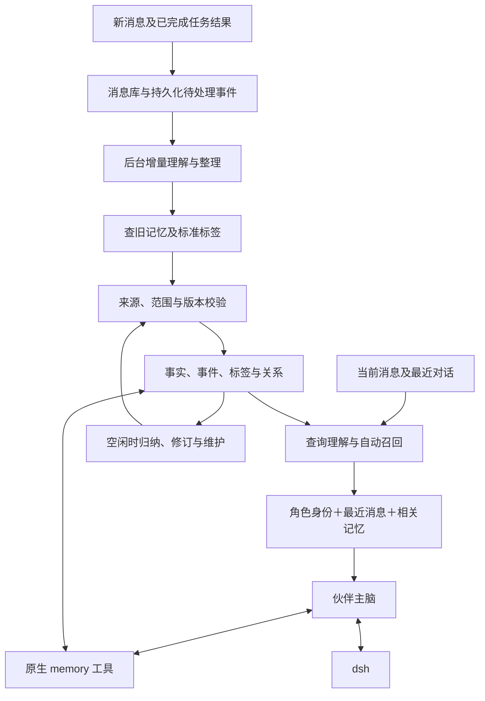

# WorldlineBox 无 Embedding 自治记忆设计

> 2026-10-21 方向更新：本设计对应已经实现的短期占位方案，后续由 VCP 完整替换。以 [VCP 记忆完整替换调研](research-vcp-memory-replacement.md) 为新实施方向；不保留旧引擎、兼容事实结构或旧方案回退。本次调研尚未更换生产实现。

设计日期：2026-10-14。状态：核心闭环已实现，实测结果及边界见 [实施说明](companion-memory-implementation.md)。适用范围：伙伴私聊、群聊、主动发言及任务经历。

维护者最新约束：代码始终只保留一套当前实现，不建立按 v 编号分流的功能、结构迁移或提取器兼容路径。旧实验聊天数据已直接清空；当前结构从新数据开始使用。事实和来源的修订记录用于历史查询、证据审计与并发检查。

伙伴通过最近消息理解正在发生的对话，通过自动召回认识过去，通过原生记忆工具维护自己的事实、经历、关系和经验。用户正常聊天即可，不需要承担打标签、要求记录或发起检索的工作。所有检索、归纳与管理均不调用 Embedding 模型，也不需要向量数据库；语言理解采用项目已有的聊天模型。

本设计不设置主脑总 token 或字符预算，不按配额切掉召回信息，不把联系人聊天变成永久追加、定期 compact 的 messages 数组。原始消息持续存档，每次请求重新取得最近消息与相关外部记忆。检索分页、图遍历终止和任务重试限制用于控制计算与避免循环，与主脑总上下文配额分开。

连续多年对话的目标是聊天无需因累计消息增长而重置，旧事实和经历保持可查，修正与遗忘可靠生效。自动标签和聊天模型都可能判断错误，因此准确性必须分别评价记忆形成、检索和最终使用，不能承诺每条历史内容每次都能被想到。

## 从 VCP 学习的机制

VCP 当前 RiverMemo 主链依赖向量。移除 Embedding 后，EPA 投影、残差正交化和向量场的数学过程无法原样成立。WorldlineBox 学习它们解决的问题，并采用独立机制；不把普通标签检索称为相同算法。

| VCP 概念或能力 | 值得保留的作用 | 本设计采用的机制 |
| --- | --- | --- |
| 被动记忆与主动工具双栈 | 回复前想到过去，遇到疑点继续核查 | 自动召回与 memory 工具共用检索服务 |
| 先看旧日记再写新日记 | 稳定命名，延续同一经历 | 写入前查询实体、标签和相关事件 |
| 特异性锚点和有序 Tag | 既能直接命中，又能保留展开脉络 | 具体实体及事件锚点、标签角色与顺序、有证据的关系 |
| Local 与 Transfer | 当前主题与跨主题背景分别参与 | 直接事实和事件检索、较弱的关系扩展 |
| Direct Anchor | 避免关联材料掩盖直接线索 | 主体、事实键、事件 ID 和原文证据优先 |
| Residual Pyramid 的解释目标 | 找到一个查询尚未被解释的部分 | 按人物、时间、状态、原因等查询要求检查证据缺口 |
| Ghost Core | 临时探索未明说的概念 | 聊天模型生成请求级检索词，检索后丢弃 |
| Spike 与枢纽校正 | 关系可以传播，但不能无限漫游 | 关系类型、路径衰减、访问集合与高频标签抑制 |
| OneRingMemo 与 TimeLine | 近期连续性和多年阶段认知 | 来源明确的事件摘要及阶段目录 |
| DailyNoteManager 与 MemoMaster | 整理冗余、追踪事件、保护细节 | 自动归类、版本化整理、状态跟踪及恢复记录 |
| AgentDream | 空闲时整理经历和寻找经验 | 后台反思任务，推测与事实分别保存 |
| 元思维 | 从经历中形成可复用方法 | 带适用条件、来源和反例的经验记录 |
| 索引与失效管理 | 内容变更后检索仍保持一致 | 事务、来源修订、依赖失效及当前索引重建 |

VCP 的写入指引要求一事一记、标签落回正文、特定实体作为锚点，并区分事件与感悟；管理说明强调写入前先看到相关旧日记，避免同义标签漂移。MemoMaster 的规则还区分事件脉络与经验、进行中与过时记录。这些是本方案的主要组织依据。[日记写入指引](https://github.com/lioensky/VCPToolBox/blob/2e75d5422430e55a16ead42f6c03b2365fdc9cc5/TVStxt/Dailynote.txt)、[记忆管理说明](https://github.com/lioensky/VCPToolBox/blob/2e75d5422430e55a16ead42f6c03b2365fdc9cc5/docs/VCP记忆管理系统.md)、[MemoMaster 规则](https://github.com/lioensky/VCPToolBox/blob/2e75d5422430e55a16ead42f6c03b2365fdc9cc5/Agent/MemoMaster.txt)。

## 系统职责与两条记忆路径

宿主提供记忆服务，伙伴拥有自己的记忆视角和整理策略。用于提取、查询理解或反思的模型调用都是该伙伴的记忆职能，不引入一个拥有所有伙伴私人记忆的新角色。模型提出内容和操作，宿主确认身份、来源、版本和操作范围后提交。

第一条路径是伙伴主脑主动调用工具：交流中确认新约定、查旧经历、更新任务结果，立即记录。第二条路径是后台根据持久化事件处理新消息，补齐主脑没有主动记录的内容。两条路径共用提交协议和来源身份，重复发现同一事实不会产生多份独立记忆。

后台覆盖用户消息、伙伴已经发送的回复以及有结果证据的行动。群聊里伙伴没有发言也可以记住自己合法见到的内容。失败或未发送的草稿不能当作已说过的话，计划中的工具操作不能当作已完成成果。

## 记忆分类与证据性质

| 类型 | 保存什么 | 主要约束 |
| --- | --- | --- |
| 事实与偏好 | 名称、关系、稳定偏好和用户声明 | 主体与事实键明确，保存当前和历史版本 |
| 经历与事件 | 共同讨论、生活事件、项目变化、情绪经历 | 人物、时间、状态及来源消息可以展开 |
| 约定与任务状态 | 双方确认的安排、计划、完成与取消 | 约定参与方明确，结果需要证据 |
| 伙伴感想 | 伙伴对共同经历的主观感受 | 属于伙伴视角，不变成用户自述 |
| 知识与经验 | 学到的方法、经验教训和适用条件 | 保留来源、局限、反例及修订 |
| 阶段概览 | 某项目或某段生活的概览 | 可重建的导航记录，不能替代原文 |
| 假设与未决信息 | 尚未确认的解释、实体候选或冲突 | 与已确认事实分开，默认不作为事实注入 |

“用户明确说了某件事”与“那件事已经客观证实”分别标识。第三方转述保存谁说了什么；引用、玩笑、设想和角色扮演保留语境，不能提取为现实事实。

“今天有点难受”可以成为一次短期情绪经历，不能自动生成“用户长期悲观”。“打算下个月搬家”是计划，“已经搬完”需要后续证据。是否值得形成长期记录，由具体性、延续性、关系意义、约定、结果和未来用途共同决定，不只看出现次数。一次明确的生日或重要经历也可以保存。

原始聊天始终保留检索入口，因此未被提炼为独立记忆的细节仍能回查。自动形成的记忆是帮助伙伴找到历史的入口，不是唯一的历史载体。

## 标签目录与实体身份

标签使用稳定 ID、名称、类型、解释、别名、状态及适用范围，不把一行自由文本作为全部管理能力。时间、有效状态和否定保存在结构化字段中，不依靠标签表达。

| 标签维度 | 示例 | 规则 |
| --- | --- | --- |
| 人物、组织、地点、项目 | 用户本人、某伙伴、WorldlineBox、某次搬家 | 关联实体 ID，名字变化不改变身份 |
| 事件 | 某次面试、某个设计决策、某次共同庆祝 | 同类事件分别拥有事件 ID |
| 主题 | 记忆管理、工作压力、咖啡 | 保持概念边界和别名 |
| 经验适用条件 | 中文检索、事实纠正、长时间运行 | 用于定位适合当前任务的方法 |

写入前先查候选标签及旧记忆，模型优先沿用已有 ID。只有已有目录不能表达新概念时才提议创建标签。候选目录来自检索，不把所有标签都传给模型。

“上班”和“工作”可以作为某主题的别名，但“工作压力”不能因此与“工作”合并。同名人物不能只靠名字合并；别名冲突保留多个候选，结合聊天空间、来源和事件判断。无法确定时保存未决映射，先使用原文检索，不制造错误身份。

标签角色区分具体锚点、事件主题、机制和宽泛分类。可以保存有意义的顺序，但顺序本身不证明因果关系。每个标签需要正文或来源支持；模型为了增强召回而想到的概念只用于本次查询，不直接写回永久标签或用户事实。

“生活”“聊天”“用户”等高频标签可用于浏览，不能单独触发大量背景注入。统计与关系扩展采用当前允许读取的范围，私人实体名称和标签也遵守相同权限。

标签治理自动完成别名整理、重复候选检查、失效标记和引用修复。概念合并保留旧 ID 的重定向与操作记录；存在歧义时保留原目录，等待后续证据，而不是要求用户日常管理标签。

## 数据模型与不可破坏的约束

以下是逻辑对象，具体表结构在实现时按现有 SQLite owner 组织。

| 对象 | 必要字段或关系 |
| --- | --- |
| source | 消息或任务结果 ID、聊天、作者、序号、修订、原文校验、证据范围 |
| memory | ID、伙伴归属、类型、内容、主体、可见范围、认知状态、版本 |
| assertion | 主体、事实键、值、限定条件、肯定或否定、声明者、有效时间、来源时间 |
| event | ID、参与者、主题、发生时间、计划或结果状态、关联事实与消息 |
| entity 和 alias | 稳定实体 ID、类型、规范名称、范围、名称与别名证据 |
| tag 和 memory_tag | 标签 ID、概念解释、别名、锚点角色、顺序、支持来源 |
| relation | 端点、关系类型、方向、来源、有效状态与版本 |
| revision 和 operation | 替代关系、预期版本、操作来源、提交结果及恢复信息 |
| derived_record | 摘要或索引内容、依赖源及修订、生成依据、是否失效 |
| outbox 和 extraction | 输入范围、提取身份、阶段、租约、失败、重试、水位 |
| forget_rule | 遗忘对象或主题、来源及衍生范围、生效位置、操作依据 |

记忆始终满足以下约束：

1. 每条事实、关系和摘要都能追溯来源；感想标明主体视角。
2. 主体、归属和公开范围分别管理，模型不能通过填写名字改变权限。
3. 原始记录及事实版本保留，整理不以唯一摘要覆盖历史细节。
4. 当前事实采用有效版本；同一事实的旧版本仍可回答历史问题。
5. 相同输入重试幂等；旧任务迟到不能覆盖新修正。
6. 提交后的事实、标签及必要全文索引立即可查询。
7. 缓存、图关系和摘要不能绕过遗忘或来源失效状态。
8. 模型提出的推测不因重复召回或重复写入变成事实。
9. 记忆服务不调用 Embedding，不设置隐藏的向量回退路径。
10. 所有模型格式使用同一工具和存储契约。

来源校验能够确认原文存在、身份和修订正确，但不能机械证明模型对原文的解释一定正确。语义分类仍需要模型判断和验收样本；人名、时间、数量、否定及关键约定保留直接证据，回答时能够回查。

## 自动形成记忆

消息提交与待处理事件在同一事务中保存。后台按序号增量取得新输入，携带相邻消息解决指代，并先查相关旧事实、事件和规范标签。处理单位是变化中的事件与事实，不要求用户结束一个聊天。

模型输出结构化候选，包括类型、主体、断言或经历、来源、时间、标签、关联的旧记录，以及新建、补充、纠正、结束或不形成记忆的判断。宿主验证 schema、实际来源、观察范围、引用修订和预期记录版本。

提交时使用来源、伙伴视角、事实或事件身份建立幂等键。提取和检索始终使用当前代码；重新处理同一来源先对照已有内容，不能制造重复记录。相同事实有多个来源时追加支持证据，不把来源数量当作多个独立事件。

无变化、寒暄或无证据的推测可以不形成新记忆。未决候选单独存放，后续有证据时再处理。模型结构化输出失败、网络中断或提交冲突时，持久化任务保留并重试，不标记该输入已完成。

记忆形成水位与消息提交水位分别记录。回复时若发现近期相关输入尚未整理，读取这段实际消息补足当前查询；需要确切旧信息时，还可自动查原始全文，不把后台未完成理解为历史不存在。

两条路径产生的候选共用提交入口。主脑直接记录成功后，后台能够识别已经处理的事实和事件；后台补充的新来源不会再次触发自己，避免“记忆摘要又被提取成新记忆”的循环。

## 自动召回流程

每次伙伴形成回复之前，宿主自动调用 recall。用户无需说“你还记得吗”。简单的实体、事实键和关键词查询可以直接执行；需要指代、隐含主题或关系解释时，用已有聊天模型生成结构化查询计划。

查询计划包括当前问题、引用消息、已确定的实体与事件、主题、时间含义、所需状态、查询要求以及请求级扩展词。例如“那个方案现在怎样了”需要先结合最近消息确定项目，再查询对应事件的当前状态。上一条伙伴回复只能提供指代线索，不能盖过用户最新明确的换题或否定。

召回同时使用五种入口：主体与事实键用于名字、生日和偏好等直接事实；标签与别名处理稳定主题；全文找原词、短名称及原话；时间和事件处理过去、现在与计划变化；有来源的关系提供当前问题相关的背景。

候选合并后先校验范围、来源状态和事实有效时间，再组织直接答案、相关经历与背景。每条结果带召回原因和路径。模糊候选需要比较时，聊天模型只评估这批候选并返回其 ID 与解释，不能自行补造未检索到的事实。

多部分问题按要求检查证据覆盖。例如查询“谁提出、为什么改、现在采用什么”，已有证据只能回答人物时，继续查决策经过和当前版本；不能把另一个相关故事当作原因。仍无证据的部分保持未确认。

检索集合由当前问题与证据形成，不按总字数分配配额。事件概览负责导航，直接证据负责回答，细节按来源展开。查询结果支持游标继续读取；如果某次输入确实超过所选模型能力，返回明确的接口问题，不静默删掉用户要求或假称成功。

## 无 Embedding 的中文全文检索

WorldlineBox 已有按 Unicode 字符编码的 FTS5 索引，读写采用相同 NFKC 规范化，能够查询一至两个汉字及连续子串。它是原始信源回查的基础，不需要退回全表 LIKE 扫描。

记忆检索在此基础上增加规范标签与实体索引，并为正文建立词项索引，用中文分词、领域词典和实体别名生成检索词，以 BM25 对内容和标签进行排序。保留字符查询路径，处理专名、短词、新造词和分词失败。词项、词频和倒排表不涉及 Embedding 模型。

查询词由宿主生成受控 MATCH 表达式，不直接执行模型生成的 SQL、正则或任意 MATCH 语法。别名可以扩大查询，否定、时间和状态仍由断言字段验证。索引规范化不改写原始证据；证据位置对应原文，而不是规范化文本的偏移。

SQLite 的默认 trigram 全文查询不能命中不足三个 Unicode 字符的子串；本项目已有字符编码路径解决了这一类短查询。SQLite bm25 的分数越低匹配越好，与部分自写 BM25 的方向不同，实现合并排序时必须统一解释。[SQLite FTS5 官方说明](https://www.sqlite.org/fts5.html)。

## 标签与关系扩展

关系至少区分检索关联、事件延续、属于某项目、参与某事件、替代旧事实，以及明确表达的原因。共现仅创建检索关联，不能升级为“导致”或“用户一定因为这个而难受”。

扩展从已确定的具体实体、事件和主题出发，选择与查询要求相符的关系类型。多步路径保留每条边的来源和方向，对远距离、宽泛标签及高连接节点降低影响。一次查询维护访问集合，避免往返循环；没有新的有效线索时终止。算法不使用向量距离、正交投影或伪装成物理量的真值分数。

直接事实与关系背景分别排序，不能让经多步联想到的经历覆盖当前事实。需要比较多个检索列表时可以融合名次和证据等级，避免把不同量纲的词频分数、关系权重与模型自报信心相加后称为准确率。具体权重由标注样本确定。

用户说“最近上班又很累”时，查询可以扩展“工作压力”“加班”等主题，找到此前明确记录的项目经历；召回结果说明这是相关背景。只有用户实际表达了因果，才能记录相应原因。查询扩展没有命中时不写入该原因。

## 修正与时间版本

断言分开保存发生或有效时间、消息声明时间、后台处理时间。处理时间不能决定哪条事实更新。时间不明确时保留未知，不以模型猜测补出精确日期。

同一主体和事实键在相同条件下出现明确纠正时，新版本替代旧版本；询问现在使用新版本，询问当时可以读取旧版本。若条件不同，例如“平时不喝咖啡，周末偶尔喝”，应保存限定条件，而不是制造矛盾。

同一用户明确纠正自己过去的说法可以自动生效；不同人互相矛盾、来源不足或时间含义不清时，保留冲突状态。伙伴在当前回答确实需要确认时才询问事实，不要求用户日常审批记忆整理。

事件状态单独管理计划、进行中、完成、取消和重新考虑。计划取消不删除曾经计划的经历。再次考虑形成新状态，不能自动复活旧承诺或重新执行过去任务。

事实过时与遗忘分别处理。旧方案被新方案替代后仍有历史价值；年龄、短期安排等会变化的内容需要时效检查。不能因很久没有召回就删除生日、重要共同经历或稳定关系。

## 伙伴的原生记忆工具

| 工具 | 伙伴能够做什么 | 宿主要求 |
| --- | --- | --- |
| memory.search | 按实体、标签、关键词、时间、事件或关系找记忆 | 身份和范围由宿主绑定，结果有继续读取游标 |
| memory.read | 读取记忆版本、事件与来源前后文 | 再次校验来源、修订与可见性 |
| memory.record | 记录事实、经历、感想和经验 | 来源必需；自主感想标明视角 |
| memory.revise | 补充来源、纠正事实、更新事件状态 | 使用预期版本及新证据 |
| memory.organize | 整理标签、关联事件、归类及生成概览 | 保留源记录与可恢复操作 |
| memory.forget | 落实用户的遗忘要求 | 校验实际请求、范围及所有衍生依赖 |

日常记忆管理可以自动完成归类、修订、关联、去重与导航归纳。伙伴可以将过时信息移出当前事实视图，保持历史可查；不能自行把长期重要经历或用户事实永久抹去。遗忘工具执行用户要求，不用来以“没用”为理由删除历史。

工具返回记录 ID、提交版本、来源及实际状态。读取工具对长事件使用来源窗口和游标；展开原文时不把一个永久聊天全部读入模型。工具失败或并发冲突时返回明确结果，伙伴不能声称已经记住或修改成功。

所有模型适配器采用统一注册、调用 ID 和返回契约。现有派发只接受 dsh，实施时必须修改注册、分发与模型格式适配；仅在提示词写出这些工具不算完成接入。

## 自主整理与阶段记忆

维护由新消息、事件状态变化、检索发现缺口、派生记录失效，以及应用空闲时的待处理队列触发。聊天回复优先，维护任务可以暂停并从断点继续。伙伴可以提议对某主题复盘，宿主避免同一范围的重复任务及无变化循环。

整理先定位相关簇，再阅读对应记录；不让模型每次通读所有记忆。完全重复的记录合并支持来源，主题相近但人物、时间、细节或视角不同的记录继续保留。事件与经验分别归纳，通过源 ID 相连，避免为了简短混成一篇难以核查的笔记。

项目、主题、阶段、事件和原始消息构成可展开目录。多年记录按年月及事件身份建立索引；每次召回相关阶段，不将全部月份摘要永久追加到主脑。概览列出主要变化和细节入口，检索遗漏时可以逐层展开。

摘要从当前有效的原子记录及来源生成，保存依赖修订；源变更后标记失效并重新生成。不能无限“摘要旧摘要”而失去来源。整理完成后原子发布新概览，源记录仍然可查；部分失败不发布半成品。

## 反思与经验学习

可以学习 AgentDream 的离线整理意图，在空闲时对真实经历提出关联和经验。无需模拟梦境叙事、引入梦模型或复刻向量算法。

经验记录包含适用场景、采取过的可说明做法、实际结果、来源及局限。例如中文短词检索失效后，保存“短专名先查实体别名，再查字符索引”的方法；保留对应失败和成功证据。这里保存可说明的方法与任务结果，不采集模型隐藏的推理链。

新的感想作为伙伴主观记录，新的解释作为假设；只有后续证据支持时才更新事实。反思不能扩大权限、改变系统规则、凭想象生成用户承诺或启动历史任务。

检索反馈记录候选、采用来源、展开行为和用户明确纠正，用于发现漏召回、误分类及标签问题。用户没有反驳、伙伴提到了某记忆或某标签被经常查询，都不能直接证明内容正确。调整策略前用保留的评测样本检验，避免越用越偏。

## 群聊与私聊中的记忆归属

伙伴拥有连续身份，但能够知道某件事与能够在当前聊天说出某件事分别校验。默认群聊只使用本群可公开的信息；从私聊分享来的信息，需要实际分享行为或明确共享依据。伙伴私聊可以按产品既有规则使用其合法经历，不能读取其他伙伴独有的私聊。

群内客观事件可以提取一次并按观察范围供伙伴读取，伙伴自己的感想和经验分别保存。相同实体 ID 不意味着共享所有围绕该实体的记忆。标签目录、别名、图路径、摘要、来源展开与缓存都采用一致的范围校验。

多个来源组成的摘要不得扩大可见范围：能读取完整摘要的对象必须有权读取其中所有贡献来源。需要更宽范围的概览时，从该范围有权看到的内容单独生成；不能把私人来源混进群公开摘要。

成员或范围变化使相关权限版本失效。历史来源按宿主的成员及可见规则判断；采用未来可变成员机制时需要记录观察时间，不把今天加入理解为当年已经参与。伙伴对内容的解释不能修改这些权限。

## 一致性与故障恢复

SQLite 继续由现有 UtilityProcess 单独拥有。模型调用、分词和归纳在事务外执行，完成后经存储协议提交。主进程和 dsh 不直接成为第二个写入 owner。

事实、标签链接、必要全文索引、内容修订号及待更新派生事件在同一事务中提交。耗时的阶段摘要和统计可以异步生成，但当前事实立即可读。失效派生记录不能作为新证据使用；需要时查询对应原子内容。

后台采用可重试投递和幂等提交，不声称网络调用天然恰好执行一次。任务记录租约和输入位置，崩溃后继续未完成部分。写入带读取过的版本与来源修订，提交冲突时重新比对。整理操作也记录输入版本和生成结果，恢复时不重复合并。

检索缓存采用精确输入及实体、范围、事实修订与权限状态。否定、数字、日期和名称变化不使用模糊缓存；不以 TTL 替代修正和遗忘失效机制。最终注入前重新校验记录状态，拦住仍被索引返回的失效项。

回复绑定来源序号及请求身份。对于该请求尚未看见的后续消息，沿用现有补充或取消机制；后台稍后提炼了较早的来源，可以按来源位置查询，但不能将后续才发生的事实偷渡进旧请求。当前明确纠正若已进入补充输入，重新验证相关记忆。

词典或标签规则变化直接使用当前规则，从权威记录事务性重建当前索引；权威内容不随索引重建丢失，不保留旧算法分支或编号代际。聊天模型更换不要求重新生成全库向量，但仍需用样本验证新模型的抽取与查询理解。

模型不可用时保留待处理队列，直接实体、事实、标签、时间和原始全文查询继续工作；复杂的隐含语义扩展暂时能力下降。索引损坏时从权威记录重建，状态可观察。队列、句柄、WAL 与内存的增长需要长期运行检查。

## 遗忘与再提取

遗忘先提交有效的规则及记录失效状态，再处理全文、标签、关系、摘要和缓存。已经在后台运行的旧提取任务在提交前检查遗忘规则，不能重新生成被忘记的内容。

规则至少区分指定记录、来源及其衍生内容、某主体的事实键或某主题，以及生效消息位置。“忘掉上次那个地址”应关联到具体旧事实，不能只删除一个摘要 ID。“以后不要记录这类信息”形成持续规则；新话题不能通过换措辞绕过它。

聊天原文保留与删除遵从用户要求。若原文保留但要求记忆忘记该内容，自动检索和信源展开也过滤对应范围，不能在记忆检索失败后从原文重新捞回。规则本身尽量只保存所需身份和范围，避免在审计正文复制被忘记的敏感内容。

用户将来重新主动提供类似信息时，是否重新形成记忆取决于规则范围：仅遗忘旧经历的规则与持续禁止记录的规则分别处理，不能自行猜测用户撤回了持续规则。

## 示例

用户正常说：“最近赶 WorldlineBox 的聊天功能，经常忙到很晚，咖啡喝多了睡不着。”伙伴自动形成项目经历，标签关联到已有 WorldlineBox 实体、聊天功能和睡眠主题；“喝咖啡后睡不着”保留这次表达及适用语境，不直接变成绝对健康结论。

隔了许多无关对话，用户说：“又忙到半夜了。”最近消息确定仍在讨论同一项目，自动召回之前的熬夜经历。伙伴可以自然回应“上次你说赶聊天功能时也经常熬夜”，相关来源随结果保留；若当前项目尚不明确，就不能擅自认定还是同一项目。

后来用户说：“聊天功能忙完了，最近在改记忆系统，而且已经不喝咖啡了。”后台更新项目阶段和咖啡相关事实。询问现在的习惯采用新状态；询问那段聊天功能开发经历仍可回到旧事件。伙伴不用要求用户说“请更新记忆”。

## 接入现有项目

现有基础包括完整消息存档、字符全文索引、来源序号、伙伴归属记忆、任务恢复及单独的数据库 owner。当前回复主要使用最近消息和按更新排序的记忆，自动记录依赖有限规则，尚没有本设计的完整自动形成、标签治理和多路召回。

实施顺序如下，各阶段都保持没有 Embedding 的完整工作路径：

1. 增加来源、事实版本、事件、规范标签、关系、待处理事件及失效记录；复用现有存储 owner。
2. 建立原生 memory 工具及共同提交入口，完成身份、幂等、并发和立即读取。
3. 接入后台增量理解，在记录前查询旧记忆和标签；对现有历史进行可暂停、可恢复的分段回填。
4. 在每次回复前接入事实、标签、全文、时间和事件自动召回，移除原来按更新时间选取记忆的默认入口及主脑字符裁剪。
5. 增加有证据的关系扩展、查询缺口补查与信源展开。
6. 增加自动整理、阶段目录和伙伴经验，完善遗忘、规则升级与长期运行恢复。

旧实验群聊、消息及关联记忆已直接清空，不提供旧结构迁移或兼容逻辑。当前结构中的消息补登记按实际来源序号推进，遵守纠正、来源修订和遗忘规则。用户可选的手工补充若缺少来源，标为待核查，不能直接成为已确认事实。

## 验收与质量评价

以下为实施验收要求，不代表已经通过模型或长期负载验证。

| 场景 | 必须验证的结果 |
| --- | --- |
| 用户从未说记住 | 事实、重要经历与约定仍能自动形成记忆 |
| 主脑未调用记录工具 | 后台补齐，重复处理不制造重复事实 |
| 很早的一次信息 | 跨大量无关消息仍能找到生日、旧约定及重要经历 |
| 同义表达与短专名 | 自动别名或查询展开可检索，两字人名可回查 |
| 同名实体 | 不误合并人物或项目 |
| 间接提示 | 找到有证据的相关背景，避免把联想当原因 |
| 换题与指代 | 最新话题优先，指代无法确认时不选错事件 |
| 否定和限定 | 喜欢改不喜欢立即生效，限定条件不丢失 |
| 过去与现在 | 正确选择时间版本，历史细节仍然可查 |
| 计划与取消 | 不把计划当结果，不复活旧任务 |
| 引用与猜测 | 不升级为用户已确认事实 |
| 并发及崩溃 | 旧任务不盖过新事实，水位和提交可恢复 |
| 刚写完就询问 | 事实及必要索引已经可读 |
| 群聊与私聊 | 正文、标签、图、缓存及摘要均不越范围 |
| 遗忘与重建 | 后台、历史回填、全文及摘要不使内容复活 |
| 自主整理 | 重要细节、独特视角与来源不丢失，可恢复旧版本 |
| 多年增长 | 回复不全库扫描，阶段与事件可按索引展开 |
| 模型变化和不可用 | 既有内容继续读取，抽取队列保留，失败状态明确 |
| 无 Embedding | 不配置、不加载、不请求 Embedding，也不隐藏回退调用 |

评价拆开记忆形成的准确性与遗漏、候选召回、排序、事实时效、来源正确性、错误实体合并、范围隔离、遗忘一致性、答案证据及延迟。直接事实、关系背景、多时间段回顾分别建立标注样本。与仅关键词、标签及事件、再加入关系扩展的版本逐项对比，以确认复杂机制实际补足了什么。

最主要的效果风险是隐含表达没有被正确转成标签或查询词；聊天模型的查询展开和原始全文补查可以改善这一点，但需要真实样本验证。最主要的运行成本来自额外的抽取、查询理解和反思模型调用；增量处理、合并重复任务和简单查询直接执行降低重复工作，不能预先宣称一定比 Embedding 方案便宜。

## 参考资料

VCPToolBox 参考版本：2e75d5422430e55a16ead42f6c03b2365fdc9cc5。源码事实、历史验证和当前项目审计见 [VCP 调研记录](research-vcp-companion-memory.md)。

- [VCP 白皮书](https://github.com/lioensky/VCPToolBox/blob/2e75d5422430e55a16ead42f6c03b2365fdc9cc5/docs/vcp-whitepaper.md)
- [RiverMemo 技术页面](https://www.vcptoolbox.com/vcp_wave_v8_engine)
- [Learn VCP](https://www.vcptoolbox.com/learn-vcp)
- [无 Embedding 的直接文本处理入口](https://github.com/lioensky/VCPToolBox/blob/2e75d5422430e55a16ead42f6c03b2365fdc9cc5/Plugin/RAGDiaryPlugin/DirectDiaryTextProcessor.js)
- [DailyNote 的聊天模型标签生成](https://github.com/lioensky/VCPToolBox/blob/2e75d5422430e55a16ead42f6c03b2365fdc9cc5/Plugin/DailyNote/dailynote.js)
- [SQLite FTS5](https://www.sqlite.org/fts5.html)
- [WorldlineBox 当前伙伴实现](companions.md)

本方案按 WorldlineBox 的聊天领域、伙伴身份及存储协议独立设计。VCP 提供组织与管理思路，不作为需要复制的组件或必须依赖的服务。
