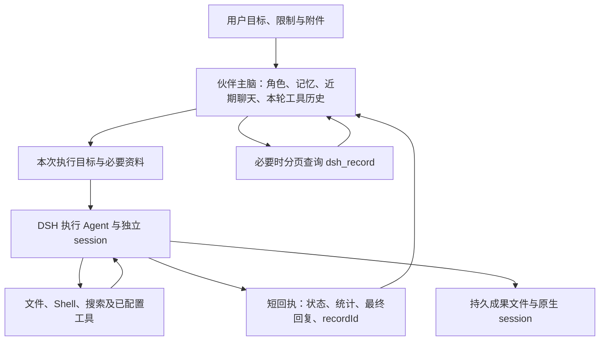

# DSH CLI 与虚拟伙伴：能力、上下文和交付研究

研究日期：2026-10-22。本文是实现调查与接入建议，不代表已修改运行逻辑。

## 1. 结论

DSH 可以承担复杂任务的执行 Agent：一次委托内部可以反复调用模型、使用工具、读取结果、纠错和继续。虚拟伙伴保留角色、用户交互、记忆和跨任务统筹，DSH 负责一个执行目标内的规划与行动。因此实际是两层 Agent 循环，不是主脑调用一个没有自身推理的命令执行器。

不会默认把整个 DSH session 回灌伙伴，也不会自动把伙伴全部记忆和聊天塞给每个新 DSH 任务。但是两层模型各自的后续请求仍会携带各自当前有效的历史；“不跨层复制完整 session”不等于“每步只传新增内容”或“没有重复 token 成本”。

用户明确的目标是：主脑能够按实际任务动态构建 DSH Agent 范式，自行安排上下文、工具、技能、插件、工作目录、会话关系和交付方式。可复用模板是便捷方式，不是唯一可选范围。当前最需要完善的是支持动态构建的接入协议，而非再实现一个工具执行循环：伙伴尚不能结构化声明这些执行要素；多阶段新任务没有自动编译上下文交接包；结果回执尚无统一、可校验的成果清单。主脑的上下文管理交给主脑自身，本研究不要求增加主脑预算限制。

## 2. 证据版本

| 对象 | 本次核实 | 用途与限制 |
| --- | --- | --- |
| 用户提供的上游源码 | `C:/Users/hp/Desktop/project/deepseek-harness`，HEAD `639ed015397290b3745d163aafe02ffee4aa3f84`，工作区干净；root、CLI、headless 包版本 `0.2.0-rc.2` | 可直接追踪 TypeScript 实现；不能默认等同于本机已安装版本 |
| 应用用户数据目录中的安装运行包 | `@deepseek-ai/dsh 0.2.1-rc.2`，runtime `runtime-7166bc2240b170bff29c0dfe` | 已只读核对编译后实现；未读取真实模型凭据或调用线上模型 |
| WorldlineBox 接入代码 | 本研究所处工作区 | 当前伙伴实际能使用什么，以这层代码为准；工作区原有其他改动不属于本研究 |
| 官方在线文档 | 查询时的 `master` | 用于交叉核实概念和当前官方接口，不将新文档全部套用于旧源码 |

上游官方入口：[CLI 帮助](https://raw.githubusercontent.com/deepseek-ai/deepseek-harness/master/docs/cli-help.md)、[headless 协议](https://raw.githubusercontent.com/deepseek-ai/deepseek-harness/master/packages/bundle/headless/README.md)、[Agent 循环](https://raw.githubusercontent.com/deepseek-ai/deepseek-harness/master/packages/core/agent-loop/README.md)、[压缩机制](https://raw.githubusercontent.com/deepseek-ai/deepseek-harness/master/packages/compaction/compaction-basic/README.md)。

下文上游路径均相对于用户提供的 `deepseek-harness` 源码目录；应用路径相对于 WorldlineBox。行号记录本次调查时位置。

## 3. 复杂任务的上下文到底怎样流动



### 3.1 伙伴主脑的上下文

基础输入包含人格、宿主规则、当前目标、当前聊天最近最多 50 条正式消息、按权限召回的记忆以及必要的当前状态。它不是该伙伴一生的全部聊天和全部记忆。依据：`src/main/companions/context.ts:48–68`。

同一用户请求触发的主脑循环中，每次 HTTP 推理会重新组装基础上下文，并追加当前有效循环中的 assistant 调用、tool result 和用户补充。DSH 的 tool result 是短回执；如果伙伴查询了 `dsh_record`，查到的页面也会成为后续历史的一部分。依据：`src/main/companions/model.ts:69–95,313–375`。

当前代码的64步是循环步数上限，不是上下文长度预算。DSH 自身压缩与主脑上下文管理也是两件事。这里记录现有行为，不据此要求限制主脑；用户已明确主脑自身负责上下文管理，后续还会扩展主脑循环功能。依据：`src/shared/companion-loop.ts:15`、`src/main/companions/service.ts:1105,1319`。

### 3.2 一次 DSH 调用内部的多个步骤

每个模型步骤从 session 派生当前消息历史，加上可见工具定义，再调用模型。下一步可看到前面已提交的工具结果。这里是整个“当前有效消息历史”，不是每步只发送新增一条。

原始持久日志与模型消息历史不同：状态、流式 chunk 等日志不全是模型消息；被压缩替换的旧消息也不会原样继续发送。依据：上游 `packages/core/agent-loop/src/agent.ts:671–680`、`packages/core/session/src/index.ts:842–860`。

在标准配置下，DSH 有自动压缩与工具结果修剪：压力达到阈值后，先修剪过大工具结果，必要时以额外模型请求把旧历史摘要，保留近期原文。当前 surface 替换为摘要及近期内容，原始日志仍保留。默认比例为 0.8 / 0.16，额外预留 65536 token；实际触发公式为 `floor(min(W × 0.8, W − O − B))`，其中 W 为模型上下文窗口、O 为有效输出上限、B 为额外预留，近期保留量按 `W − O` 的16%计算。小窗口需要适配配置，压缩也不保证任意长任务永远成功。

依据：上游 `packages/compaction/compaction-basic/src/config.ts:20,23,75,108,191`、`src/summarizer.ts:163`、`src/region.ts:507`；标准预设在 `packages/bundle/web-app/presets/standard.patch.yml:63–79` 组合压缩服务。

### 3.3 伙伴再次发起一个新的 DSH task

当前实际输入是：固定执行要求 + 当前用户消息全文 + 伙伴生成的 `task.prompt` + 当前来源消息的附件路径。不会自动带入伙伴人格、全部召回记忆、50 条聊天、前次 DSH 的完整 transcript。依据：`src/main/companions/service.ts:1302–1304,1694,1857–1861`。

新 task 会创建随机 session。前次成果文件可能还在共享目录，但新 task 不会因此自动知道它们或继承前次对话。伙伴必须在新 `task.prompt` 中说明必要的阶段事实、成果路径、当前目标和约束。共享工作区不是共享 session。依据：`src/main/dsh/companion-runtime-source.ts:46,118–126`。

例如“调研 → 写报告 → 根据用户反馈修订”可以分三次调用。第二次应收到调研结论与来源文件路径、报告要求和约束；第三次应收到报告路径、用户明确反馈和必须保留的事实。没有必要把每次搜索返回和每次命令输出都复制给下一阶段。

### 3.4 中断恢复与运行中补充

恢复原行动会绑定原 instance、runtime、workspace、session 和权限，并通过原生 `agents.resume()` 读取持久 session，不靠伙伴手工复制完整 transcript。恢复要求核查已有文件和实际状态，以免重复已经发生的外部动作。依据：`service.ts:1757–1780,1858–1861`、`task-broker.ts:146–148,204–206`、`companion-runtime-source.ts:118–126`。

运行中的引导通过 `steer` 进入下一模型步骤，排队补充通过 `followup` 进入下一轮。当前伙伴的模型工具没有公开 `sessionId`，不能主动把“第二次新委托”声明为“继续某个已经成功结束的 session”；应用已实现的是运行中补充和中断恢复。原生 headless 自身另有 `--session-id` 续接，但有工作区、预设和会话归属限制。

补充约束有实际缺口：宿主会将引导存入主脑 loop，并转给当时运行/排队的行动；后续新行动的 supplements 初始化为空，新任务拼装也不自动包含全部 loop supplements。主脑若未把补充写进新的 task.prompt，阶段间可能漏传。依据：`service.ts:562–578,1303,1694,1736–1748`。

## 4. 能否按次指定工具、模式、工作区、模型

| 配置项 | 原生 DSH | WorldlineBox 下层 | 伙伴目前暴露的接口 |
| --- | --- | --- | --- |
| 目标 | task 参数或 stdin | `prompt` | 有，`tasks[].prompt` |
| 工具组合 | profile、插件、agent preset、单次 patch | 交互执行挂载实例 `standard` preset | 没有工具白名单参数 |
| 权限 | sandbox / permission / approval 插件配置 | 有三个访问模式的真实执行 patch | 没有权限参数；新任务硬编码完全访问 |
| 工作区 | 进程 cwd 或文件系统 provider；创建 Agent 可提供 cwd | 当前选择共享工作目录，恢复沿用原目录 | 没有 workspace/cwd 参数 |
| 模型 | provider/model 默认选择、profile/patch 或 Agent API | 特意沿用 DSH 配置，拒绝任务模型及凭证覆盖 | 没有模型参数；与伙伴聊天模型独立 |
| session | 新建或 `--session-id` / Agent resume | 可信 checkpoint 恢复 | 没有 sessionId 参数 |
| 超时和输出上限 | 执行器可控制 | API 有，默认30分钟和16MiB stdout | 未向伙伴模型开放 |

伙伴 `dsh` 的真实模型 schema 只有 `tasks[1..4]{title,prompt}`；标题最多100字符，prompt最多16000字符。同一调用最多四个并发任务，不能把这理解成必须将一个复杂目标拆成四个。依据：`src/shared/companion-dsh-tool.ts:13–24`。

原生 CLI 的外层有 `--profile`、可重复 `--patch`、配置检查命令；headless 内层主要有 task、`--json`、`--session-id`。没有现成的 `--tools`、`--workspace`、`--model`、`--agent-preset` headless 开关。可以通过组合机制实现控制，但这与现成命令行参数、以及本项目已开放能力是不同的事。依据：上游 `apps/cli/src/args.ts:168–173`、`packages/bundle/headless/src/startup.ts:43`。

“模式”还要分清四件事：profile 是程序组合；agent preset 是某个执行 Agent 的能力组合；plan mode 是规划与审阅流程；访问模式是文件效果约束。`tools.mode=native/ptc` 只是工具呈现/调用形式，不是读写权限或任意白名单。上游 `packages/plan/plan-mode/README.md` 明确说明 plan mode 不阻止工具调用，强制限制要用 sandbox/approval。

### 需要优先处理的权限事实

`src/main/companions/service.ts:1860` 为伙伴新任务显式传 `{mode:'danger-full-access'}`。`src/main/dsh/launcher.ts:217` 仅在未传 access 时才继承启动器偏好。因此当前伙伴路径不会自动受界面里保存的 read-only/workspace-write 偏好约束。prompt 中“不得写入”仍是模型指令，不等于 native permission 已被设为只读。

下层 `src/main/dsh/task-access.ts:89–109` 已能配置 `danger-full-access`、`workspace-write`、`read-only`，包括 filesystem、shell、permission 与 `approval=never`。这些模式在当前接入定义中约束文件效果，不能理解成网络隔离、Windows UAC 或整个进程的操作系统沙箱；第三方工具也要逐一核实是否经过相同执行策略。

## 5. DSH 能力范围

以下是源码和安装包中的能力，不代表当前伙伴每次都装载或全部运行成功。

| 能力 | 已确认的工具/机制 | 实际用途与条件 |
| --- | --- | --- |
| 文件与代码 | `read/write/edit/read_image/glob/grep` | 阅读、写作、修改代码、查找材料；看图还取决于模型视觉支持 |
| 命令执行 | Windows `pwsh`，其他平台 `bash` | 运行脚本、测试、Git、文件处理；具体命令依赖实际安装及访问权限 |
| 后台作业 | `job_output/job_list/job_kill` | 启动后观察输出、管理长任务；不代表进程退出后所有后台工作都已交付 |
| 网络资料 | `web_search/web_fetch` | 检索与读取网页；搜索 provider、联网与凭据必须可用 |
| 技能 | `skill`、filesystem skills | 按需载入工作说明；技能本身不是已经完成任务的证明 |
| 规划与持续目标 | todo、goal、plan | 组织步骤、追踪目标；计划流程与强制访问权限分开 |
| 子 Agent 与工作流 | subagent/fork/control/list、workflow | 独立调查、并行执行、阶段协作；也会产生额外上下文与模型成本 |
| 外部系统 | MCP 和其他已配置插件 | 能力取决于实际 server、账号、权限与工具接入，不能凭包名承诺服务可用 |
| 交付与会话管理 | present、workspace changes、session query | 上游有专门组件；本项目当前短回执未直接提供统一结构化成果清单 |

标准预设的主要组合见上游 `packages/bundle/web-app/presets/standard.patch.yml`。WorldlineBox 的交互执行在 `src/main/dsh/companion-runtime-source.ts:102–107` 明确挂载所选实例的 `standard`，可含用户配置插件。非交互 toolkit 的固定工具行不能作为伙伴实际全部工具目录。

DSH 能覆盖研究、写作、代码修改、批量文件处理和依赖脚本的资料加工等复杂工作。某项桌面软件操作、特定平台账号操作、图片生成或特定文档格式生成是否能做，要继续检查对应插件、服务和系统工具；不能因为存在 Shell 就把任何任务都当作已具备可靠专用能力。

### 5.1 扩展能力的实际前提

| 扩展 | 上游实际状态 | 对伙伴系统的含义 |
| --- | --- | --- |
| 浏览器 | browser-use 本体是注册服务，没有模型工具；Playwright MCP、Chrome DevTools MCP、Stagehand 属显式启用的 experimental provider | 主脑构建浏览器范式前需要发现可用后端、浏览器/调试端点、认证和图像能力 |
| 桌面 | computer-use 本体同样不提供操作工具；CUA native/MCP 需要驱动、图形会话和系统权限 | 并行 DSH session 不代表可以同时操作同一桌面；恢复 session 不会自动还原外部窗口和页面现场 |
| Office | skill-office 提供说明与脚本，Python/库/渲染工具由部署方提供；官方 Desktop 有独立 carrier 集成 | WorldlineBox 启动 npm runtime 不自动等于已获得官方 Desktop 的全部文档运行环境 |
| MCP | 默认没有 server 启用，必须配置 transport、command/URL 与认证 | 只能把已连接并探测成功的工具加入实际范式 |
| 插件扩展 | plugin_manager 在 standard 默认禁用；安装改变 profile 环境 | 动态启用已安装组件，与安装/升级插件是两种不同生命周期 |
| 多媒体 | 附件保存与显示不等于音视频理解或生图；可部署 CLI、库、API 扩展 | 每种能力要对应实际可调用工具，不能用一个泛化 shell 声明代替能力发现 |

依据：上游 `packages/experimental/README.md:12`、`packages/browser-use/browser-use/README.md:12,80`、`packages/computer-use/computer-use/README.md:12,78`、`packages/skill/skill-office/README.md:28`、`packages/skill/tool-workspace-dependencies/README.md:47`、`packages/mcp/mcp-client/README.md:12`、`packages/boot/plugin-manager/README.md:14,31`。

Stagehand 还需要独立的受支持模型配置，不复用 DSH 的模型路由、凭据和用量统计，不能认为换一个浏览器后端没有额外条件。依据：`packages/experimental/browser-use-stagehand-native/README.md:157–161`。

## 6. 伙伴实际收到什么

原生 headless 默认 stdout 为最终答案，`--json` 为 JSONL 执行事件；JSONL 不保证最终答案符合业务 JSON Schema。原生事件协议可能包含 thinking。WorldlineBox 的伙伴路径使用自有轻量适配插件对接原生 Agent API，主动排除 private reasoning，并将公开状态、消息和工具数据投影给 UI/档案；不是直接把原生 stdout 全部交给伙伴。

伙伴的实际回执由 `src/shared/companion-dsh-receipt.ts:3–16` 构造，字段包括：

```text
id, title, status, sourceMessageId,
recordId, recordsAvailable,
statistics { turns, steps, toolCalls, durationMs, recordCount },
finalReply, finalReplyChars, finalReplyTruncated, finalRecord,
complete, storageLimited, error?, readTool, trust
```

单 task 的 finalReply 默认最多6000字符；同一调用有2、3、4个 task 时，每项分别最多4000、2333、1500字符。字符不等于 token。这不是摘要模型生成的另一个摘要，而是最终回复文本的有界截取，截断状态会明确返回。依据：`service.ts:1310`。

需要更多证据时使用 `dsh_record`：默认只返概览；指定范围才读事件，默认20条、最多50条，每条默认2000字符、最多4000字符，entries总预算约12000字符。可用 snapshot、nextStart 和 textOffset 续读。来源权限绑定当前伙伴、当前聊天及有效来源消息。依据：`src/shared/dsh-task-record.ts:4–15`、`service.ts:1810–1825`。

档案是脱敏事件投影，不是无损原生 session：内部 reasoning 与 stderr 不进可查询正文，工具结果在适配器已有64000字符截取；存档还有64MiB/100000条上限。UI live events 也独立于伙伴回执。依据：`companion-runtime-source.ts:63,87`、`task-broker.ts:281–305,314`、`task-record-store.ts:10`。

特别注意两个状态语义：`complete:true` 只表示档案没有写入失败或存储截断，failed/cancelled 任务也可能为true；`status:succeeded` 表示执行正常退出、未报告任务错误且有final，不是宿主已经独立验证用户全部目标。依据：`task-record-store.ts:112`、`task-broker.ts:318–326`。

当前回执尚无统一结构化 `artifacts / changedFiles / verification / citations / remainingWork / usage / cost`。文件可作为实际成果保存在磁盘，伙伴还可通过 `send_file` 附上已有文件，但成果路径、检查证据与未完成项仍主要依靠最终文本表达。

## 7. 建议的复杂任务接入

### 7.1 执行粒度

把“调查 → 修改 → 测试 → 修复 → 复验”这样的相依执行链优先放进一个 DSH task，由它保留内部上下文。主脑只在需要改变目标、融合多个分支结果、响应用户反馈或进行业务判断时重新接管。互不依赖的调查可以并发；修改同一资源的动作应排序。

需要再次新建 task 时，由主脑决定要交给执行器的上下文，宿主负责将选定资料及仍有效的真实约束正确编译，不自动注入主脑全部上下文：

```text
本次目标与验收条件
当前有效用户约束与授权来源
可信工作区 ID、输入文件引用
已完成项与必要结论
成果文件路径、证据和相关 recordId
仍需完成项与本次新增要求
```

这些字段是建议新增，不是目前已存在的接口。用户限制应从宿主保存的真实来源和补充汇总，避免多阶段转述丢失；长资料按文件与记录引用按需读取。

### 7.2 核心能力：主脑动态构建执行范式

不应只开放几个写死的 research/coding/writing 按钮。应让主脑先发现能力，再动态声明本次 Agent：执行角色与指令、工具集合、需要按需加载或预载的技能、插件及其参数、工作目录、访问模式、模型路由引用、上下文输入和成果要求。预设可保存、继承和修改，也可完全按本次目标新建。

DSH 的 Cordis 组合、profile/patch、Agent preset 和 scoped setup 为此提供了底层基础；缺的是 WorldlineBox 面向主脑的声明接口和执行工厂。主脑生成声明，Main 将声明解析为本次实际插件组合与作用域，再经正式 CLI profile 启动原生 Agent。只在 prompt 里写“你现在是某种 Agent，只能用这些工具”不算完成能力配置。

具体机制有直接源码支持：`agentPresets.register(definition)` 接受合法插件条目并加载；`agents.create({meta:{cwd},agentOptions,setup})` 在发布前等待 setup，可为本 Agent 注册工具、提示与限制；tools 有 scoped register/restrict/guard。依据：上游 `packages/preset/agent-preset-registry/src/index.ts:80–109`、`packages/core/agent/src/index.ts:51–118`、`packages/core/tools/src/index.ts:1063,1097,1136`。工具集合变化也有请求历史记录机制，不能把配置变化只留在进程内的临时变量中。

建议新增的声明结构如下，仅为设计，不是当前已经接受的参数：

```text
TaskSpec
  objective / acceptance
  agent
    instructions
    tools: 本次可见且可调用的工具
    skills: 所选技能及加载方式
    plugins: 本次组合的已安装组件及配置
    workspace: 工作目录与输入/输出目录
    access: 本次真实执行权限
    modelRef: 采用默认执行模型或显式选择已配置路由
  context
    messages / selectedFacts / inputRefs / priorResultRefs
  session
    strategy: new / continue / resume / fork / handoff
    sessionRef?
  delivery
    成果类型、输出位置、验证方式、返回格式
```

其中 tools 要落实到注册与执行入口，skills 要落实到实际技能目录或提供者，plugins 要落实到实际可解析的包及配置，workspace 要落实到 filesystem/shell 的真实工作目录。技能可只提供目录与按需读取入口，不必每次把全部技能正文塞进上下文。宿主可返回解析后的 effective configuration，让主脑知道实际挂载了什么；解析失败时返回具体缺失组件，不伪称已经获得能力。

每个运行任务保留自己的已解析配置、依赖版本和变更记录；另一个任务创建新范式不应偷偷改变正在运行的 Agent。需要在当前 session 内增减工具时，通过明确的 scoped 变更和记录完成。插件安装/升级属于环境准备，已安装组件的逐次组合属于任务启动。这是独立的生命周期管理，不要求把主脑限制在固定模板内。

### 7.3 交付结果

保留现有短回执与渐进查证机制，增加有界结构化成果：实际文件引用、执行检查、关键来源、尚未完成项和阻碍。宿主可验证文件存在、大小/摘要、测试退出码等事实，避免把模型一句“完成”当成验收。`recordId` 继续作为排查入口。

### 7.4 会话策略与范式变化

| 策略 | 应提供的行为 | 上游与当前接入的限制 |
| --- | --- | --- |
| new | 新范式、新 session，只有主脑选定的输入 | 最符合干净独立上下文；当前伙伴新 task 已是新 session，但不能声明范式 |
| continue | 在同一个已存在的执行会话追加任务 | 原生能续轮；伙伴现接口未开放成功任务的显式续用 |
| resume | 从中断的同一会话恢复未完成目标 | 当前已有；保留原环境绑定并核对实际外部状态 |
| fork | 从旧会话历史分出新的分支 | 会继承历史，不能当作干净上下文；默认 fork 还保留原 preset 与 cwd |
| handoff | 新范式、新 session，接收主脑明确选择的旧结果和资料 | 最适合研究范式转写作/代码/审阅等不同执行组合 |

已有 session 的范式变化需要分层解释。现成 `agentPresets.select()` 仅允许首轮开始前选择；已有历史后返回 `agent-preset/locked`。默认会话 fork 保持源 preset/cwd，子 Agent fork 也沿用父的准确 preset revision。依据：上游 `packages/preset/agent-preset-registry/src/index.ts:301–326`、`packages/api/session-controller/src/commands.ts:267–283`、`packages/subagent/subagent/src/child-agent.ts:205`。

但底层 `agents.resume()` 本身允许 setup：加载历史后，宿主可在新的未发布作用域中组合能力。因而“复用已有 session 并更换能力组合”不是底层绝对做不到；它需要自有 runner 明确定义、记录和恢复组合版本，处理旧工具历史与新服务的兼容，而不是调用现成 Web preset 切换。工具增减和上下文注入也可通过 scoped API 在合适的步骤/轮次边界完成。依据：`packages/core/agent/src/index.ts:125–143`、`packages/core/agent-loop/src/agent.ts:626–647`。`restrict` 仅过滤继承工具，不覆盖同scope自己注册的工具，需要强制执行约束时应使用正确的 guard，不把可见工具过滤当作所有插件的访问控制。

工作目录则更严格：cwd 位于冻结的会话创建 header，resume 参数没有新的 meta/cwd，不能把旧会话简单改成另一个工作区。建议让主脑可选：同组合续用；同session增减工具/上下文；通过受支持的自有runner恢复并重组；或新范式新session交接。工作区迁移默认采用新session。依据：`packages/core/session/src/index.ts:457–464`。主脑决定策略，执行层准确实现并说明实际可用范围。

DSH 自身沿用原生 session 压缩与恢复；主脑自行管理自己的上下文，不在这项接入改造中另加预算要求。

### 7.5 SDK 可以作为通信选项，不能代替执行工厂

源码 SDK 仍以 `dsh --profile ... --patch ...` 启动运行进程。客户端可选 profile、patches、dshHome、processCwd；initialize 可传 cwd/provider/model/reasoningEffort/maxTokens，但这些是进程级配置。单次 prompt 只有 sessionId/contentBlocks，没有每次的工具、preset、权限、cwd 配置。依据：上游 `packages/sdk/client/src/types.ts:24–52`、`packages/sdk/protocol/src/types.ts:16–40`。

这份源码的 SDK 协议只有 initialize/session-prompt/shutdown，没有完整的逐会话取消、销毁、跨进程resume或steer接口。server 新会话调用 agents.create，不挂载 Web standard preset。因此当前项目的 CLI 适配插件已有的权限、恢复、运行中引导和进程回收，不能简单换成 SDK 后假定仍然存在。依据：`packages/sdk/protocol/src/types.ts:115–119`、`packages/sdk/server/src/server.ts:193,259–290`。

高层 SDK run 默认返回 finalResponse、全部 events 与 notifications；server 把 session event 原样发给 client。事件可能含用户内容、工具输入输出和 reasoning 内容块。因此 SDK 不能原样回灌主脑；即使采用 SDK，也应在宿主消费事件、保存证据、抽取交付，再返回伙伴所需结果。依据：`packages/sdk/client/src/types.ts:70–78`、`src/api.ts:176–223`、`packages/sdk/server/src/server.ts:95–97`。

上游 `present` 可提供 `deliverables/presented {turn,callId,files:[{path,description?}]}`，可作为成果引用来源；它证明文件存在，不证明业务验收通过。workspace-changes 的摘要/diff在Host临时服务里，session事件仅记录turn，当前SDK没有对应查询接口。需要主动接入并持久化，不能靠转发默认final自动获得所有交付。依据：`packages/deliverables/tool-present/src/index.ts:78–107`、`packages/deliverables/workspace-changes/src/types.ts:25–39,100–106`。

## 8. 本次验证与未解决项

第一组执行了7个测试文件：`dsh-task-execution`、`dsh-task-access`、`dsh-task-record`、`dsh-task-broker`、`companion-activity-memory-receipt`、`dsh-companion-toolkit`、`dsh-native-profile-execution`。结果为5文件通过、2文件失败，40项通过、3项失败。通过部分覆盖 schema、访问配置快照、短回执/分页档案和使用 fixture 的进程接入行为，不等于真实复杂任务验收。

两个 native toolkit 探针在30秒的 profile boot 阶段超时；native profile 合成本地模型测试在40秒等待 ready 超时。随后把后者指向应用目录实际安装的0.2.1-rc.2并单独运行，仍在等待ready时超时。没有调用付费线上模型，失败原因尚未定位，不能报告为本轮原生端到端通过，也不能只据超时认定这些原生能力不存在。

另跑 `companion-model` 与 `companion-context-drafts` 两文件，47项全部通过。因此不同测试项合计87项通过、3项失败，外加同一native profile测试的一次失败重试。

项目旧文档记载了小说多章并行、补充引导、新闻检索和中断恢复的历史真实验收。它们可作历史背景，不能替代本轮重跑证据；其中旧的“全局模型/统一权限”表述也必须让位于当前代码。

版本差异还包括：用户提供的0.2.0-rc.2源码中headless只等待 `agent.whenIdle()`；应用已安装0.2.1-rc.2的headless另有子任务等待处理。本项目自有伙伴适配器也只等待本Agent空闲。因此不能把新上游“收齐子任务”的行为直接归给旧源码或当前适配器。

研究未修改 WorldlineBox 业务代码或 DSH 源码，未安装、升级运行包，也未变更真实模型或账号配置。
