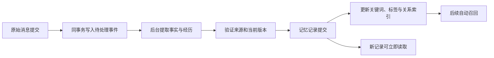
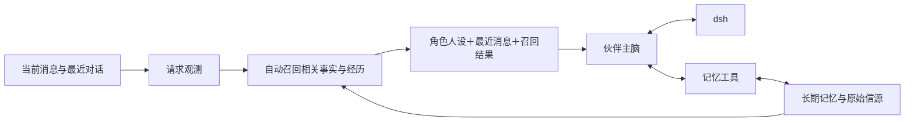

# WorldlineBox VCP 自动召回与长期记忆设计研究

> 2026-10-21 方向更新：维护者已明确现有无 Embedding 实现仅为占位，后续由 VCP 完整替换，不保留双引擎或旧方案回退。当前替换依据见 [VCP 记忆完整替换调研](research-vcp-memory-replacement.md)。下文保留为旧方案背景，不能再将“不依赖 Embedding、独立重写”作为后续实施约束。

调研日期：2026-10-14。核对版本：VCPToolBox 2e75d5422430e55a16ead42f6c03b2365fdc9cc5。

WorldlineBox 的目标是让同一个私聊或群聊长期持续使用。每次伙伴回复由角色身份、人设、最近消息和自动召回的相关记忆共同构成；伙伴还可以直接调用记忆工具，查询、核查和维护自己的记忆。长期存档不依赖一次模型 session，也不要求用户定期新建聊天。

本方案遵循已确定的方向：主脑不增加总上下文预算层，不按 token 配额分配或裁剪消息与记忆，不把联系人聊天维护成永久 append 与 compact 的执行会话。检索集合按当前问题的相关性、证据、有效状态和可见范围形成。VCP 的机制作为研究对象，WorldlineBox 按自己的领域模型独立实现。

当前设计已确定完全不依赖 Embedding 模型：使用自动标签、实体与别名、结构化事实、全文检索、时间和有来源的关系召回。下文的向量、EPA 与 RiverMemo 数值过程描述 VCP 的实际实现，不是 WorldlineBox 的依赖清单。具体方案见 [WorldlineBox 无 Embedding 自治记忆设计](design-companion-autonomous-memory.md)。

“无限对话”的验收含义是：聊天不会因为累计消息达到 session 长度而需要重置；原始记录可以持续保存和回查；很久以前的重要经历、事实和约定能够再次参与当前对话；纠正、遗忘、重启和并发操作不会破坏记忆一致性。是否能答对某条旧信息，需要分别验证它是否入库、是否被召回，以及模型是否正确使用了证据。

## VCP 当前记忆系统的实际分工

| 部分 | 当前作用 | 学习要点 |
| --- | --- | --- |
| DailyNote | 创建、更新日记，进入文件变更和索引协调队列 | 记忆需要可靠写入及明确状态 |
| KnowledgeBaseManager | 管理 SQLite、分块、向量、标签、索引和派生资产 | 原始内容与可重建索引分别管理 |
| RAGDiaryPlugin | 在模型回复前召回日记并替换上下文占位符 | 自动召回发生在模型形成回答之前 |
| LightMemo | Agent 主动检索日记或冷知识，支持 RiverMemo、纯 KNN 和其他筛选 | 自动提供线索与主动深入核查共用记忆能力 |
| RiverMemo | 基于查询观测、标签传播、局部与迁移场、结构读出排序 | 关系检索同时保留正文和直接事实支持 |
| OneRing | 跨前端近期原始消息同步 | 近期连续性与永久聊天存档职责不同 |
| OneRingMemo | 对近期消息生成客观事件摘要 | 连续性摘要保留人物、来源和时间 |
| VCPTimeLine | 月度阶段概览及相关时间线展开 | 多年经历可以按阶段组织并按需深入 |
| DailyNoteManager | 接收整理后的内容，将原日记归档 | 整理后的记录需要能追溯原记录 |
| AgentDream | 可选离线联想、合并、删除和感悟提案 | 反思结果不能直接变成已证实事实 |
| DeepMemo 和 TopicMemo | 配套前端或分布式侧提供原始聊天回查 | 日记检索需要原始信源核查作为补充 |

当前通用热记忆检索主线已收束为 RiverMemo。历史 TagMemo 检索分支和 DTSC 读出已退休，共享的 EPA、残差、AGS 与 Spike 底座仍保留。纯 KNN 作为独立出口，用于候选、显式对照和部分故障回退。文件名中包含 TagMemo 不代表该文件仍提供独立的旧检索主线。

RAGDiaryPlugin、部分旧 README、梦系统说明和知识切片存在不同年代的描述。实现判断以当前调用路径和有效插件清单为准。AgentDream 当前插件清单为 .block；OneRingMemo 自动生成默认关闭，不能认为安装后所有聊天都会自动整理成长期记忆。

来源：[当前记忆管理说明](https://github.com/lioensky/VCPToolBox/blob/2e75d5422430e55a16ead42f6c03b2365fdc9cc5/docs/VCP记忆管理系统.md)、[检索主线](https://github.com/lioensky/VCPToolBox/blob/2e75d5422430e55a16ead42f6c03b2365fdc9cc5/modules/knowledgeBase/searchService.js)、[OneRingMemo 默认值](https://github.com/lioensky/VCPToolBox/blob/2e75d5422430e55a16ead42f6c03b2365fdc9cc5/Plugin/OneRing/OneRingMemo.js#L8)。

## 记忆从产生到可检索的完整链路

VCP 的日记主要由 Agent 调用 DailyNote 创建或更新。工具接受正文、日期、作者、目录和标签，内容以文件保存。知识库监听变更，将文本切片，生成或复用向量，更新 SQLite 内容、文件标签与原生索引，再刷新受影响的派生资产。

写入与索引完成是两个状态。DailyNote 和 DailyNoteManager 当前使用最终一致的队列模式：文件成功落盘可以先返回，后台继续删除旧索引、向量化新内容和发布索引。DatabaseCoordinator 负责协调 JS 批处理、外部文件变更和 Rust 写入，并支持等待索引完成。

这种方式适合把耗时的索引计算移出聊天响应路径，但应用必须明确处理刚保存的记忆。用户说“记住这个”后立即问“你记住了什么”，不能因为向量索引尚未完成就说不知道。

WorldlineBox 的建议链路：

原始消息与待处理事件由消息库 owner 在同一事务中提交。后台按消息序号增量处理，持久化成功位置和失败状态。重启后从未处理部分继续，不扫描整段聊天，也不只依靠聊天停下来才开始整理。

显式记忆工具和后台提取共用验证与提交入口。后台根据消息中的事实、稳定偏好、约定、事件和纠正形成记录；普通寒暄、模型猜测、引用台词及工具参数草稿不能自动成为用户事实。工具成果只有在有结果证据时才作为已完成经历记录。

幂等身份需要包含来源消息身份、消息修订、记录类型和提取器版本。重试应更新同一份候选或形成明确版本，不重复制造多个“同一事实”。后台较晚处理一条旧消息时，也不能按处理完成时间覆盖用户后来明确纠正的事实。

来源：[DailyNote](https://github.com/lioensky/VCPToolBox/blob/2e75d5422430e55a16ead42f6c03b2365fdc9cc5/Plugin/DailyNote/dailynote.js)、[变更协调器](https://github.com/lioensky/VCPToolBox/blob/2e75d5422430e55a16ead42f6c03b2365fdc9cc5/modules/knowledgeBase/databaseCoordinator.js#L243)、[入库流程](https://github.com/lioensky/VCPToolBox/blob/2e75d5422430e55a16ead42f6c03b2365fdc9cc5/modules/knowledgeBase/ingestionPipeline.js)。

## 自动召回如何构造当前问题

RAGDiaryPlugin 先识别需要记忆的上下文入口。没有相应占位符的请求直接返回，不计算完整记忆链路。纯文本直接读取和 BM25 入口还有单独的快速路径。

默认主查询对最新真实用户消息与最近 AI 消息分别生成向量，再按 0.7 与 0.3 加权。历史分段可以作为补充候选查询。ContextVectorManager 的历史聚合默认采用最近 10 条向量和 0.75 的衰减率；历史消息主动调用 Embedding API 默认关闭，因此“全上下文观测”不能解释成每次都重新向量化所有旧消息。

BM25QueryOptimizer 对上一条 AI 的主题影响增加门控。用户突然换话题时，降低旧 AI 内容的权重，保留实体和具体术语。时间检索解析最新真实用户消息，避免把 AI 自己说出的时间误当用户的查询范围。

WorldlineBox 应构造独立的请求观测：

- 当前用户要求及其引用消息。
- 最近对话中与指代和话题延续有关的内容。
- 已确认的人物、项目、事件、别名和时间线索。
- 用户询问当前状态还是历史状态。
- 当前伙伴身份、聊天空间、可见范围与消息序号。
- 本次正在执行的任务身份，避免将旧任务误当新委托。

换话题、否定、更改名字或日期时，应优先采用最新明确输入。查询展开产生的联想只属于本次检索，不自动写回长期事实图。VCP 的 Ghost Core 机制也区分了请求级临时桥与永久标签关系。

WorldlineBox 不应照抄 0.7、0.3、0.75 等常量。可以学习来源分开、话题门控与衰减的方法，再用本项目中文聊天、群聊和短指代样本确定行为。

来源：[查询组装](https://github.com/lioensky/VCPToolBox/blob/2e75d5422430e55a16ead42f6c03b2365fdc9cc5/Plugin/RAGDiaryPlugin/RAGDiaryPlugin.js#L1542)、[上下文向量](https://github.com/lioensky/VCPToolBox/blob/2e75d5422430e55a16ead42f6c03b2365fdc9cc5/Plugin/RAGDiaryPlugin/ContextVectorManager.js)、[关键词查询门控](https://github.com/lioensky/VCPToolBox/blob/2e75d5422430e55a16ead42f6c03b2365fdc9cc5/Plugin/RAGDiaryPlugin/BM25QueryOptimizer.js)。

## 关联检索怎样超出文本相似度

VCP 把日记的有序标签持久化为文件与标签关系。重复出现的标签提供跨日记连接，位置及共现关系参与图资产生成。当前问题激活部分标签，传播后形成请求级节点状态与实际边流。

EPA 对标签向量建立投影基底，测量当前向量在相关方向上的能量分布。Residual Pyramid 逐层解释已经匹配的分量，并继续寻找剩余方向。AGS 选择具有解释增益和新信息的邻居。它们提供检索观测，不证明记忆本身真实。

Spike 传播记录前驱节点，衰减远距离信号，抑制立即回流，并设置跳数、邻居和传播状态终止条件。这样可以利用关系链，而不让高频公共标签把所有记忆串成一个无法区分的巨大主题。

RiverMemo 将同一查询观测投影为局部场与迁移场，检查候选的有序标签链如何接触这些场，以及对应关系是否能够回到候选正文。Ω 测量本次查询结构是否充分形成，从而限制关系结构对排序的影响；Direct Anchor 保留较直接的源标签接触。

重要区别：上述“可信”“锚点”“逻辑深度”是内部检索信号。Direct Anchor 也不是逐字原文核验，源码包含语义接触与弱化兼容分支。具体人名、日期、数量、否定和事实状态，还需要单独的来源与结构化事实验证。

WorldlineBox 可以独立实现以下思路：

1. 将记忆中的人物、项目、事件、主题与别名建立关联。
2. 同时保留关键词、标签、时间和直接实体匹配入口；聊天模型可以提出检索词和候选解释，不生成检索向量。
3. 用关系链提供补充候选，并保留候选为何被召回的解释。
4. 标签共现只支持检索关联，不自动升级为因果事实。
5. 将“直接回答所需事实”和“相关背景”分别标识，避免背景挤占直接答案。
6. 图稀疏或尚未建立时，继续用直接事实、关键词和标签检索工作。
7. 只有实际提升回忆表现的关系算法才进入默认路径。

研究 RiverMemo 的数值实现有助于理解这类机制，但本项目应独立确定算法与数据结构。不能因为使用了图、向量投影或传播，就认为已拥有相同效果。

来源：[RiverMemo 生产构型](https://github.com/lioensky/VCPToolBox/blob/2e75d5422430e55a16ead42f6c03b2365fdc9cc5/docs/RIVERMEMO_TOPOLOGY_V3.md)、[Rust 查询观测](https://github.com/lioensky/VCPToolBox/blob/2e75d5422430e55a16ead42f6c03b2365fdc9cc5/rust-vexus-lite/src/memo_pipeline.rs)、[Rust 传播](https://github.com/lioensky/VCPToolBox/blob/2e75d5422430e55a16ead42f6c03b2365fdc9cc5/rust-vexus-lite/src/memo_sensing.rs)、[Rust 最终排序](https://github.com/lioensky/VCPToolBox/blob/2e75d5422430e55a16ead42f6c03b2365fdc9cc5/rust-vexus-lite/src/rivermemo_topology_v3.rs)。

## 检索结果如何进入伙伴主脑

VCP 的自动召回通过占位符替换回填到请求中的 system 或指定的虚拟系统载体，并用自描述区块保留检索元数据。它同时去除工具标记等检索噪声，去重重复的日记和结果；多模态消息采用修改时复制，尽量复用未变内容。

WorldlineBox 不需要引入 VCP 的占位符协议。宿主已经知道角色、聊天和当前用户消息，可以在调用模型前直接请求记忆服务，再将返回内容与最近消息共同组织为本次输入：

召回记录应带身份、时间、来源、类型、有效状态和相关事件。稳定人格与行为规则单独保存，记忆内容作为资料处理。原聊天、网页和其他伙伴发言中的指令不能通过召回变成系统权限。

每次按当前语境重新形成相关记忆集合。没有匹配时允许返回空集合；存在明确回忆要求但没有证据时，伙伴通过主动工具继续核查，仍找不到则说明无法确认。

检索条数与相关性筛选属于检索行为。本设计不在检索后另加主脑总 token 配额或按字数静默裁剪。复杂回顾可以通过事件概览、主题检索和原文展开逐步读取证据。模型接口自身的上下文能力仍然存在；若一次请求确实无法被当前模型接受，应明确返回兼容问题，不能以暗中删掉当前要求来假装正常。

## 原始聊天回查如何适配持续聊天

配套 VCPChat 的 DeepMemo 插件源码采用话题 history.json：按文件修改时间排除最近一个话题，对剩余话题临时建立 FlexSearch 索引，检索关键词并读取命中消息的前后窗口，支持可选重排。按该路径推导，如果联系人只有一个永久话题，排除后就没有可搜索来源。这是该插件实现的适配限制，不能推广为所有 VCP 部署的行为。[DeepMemo 插件源码](https://raw.githubusercontent.com/lioensky/VCPChat/main/VCPDistributedServer/Plugin/DeepMemo/DeepMemo.js)

TopicMemo 这份源码提供 ListTopics 和 GetTopicContent：列出话题，或读取并格式化整个话题历史。这说明它采用话题文件作为信源展开单位，不能直接作为本项目永久群聊或私聊的默认读取方式。[TopicMemo 插件源码](https://raw.githubusercontent.com/lioensky/VCPChat/main/VCPDistributedServer/Plugin/TopicMemo/TopicMemo.js)

WorldlineBox 可以学习“检索线索，再读原始前后文”的机制。原文查询继续使用已有的 SQLite 全文索引、消息序号与 around 游标，允许检索当前聊天中已经离开最近窗口的消息。每条记忆保存来源消息身份；展开事件时按这些身份合并相邻窗口，校验聊天范围、修订和删除状态，并返回可以继续读取的游标。

原始历史、记忆、工具输出和事件摘要有不同证据性质。人物、日期、数量、原话和旧约定需要核查时，读取对应原文；原任务的成果需要核查时，读取已保存的结果证据。召回历史任务只提供背景，不重新执行旧任务。长事件可以按来源窗口继续读取，无需将整个永久话题一次装入主脑。

这两份配套源码为 2026-10-14 读取的公开 main 文件，未固定到已核对的提交；它们与本地 VCPToolBox 固定版本分别标识，后续实现前需再次确认入口及部署版本。

## 记忆记录的数据模型

以下为 WorldlineBox 建议模型，并非 VCP 现有 schema：

| 对象 | 必要信息 | 作用 |
| --- | --- | --- |
| 原始消息 | 消息 ID、聊天 ID、作者 ID、序号、时间、修订、正文与附件引用 | 完整聊天信源与顺序 |
| 记忆记录 | 类型、正文、主体、来源、归属、可见范围、状态、版本 | 事实、偏好、约定与经历 |
| 事实版本 | 事实键、有效起止、替代关系、来源时间 | 区分“过去如此”和“目前如此” |
| 经历事件 | 人物、项目、主题、事件时间、关联消息 | 跨多条消息形成完整经历 |
| 记忆来源 | 来源消息、消息修订、正文校验、证据类型 | 追溯、修订与来源失效 |
| 记忆关联 | 端点、关系类型、支持来源、状态 | 检索关联与证据链 |
| 索引状态 | 内容版本、分词与标签规则版本、发布代际 | 重建与切换索引 |
| 处理事件 | 来源身份、处理阶段、失败信息、重试与水位 | 断点恢复和幂等处理 |
| 遗忘记录 | 作用对象、范围、来源及衍生关系、操作时间 | 防止旧信息从索引或后台提取中复活 |

建议区分用户明确事实、用户偏好、双方约定、客观经历、任务状态和伙伴主观感想。主观感想可以作为伙伴经历保留，但不得作为用户已经确认的事实回答。

例如“准备六月搬家”“后来取消搬家”“七月又重新考虑”应分别保留事件与变化。当前状态回答采用最新有效证据；询问“当时怎么想”时，可以检索历史版本。排序按事实发生与来源时间处理，不能用后台更新日期代替事件时间。

## 主动记忆工具与管理闭环

| 工具 | 语义 | 宿主负责的校验 |
| --- | --- | --- |
| memory.search | 按主题、人物、项目或时间找相关记录 | 查询范围与当前身份 |
| memory.read | 展开指定记忆、事件及原始前后文 | 来源版本、可见范围和删除状态 |
| memory.write | 记录新的明确事实、约定或经历 | 来源真实性、归属、重复和已有新版本 |
| memory.update | 补充、纠正或结束某条记录的有效状态 | 记录版本与支持新内容的来源 |
| memory.forget | 按用户要求使信息退出回忆与再提取 | 作用范围及所有衍生索引、摘要和关联 |

伙伴主脑直接调用这些工具，dsh 继续处理外部执行任务。所有已支持模型格式需要采用统一的工具注册与分发契约，保留原生调用 ID 和返回对应关系。现有只接受 dsh 的派发限制需要在实现阶段调整，单独添加工具描述不能完成接入。

写入返回应明确记录是否已提交。事实、标签关联和必要全文索引在同一事务提交，新记录立即可查询；耗时的阶段归纳可以后台更新。读写结果保留记录 ID 与来源信息，便于继续读取、纠正和管理。工具调用失败不能生成“已经记住”的成功表述。

遗忘需先提交失效或遗忘状态，再更新索引、缓存、事件摘要和关联。即使旧索引尚在，读回记录时也必须过滤失效项。后台重试不能重新提取被明确忘记的来源及衍生内容。聊天原文的保留或删除遵从用户指定范围。

批量整理只处理可追溯记录。来源图保留合并前的记录身份，整理失败可以恢复。VCP 的 DailyNoteManager 有归档流程，AgentDream 则先生成待审核提案；WorldlineBox 可以学习这种分离，保持清理与事实确认各自明确。

来源：[批量整理](https://github.com/lioensky/VCPToolBox/blob/2e75d5422430e55a16ead42f6c03b2365fdc9cc5/Plugin/DailyNoteManager/daily-note-manager.js#L242)、[梦操作](https://github.com/lioensky/VCPToolBox/blob/2e75d5422430e55a16ead42f6c03b2365fdc9cc5/Plugin/AgentDream/AgentDream.js)。

## 群聊和私聊中的身份与并发

同一伙伴在私聊和群聊里可以具有连续身份，但每条记忆的可见范围由来源和用户授权确定。伙伴归属与记忆公开范围是两个维度。

群内共同事实可以保存一份，由有权限的成员读取；伙伴对经历的主观感想分别归属于自己。不同群、伙伴私聊和明确共享的信息采用独立范围。群成员加入、退出以及用户分享某段私聊内容，需要能够说明相应信息何时对谁可见。

记忆工具不能通过模型填写其他伙伴名字或任意目录获得权限。宿主给出已验证的身份与范围，检索在这些范围内执行，返回正文前再次验证。关系图的来源贡献也需按范围筛选，避免私聊关联暗中影响群聊查询。

每次回复绑定来源消息和读取快照。最近消息读取不越过该来源序号；执行中的用户补充通过已确认的补充渠道加入。记忆版本按其来源和有效状态解释，避免排队旧请求把后来的要求误当自己的目标。

并发处理需要请求自己的查询观测和历史分段。可以共享不可变索引与可验证的 embedding 缓存，不能共享可被另一聊天覆盖的最近对话状态。更新记忆采用版本校验，重复写入采用幂等身份；较旧事件迟到时不能覆写较新的纠正。

来源：[VCP 显式日记作用域](https://github.com/lioensky/VCPToolBox/blob/2e75d5422430e55a16ead42f6c03b2365fdc9cc5/KnowledgeBaseManager.js#L1863)、[查询范围传播](https://github.com/lioensky/VCPToolBox/blob/2e75d5422430e55a16ead42f6c03b2365fdc9cc5/modules/tagmemoV10/provenance.js)、[WorldlineBox 现有来源消息快照](companions.md)。

## 长期运行与多年记忆

WorldlineBox 的完整消息库继续作为原始聊天的权威存档。VCP 的 OneRing 默认只保留每个 Agent 最近 100 条消息，可以配置关闭该限制；它承担近期跨端连续性，不能替代永久存档。OneRingMemo 的近期摘要也只能覆盖当时仍然可访问的输入。

近期对话、事件记忆、事实状态和长期阶段概览可以独立存在。近期事件摘要与月度阶段概览属于外部记忆记录，并保留来源；它们不替换原始聊天。需要细节时展开对应事件和消息。无需等待用户关闭一个 session，话题或事件已经形成时就可以后台更新。

全文索引、关系统计和阶段概览属于派生数据。损坏时从权威记录重建，事实与原始来源继续保留。改变中文分词、标签规范或关系算法时，为派生数据记录规则版本，验证后发布新代际。聊天模型更换后不重编码整个语料库；已有事实和标准标签继续使用。

VCP 值得借鉴的可靠性机制包括：SQLite 事务、受影响标签的失效标记、索引增减的原子发布、双槽基线、基线与当前记录差异回放、按需加载、空闲索引回收、运行代际和失败重建。

WorldlineBox 当前消息库由 UtilityProcess 独占。记忆落库、事件队列和写入协调应遵循这一职责。模型请求和耗时计算可以独立调度，完成后通过已验证的结果提交。不要让主进程、dsh 和原生检索器同时成为消息库写入 owner。

每次索引关闭、切换、角色移除和应用退出都需要释放句柄与注册关系。长期运行的验收应观察进程内存、索引驻留、待处理队列、WAL、文件句柄和重启后的恢复状态。

来源：[OneRing 存储清理](https://github.com/lioensky/VCPToolBox/blob/2e75d5422430e55a16ead42f6c03b2365fdc9cc5/Plugin/OneRing/OneRingDB.js#L67)、[OneRing 默认上限](https://github.com/lioensky/VCPToolBox/blob/2e75d5422430e55a16ead42f6c03b2365fdc9cc5/Plugin/OneRing/OneRing.js#L651)、[索引仓库](https://github.com/lioensky/VCPToolBox/blob/2e75d5422430e55a16ead42f6c03b2365fdc9cc5/modules/knowledgeBase/indexRepository.js)、[UtilityProcess 存储职责](companions.md)。

## 需要独立验证的准确性问题

文本近似缓存可能掩盖语义反转。对“我喜欢甜食”与“我不喜欢甜食”放在同一较长句中的合成探针，ContextVectorManager 的 Dice 相似度为 0.953846，高于其 0.85 阈值；缓存分支实际复用了旧向量。此探针验证的是分支行为，不代表最终模型一定答错。对否定、人名、数字、日期和事实修订，WorldlineBox 应使用内容与模型签名精确校验，重新建立受影响索引。

去重也不能只看向量相似度。同一事件的两次修订、计划与取消、两个不同人的类似经历，都可能十分相似。先检查主体、事实键、来源与有效时间，再判断是重复、变化还是不同记录。

检索缓存需要包含可见范围、记忆内容版本、模型签名和算法版本。当前 VCP 的查询缓存键主要包含查询、日记范围、修饰符和检索参数，未包含语料修订；默认查询缓存 TTL 为一小时，配置变化有清理路径。不能仅依靠 TTL 满足用户刚纠正或刚忘记的信息立即生效。

完整 AIMemo 模式可能读取整个选定知识库，再由额外模型综合处理。该机制适合明确的深入回顾，不宜直接成为无限增长聊天的每次默认前置流程。WorldlineBox 默认自动召回应先用索引找到相关材料，需要深入综合时再处理相关来源集合。

VCP 的部分内部观察、可视化和 ANN 指标不能替代记忆正确率。检索找到旧事实、模型引用旧事实、正确采用后来的纠正，是不同验收点。

来源：[缓存匹配](https://github.com/lioensky/VCPToolBox/blob/2e75d5422430e55a16ead42f6c03b2365fdc9cc5/Plugin/RAGDiaryPlugin/ContextVectorManager.js#L78)、[查询缓存键](https://github.com/lioensky/VCPToolBox/blob/2e75d5422430e55a16ead42f6c03b2365fdc9cc5/Plugin/RAGDiaryPlugin/RAGDiaryPlugin.js#L5067)、[AIMemo](https://github.com/lioensky/VCPToolBox/blob/2e75d5422430e55a16ead42f6c03b2365fdc9cc5/Plugin/RAGDiaryPlugin/AIMemoHandler.js)。

## 本次验证记录

以下验证使用隔离 fixture 或临时数据库，没有调用付费模型或访问真实聊天库：

| 验证 | 结果 | 能支持的结论 |
| --- | --- | --- |
| 原生联合检索协议及失败回退 | 6 项 node:test 通过 | 参数、结果对应及回退路径成立 |
| 结果去重 | 11 项 node:test 通过 | 硬去重、近重复抑制、缺失向量与失败回退成立 |
| OneRing 临时契约 | 5 项 node:test 通过 | 前端范围只作用于当前请求及输入位置校验成立 |
| NativeKnowledgeRuntimeRegistry | 脚本正常退出 | 注册归属、代际替换、共享修订和关闭成立 |
| NativeSemanticDeduplication | 脚本正常退出 | 临时 SQLite 下批量取向量与语义去重成立 |
| DiaryIndexAtomicDelta | 脚本正常退出 | 1,200 条合成向量更新期间读取不混合半批，失败后可从 SQLite 重建 |
| TagIndexGenerationalBaseline | 脚本正常退出 | 基线差异回放与双槽代际发布成立 |
| TagPairwiseIncrementalPersistence | 功能断言完成，清理阶段退出码 1 | 向量变更失效行为已覆盖，但该运行不能记为完整通过 |
| NativeMemoManifestCompatibility | 功能断言完成，清理阶段退出码 1 | 句柄、原生联合查询等功能断言完成，但该运行不能记为完整通过 |
| 文本否定变更缓存探针 | 相似度 0.953846，复用旧向量 | 模糊缓存必须考虑关键语义变化 |
| 话题切换关键词探针 | AI 主题门控 0.08，仅选择当前 SQLite 主题术语 | 该合成场景能抑制上轮无关关键词 |

五个依赖 SQLite 的原生脚本使用 WorldlineBox 已安装的 Electron Node 与 better-sqlite3 依赖解析路径，没有安装或修改 VCP 依赖。测试文件保持原样；运行包装仅验证临时目录清理范围。两项清理错误发生在 Windows：原生构建路径保留 SQLite keepalive，导致测试在进程结束前删除临时文件时报 EPERM。源码中 SQLITE_KEEPALIVES 保存了进程级连接；所查调用点没有对应移除操作。不能据此直接声称应用会泄漏，但句柄生命周期需要单独实现和验证。

额外清理这两个目录的操作被自动审批以 blocked by policy 拒绝，目录保留为：

- C:/Users/hp/AppData/Local/Temp/vcp-pairwise-incremental-lAp1Jt
- C:/Users/hp/AppData/Local/Temp/vcp-native-memo-manifest-htJz8V

以上验证不包含真实自然语言 Embedding 的召回质量、真实模型最终回答正确率或百万记忆的生产负载。算法行为与工程不变量已经有检查基础，效果仍需带人工相关性标注的长期聊天样本。

来源：[原子更新测试](https://github.com/lioensky/VCPToolBox/blob/2e75d5422430e55a16ead42f6c03b2365fdc9cc5/tests/diaryIndexAtomicDelta.test.js)、[原生兼容测试](https://github.com/lioensky/VCPToolBox/blob/2e75d5422430e55a16ead42f6c03b2365fdc9cc5/tests/nativeMemoManifestCompatibility.test.js)、[SQLite keepalive](https://github.com/lioensky/VCPToolBox/blob/2e75d5422430e55a16ead42f6c03b2365fdc9cc5/rust-vexus-lite/src/lib.rs#L1451)。

## WorldlineBox 实现顺序与验收

实现按依赖组织，但每一阶段都要贯通实际聊天入口：

1. 建立来源、版本、事实状态、经历事件和持久处理队列，让显式记忆与后台提取可靠提交。
2. 给主脑接入记忆工具；统一身份、作用域、来源读取和修改行为。
3. 在每次回复前接入自动召回，将相关事实与经历同最近消息一起送入主脑。
4. 加入时间、人物、项目、标签与全文混合检索，以及原始聊天展开。
5. 加入关系传播和相关背景召回，验证它是否补足常规检索遗漏。
6. 加入经历整理与阶段概览，保持来源及事实版本。
7. 完成长时间连续使用、故障恢复、索引切换、缓存失效和句柄生命周期验收。

| 场景 | 必须满足的行为 |
| --- | --- |
| 极早事实 | 在隔了大量无关消息后仍能找回名字、生日或约定 |
| 间接提示 | “压力又大了”能召回确有证据的关联背景，且不凭联想断言原因 |
| 指代延续 | “之前那个方案”结合最近话题召回对应事件 |
| 主题切换 | 上一轮旅行话题不污染下一轮数据库问题 |
| 状态修订 | “喜欢”改为“不喜欢”后，当前回答采用新事实；历史查询保留旧版本 |
| 计划变化 | 计划、取消与重新考虑按时间区分 |
| 精确信源 | 人名、日期、数量和原话可以回到原始消息核对 |
| 群聊范围 | 伙伴私聊、其他群内容与群内共同事实保持正确范围 |
| 并发纠正 | 旧提取任务迟到不会覆盖新纠正 |
| 遗忘 | 缓存、全文索引、关联、摘要及后台重试都不能使遗忘内容复活 |
| 索引滞后 | 刚写入的事实、标签及必要全文索引同时可读，阶段概览可稍后生成 |
| 重启 | 未处理消息继续入库，已完成外部动作不重复执行 |
| 模型切换 | 聊天模型更换不要求重建全部记忆；分词、标签和抽取规则保持明确版本 |
| 长期增长 | 单次回复不扫描全量消息；旧记录保持可检索 |
| 多年回顾 | 按阶段定位并展开相关事件，无需重置联系人聊天 |
| 长期运行 | 内存、队列、索引与句柄状态可观察，失败可恢复 |

评价分别覆盖入库完整性、候选召回、排序、事实时效、来源正确性、跨范围隔离、遗忘一致性和最终回答。可采用带标注样本的 Recall、排序指标及答案证据核验，并记录检索与模型调用各自耗时。直接事实、关系背景和多时间段查询分别评价，不能用一个平均分掩盖旧事实反转或范围泄露。

当前 WorldlineBox 已有完整 SQLite 消息存档、分页、关键词搜索、伙伴归属记忆和按来源消息固定的回复上下文。需要补齐的核心是：可靠的记忆形成与修订、主脑主动记忆工具、回复前自动召回，以及贯通这些入口的长期一致性。相关实现尚未在本次调研中修改。

## 参考范围与独立实现原则

主要资料为本地 VCPToolBox 固定版本的源码、白皮书 V5、当前记忆管理文档、RiverMemo Topology V3 说明和两个官方页面：[Learn VCP](https://www.vcptoolbox.com/learn-vcp)、[TagMemo V9 与 RiverMemo V10 引擎说明](https://www.vcptoolbox.com/vcp_wave_v8_engine)。网址中的 V8 名称不代表当前页面只介绍旧 V8。

WorldlineBox 学习自动唤起过去、主动核查信源、分层存储经历、关系检索和可靠索引管理的机制，按本项目角色、群聊、SQLite owner 与工具协议独立实现。VCP 的占位符、角色称呼、目录命名、提示词与具体数值参数不作为本项目必须采用的格式。

VCP 仓库许可为 CC BY-NC-SA 4.0，WorldlineBox 当前声明 MIT。若今后转为直接复制或分发 VCP 组件，需另外处理其许可与授权；本设计采用独立实现方向。
