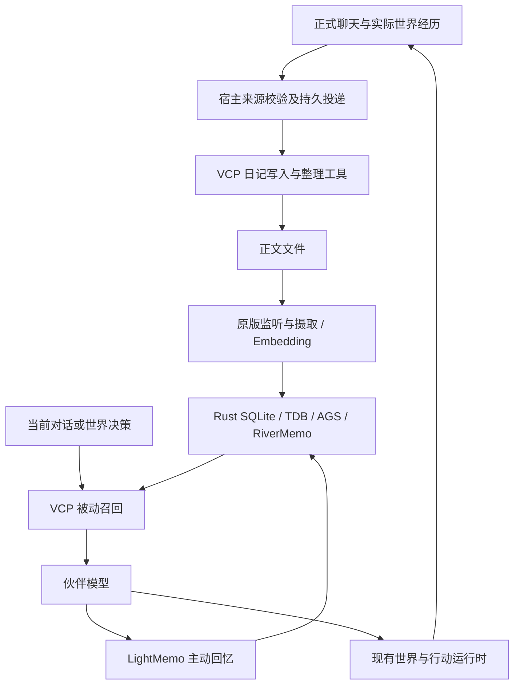

# 用 VCP 完整替换伙伴记忆系统：源码调研与实施边界

日期：2026-10-21。本文保留前期源码调研与实施边界；生产接入已推进，以 [当前实施说明](companion-memory-implementation.md) 和本次实际验证输出为准。

核对版本：WorldlineBox `b193d3e95b8b1be677708a29083d7f81bf2d1466`；VCPToolBox `7ceecd48c46caac8168b909ade5febbc4a254e42`。本次还读取了用户引用的 VCP 调研聊天，并以当前本地源码重新验证结论。

## 已确定的方向

维护者明确：现有无 Embedding 方案是短期占位，VCP 应完整替换它。最终只运行一套 VCP 记忆系统，不保留旧检索、旧抽取器、双引擎、兼容事实结构或旧引擎回退。

本文取代旧设计文档中“长期不依赖 Embedding、独立重写 VCP 思路”的后续实施方向。旧文档仍可用于理解现状，不能再作为新增记忆实现的约束。本次没有删除旧代码或用户数据，也没有导入 VCP 的实际日记、配置和密钥。

结论：可以移植，而且数据库、向量索引和 RiverMemo 数学核心可以保持上游源码字节不变。完整产品接入仍需要路径、模型调用、身份、来源、权限、工具和世界生命周期适配；不能承诺整个插件体系零修改即可放入 Electron。

## 当前 VCP 的真实底座

当前主线是 Rust 持有 SQLite 业务事务，内联 TDB 2-bit 检索，AGS 几何、EPA/残差观测、Spike 传播、RiverMemo 双场与 Topology V3 排序。不是旧资料中的 USearch，也不是把 JavaScript 标签搜索换一个名字。

VCP 的“自研数据库”包含自研运行时、集成和算法，底层 SQLite 仍是外部基础设施；`vcp-tdb-index/Cargo.toml:8` 还明确标为移入的 TriviumDB 0.8.9 QuIVer 检索内核。它不是所有依赖均从零自研。向量模型也需要另外提供。当前白皮书也说明了基础设施边界。VCPToolBox 后端是 Node.js/CommonJS 与 Rust N-API，Electron 是其客户端生态的一部分，无需复制整套客户端才能嵌入 WorldlineBox。

| 数据层 | 当前事实 | 移植处理 |
| --- | --- | --- |
| 可编辑记忆正文 | `dailynote/<日记本>/*.txt`、`*.md` | 新建 WorldlineBox 专属目录，保留原格式与有序 Tag |
| 已索引内容与原始向量 | `knowledge_base.sqlite` 的 `files/chunks/tags/file_tags` 等 | 保留 Rust schema 与 Write Actor，不改成旧事实表 |
| 加速索引 | TDB、全局/日记索引、双槽 checkpoint | 保留原实现与签名检查 |
| 关系和几何 | AGS、传播图、Memo artifact 等派生资产 | 保留原构建、失效与发布机制 |
| 聊天原文、世界状态、来源与操作投递 | WorldlineBox 已有消息库及世界存储 | 继续由宿主拥有，不与 VCP SQLite 混写 |

正文文件提供编辑和重新摄取来源；SQLite 是检索运行时的已索引事实依据。原始 FP32 向量仍存在，2-bit 不能解释成整个数据库缩小到 1/16。索引恢复与重新生成 Embedding 是不同操作。

证据：[当前白皮书 V6](https://github.com/lioensky/VCPToolBox/blob/7ceecd48c46caac8168b909ade5febbc4a254e42/docs/vcp-whitepaper.md#L8)、[Rust schema](https://github.com/lioensky/VCPToolBox/blob/7ceecd48c46caac8168b909ade5febbc4a254e42/rust-vexus-lite/src/schema.rs#L3)、[Rust 依赖](https://github.com/lioensky/VCPToolBox/blob/7ceecd48c46caac8168b909ade5febbc4a254e42/rust-vexus-lite/Cargo.toml#L30)。官网 [RiverMemo 页面](https://www.vcptoolbox.com/vcp-rivermemo-engine) 与当前主线相符，其交互演示明确不是检索质量或实际延迟测试。

## 原样保留的最小核心

从 `KnowledgeBaseManager.js` 出发，当前热记忆 JavaScript 本地依赖闭包是下列 19 文件：

```text
EmbeddingUtils.js
KnowledgeBaseManager.js
ResultDeduplicator.js
RiverMemoEngine.js
TagMemoEngine.js
TagMemoV10Engine.js
modules/knowledgeBase/databaseCoordinator.js
modules/knowledgeBase/diaryMetadataCache.js
modules/knowledgeBase/fileWatcher.js
modules/knowledgeBase/indexRepository.js
modules/knowledgeBase/ingestionPipeline.js
modules/knowledgeBase/memoConfig.js
modules/knowledgeBase/memoryProfiler.js
modules/knowledgeBase/searchService.js
modules/knowledgeBase/tagConsistencyService.js
modules/knowledgeBase/textPreprocessor.js
modules/knowledgeBase/vectorCodec.js
modules/tagmemoV10/immutable.js
modules/tagmemoV10/riverObservability.js
```

另外必须保留 `rag_params.json` 和 `rust-vexus-lite` 的源代码、加载器、平台产物与构建锁。核心外部 npm 依赖为 `@dqbd/tiktoken` 与动态加载的 `node-fetch`，以及 Node 内置模块。这里没有计算测试、构建工具或外围插件的依赖。

热核心不要求整个 Express server、PluginManager、WebSocket、Vue 管理后台或 JavaScript `better-sqlite3`。但 RAGDiary 等外围插件会再引入这些依赖中的一部分，不能把 19 文件误认为完整用户体验的全部清单。

`TagMemoEngine.js`、`TagMemoV10Engine.js` 虽然保留历史名称，当前仍在核心依赖图中。不能因为旧 TagMemo 检索退役就删掉这些文件；它们承担当前配置、派生资产及桥接职责。保留上游内部代码不等于保留 WorldlineBox 的旧引擎。

配套的 [提取清单](research-vcp-memory-replacement-manifest.json) 记录当前这 19 文件、参数文件和 Windows 原生二进制的 SHA-256，以及 55 个已跟踪 Rust 子项目非二进制文件的 hash。它是审计和实施输入，不是已经可分发的独立 npm 包。

### 热记忆和冷知识不是同一个部署模块

热记忆内部已经使用 TDB 检索，不意味着另外的 `TDBKnowledge.js` 也已被包含。后者服务于低频更新的大规模 `knowledge/` 资料，默认 `TDB_KNOWLEDGE_ENABLED=false`（`:53`），使用独立 `VectorStoreTDB/`、npm `triviumdb`、JavaScript `better-sqlite3` 元数据、chokidar 与 `TextChunker.js`。`TextChunker` 还有加载时读取 cwd 下配置的副作用。

伙伴经历替换首先需要完整热记忆闭环。若同时要求静态资料知识库，则将原 `TDBKnowledge` 作为 VCP 的另一内嵌服务加入，不改造成现有素材 sqlite-vec 索引；它仍属于 VCP 架构，并非保留旧 WorldlineBox 引擎。此次热链与 Electron 验证不覆盖冷知识服务，应独立验证其 npm 原生产物、摄取与检索。

## 需要一起移植的记忆外围

| 模块 | 保留价值 | 接入方式与必要适配 |
| --- | --- | --- |
| DailyNote | 原版创建、编辑日记及标签处理 | 原 `initialize` / `processToolCall`，绑定宿主身份和路径 |
| DailyNoteManager | 原版整理、归档、关联发现 | 保留操作实现；关联发现需再带上 `modules/associativeDiscovery` 闭包 |
| RAGDiaryPlugin | 原版语境查询、时间/文本候选、被动召回、结果装配 | 保留选定完整闭包；宿主在模型调用前执行，适配路径与外部消息辅助函数 |
| LightMemo | 原版主动回忆、查询参数与格式化 | 由伙伴原生工具调用，宿主覆盖检索范围 |
| VCPTimeLine | 月度概览和长期时间骨架 | 作为长期连续性模块移植；将内部 HTTP 模型调用接到宿主 provider |
| 日记写入和整理提示 | 一事一记、具体实体锚点、先看旧记忆、保护细节 | 保留规则意图，替换 Agent 名称、工具入口及世界事实来源 |

建议目标包含上述写入、管理、被动、主动和长期概览闭环，而不是只移植 `executeNativeRiverQuery()` 后重写一套简化 RAG。实现可分阶段，但阶段一只有底座跑通时不能宣称已经完成整体替换。

另有 [外围静态依赖审计](research-vcp-memory-peripheral-dependencies.json)，使用 TypeScript AST 扫描字面量 require/import/export，不执行模块。五个入口去重为 54 个 JavaScript 文件和 6 个现存跨平台 `.node` 文件；这是当前本地静态可达集合，不意味着发布时应携带全部平台二进制。配置、模板、fs 读取的资源、依赖注入和平台 loader 的可选分支仍需单独打包验证。

选定外围连同核心的实际非平台直接 npm 包共 12 个：`@dqbd/tiktoken`、`@node-rs/jieba`、`axios`、`better-sqlite3`、`cheerio`、`chinese-lunar-calendar`、`chokidar`、`dayjs`、`dotenv`、`https-proxy-agent`、`mime-types`、`node-fetch`。WorldlineBox 当前仅直接声明其中的 `better-sqlite3`，其余需显式管理版本，不能依赖碰巧存在的传递安装。Cold TDBKnowledge 所需 `triviumdb` 另算。

具体入口：DailyNote `dailynote.js:1675/1698/1709`；DailyNoteManager `daily-note-manager.js:620/657`；LightMemo `LightMemo.js:38/99`；RAGDiary `RAGDiaryPlugin.js:586/1382/5587/5907`；TimeLine `VCPTimeLine.js:37/383/640/682`。以上行号对应本次固定提交。

### 为什么外围不能全部零改动

1. `KnowledgeBaseManager.js:36-46` 原生模块加载失败会 `process.exit(1)`，文件末尾导出单例。应放在独立 UtilityProcess，避免影响 UI 主进程。
2. `EmbeddingUtils.js`、DailyNote 和 RAGDiary 有模块顶层环境读取。配置必须在 `require()` 之前设好；只修改 KBM 实例配置不能改变所有全局读取，尤其 `VECTORDB_DIMENSION`。
3. RAGDiary 在 `__dirname` 写 `vector_cache.json`（`:207/551`）、`folding_store.db`（`:268`），并读取或监听本目录配置。不能直接把这些运行文件放入只读 ASAR。
4. RAGDiary `:26-30` 静态引入 `modules/messageProcessor.js` 的辅助函数，后者 `:31-38` 顶层带入 Agent、TVS、工具注册等非记忆管理模块。需要做完整依赖扫描，或用一个明确的小补丁注入原有辅助函数实现，不能遗漏依赖后靠运行时报错补齐。
5. VCPTimeLine `:47` 固定配置目录，`:518-542` 固定向本地 VCP `/v1/chat/completions` 调模型；不能在没有 VCP server 的情况下直接使用。

推荐将源码分为 `upstream/` 与宿主适配代码：核心 19 文件及 Rust 保持原始 hash；外围只允许集中、可审阅的路径和依赖注入补丁。每个补丁记录原因、上游来源及行为验证。保留代码原样不等于复制密钥、原作者日记或用户机器状态。

另一种零字节修改办法是把完整选定 CommonJS 树部署到可写 runtime 目录。它能保留相对路径，但会把代码和运行数据混在一起，也扩大无关依赖，故不作为首选。不能为了口头承诺“一字不动”而隐藏这些代价。

## 完整数据与行动链路



VCP 不会因为某条聊天已经存在，就自动把它全部整理成长期日记。需让伙伴写日记，并用宿主持久任务补足未处理的实际经历。该任务只负责来源投递和调用 VCP 日记能力，不再使用旧 `factKey/subject/value` 抽取器、旧标签治理或旧查询规划。

模型负责“如何用原版工具记日记”，原版 DailyNote/Manager 负责落盘与整理，原版 KBM/Rust 负责向量化、图和检索；宿主负责证明这件事实际发生、谁看见过、操作是否完成。这是必要的领域接入，不是再造一套记忆算法。

来源、操作 ID、内容修订、日记路径、入库回执用独立宿主台账关联。消息库与 VCP 库之间没有原子跨库事务：采用持久投递、幂等身份与可恢复回执。失效来源的补偿删除及重新索引期间，不能继续把受影响域作为有效记忆发布。

适配层可以只暴露以下职责，名称为建议，不是声称上游已经有这些 API：

```ts
deliverExperience(sourceIds, operationId) // 校验并持久投递真实经历，由原版日记工具处理
recallForDecision(decisionContext)       // 在宿主选定的可见域执行原版被动召回
callMemoryTool(toolName, args, identity) // DailyNote / Manager / LightMemo 的原生工具映射
awaitIndexed(noteReferences)            // 等待原版摄取完成，区分已保存和可检索
readDiary(noteReference, identity)       // 展开正文及宿主来源映射
shutdownDomain(domainId)                // 关闭原版 watcher、任务及 Rust runtime
```

可见域、路径、伙伴身份与来源凭证由宿主决定，不能由模型在参数里自行扩大。例如伙伴真正经历“雨天借伞并答应归还”后，日记工具保存这次经历；未来世界感知再次出现下雨，先运行 VCP 被动召回，再决定是否想起借伞的人及约定。此行为仍取决于日记内容、标签、Embedding 和查询质量，需要真实场景验收。

DailyNote 成功结果目前含 `indexStatus:"queued"`（`:762`），内部 `waitForIndex:false`（`:1647-1659`）。宿主 UI 和工具必须区分“已保存正文”与“已经可检索”；需要立即回忆时等待 KBM 的入库完成回执，不保留旧引擎来掩盖索引延迟。DailyNoteManager 部分整理失败还有 `partial` 状态，见 `:438-472`。

## 最重要的缺口：原版范围参数不是完整权限系统

静态与隔离实测都表明，不能直接拿 VCP 日记本参数替代 WorldlineBox 的伙伴与群聊访问规则。

静态路径：KBM `:2781` 先 `prepareUnifiedMemoObservation()`，之后 `:2790` 才建立候选 scope；`:2205` 附近传入 Memo pipeline 的内容没有日记本权限。Rust `memo_pipeline.rs:1935` 使用全局 Tag 索引及共享 artifact。日记本参数可以限制返回正文，但观测、标签图和传播场仍可能来自整个库。

此外，联合路径 KBM `:2793-2794` 根据日记本重新生成 `allowedFileIds`，并将 `deniedFileIds` 固定为空。不能声称调用方传入任意文件 ACL 就会被原生联合查询尊重。

本次额外复现：

- A 日记只有 alpha/beta，B 含 gamma；以 `diaryNames:['A']` 调观测，`matchedTags` 仍返回 gamma。
- 在 A/B 联合查询中传空 `allowedFileIds` 并把 A/B 文件全部放入 `deniedFileIds`，仍取得两条 A/B 结果。

推荐初始实现按“伙伴身份 × 实际可见域”隔离 SQLite、Tag 图、向量索引、artifact 和缓存，独立运行活跃记忆域，空闲时关闭并恢复；不能只在返回后过滤正文。群聊域只摄取群内合法来源，伙伴私人域不得偷偷混入群输出。模型传入的 `maid/folder/search_all_knowledge_bases` 也不能决定权限。

跨域联查有明确取舍：分别运行 RiverMemo 后合并结果，不再等价于单个全库 RiverMemo 排序；将合法内容投影到同一可见视图需要处理复制、修订与遗忘；在原生图中加入细粒度 scope 则需要维护上游补丁。实施时应先选择并验证这一点，不能宣称既零修改又天然支持任意细粒度 ACL。

消息序号截止、来源撤回及并发变更也不是原版日记 schema 的完整能力。宿主需在投递、查询和最终发布检查来源/域代际；旧请求遇见域变化应取消或重新装配上下文。若产品要求严格历史快照，必须另做快照或限定源视图设计，不能用最终正文过滤假装已经实现。

## Embedding 接入

| 项目 | 调研结论 |
| --- | --- |
| 模型接口 | 原 `EmbeddingUtils.js` 使用 OpenAI 兼容 Embedding 请求 |
| 默认维度 | KBM 为 3072，实际模型维度必须一致 |
| 当前内核上限 | 4096；本次实际验证 3072 查询及 4097 拒绝 |
| 内置模型 | 无；需要远端服务或本地模型服务 |
| 更换模型 | 同维不同模型也不能混用；需新语义空间或明确全量重嵌入 |
| 可复用宿主设施 | 服务配置、safeStorage 密钥、本地 llama-server 生命周期 |
| 不应复用 | 素材库 sqlite-vec、素材 embedding_profiles、libraryId 授权模型 |

配置应显式提供 endpoint、model、modelSig 和 dimension，不依赖上游不完全相同的默认模型名。保留 chunk/query/tag 的原版文本处理；素材检索的专用前缀不能悄悄套入 VCP。

现有 `src/main/embedding-service-registry.ts:27-44` 已有服务配置；`embedding-http.ts:24-93` 有 HTTP 请求；`embedding-llama-session.ts:144-183` 启动 OpenAI 兼容本地服务，但公开 session 类型 `:27-34` 只暴露 embed 方法，没有 endpoint。保持 VCP `EmbeddingUtils` 不改时，需要宿主暴露受控 endpoint 或桥接到本地兼容接口。

未在本次选择具体付费模型，也未访问用户密钥或调用真实模型。模型选择和实际语义质量仍需后续固定语料验证。

## 持续生活：替换记忆，接入现有世界生命周期

持续生活来自持久状态、世界事件、调度、当前上下文、长期记忆和实际行动组成的闭环；不是模型永久在后台思考。

VCP OneRing 主要解决跨前端近期消息同步，默认 record-only 为 true（`OneRing.js:1013`）、每 Agent 最多 100 条（`:652`）。OneRingMemo 自动生成默认关闭（`OneRingMemo.js:8-17/457-467`）。AgentAssistant 部分会话和委托状态保存在内存 Map，默认委托 15 轮/300 秒（`AgentAssistant.js:37-41/185-186`）。AgentDream 当前 manifest 是 `.block`，其梦整理操作是 `pending_review` 提案。

WorldlineBox 已有权威消息存档、伙伴身份、虚拟时间、情绪作息、500ms 世界 tick、社交、行动任务、真实电脑任务、取消和恢复。应让这些成为 VCP 记忆的经历生产者与调用者。无需再引入 OneRing 的第二套消息 owner，或 AgentAssistant 的第二套行动调度器。

原版 VCPTimeLine 等长期概览可以接入，睡眠整理应改为 VCP 日记管理流程；AgentDream 的设计可以另行评估，不能把一个当前禁用且需审核的插件当成已经存在的自动生活能力。

接入点不能只覆盖普通聊天，还包括主动联系、任务回执、世界自主决策、社交互动与睡眠整理。世界决策必须在决定行动前获得合法相关记忆，之后把实际发生的结果记回去；计划和想象不能当成已发生经历。

## WorldlineBox 必须替换与必须保留的部分

| 位置（本次 WorldlineBox 提交） | 实施处理 |
| --- | --- |
| `src/main/companions/memory-service.ts:36/77/128` | 删除旧检索、查询规划、事实抽取与维护链，换 VCP 宿主服务 |
| `src/main/companions/memory-model.ts:40` | 删除旧抽取/整理/查询 schema；改用 VCP 日记及工具行为 |
| `src/companions/memory-store.ts:30/603` | 退休旧记忆事实表、FTS/结构锚点/关系排序，不参与新召回 |
| `src/shared/companion-memory.ts`、`companion-memory-tool.ts` | 用 VCP 真实日记/工具契约替换旧事实参数，不伪装兼容 |
| `src/main/companions/service.ts:790-805/1322-1351/1660-1684` | 普通回复、主动工具、任务结果回复统一接 VCP |
| `src/main/companions/model.ts:222-265` | 保留已有多模型工具协议映射，换工具定义与执行目标 |
| `src/main/companions/context.ts:151-158` | 注入 VCP 结果与来源，停止转换成旧事实结构 |
| `src/renderer/companions/CompanionMemoryPanel.tsx` | 改为日记本、正文、有序标签、来源和实际索引状态 |
| `src/renderer/companions/CompanionMemoryManager.tsx:8` | 弹窗与伙伴切换容器可复用 |

### 不能随着旧引擎一起删掉的职责

`memory.sources.filter` 当前还承担全项目的真实来源、可见范围、授权和时序判断。`src/companions/store.ts:88-128` 将其传给作息、世界、社交、状态、日程、工作单、中断与行动任务；`service.ts:1154/1175/1197/1359/1492/1511` 用它检查真实执行依据。

这些规则应迁到独立的宿主来源访问服务。该服务基于原消息、观察者、VCP 日记映射和宿主撤回记录重建，不应原样带走旧 `memory_sources/dependencies/forget_rules` 及 `subject/factKey` 事实结构。保留来源与授权规则不等于保留旧检索器。原始聊天 FTS 继续服务聊天记录搜索，但不得偷偷作为 VCP 失败后的第二套记忆召回。

### 容易漏掉的事务与世界 SQL

- `src/companions/activity-task-store.ts:261-300` 在 SQLite 事务中同步执行旧记忆操作。VCP 调用需要异步 Embedding 和独立数据库，必须改成“提交操作意图 → 事务外执行 → 核实租约/来源 → 提交回执”，不能直接塞一个 await。
- `src/companions/world-store.ts:93-102` 从旧 `memories/factKey=scene_entry` 读取已经学会的入口地址。改为有来源的世界领域投影，不把旧事实检索作为保留理由。
- `world-store.ts:1139/1164/1459/1501/1516/1538`、`src/main/companions/world-service.ts:203-221` 的睡眠整理依赖旧 memory ID/version，需全部重接。
- `src/companions/state-store.ts:234-240` 的共同经历计数、`reset-store.ts:312-315` 的重置清理同样依赖旧记忆表。

旧事实库不直接提升成 VCP 真值。原始聊天可通过新日记流程重新处理，是否以及何时回填/清除实际历史数据属于实施时明确的数据操作，不在此次调研中执行。

## 进程、配置与打包落点

建议部署：

```text
WorldlineBox renderer
  -> Electron main / 伙伴和世界服务
       -> 现有 CompanionStorage UtilityProcess
          messages.sqlite / 世界状态 / 来源台账 / 持久投递
       -> 新 VCP Memory UtilityProcess（按活跃可见域隔离）
          原版 CommonJS + Rust N-API
          dailynote/ + VectorStore/ + 独立缓存
```

不要让 Rust 打开现有 `companions/messages.sqlite`，也不要把高成本检索放进 renderer 或 UI 主进程。不同库分别只有自己的写入 owner。

代码资源与用户数据分离；VCP addon 和需要读取的资源按实际路径交付到 ASAR 外。`forge.config.ts:95-109` 当前已有原生解包规则，`:158-160` 的忽略规则会丢掉普通 vendor 目录，`:164` 的 rebuild 仅处理 better-sqlite3。`vite.companion-worker.config.ts:6` 当前仅 externalize better-sqlite3。新 worker、VCP 资源复制、依赖和平台产物必须显式登记。

原版 N-API 使用 napi4，可减少 Node ABI 绑定负担；当前内联 TDB crate 要求 Rust >=1.89、edition 2024。这不代替各目标 OS/架构、动态依赖、macOS 签名及 packaged 应用测试。本次只验证 Windows x64 的仓库现有产物，没有重新执行 Cargo 构建，也没有证明其他平台产物与当前源码完全一致。

## VCP 自身降级与“删除旧方案”的区别

KBM `fallbackToLegacy` 的名字容易误导。当前它表示联合原生 ABI 失败后，改由 JS 编排候选，再进入同一个 Rust RiverMemo Topology V3（`KnowledgeBaseManager.js:2806/2857-2882`、`RiverMemoEngine.js:313-326`）。它不是旧 WorldlineBox，也不是旧 TagMemo 检索器。

stale memo 时 KBM `:2848` 还有纯 KNN 降级，ContextBridge 也有显式 `fallback:'knn'`。这些是 VCP 自身行为，是否保留应按原版行为及产品故障策略明确显示；用户要求删除旧占位方案并不自动要求篡改所有 VCP 内部降级路径。验证原生主链时可设置 `fallbackToLegacy:false` 并检查 diagnostics，防止误把降级通过当成主链通过。

## 本次实际验证与限制

| 验证 | 实际结果 |
| --- | --- |
| WorldlineBox Electron 加载上游现有 Windows addon | Electron 43.1.0 / 内置 Node 24.18.0 / N-API 10 / win32 x64 成功 |
| 3072 维插入与查询、4097 维边界 | 成功；4097 明确拒绝 |
| 原样运行 `tests/nativeMemoManifestCompatibility.test.js` | 通过：原生 store、Memo handle、RiverMemo SQL、联合检索及并发句柄等脚本断言 |
| 原样运行 `tests/kbmNativeLifecycle.test.js` | 7/7 通过，覆盖关闭排空、持久取消、metadata 版本、几何发布与统计 |
| KBM 隔离 smoke | 4 维手工向量，真实 Rust 写入/AGS/图/联合 River 查询通过；混合候选通过；两个查询复用一次 Sense，退出释放 handle |
| 日记范围/文件 ACL 额外复现 | 确认共享标签观测及联合查询忽略调用方文件 ACL 的边界 |

Electron 验证通过宿主 `require('electron')` 可执行文件，以 `ELECTRON_RUN_AS_NODE=1` 启动原脚本，子进程 `windowsHide:true`，使用脚本自行创建的临时库。KBM smoke 仅禁用 OS watcher 与自动维护 timer，向量是固定 fixture，没有调用真实 Embedding 或生成模型。

隔离 smoke 的附加 npm 依赖安装在临时目录，不修改两个项目的 package/lockfile。测试证明当前产物和接口能在选定运行时工作，不证明真实模型准确率、原版整体 UI 行为、完整 watcher 生命周期、严格多域隔离、长期大规模性能或发行包安装成功。

## 实施顺序与完成标准

1. 固定上游提交、核心 hash、完整选定插件闭包、依赖锁与补丁清单；先建立独立 memory worker，并跑同输入、同参数的上游/嵌入行为对照。
2. 将来源与授权职责从旧 memory-store 拆到宿主服务，确定可见域隔离；先验证跨伙伴、私聊/群聊与来源撤回不会污染图和缓存。
3. 接入 VCP DailyNote/Manager、持久投递、Embedding、入库完成回执和真实故障恢复；保留原始有序标签。
4. 接入原版被动召回与 LightMemo 主动工具，覆盖聊天、主动联系、任务回执、世界决策与社交；删除旧查询规划和旧检索路径。
5. 接通 TimeLine、睡眠整理、世界入口投影、共同经历和重置；替换活动任务中的同步记忆回调。
6. 更新日记管理 UI、共享协议、测试和文档；删除旧事实 schema、抽取器、FTS/结构排序及旧工具参数，不保留运行期开关切回旧方案。
7. 在真实 packaged Electron 中验证原生资源、日记保存到可检索、编辑删除、重启恢复、任务跨步续行、权限与遗忘，再做固定语料的真实模型召回评测和多伙伴长期负载。

整体完成必须同时满足：只有 VCP 一套运行路径；算法核心 hash 可核查；完整写入/检索/管理闭环；世界各入口都调用到它；权限与撤回成立；原生发行包可用。阶段性并行开发不应变成最终产品的双引擎。

## 原始许可记录与本次授权

用户已明确说明取得作者改造许可，并要求在 README 标明参考项目。本次实施据此继续，保留上游许可文件和署名；下列内容为最初调研时对原始许可的记录，不再作为本任务的额外审批条件。

WorldlineBox 根许可是 MIT；VCPToolBox 根 `LICENSE` 与 package 声明是 CC BY-NC-SA 4.0；其中 `rust-vexus-lite/crates/vcp-tdb-index` 自己另有 Apache-2.0 许可。不能因为一个子 crate 的许可就把整个 VCP 记忆闭包当作 Apache/MIT。

CC 官方说明要求署名、非商业使用，并对演绎作品分发提出相同方式共享条件。因此复制整套 VCP 后，不能继续把被复制代码统一标成 MIT；若计划商业使用或保持现有分发方式，需要先明确额外授权或适用的分发安排。进程隔离本身不解决许可问题，具体组合边界不能在此次技术调研中直接裁定。

许可问题不妨碍此次源码调研和隔离技术验证；它需要在发布或商业使用前解决。[VCP 固定提交 LICENSE](https://github.com/lioensky/VCPToolBox/blob/7ceecd48c46caac8168b909ade5febbc4a254e42/LICENSE)、[CC 官方中文说明](https://creativecommons.org/licenses/by-nc-sa/4.0/deed.zh-hans)。
