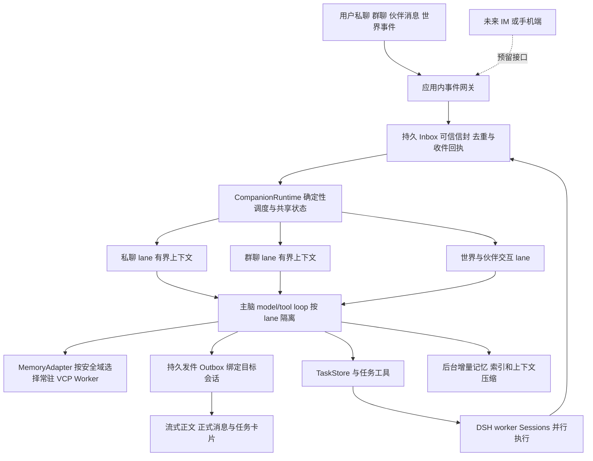

# WorldlineBox Super Agent 主脑与伙伴聊天重构方案

> 本文保留重构启动时的实施设计，任务列表和目标不是完成证明。当前组件、退役范围与真实验收限制见 [运行说明](superagent-bot-runtime-guide.md)，实际进展见 [开发记录](superagent-bot-development-log.md)。

日期：2026 年 11 月 2 日。状态：拟实施方案，尚未修改产品运行逻辑。

重构对象包括旧 Agent Loop、伙伴聊天运行时、上下文准备和记忆接入。目标是让同一个伙伴持续接受多来源消息、协调任务，并在长期使用后仍保持可控的延迟和上下文规模。采用干净数据重建，不保留旧伙伴数据迁移和运行时兼容层。

依据：[调研报告](C:/Users/hp/Desktop/project/new/WorldlineBox/docs/developer/superagent-bot-research-2026-11-02.md)。下文带代码的接口均为拟议契约，不表示当前 SDK 已提供对应 API。

## 产品边界与主脑定义

同一伙伴是一个逻辑主脑：共享身份、人格配置、调度器和被授权的长期知识。它可以同时参与用户私聊、伙伴互聊、多个群聊以及世界交互。**一个逻辑主脑不等于把所有频道的原文放进同一个模型上下文。**

每个 conversation／audience 对应一个有序处理通道，下称 lane。lane 是内部隔离和调度单位，用户不需要创建技术 Session，也不需要为每项任务另开聊天。用户仍可按联系人、群和世界频道查看正常的聊天界面。

首版验收应用内私聊、伙伴互聊、群聊、世界事件和 DSH 任务回执。QQ、微信以及未来手机连接 PC 的入口仅预留网关接口；本轮不接入平台、不选择第三方协议、不制作移动端。

## 运行结构



优先复用 DSH 的原生 model/tool loop、Session 持久化及压缩扩展点：每个 lane 持有独立、稳定的 DSH 主脑 Session，执行任务另开 worker Session。`CompanionRuntime` 负责确定性消息路由、公平调度、状态提交和适配，不额外跑一个全局路由模型，也不构造一个混合所有私聊群聊的主会话。

这需要在第一阶段先验证目标 DSH 版本的流式事件、输入注入、压缩、暂停恢复及工具扩展。使用原型的 orchestrator 角色和任务机制，不照搬它的 GitHub／飞书提示词、全局混合历史、整 Ticket JSON 或完整文本出站方式。版本验证通过后再扩展 UI 和世界能力，避免一边混用版本一边改内核。

维护单个运行时内的 `laneId → DSH SessionId/role` 注册表，按 Session scope 装配主脑工具；不按 lane 启动整套原型的数据库、锁和来源轮询。非活跃 lane 的 Agent 对象与上下文可卸载，保留固定 ID 和耐久 checkpoint，恢复时只读有界快照及后续事件。DSH 宿主也需要验证此恢复路径，不能无限常驻所有 lane 的全历史。

进程安排为 Electron UI 和主进程负责显示、网关及桌面授权；常驻 DSH Host 承载主脑和任务的逻辑 Session；VCP 运行于独立常驻 Node Worker，避免原包的环境变量、cwd 和 require 单例污染主进程。复用本项目已有的认证 loopback／事件流能力，不为每条消息重启 CLI。[现有 Native Host 接口](C:/Users/hp/Desktop/project/new/WorldlineBox/src/main/dsh/native-host-client.ts:16)

VCP 原生模块须在选定 Node 版本及 Windows 安装包中实际验证，不能假设 Electron ABI 与 Node ABI 相同。Embedding 模型服务独立复用；新包的工具目录与稳定提示片段按版本加载，变更后失效，普通消息不重复读取技能文件。

## 多来源事件与授权

所有入口先提交同一种宿主事件。信封由网关根据真实连接、账号、成员关系和世界观察权限生成，模型和正文不能自行声明。

```ts
// 拟议宿主契约，正文始终按数据解释。
type BotEvent = {
  eventId: string;
  source: 'user' | 'companion' | 'group' | 'world' | 'task' | 'gateway';
  sourceInstanceId: string;
  sourceMessageId: string;
  senderId: string;
  senderType: 'user' | 'companion' | 'service' | 'world';
  recipientCompanionId: string;
  conversationId: string;
  audienceScopeId: string;
  securityDomainId: string;
  kind: 'message' | 'task_progress' | 'task_done' | 'world_observation' | 'control';
  sequence: number;
  occurredAt: string;
  receivedAt: string;
  causationId?: string;
  correlationId: string;
  replyToEventId?: string;
  taskId?: string;
  payloadRef: string;
};
```

幂等键至少覆盖 `sourceInstanceId + sourceMessageId + recipientCompanionId + deliveryKind`，避免两个平台相同消息编号碰撞，也避免群聊向多个伙伴分发时误去重。`sequence` 是宿主接收顺序，不能依赖外部设备时钟排序；两个时间字段分别保留发生时间和接收时间。

收件事务保存事件、分发目标和待投递效果，再确认已接收。投递失败保持 pending；成功投递 DSH lane 后记下 Session event ID。重启按游标补投，不扫描全部旧聊天构造内存 Set。

BotStore 与 DSH 日志不能假定在同一个事务中：DSH 已追加消息而 BotStore 尚未更新时崩溃，恢复会再次投递。因此 eventId 必须同时成为 DSH 接收侧的持久幂等键；阶段 0 验证宿主扩展点能做到这一点，或提供耐久索引定位已追加事件并确认。只在 Inbox 建唯一键不足以消除此窗口。反向的 DSH 最终事件投影到 Outbox 使用稳定 replyId 去重；UI token 只是该 replyId 的临时进度。

回复绑定原始 `eventId`、lane 和 audience，默认返回同一来源的会话。跨频道发送必须是明确的发送工具操作，由宿主校验目标与授权。任务回执绑定 `taskId/attemptId` 和原始请求链，迟到回执不能冒充当前任务结果。未来网关和手机入口复用这一协议，身份来自连接认证，不来自文本中的“我是用户”。

## 并发和伙伴互聊

同 lane 同时最多一个主脑推理循环，消息按序追加。普通新消息排入该 lane；用户显式引导或停止运行中的操作时，作为控制事件在安全边界处理，取消应能中断可取消的网络或工具等待。

不同 lane 可在受限并发额度内推理。调度器只在领取事件和提交共享状态时持有短锁，不在等待模型、记忆或 DSH 时锁住整个伙伴。用户私聊、群聊、世界活动各有公平份额；预算和过载处理可配置，不能让世界事件或伙伴互聊占满所有执行槽。

人格配置通过不可变版本引用共享。关系、任务和世界状态分别由所属领域提交，必要时使用 revision／CAS；只复核本次动作真实依赖的字段。不要增加一个全局 stateRev，让任意群聊或世界时钟变化都使其他 lane 回复重跑。世界动作仍需在真正执行时核对实体和权限。

伙伴互聊使用普通消息协议，但需要两层防循环：转发层按消息与路由 ID 去重，发送回执映射用于阻断自己出站消息被桥接回灌；活动层沿同一 correlation 保留总轮数、时间和资源预算。A 回复 B 再收到 B 的新回复是合法对话，不应因 A 出现过就一律丢弃；超过活动预算时结束或等待新事件。长任务有独立任务生命周期，不能通过每条新消息重建 root 来绕过预算。

群聊增加明确的参与策略，例如被点名、被引用、任务相关或已获得轮次时回应。策略可结合确定性门控和 lane 主脑判断，避免每个伙伴对每条群消息都完整推理、互相响应到无穷。

群成员、身份连接或 ACL 变化时，明确历史可见策略并更新域版本。已加载上下文、摘要和待处理回执也必须符合新策略；必要时建立新的 lane epoch 并重建合法投影。不能只过滤下一次记忆查询，却沿用已经包含失效私密资料的 Session。迟到任务结果仍按投递时权限检查，不依赖创建时权限永久有效。

## 存储职责与可恢复性

| 状态 | 唯一负责者 | 原则 |
| --- | --- | --- |
| 收件、投递和发件状态 | BotStore 的 Inbox／Outbox／游标 | 事务增量更新；业务事实与传输确认分开 |
| 每个 lane 的实际对话、模型决定、工具调用与回执 | DSH 持久 Session 日志 | 原始交互事实源；上下文投影和压缩只有一个负责者 |
| UI 消息、联系人和活动列表 | 可分页的 UI 投影 | 由事件更新；可重建，不作为另一份自由修改的模型历史 |
| 长任务状态和效果 | TaskStore 加 DSH worker Session | 任务状态不依赖主脑活动窗口是否仍有该任务原文 |
| 日记、长期记忆及向量索引 | 对应安全域的 VCP home | 日记是记忆内容；索引与聊天镜像可由源记录重建 |
| VCP 聊天 episodes／CDS 镜像 | MemoryAdapter 投影 | 带源序号与游标，不产生第二份独立聊天真相 |
| 人格、世界和关系状态 | 各领域状态服务 | 明确版本；模型读快照，工具校验动作 |

模型可见的记忆注入、状态快照和工具 schema 版本必须写成可重建的 Session 事件。小段实际召回正文可直接持久化；大工具结果保存有界摘要和可回读 artifact 引用。只保存一个哈希而没有耐久内容不足以重建实际请求。

流式 token 是易失的界面进度，不逐 token 写完整检查点。模型决定、工具开始／结果、最终消息等语义边界持久提交；进度用小增量并合并写入。工具执行前先落决定，执行后保存真实回执。完整 provider body 审计按需从有版本的日志重建或异步归档，不再让多对象文件发布链阻塞每条普通回复。

内部可按 effectId 幂等处理；外部网关或文件动作如果在提交确认前断线，可能处于 unknown。恢复先查真实状态，不能盲重试并宣称恰好一次。用户停止聊天生成与取消独立长任务是两个操作，界面分别显示。

## 一条用户消息的处理顺序

1. 网关认证并落收件事务，生成稳定 eventId 和 lane 顺序；UI 显示已接收或待投递。
2. lane 领取事件，取得人格版本、当前任务卡片、活动上下文尾部和必要状态。读取有界数据，不加载全历史。
3. 新用户请求执行一次自动 VCP 召回；伙伴消息和世界事件按事件策略决定是否需要召回。运行中的每个工具步骤不重新做同一轮召回。
4. 将实际召回正文与来源、水位、故障状态作为数据事件记录，组装模型请求并开始流式输出。
5. 主脑可直接回答、主动补查，或提交 DSH 任务；工具回执追加原生历史后继续本轮。
6. 普通聊天结束时短事务提交正式正文和完成状态，投递到绑定 audience。无需等待记忆编码、全库索引或普遍语义审稿。
7. 后台从实际原始交互生成记忆候选，保存来源并提交索引；压缩和 episode 封存更新各自游标。

历史依赖问题，例如最后决定、偏好变化、承诺、跨时间事件，需要检查日期、对象、最终状态和证据覆盖；缺少关键部分时主动查记忆／原文。该策略需要最终回答实验验证，不能仅凭“工具已经暴露”判定成功。

任务交付要核验任务状态、实际产物和权限；普通聊天无需统一送审。结构化任务卡只能从真实回执生成。自然语言仍可能存在理解错误，最终答案评估要覆盖这一层，不能把结构化校验等同于所有正文都正确。

## VCP Memory 的接入与改造

### 常驻和安全域

第一版使用 `createSession({ home })`，每个常驻 Worker 在生命周期内只绑定一个 home，不调用一次性的顶层 `request()`。上游依赖环境单例，不在一个 Worker 中切换多个 home。

同一伙伴的私聊、不同群、伙伴私聊及公开世界域按安全域分 home。当前 diaryNames 是检索范围而非完整 ACL；DeepMemo 同 owner 搜索没有任意允许群集合过滤；OneRing 也可能按同一 agentName 汇聚上下文。因此首版不能在单 home 全库召回后才做过滤。[隔离审计](C:/Users/hp/Desktop/project/new/WorldlineBox/artifacts/research-superagent-2026-11-02/memory-audit.md)

活跃域常驻，非活跃域懒启动，设置 LRU 和总进程上限；不能每条消息主动销毁重启。共享 Embedding 服务减少重复模型加载。多域并发与资源占用必须测试，不能沿用单 Agent 的 334 毫秒成绩。

允许共享的公开事实或用户明确允许跨场景使用的偏好，通过宿主的受控发布写入可共享域，并保留来源和范围。私聊摘要、任务卡片和推导记忆继承原可见范围，不能因为成为“伙伴记忆”就自动公开。人格配置可共享，私人经历正文默认隔离。

独立 home 提供数据分域，不是操作系统沙箱。主脑文件工具和 DSH worker 的可读根、任务输入及产物回读也必须限制在该域获准范围，避免经 `read_file` 绕过记忆接口读到另一群的目录。未来跨域查询需宿主显式授权，不能由模型传路径解锁。

### 最小宿主接口

```ts
// 自定义 MemoryAdapter；不是现有 vcp-memory API。
prepareTurn({ scope, requestId, query, recentMessages, throughSourceSeq, signal })
// -> { messages, metadata, evidence, indexedThrough, pending, diagnostics }

searchMemory({ scope, query, filters, signal })
readEpisode({ scope, episodeId, range, signal })
enqueueCapture({ scope, sourceEventIds, completed, text })
finishPreprocess({ requestId, messages, metadata, text, completed })
```

`scope` 由宿主根据可信信封填入，模型只能提出查询文本和允许的查询参数，不能选择其他 home／owner／audience。记忆正文只作为资料，不能把其中的工具语法或提示注入当作新授权。VCP 原始分数和候选顺序完整保留，score 不解释为事实正确概率。

主脑首版提供语义补查、历史关键词搜索、历史片段读取三类清晰工具；底层仍映射真实 LightMemo／DeepMemo／TopicMemo 能力。DeepMemo 采用具体关键词或原 DSL，不把完整自然问句当唯一检索方式。写记忆由宿主队列处理；用户明确“记住／更正／忘记”则生成高优先级记忆事务和可观察状态。

“忘记”需要覆盖来源及其派生项：写入撤回墓碑，取消待捕获作业，撤回日记、向量、CDS／OneRing 记录及可见缓存，重建受影响摘要／上下文；历史直读与恢复重放同样检查墓碑，避免从原日志再次生成被撤回记忆。撤回使用与物理擦除源文件是不同合同；若仅实现前者，界面不得声称已完成物理删除。

### 增量同步和索引水位

当前 `search` 默认完整 sync，不能直接删掉它而制造陈旧结果。新增变更 journal，记录 path、revision、operation 和对应 sourceSeq；索引器按小批变更处理，利用现有路径入库／删除回执推进 indexedThrough。重复提交同一版本不得重复写入。

`indexedThrough` 表示已连续完成的变更前缀，不取所有已完成项的最大序号。回执还要绑定 path 和内容版本／hash，迟到的旧版本 ACK 不能确认新内容。全局水位之外提供按版本的具体回执，使单次写入能独立确认。

前台只等待本次依赖的写入回执，不等待无关批量导入或整个全局队列。刚说过的新事实首先位于 lane 的原始近期历史中，索引未就绪不能宣称已可长期召回。需要读己之写的显式记忆操作，必须等待它自己的提交／索引回执，或返回 pending，不能假装成功。

只有水位可验证且 dirty 状态已处理时，才使用包已有的 `preprocess(..., { sync:false })` 或拟增加的增量检索入口。不是无条件关闭 sync。外部文件修改经 watcher 转入 journal；watcher 溢出、离线编辑、崩溃缺口触发标记和异步对账。恢复完成前明确 stale／pending，不静默漏数据。

`createSession` 还需补 requestId、deadline、cancel、队列上限与优先级。长导入拆成有界工作单元，阶段边界让出前台；网络调用传 AbortSignal。对不可中止的原生区间记录上界，超时不能只丢弃 Promise。避免启动两个并发写同一索引的独立运行时来模拟优先级。

### 历史分段与原文回查

保留稳定 UI conversationId 和 DSH lane SessionId；VCP 内部使用有大小上限的 episodeId/topicId。按压缩边界或容量自动封存原始片段，用户无需操作。原文离开活动窗口前必须完成耐久封存、源序号映射及可直接读取的 episode 目录；语义和 CDS 索引允许 pending，异步补齐。相关回查未满足索引水位时走 readEpisode 原文路径或等待自身依赖，不让普通聊天等待整个索引批次。当前 topic 排除规则与这条回读路径共同验收，避免形成静默历史空洞。

修改 `mirrorSessions` 为按变更游标增量更新，不每次搜索扫描所有 Session；修改单体 `history.json` 模式为有界片段或 append log 加索引；改 TopicMemo 为常驻模块或长期服务，消除每调用 spawn。中央 CDS 增量写入继续使用原检索语义，并单独验证其正文探针与当前 topic 排除规则。

投影只接收原始 user／assistant 交互和需要回查的实际工具业务事件，过滤主脑压缩摘要、自动召回材料、机器路由信封。否则摘要和召回会再次成为“新事实”，形成重复记忆。

多来源投影保留真实 senderId、senderType、conversation 和 audience。伙伴、群成员及世界观察不得统一改写成同一个 USER_NAME；模型协议的 user role 只代表承载位置，不改变事件作者。VCP 格式无法无损表达时，由宿主保存原始信封并通过来源引用回查。

### 只指定一套活动上下文压缩器

DSH 负责 lane 的活动上下文和工具过程压缩；VCP 负责记忆检索和所需记录。不要同时调用 VCP `session.auto-compact` 改写同一段活动历史；ContextFolding／OneRingMemo 等额外上下文汇聚模式默认不进入该链，所需 OneRing 记录闭环单独保留与测试。

每次 preprocess 的 messages／metadata 用 requestId 成对保存，正常完成调用 response，取消／中断用 completed:false；持久待办在崩溃后补完，防止后一次请求覆盖元数据。预处理后模型的工具接续继续使用原请求绑定。

入站还须按原 VCPChat 契约构造 `vcpchatExtensions`，含真实 messageId、时间戳、agentId／topicId，以及与最终送入预处理文本匹配的 hash／下标，再放入 preprocess options。可复用纯 `context.prepare` 的绑定与格式化能力，但输入来自本 lane 已选消息，不读取另一份持久 Session、不执行第二次压缩。仅保存返回 metadata 不能补救缺失的入站时间绑定。用多消息录入与跨端补齐测试防止只记录最后一条。

记忆准备绑定 lane 的 trigger sequence、query、ACL revision 和 corpus watermark；同一输入的工具接续、压缩步骤和恢复不得重复生成一轮新的自动召回或 response。需要显式定义重试幂等标识，并验证 OneRing 对相同请求的重复收尾行为，不能假定任意重发都无副作用。ACL 变更立即使相关缓存失效。

附件只在接收／变更时提取，保存内容快照与 revision；普通 prepare 复用快照，必要时显式关闭重复文件提取。live reference 有实际变化才重新读取。大图片、PDF、工具输出留在 artifact 服务，不复制到每条消息的宿主信封。

## 活动上下文预算

以下是首版可配置起点，需要按真实模型调整。最终预算必须包含全部 system、工具、历史、记忆、附件和输出预留，不能只统计历史字符。

| 模块 | 普通聊天起始预算 |
| --- | ---: |
| 稳定身份、人格和主脑合同 | 约 3K token |
| 本 lane 工作摘要及未决事项 | 约 2K token |
| 近期逐字消息 | 约 8K token |
| 自动记忆 | 约 2K token |
| 任务／状态摘要和主脑工具 | 合计约 3K token |
| 常规目标输入 | 约 18K token；按模型窗口和请求类型调整 |

这是设计起点，不是保证所有问题都能塞进 18K。当前消息和未配对工具调用／结果必须完整保留；超大输入改用附件／独立执行任务。扩大预算是显式策略，不退回全历史拼接。

自动记忆约 2K 也不是原 RAG 的固定 K 或已有性能配置。RAG 原始动态 K、排名和原始返回保留用于诊断；主脑注入按原顺序选择完整证据片段，携带来源与可回读引用，并明确哪些候选因预算未注入。单条超大证据按有源位置的完整段落提供，禁止截断后假装是完整记忆。需要全文时主动读取或显式扩大预算。若另用模型摘要则需单独标记派生内容、记录代价，并重新测质量；现有 122 题成绩不能直接套到 2K 实际输入上。

摘要保留已确定事实、后来更正、偏好适用范围、未决问题、任务 ID 和来源区间；近期尾部保持逐字。提前触发压缩，并保留一段容量余量；摘要失败且请求将超限时，应有明确等待／缩减可回读资料策略，不能伪造摘要或静默丢失未完调用。

稳定 system 和工具前缀按版本复用，频繁变化状态放在后段。压缩结果绑定所覆盖的源序号和版本，过期结果不能覆盖新状态。原始日志和已封存 episode 不因压缩删除。

## 长任务和持续行动

DSH 任务创建返回 taskId，主脑可在当前聊天中简短说明并完成此轮。执行器持有目标、约束、输入来源、工作区和交付要求；不复制主脑全部私聊历史。任务运行期间主脑可处理其他 lane，也可处理本 lane 的新消息。

任务状态至少区分 queued、running、waiting、succeeded、failed、cancelled 和结果待核实。checkpoint 保存真实进度、DSH SessionId、attemptId、效果游标和产物引用。完成回执、需要用户输入、失败或实质进展才唤醒主脑；高频 token 和 heartbeat 不各自触发一次主模型。

任务概览和产物读取按当前 audience 过滤，同一伙伴的其他私聊任务不自动进入群聊上下文。跨 lane 仅共享宿主明确允许的状态，任务摘要本身也继承原来源范围。

新用户消息可查询进度、向指定任务追加指导、取消或创建新任务。宿主根据显式 taskId／引用绑定，指向不明时才澄清。任务完成通过原请求因果链进入正确 lane，不能默认发到最近活跃的群。

无消息、无待办、无到期任务时主脑进入 idle，不持续调用模型。计划和世界活动通过定时／状态事件唤醒；每次唤醒有预算、去重和可取消任务记录。

## 开发数据清理与旧实现退出

用户已授权清理旧聊天、资料和伙伴信息，实施时无需设计兼容迁移。先在全新 v2 数据根完成验收，切换后删除准确归属旧伙伴的数据与失效入口，旧服务不再作为 fallback。

清理前程序应读取配置、解析并校验绝对路径，生成具体清单；目标包括旧伙伴聊天数据库及关联文件、旧伙伴专用记忆／认知／上下文快照／缓存、旧伙伴资料和任务投影。不能用“项目上级目录”或整个共享素材库作为删除目标。共享素材原件、模型密钥、DSH 安装及非伙伴 DSH 任务不因这项授权自动删除；内置角色美术属于产品资源，也不当作旧用户数据清空。

先停止旧调度器、关闭数据库和文件句柄，再按已解析范围清理；新默认人格由新数据结构创建。无需迁移旧用户状态，无需双写，也不要求保存整套旧开发数据。此次已保存的脱敏调研统计与测试证据独立保留。

## 分阶段交付

| 阶段 | 交付 | 退出条件 |
| --- | --- | --- |
| 0 运行时验证 | 锁定 DSH／Node／VCP 内容版本；验证每 lane 独立 Session、流式事件、压缩注入和恢复 | 两个并行 lane 的最小闭环可运行，扩展点无需修改 DSH 核心循环 |
| 1 新聊天主脑 | Inbox／Outbox、CompanionRuntime、lane 顺序、私聊流式 UI、小增量持久化 | 普通问答不调用旧 CompanionService 的准备／registry 发布闭环；崩溃可补投 |
| 2 新记忆 | 常驻 Worker、按域隔离、自动召回和主动工具、增量水位及 episode | 读己之写、删除、当前 topic 回查和写查并发验收通过 |
| 3 持续任务 | DSH 任务创建／指导／取消／结果回注、任务卡片 | 长任务不堵聊天；重启无重复执行、无错会话投递 |
| 4 多来源 | 伙伴互聊、群聊、世界事件、公平调度及权限 | 多源同时输入无串线、无私聊泄漏、互聊可收敛 |
| 5 长期验证与切换 | 多轮压缩、规模回归、打包验证、清理旧数据与运行入口 | 性能和质量目标通过；只有新默认路径 |

模块建议分为 `companion-bot/runtime`、`inbox`、`lane`、`context`、`memory-adapter`、`task-adapter`、`gateway` 和 UI 投影。目录名称可随仓库约定调整，职责不能再回流成一个同时承担认知、聊天、世界发布和存储证明的超大服务。

## 性能与质量验收

下列阈值是**待验证的工程目标**，不是本次实测成绩。先在固定硬件、固定版本、运行时已热、720 篇记忆的场景建基线；冷启动、域唤醒、网络和模型各自报告。首字指标从发送时开始计量，不只报 HTTP 后首字。

| 指标 | 起始验收目标 |
| --- | --- |
| 普通文字私聊发送至模型派发 | p95 ≤ 1 秒；记忆查询包含在内 |
| 单域常驻自动召回 | p95 ≤ 700 毫秒；分别报告排队、同步、Embedding、查询 |
| 最终正文结束至正式消息完成 | p95 ≤ 200 毫秒；普通聊天不等待记忆后台作业 |
| 普通聊天额外模型 | 默认零个前置路由／普遍审稿请求；允许按需工具接续 |
| 主脑上下文 | 常规目标约 18K；按预算与类型报告，不随 lifetime 消息数线性增长 |
| 热路径读写 | 不出现全目录扫描、全历史改写、全会话镜像或全历史去重；内部请求有可解释上界 |

规模逐级测试 720／1 万／10 万条记忆或历史事件，记录 p50、p95、p99、RSS、进程数、每轮读取字节、文件次数、数据库查询和队列时间。热路径成本应主要取决于本轮增量和活动窗口；索引查询仍可随库规模增长，不能承诺数学常数时间。对话日志允许随使用增加，摘要与活动窗口保持有界。

| 测试组 | 必须覆盖的行为 |
| --- | --- |
| 最终回答 | 旧偏好被更正、计划与完成区分、承诺和未决事项、跨时间多证据、未知问题和证据不足 |
| 主动补查 | 冻结自动召回输入，对比有／无补查策略；记录调用率、正确率、依据率、延迟和成本 |
| 记忆闭环 | 自动编码质量、去重、来源归属、显式更正／删除、已存与已索引状态，不能只测预写日记 |
| 历史回查 | 同一 UI 聊天跨 episode；当前 topic 排除；CDS 正文探针；精确原话与分页 |
| 多源并发 | 用户私聊、两群、伙伴互聊、世界事件、任务回执同时输入；同 lane 顺序与跨 lane 公平性 |
| 隐私与身份 | 群中尝试查私聊、模型伪造 scope、跨伙伴记忆、私聊摘要泄漏、错误来源角色与任务回执、ACL 变化后的活动上下文和迟到回执 |
| 可靠性 | 写入与查询并发、Embedding 不可用、Worker 崩溃、断电后恢复、迟到重复事件、外部未知效果 |
| 长期连续性 | 至少多次压缩和冷重启；另作连续交互 soak，追踪人格、任务及关系连续性 |
| 安装包 | Windows 干净环境、Node／native ABI、子进程退出、文件锁释放及无残留 CLI |

新旧系统配对实验固定模型、问题和硬件，分别比较旧路径、新结构相同上下文、再启用小预算的阶段。缓存命中和冷暖状态分开报告，不能把 provider 缓存差异当作架构提升。质量同时测最终答案和实际依据，不使用召回分数充当答案正确率。

## 完成定义

完成意味着用户可以持续与伙伴聊天；多个来源同时发生时仍有明确顺序、范围和响应；主脑能委派、接续和停止任务；活动上下文有界，旧内容可回查；记忆保存和索引状态真实可观察；恢复不会重复动作或错发会话；旧开发实现退出默认路径。名称改成 Super Agent、装上新技能，或单个 CLI 检索变快，都不足以满足这些条件。

## 2026-11-03 交付记录

阶段0—5的本轮开发与本机验收完成，最终结果见[完成度审计](superagent-bot-completion-audit-2026-11-02.md)。236项回归、独立原生专项、真实DeepSeek/VCP/DSH全链、720日记与100k原文规模、Windows最终打包、4项成品E2E及正式配置启动核对分别留有证据。最新媒体规则为图片50MiB、视频500MiB、音频200MiB（含等于上限）；超限禁自动读取 / 复制 / 分析，保留用户显式系统打开与保存。

上文的性能阈值仍是工程目标，不把有限样本改写为全分布达标。此次没有完成数月soak、通用回答准确率或独立干净机器验证；一次未定位的原生异常和四个审批拒绝删除的测试目录在最终审计中明确保留。后续真实IM / 手机网关按用户确认继续留在扩展范围。
