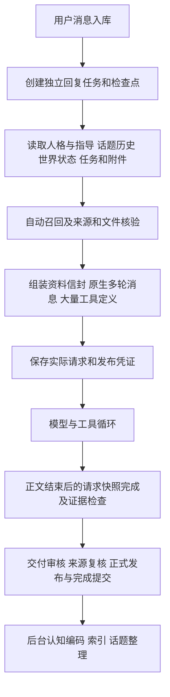
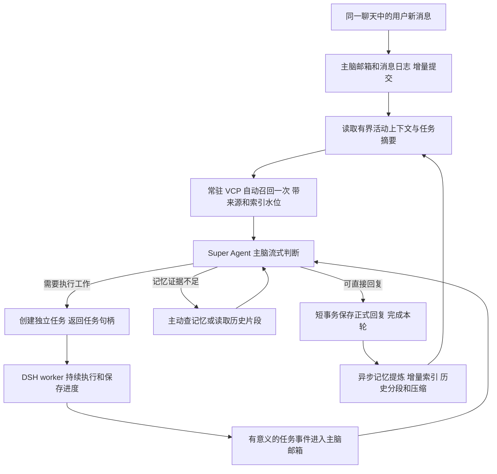

# WorldlineBox 虚拟伙伴 Super Agent 重构调研报告

日期：2026 年 11 月 2 日。面向虚拟伙伴主脑、记忆和持续任务的重构决策。

> 历史证据说明：本报告的“当前源码／当前链路”指调研时的重构前快照，不能当成新系统仍在运行的逻辑。被引用的旧源代码已移出运行目录，链接指向 `artifacts/research-superagent-2026-11-02/legacy-source` 的只读快照。当前运行边界见 [Super Agent 运行说明](superagent-bot-runtime-guide.md)，实际进展见 [开发记录](superagent-bot-development-log.md)。

建议采用一个常驻的逻辑 Super Agent 主脑，统一接收用户、伙伴、群聊和世界事件；各会话持有隔离的持久 DSH 上下文，复杂工作交给独立任务执行器；最新独立 `vcp-memory` 负责记忆检索与记录。**重构必须同时缩短宿主调用链、限制活动上下文，并改造新记忆包的全量同步路径。仅替换记忆包，或者把 Super Agent 包在旧伙伴服务外面，不能解决当前问题。**

用户已明确允许清空开发版旧聊天、资料和伙伴信息。因此实施方案采用全新数据布局，不迁移旧记忆，不双写，不做旧运行时兼容。本报告最初交付仅含调研和实施方案，当时未删除旧数据或修改产品运行逻辑；后续重构与清理不改变这里保留的历史统计。

## 研究范围与证据

本报告将三类内容分开：**核验事实**来自源码、实际数据库、日志或已保存的测试结果；**原因判断**说明事实之间可支持的关联；**实施建议**是待实现、待验收的设计。

| 对象 | 本次核验范围 | 适用边界 |
| --- | --- | --- |
| WorldlineBox | HEAD `ecdace4b419ae7c4176be9be2cfb9e67c7d64f51`；实际聊天检查点及日志；当前消息、上下文、发布链路 | 工作区有用户原有的通知 UI 修改，未触碰 |
| dsh-superagent-prototype | HEAD `6337fc823ce20251c8de8085948165c81aaa701e`；主脑、Ticket、Effects、任务恢复及测试源码 | 单仓 GitHub／飞书原型；未安装依赖重跑它的测试 |
| 独立 vcp-memory | `0.1.0`；SDK／CLI／常驻 Worker、检索和会话适配；已有性能与质量报告；定向离线验证 | 是当前本地包的核验，不把版本号当内容指纹 |
| 两段关联会话 | 已通过 `read_thread` 读取消息流程调研、最新记忆测试和相关结论 | 历史会话是线索，关键数字另查原材料；第二段只读取与本任务直接相关的最近三轮 |

历史运行构建与当前源码 HEAD 的二进制同一性未证明。因此日志用于确认已发生的时间和请求规模，当前源码用于解释仍存在的放大机制，不将每个源码分支都断言为当时实际执行过。

主要附件：[当前链路审计](C:/Users/hp/Desktop/project/new/WorldlineBox/artifacts/research-superagent-2026-11-02/current-loop-audit.md)、[Super Agent 原型审计](C:/Users/hp/Desktop/project/new/WorldlineBox/artifacts/research-superagent-2026-11-02/superagent-audit.md)、[独立记忆包审计](C:/Users/hp/Desktop/project/new/WorldlineBox/artifacts/research-superagent-2026-11-02/memory-audit.md)、[研究范围记录](C:/Users/hp/Desktop/project/new/WorldlineBox/artifacts/research-superagent-2026-11-02/research-scope.json)。

## 重构前一次聊天实际经过什么

当前核心模型循环已经是正常的 Agent 循环：准备输入、请求模型、记录决定、执行工具、保存回执、继续或结束。源码会在工具执行前保存模型决定，并检查调用和回执完整对应。这些机制值得保留。问题主要来自围绕循环组织的宿主工作。[循环内核](../../artifacts/research-superagent-2026-11-02/legacy-source/src/main/companions/agent-kernel.ts#L43)

每条用户消息会建立新的回复任务，任务开头冻结一份较大的输入。主脑得到历史、人格、世界、认知、任务状态和来源资料，之后的工具步骤沿用该任务输入并追加回执。这有利于恢复和一致性，但也使简单聊天承担大量和本轮问题无关的准备与核验。

当前源码**已有常驻存储进程、记忆运行时复用、缓存、话题后台摘要和任务内摘要**，不能把失败归结成“完全没有常驻或压缩”。任务内摘要默认是 32 步／24 万字符，保留近期 16 步；这些是字符和步骤阈值，不是整个模型请求的 token 预算。[存储进程](../../artifacts/research-superagent-2026-11-02/legacy-source/src/main/companions/storage-client.ts#L151)、[任务摘要](../../artifacts/research-superagent-2026-11-02/legacy-source/src/main/companions/loop-continuity.ts#L9)

## 截图这轮为何用了四十多秒

已用源消息哈希关联实际 SQLite 检查点和日志。这轮是“你现在能用 dsh 吗”，主脑实际输入 110,828 token、输出 176 token，主脑请求一次，工具调用零次。[脱敏原始统计](C:/Users/hp/Desktop/project/new/WorldlineBox/artifacts/research-superagent-2026-11-02/current-loop-count-evidence.json)

| 区间 | 实际时间 |
| --- | ---: |
| 用户消息保存至模型 HTTP 派发 | 14.842 秒 |
| HTTP 派发至主脑用量记录结束 | 3.443 秒 |
| 主脑结束至回复完成 | 26.084 秒 |
| 用户消息至回复完成墙钟时间 | 44.369 秒 |
| 界面累计处理时间 | 43.401 秒 |
| 用户消息至首次可见正文 | 16.726 秒 |
| HTTP 派发至首次可见正文 | 1.884 秒 |

因此约 92.2% 的这次墙钟时间在主脑请求区间之外。该值不代表所有聊天的平均情况；它足以证明这轮的主要瓶颈不在主模型生成。墙钟时间和界面累计处理时间口径不同，不能混用。

请求前自动召回约 3.893 秒，另有上下文准备约 1.429 秒、派发前最终检查约 3.798 秒。这些阶段有嵌套和重叠，不能简单求和。

按同一存储操作哈希、响应完成时间和半开区间重新统计，三个阶段出现的 `storage.worker` 响应记录分别为 **379、31、383 条**。此前会话中的中间值为 30，本次明确边界后为 31；这不影响瓶颈判断。这些数字是日志中的请求完成记录，不是网络包数，也不能通过累计各条耗时重建墙钟时间。

正文结束后的 383 条中，包含 118 次 `cognition.registry.read`、42 次 `cognition.registry.publication.read`、33 次 `cognition.registry.refs.validate`，以及各 24 次 `action.get`、`checkpoint.get`。请求前还有 19 次 `loop.save`，请求后有 5 次。一个无工具问答产生了密集的内部存储与核验工作。

### 可以定位到代码的放大机制

| 机制 | 实际路径 | 后果 |
| --- | --- | --- |
| 通用存储调用附带来源核验 | `service.ts` 的 `call` 包装执行来源 guard；核验中还可能读取存储 | 一次业务读可展开为多次 registry、来源和文件读 |
| 文件凭证核验重新读取正文 | registry witness 路径执行元数据读取、文件读取／哈希、再读元数据 | 保持一致性的成本沿不同调用入口重复支付 |
| 实际请求快照进入正式发布链 | 保存 provider body，派发和完成时再更新凭证；模型完成钩子等待该链 | 网络正文结束后，主脑流程仍被请求取证和存储工作阻塞 |
| 大检查点被反复保存 | 进度更新仍有完整 `loop.save` 路径 | 序列化、跨进程传输和持久化成本随上下文增大 |
| 普通讨论也可能进入辅助语义审核 | `requireReview: topic.kind !== 'story'` 等入口 | 无实际交付的问答也可能增加模型等待；不是截图每个辅助调用的证明 |

源码入口：[存储包装](../../artifacts/research-superagent-2026-11-02/legacy-source/src/main/companions/service.ts#L930)、[文件 witness](../../artifacts/research-superagent-2026-11-02/legacy-source/src/main/companions/artifact-registry.ts#L184)、[请求快照](../../artifacts/research-superagent-2026-11-02/legacy-source/src/main/companions/context-snapshots.ts#L242)、[完成钩子](../../artifacts/research-superagent-2026-11-02/legacy-source/src/main/companions/model.ts#L505)、[回复审核入口](../../artifacts/research-superagent-2026-11-02/legacy-source/src/main/companions/service.ts#L4256)。

**原因判断：**当前设计把来源管理、认知发布和聊天完成紧密耦合，并通过细粒度调用组合完成一致性检查，导致同一批状态被多次跨进程读取和重复验证。后台世界／认知工作还会竞争存储队列。这是可见的架构放大因素；26.084 秒不能全部分配给某一个函数或审核模型，仍需更细的链路采样才能精确归因。

### 上下文规模也是独立问题

这一轮携带 248 条历史消息，正文合计 40,529 字符；宿主资料信封约 314 KB，任务资料快照约 474 KB，完整检查点约 1.24 MB。提供方实际缓存读取 25,984 token，约占输入 23.4%。

本地估算 system 18.4K、对话与信封 79.2K、工具 11.6K token，总体实测为 110.8K。估算分项不能冒充提供方逐模块计量。本轮主脑仍只用了 3.4 秒，所以长上下文不是本轮最大延迟来源；它会增加成本、影响注意力分配，并放大宿主持久化和恢复工作。

## Super Agent 原型提供了什么

原型已经实现了适合借鉴的控制结构：一个持久 orchestrator 主会话协调多个 Ticket，每个任务使用独立 worker Session；业务任务状态与模型 Session 分离；SQLite 事务配合 durable Effects／outbox 投递；主脑接收非例行任务报告，并能向 worker 补充不增加授权范围的事实。通用任务指导和取消仍需按伙伴场景设计，不能把原型的 ticket_note 当作任意扩权接口。[原型源码审计](C:/Users/hp/Desktop/project/new/WorldlineBox/artifacts/research-superagent-2026-11-02/superagent-audit.md)

| 能力 | 可借鉴部分 | 伙伴系统仍需补齐 |
| --- | --- | --- |
| 统一入口 | 稳定主脑协调，而不是让用户管理 worker Session | 私聊／群聊隔离、伙伴人格、自然聊天和消息顺序 |
| 持续任务 | Ticket 状态机、恢复、指导和任务结果投递 | 聊天中断语义、离线恢复、任务通知合并 |
| 可靠投递 | 事务、Effects、幂等标识和 Session 记录 | 桌面消息流／附件／现有 DSH 桥接的幂等协议 |
| 上下文控制 | preset 注册 DSH compaction 与工具结果裁减 | 主脑各模块 token 预算及长期伙伴记忆 |
| 工具组织 | 主脑协调，执行器持有具体工作能力 | VCP 自动召回、主动查记忆、历史原文回查 |

它面向单个 GitHub 仓库和可选飞书入口，不是现成的 QQ／微信伙伴。原型自身没有完整的语义长期记忆，也没有证明数月自然聊天质量。其投递器首次会分页扫描主会话历史用于去重，随后缓存；每次投递仍会 flush。因此不能把它称为完全不读文件、固定常数成本的系统。

原型依赖 DSH `^0.2.1-alpha.2`；旁边 `deepseek-harness` 检出的源码是 `0.2.0-rc.2`。二者不能混作同一依赖版本的验证证据。实现时必须锁定具体 DSH、插件与运行时版本，复验所用扩展点。

## 最新 VCP Memory 是否能直接替代旧记忆

它适合作为新的记忆底座，但“算法和功能已移出”与“已经具备永续聊天的宿主接入”是两个结论。

### 现有测试已经支持的能力

既有测试使用 60 天合成交流、720 篇整理记忆和 142 道题；不是现实用户连续两个月自动提炼产生的数据。以下是保存的测试结果，本次没有重新运行联网回答或整套性能实验。

| 指标 | 已有结果 | 应如何解释 |
| --- | --- | --- |
| 主 RAG 至少一组必要证据完整覆盖 | 106／122，86.9% | 有答案题上的证据覆盖，不是通用回答准确率 |
| 主 RAG 全部必要证据组完整覆盖 | 84／122，68.9% | 按完整正文标准计分，不能直接当成可回答比例 |
| 完整问答正确 | 90／122，73.8% | 合成题集及模型评审口径下的历史结果 |
| 主动补查 | 142 题中零次 | 开放五个工具并不保证模型主动补齐证据 |
| CLI 查询中位数／p95 | 约 334／388 毫秒 | 含宿主往返与同步检查，不只是向量算法 |
| 同进程重复查询中位数 | 约 223 毫秒 | 重复查询口径，与首遍不能直接比较成普遍加速比 |
| 单条写入至向量可查 | 0.663 秒 | 模型和运行时已启动 |
| 720 篇写入至向量可查 | 317.920 秒 | 约 2.26 篇／秒，正常重启验证通过 |

历史报告还披露了评分器路径格式修正、多证据题遗漏，以及 CDS 正文探针仅 1／3 通过。日记召回性能不能代替聊天历史回查验收。[纯召回与存储报告](C:/Users/hp/Desktop/project/new/vcp-memory/benchmarks/two-month-recall-v1/REPORT.md)、[完整问答报告](C:/Users/hp/Desktop/project/new/vcp-memory/benchmarks/two-month-system-v1/REPORT.md)

### 直接接入会保留下来的问题

1. **一次性 SDK 会每次启动进程。** `request()` 每调用 spawn；`createSession()` 才复用常驻 Worker。服务端只绑定一个显式 home，串行处理请求。技能包是操作规范，不应每轮读取技能文件再执行 CLI。[客户端](C:/Users/hp/Desktop/project/new/vcp-memory/lib/client.cjs:5)
2. **常驻不等于没有全量 I/O。** `search()` 默认 `sync()`，同步会扫描日记并核验入库；既有 RAG 方法中位数约 312.55 毫秒，其中 sync 中位数约 220.44 毫秒，属于包含关系。数据量扩大和边写边查需要另测。[检索与同步](C:/Users/hp/Desktop/project/new/vcp-memory/lib/runtime.cjs:246)
3. **会话适配仍会重新镜像历史。** DeepMemo／TopicMemo 会先同步映射 sessions，TopicMemo 还另起 Node；`session.append` 读取并重写 JSON 历史。不能把一个持续数年的聊天永久写成一个不断增长的 history.json。[聊天适配器](C:/Users/hp/Desktop/project/new/vcp-memory/lib/chat-memory.cjs:115)
4. **DeepMemo 默认排除当前 topic。** 永久 UI conversationId 不应直接等于永久 VCP topicId；否则携带同 topic 的回查可能排除自己全部旧记录。这是新设计必须验证的边界，不能据此断言它就是既有 CDS 探针失败原因。
5. **缺少交互式调度协议。** 当前 `createSession` 没有完整的请求取消、超时及优先级协议；长 sync／导入会阻塞同队列查询。外层 Promise 超时不能中止内部任务。
6. **上下文和记录必须闭环。** `preprocess` 返回的 messages 和 metadata 要逐请求保存，再交给 `response`；不能用可被下一请求覆盖的 lastMessages。DSH 若负责压缩，应避免同时启用 VCP 的另一套聊天压缩。[上下文契约](C:/Users/hp/Desktop/project/new/vcp-memory/docs/AUDIT_CONTEXT.md)

因此，建议**保留新包原有检索算法、排名、分数与工具语义，修改接入生命周期、增量索引和历史投影**。这不是重新手写一套“类似 VCP”的召回算法。

## 应采用的主脑流程

用户面对一个稳定聊天，后台维护有限的活动上下文、持久任务和可回查的完整历史。无限对话意味着可以持续追加和恢复，不意味着所有历史同时进入模型，也不意味着模型在没有事件时持续思考。

主脑应拥有真正的主动回查工具。目前旧系统会过滤 `memory` 工具，仅靠开头自动召回，不能指望它自主补查。[旧工具策略](../../artifacts/research-superagent-2026-11-02/legacy-source/src/shared/companion-tool-policy.ts#L36)

主脑对普通聊天直接回答；需要工作时在同一轮调用 DSH 任务工具。不要额外增加一个强制串行的“路由模型”给所有消息预分类。具体代码、网页、文件和长研究过程留在执行器，主脑接收有大小上限的进度、结果与来源引用。

## 多来源与同时发生的交互

用户进一步明确了多来源并发要求：同一伙伴可能同时参与用户私聊、伙伴互聊、群聊和虚拟世界交互；未来还可能从 IM 网关或手机连接 PC 收到消息。首版只预留外部网关接口，不实现 QQ、微信或移动端。

推荐一个确定性 `CompanionRuntime` 负责持久收件箱和调度；每个 conversation／audience 是一个 lane，持有独立 DSH 主脑 Session 和有界上下文。同 lane 有序，不同 lane 受控并行。这里保持同一个逻辑主脑、身份与人格，不把用户私聊原文和各群历史混成一个全局 transcript。原型的单仓单主会话需要改为 lane 注册和隔离工具作用域，不能为每个 lane 重启整套原型服务。

可信事件信封保存真实发送者、来源实例、目标伙伴、会话、受众、序号和因果链；任务回执与回复都绑定正确来源。共享状态由领域服务短事务提交，模型调用期间不锁住整个伙伴。伙伴互聊需要传输去重与活动预算，群聊需要参与策略，防止互相回声和无穷回应。

记忆也必须按可见范围隔离。当前 VCP 的 diary／topic 查询参数不是完整 ACL；首版按伙伴与安全域分独立 home，活跃域常驻并设置数量上限。共享人格不意味着私聊记忆可以进入群聊。以后如合并存储，需要在检索、窗口扩展、原文直读、缓存及 OneRing 等全入口实现权限过滤，不能先全库召回再过滤。[多来源设计审计](C:/Users/hp/Desktop/project/new/WorldlineBox/artifacts/research-superagent-2026-11-02/superagent-audit.md)、[记忆隔离审计](C:/Users/hp/Desktop/project/new/WorldlineBox/artifacts/research-superagent-2026-11-02/memory-audit.md)

## 避免重演的工程约束

| 当前风险 | 新设计必须满足的约束 |
| --- | --- |
| 更换包后仍用旧服务反复核验 | 新热路径不依赖旧 memory lifecycle／registry／publication 的调用闭环 |
| 永久会话等于永久全历史请求 | 活动窗口按模型 token 预算；完整历史保留在日志及可检索片段 |
| 只增加缓存，冷启动或失效后仍全量扫描 | 持久增量游标、变更记录、可恢复投影；全量核对移到启动恢复或独立维护 |
| 回复完成等待记忆和辅助审核 | 正式消息提交与异步记忆索引分离；需要事实交付的任务单独核验 |
| 两套存储各自决定聊天真相 | DSH 持久会话日志作为原始交互事实源；VCP 会话／索引是派生投影 |
| 多套摘要相互喂入 | 只指定一套活动上下文压缩器；摘要、召回文本不回灌成新用户事实 |
| 后台任务挤占交互 | 按任务／伙伴隔离，后台小批量执行，前台查询优先，限制不可抢占区间 |
| 宣称恰好一次但外部操作不可去重 | 内部 effect 幂等；外部不确定结果标记 unknown，先查验再重试 |
| 用小样本声称无限可靠 | 对规模、连续交互、异常恢复和最终回答分别验收 |

上下文压缩、持久笔记和子任务隔离是互补手段。Anthropic 的技术材料也说明单靠压缩仍不足以维持长任务，任务状态和交接材料需要独立保存；这支持本报告分离活动上下文与持久任务的方向，不构成对本项目效果的实测证明。[上下文工程](https://www.anthropic.com/research/effective-context-engineering-for-ai-agents)、[长期任务 harness](https://www.anthropic.com/research/effective-harnesses-for-long-running-agents)

LangGraph 同样区分会话检查点与跨会话长期存储。本方案借鉴这种职责分离，不要求引入 LangGraph。[持久化文档](https://docs.langchain.com/oss/javascript/langgraph/persistence)

## 实施顺序与通过条件

建议先完成一个干净的文字私聊闭环，再加记忆、任务和世界能力。一次把旧伙伴认知、社交、世界调度都搬进新主脑，难以判断迟延从何产生。

1. 建立常驻 Router、持久聊天日志、增量 UI 消息和最小工具接口；普通问答不经过旧主脑服务。
2. 接入常驻 VCP Worker，完成每轮一次自动召回及主动回查；补索引水位、增量同步与历史分段。
3. 接入 DSH 长任务和可靠结果投递；主脑在执行器工作期间仍能聊天、接收引导或取消。
4. 开启有界 token 上下文和后台压缩，验证多次压缩后的事实、偏好和未完任务连续性。
5. 在新工作区验收后，按用户授权清理已明确归属旧伙伴的开发数据及旧代码入口，默认只启用新系统。

详细的进程布局、存储职责、事件和接口契约、记忆包改造点、清理范围、性能目标及验收矩阵见：[重构实施方案](C:/Users/hp/Desktop/project/new/WorldlineBox/docs/developer/superagent-bot-implementation-plan-2026-11-02.md)。其中所有性能阈值均是拟定验收目标，尚不是新系统成绩。

## 本次验证与仍需验证的边界

本次进行了只读代码／日志／数据库审计。WorldlineBox 三个定向单元测试文件共 33 项通过；vcp-memory 定向离线测试 24 项通过，完整性核验五份清单、517 个文件通过。它们验证本地协议和已有机制，不验证新架构的用户体验。原型没有 node_modules，本次未安装或运行其完整测试。[记忆包审计与验证命令](C:/Users/hp/Desktop/project/new/WorldlineBox/artifacts/research-superagent-2026-11-02/memory-audit.md)、[当前链路验证记录](C:/Users/hp/Desktop/project/new/WorldlineBox/artifacts/research-superagent-2026-11-02/current-loop-audit.md)

新架构尚未实现，故没有同模型配对延迟、写查并发、十万条历史增长、崩溃恢复或长期人格质量的验收成绩。已有数据支持“当前宿主链路需要重构”和“新 VCP 检索可作为起点”，不能支持“换上新框架即可无限可靠对话”。
