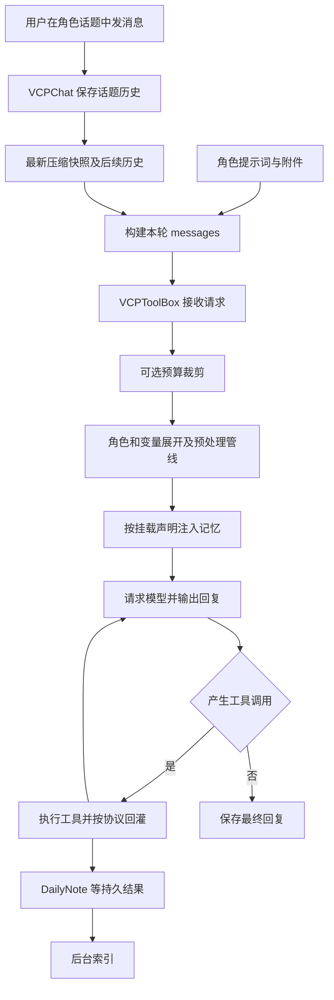
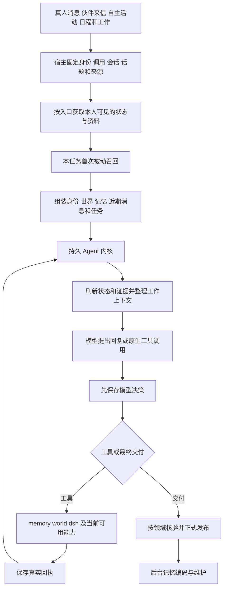
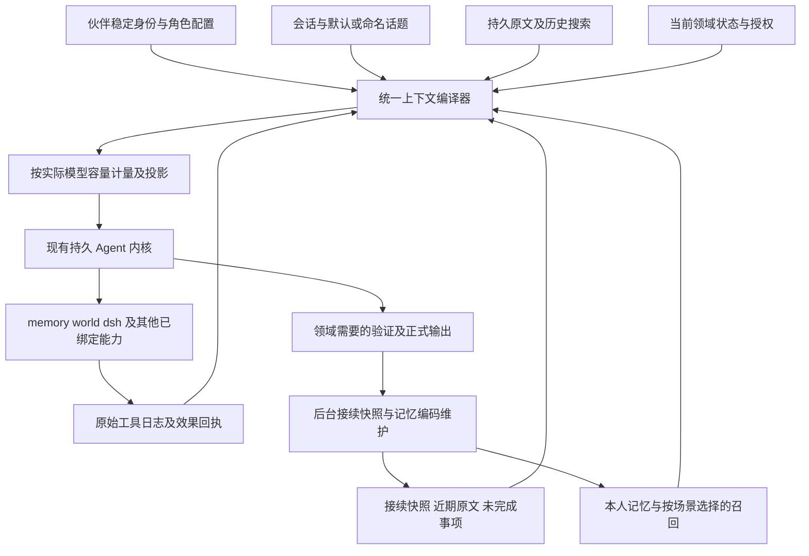

# VCP 与 WorldlineBox 虚拟伙伴 Agent 架构对比

日期：2026 年 10 月 27 日。

WorldlineBox 已具有长期运行的 Agent 内核、持久消息、话题工作状态、上下文压缩和原版 VCP 检索组件。当前最值得调整的是这些能力的覆盖范围和装配方式：让普通聊天也有持续上下文，让每轮回忆可以按场景选择成本，让历史原文更容易找回，并将游戏与写作的专用处理从普通对话路径中拆开。

VCP 值得借鉴的是 VCPChat 的话题使用方式，以及 VCPToolBox 的可组合上下文管线。WorldlineBox 自己的持久执行、来源撤回、角色隔离和多人话题私态应继续保留。建议在现有内核上改造会话与上下文层，避免重复替换已经移植的检索引擎。

## 1 对比范围和版本

| 对象 | 版本与范围 |
| --- | --- |
| WorldlineBox | 当前工作区 `C:/Users/hp/Desktop/project/new/WorldlineBox`；伙伴源码基准 `435a9374566475b5ab63aa95eadf0880b1fb7979`；交付时 HEAD `efb81d7d6437ff2a9ffb9196c2a9baf3e9445854`，新增提交仅涉及 Windows 安装下载，与本报告所比较的伙伴及供应源码无差异 |
| 本地 VCPToolBox | `C:/Users/hp/Desktop/project/VCPToolBox`；HEAD `b8e37d4fca6cab99db90c1a66b9a79d32825766b` |
| 官方 VCPChat | 固定提交 `2af26aaddcf82163c9f3e88b55d53518cb9db059`；用于补足聊天前端、话题和压缩的实现 |
| 本项目移植的 VCP | 两个 vendor manifest 均锁定 `7ceecd48c46caac8168b909ade5febbc4a254e42` |

VCPChat 的聊天历史、分支和前端压缩，与 VCPToolBox 的模型代理、工具循环、日记和检索，属于不同组件。只比较两个仓库的后端，会漏掉用户最关心的话题体验。引用聊天中关于前端的结论已在这一固定提交的源码中复核；该提交的功能不代表本机另有一个已启用同等配置的 VCPChat。

WorldlineBox 已有的 2026 年 10 月 22 日至 26 日设计与调研文档提供背景，当前行为以代码为准。本次没有修改运行配置或伙伴存档，也没有启动真实模型进行两个系统的速度与内容质量对照。下文的效率判断是依赖链分析，实际优劣需要相同模型、语料和配置的测量。

## 2 核心结论

1. **两个系统都会重新组织模型请求。**长期对话不依赖模型实例永久保存某个角色的所有消息。持久聊天、当前请求、长期记忆和任务执行日志必须分别管理。
2. **WorldlineBox 的主要连续性缺口在普通聊天。**普通聊天允许 `topicId` 为空，近期窗口会滑动；当前话题自动压缩要求有效话题和本人状态。普通聊天并没有自动获得命名话题的接续快照。
3. **话题功能的语义不同。**VCPChat 的话题首先是一段独立聊天；WorldlineBox 的话题同时是一项可参加、暂停、恢复并具有公共与个人状态的活动。后者在多人游戏方面更丰富，却不完全对应用户熟悉的聊天分栏。
4. **上下文灵活性差异主要在策略层。**VCP 允许各角色组合直接文本、BM25、门控 RAG、时间、语义组和聚焦等路径。WorldlineBox 已暴露多种主动检索选项，但当前被动召回的默认构造固定为 RiverMemo 与 AIMemo+，缺少同等自由度的每角色上下文配方。
5. **Agent 循环本身不应重写。**WorldlineBox 已在执行前保存决策、保存匹配工具回执、从持久槽位恢复，并对无进展循环停止收费推理；其任务总寿命没有固定 64 步上限。VCP 单次请求内的工具循环反而有配置上限。
6. **无法根据当前材料认定 VCP 全面更快。**VCP 的纯文本及无记忆入口能走轻路径；启用 AIMemo、重排或前端压缩时也会增加模型请求。WorldlineBox 已有分离聚焦与图查询占用、复用本任务回忆等优化，不能忽略。

## 3 每个角色实际怎样运行

### VCP 的执行路径



VCPToolBox 的 `agentManager` 主要加载、缓存和热更新角色文本，不是为每个角色永久养着一份无限模型会话。聊天的角色与话题历史由前端管理。VCPChat 从最新 checkpoint 开始选择有效历史，逐条保留 user、assistant 等角色，再加入 system 与附件资料。

后端先处理可选 `contextTokenLimit`，随后展开变量、按顺序执行预处理器、应用 Detector 和可选 Role Divider，最后构造上游请求。本地预处理顺序包括 RAGDiaryPlugin、VCPTimeLine、OpenHerPersona、OneRing 和 ContextFoldingV2；列表中的名字仍须有已加载且满足条件的插件才会生效。它是一条有序管线，不是所有预处理器自动并行。

模型输出 VCP 文本工具块后，宿主解析、执行并继续请求。普通工具结果需要反馈给模型；`archery: no_reply` 的成功结果可以不回灌、不引发下一次模型循环，但工具执行与错误处理仍然存在。这解释了部分日记写入不会增加一次“读回执再作答”的推理。

证据：[前端请求组织](https://github.com/lioensky/VCPChat/blob/2af26aaddcf82163c9f3e88b55d53518cb9db059/modules/chat/singleChatRequestOrchestrator.js#L351)、[后端主流程](/C:/Users/hp/Desktop/project/VCPToolBox/modules/chatCompletionHandler.js:844)、[工具循环](/C:/Users/hp/Desktop/project/VCPToolBox/modules/handlers/streamHandler.js:434)、[静默结果语义](/C:/Users/hp/Desktop/project/VCPToolBox/modules/vcpLoop/toolExecutor.js:479)。

### VCP 的三类 Agent 循环必须分开

| 路径 | 上下文与运行状态 | 运行边界 |
| --- | --- | --- |
| 普通聊天内的工具循环 | 本次请求中的消息与工具结果追加 | 流式与非流式各有循环配置，未配置时回退5次 |
| AgentAssistant 联络或委托 | 目标角色配置、session 历史，或委托自己的消息数组 | 会话历史有TTL与消息上限；委托默认最多15轮并有超时 |
| VCPChat Flowlock 自主续写 | 每角色一个活动Session，绑定一个话题，每次从该话题重新读取历史 | 最终回复完成并保存后才调度下一次心跳，可停止、完成或失败 |

AgentAssistant 的普通会话历史保存在进程内 `Map`，按目标角色名与 `session_id` 区分；缺省 session ID 由目标角色生成，不是按每位发送者自动生成。临时联络可以跳过历史加载。默认不活跃TTL为24小时；`maxHistoryRounds` 默认7，但实际消息截取公式是该值乘20，即默认140条消息，不能按名字理解为只保留7对问答。它不等同于 VCPChat 的磁盘话题历史。

AgentAssistant 可临时注入工具说明并向本机 VCP 接口再次发起请求。异步委托使用自己的消息数组与运行跟踪，默认15轮。这提供方便的角色协作接口，但不能替代 WorldlineBox 的逐决策与逐效果持久日志。

Flowlock 才是聊天前端“回复后自己决定何时再运行”的主要路径：上一轮正式保存，再根据控制协议安排下一跳；后台续写固定读取Session绑定的角色和话题，而不依赖用户当前正在看的界面。WorldlineBox 已有自主活动、日程与持久任务，若要提供类似自主续写体验，应把下一次运行意图接入已有调度器，而不再建立一条与现有任务脱节的无限递归循环。

证据：[AgentAssistant历史与TTL](/C:/Users/hp/Desktop/project/VCPToolBox/Plugin/AgentAssistant/AgentAssistant.js:226)、[会话与请求组装](/C:/Users/hp/Desktop/project/VCPToolBox/Plugin/AgentAssistant/AgentAssistant.js:820)、[委托循环](/C:/Users/hp/Desktop/project/VCPToolBox/Plugin/AgentAssistant/AgentAssistant.js:1026)、[Flowlock状态机](https://github.com/lioensky/VCPChat/blob/2af26aaddcf82163c9f3e88b55d53518cb9db059/Flowlockmodules/flowlock.js#L76)、[后台话题续写](https://github.com/lioensky/VCPChat/blob/2af26aaddcf82163c9f3e88b55d53518cb9db059/Flowlockmodules/flowlock-integration.js#L98)。

### WorldlineBox 的执行路径



普通聊天由 `service.ts` 驱动；伙伴交流、世界决策、自主活动等通过 `runCompanionStructuredAgent` 使用相同的上下文装配与持久内核，同时保留各领域的输出契约。不同伙伴共享的是执行算法，各自的身份、消息入口、记忆归属、状态和执行日志独立。

这里有两种“重建”：新任务先准备回忆与初始资料；同一任务的后续推理刷新有效状态、身份、来源和工具历史，并复用已经准备的回忆。代码明确避免在每个工具回执之后再次串行运行 AIMemo。不能将其描述成每一步都完整重跑记忆管线。

`runCompanionAgentKernel` 自身负责决策和效果的先后顺序。每 32 步让出一次事件循环，不结束任务。当前任务工作历史超过窗口时由另一个组件生成工作摘要；原始调用和结果仍然持久保存。

证据：[统一内核](/C:/Users/hp/Desktop/project/new/WorldlineBox/src/main/companions/agent-kernel.ts:44)、[调用绑定](/C:/Users/hp/Desktop/project/new/WorldlineBox/src/main/companions/invocation-context.ts:37)、[聊天准备与回忆复用](/C:/Users/hp/Desktop/project/new/WorldlineBox/src/main/companions/service.ts:1999)、[领域 Agent](/C:/Users/hp/Desktop/project/new/WorldlineBox/src/main/companions/structured-agent.ts:156)。

## 4 架构差异总表

| 维度 | VCPToolBox 与 VCPChat | WorldlineBox 当前实现 | 对目标的影响 |
| --- | --- | --- | --- |
| 角色身份 | 角色提示词、变量映射与插件配置 | 宿主固定 companionId，角色资源与身份合同 | 保留本项目的明确身份绑定 |
| 每轮输入 | 前端组织历史消息，后端继续处理 | 宿主组织结构化资料，再投影到各模型协议 | 两者都可以长期重建请求 |
| 普通聊天 | 普通单聊也归属角色话题 | 允许不属于命名话题的日常聊天 | 自动接续覆盖范围不同 |
| 对话历史表示 | 主要保留原生 user 与 assistant 消息 | 聊天行、身份、状态等主要打包进一个 user JSON | 本项目语义显式，输入也更繁复 |
| 近期原文选择 | 最近 checkpoint 后的有效历史，可叠加后端裁剪 | 最近 7 日、最多 256 条、480000 字符，至少尝试保留近期 32 条 | 本项目窗口按字符和条数，不等于模型 token 容量 |
| 话题压缩 | 开启并配置模型后，单聊生成接续快照 | 每角色话题状态压缩，保留原文尾部并检查来源及版本 | 已有能力，需扩展至普通聊天 |
| 单任务工具历史 | 本请求内追加，工具循环次数可配置 | 独立持久日志与工作摘要，无固定任务总步数 | 本项目的恢复基础应保留 |
| 被动回忆 | 由挂载语法决定是否检索和是否聚焦 | 每个新聊天任务准备召回，默认 RiverMemo 与 AIMemo+ | 本项目应增加轻重可选策略 |
| 主动回忆 | LightMemo、日记搜索、DeepMemo、TopicMemo 等 | memory.search/read、检索模式、topic 查询、当前入口 history | 历史原文跨话题搜索体验仍有差距 |
| 记忆形成 | 模型主动调用 DailyNote 为主要入口 | 主脑显式记录，加后台来源队列与事件窗口编码 | 本项目覆盖更主动，也增加治理成本 |
| 近期跨端经历 | 可选 OneRing 与 OneRingMemo | 本人跨入口长期记忆及独立任务状态 | 不能把两者视为已经逐项等价 |
| 日记与索引 | 文件提交后后台索引 | 受管正文、版本与来源账本，加 VCP 投影和索引 | 本项目需要维护更多一致性关系 |
| 多人话题 | 普通群聊与相应编排组件 | 每角色参加和暂停、公共状态、本人私态、主持人权限 | 多人游戏应继续使用本项目的能力 |
| 分支 | 从指定气泡复制历史前缀 | 新话题继承公共及创建者工作状态，并记录父话题 | 当前分支语义并不相同 |
| 输出检查 | 主要是插件、协议和具体功能自己的检查 | 另有游戏隐私、叙事连续性、来源和执行事实检查 | 应按领域和内容需要启用 |
| 性能证据 | 有轻路径，也有额外聚焦与压缩请求 | 有固定被动聚焦，也有缓存、恢复与脱离图锁优化 | 需要同条件对照测试 |

## 5 无限对话的准确实现边界

“无限对话”应定义为：同一聊天入口不因消息累计而失去可用性，完整记录能够继续保存，模型使用有限输入接续，必要时可找回原文。它不能等同于每轮都发送全部历史，也不能承诺摘要永不遗漏任何细节。

### VCP 怎样接续

VCPChat 保留完整 UI 历史，并在发送时使用最新压缩快照及其后的消息。自动检查以配置容量的约 85% 为阈值，需要开启压缩并配置压缩模型；核对版本的这一压缩服务仅支持单聊。压缩失败或历史在期间发生变化，不提交新快照。快照独自就过大时也不会无限自压缩。

后端另有直接裁剪与可选语义折叠。直接裁剪保护 system、特定系统提示以及最后两条消息，其余按位置或可选 Jev 相关性删除；它不会自动为删除的内容生成长期日记。后端字符估算和前置裁剪也不能严格覆盖后来注入的记忆与所有多模态 token。

证据：[前端压缩服务](https://github.com/lioensky/VCPChat/blob/2af26aaddcf82163c9f3e88b55d53518cb9db059/modules/chat/contextCompactionService.js)、[有效历史](https://github.com/lioensky/VCPChat/blob/2af26aaddcf82163c9f3e88b55d53518cb9db059/modules/chat/contextCompactionState.js#L15)、[后端裁剪](/C:/Users/hp/Desktop/project/VCPToolBox/modules/contextManager.js:64)。

### WorldlineBox 已经有三个不同窗口

| 窗口 | 当前规则 | 当前缺口或边界 |
| --- | --- | --- |
| 聊天近期原文 | 7 日、256 条、480000 字符；最低近期条数为 32 | 普通聊天滑出窗口的内容依赖记忆或主动回查，缺少同等自动摘要接续 |
| 命名话题原文 | 256 条或480000字符的约80%触发；通常保留约16%且至少32条原文 | 要求有效 topic 和本人状态；时间窗口与模型实际容量仍须协调 |
| 单任务工具步骤 | 超过32轮或240000字符时整理，默认保留16轮完整尾部 | 只解决当前任务的工具历史，不替代聊天连续性 |

话题压缩同时处理旧摘要、新前缀、当前阶段、精确用户约束及来源水位。提交前核对原文摘要、旧 checkpoint、话题修订和正式发布序号，失败不推进。它在数据一致性方面已经相当完整。

必须注意两点。第一，当前源消息会整条保留，即使它本身已经超过近期窗口，因此上述字符数不是绝对请求上限。第二，工作摘要和阶段合计目前最多 3000 字符，这只是一个模块的预算；身份、精确约束、世界状态、记忆、工具 schema 和附件仍然占用模型输入。

**优先补齐的路径是普通私聊的连续性，而不是继续放大256条窗口。**建议为日常聊天提供默认会话上下文，自动保存与消费接续 checkpoint；游戏、写作再在其上叠加活动状态。若要保持 UI 中“日常聊天”的名称，可以让该入口在内部绑定默认话题，或让连续性模块直接支持无命名话题的会话。两种方式需要统一来源、可见范围和旧存档迁移规则。

证据：[近期窗口](/C:/Users/hp/Desktop/project/new/WorldlineBox/src/main/companions/context-window.ts:5)、[话题压缩入口与条件](/C:/Users/hp/Desktop/project/new/WorldlineBox/src/main/companions/topic-compaction.ts:188)、[聊天接入位置](/C:/Users/hp/Desktop/project/new/WorldlineBox/src/main/companions/service.ts:2989)、[工具历史压缩](/C:/Users/hp/Desktop/project/new/WorldlineBox/src/main/companions/loop-continuity.ts:9)、[摘要模块预算](/C:/Users/hp/Desktop/project/new/WorldlineBox/src/main/companions/working-summary-budget.ts:19)。

## 6 上下文的全面性与灵活性

### VCP 的优势来自可组合的挂载方式

VCP 的角色文本可以按用途组合不同记忆入口：

| 入口 | 主要含义 |
| --- | --- |
| `{{某日记本}}` | 直接文本，可加 LastN 或 BM25 等选择 |
| `[[某日记本]]` | RAG 检索片段 |
| `<<某日记本>>` | 通过相关性门控后直接注入 |
| `《《某日记本》》` | 通过相关性门控后进行 RAG |
| Time、Group、RiverMemo、AIMemo 等修饰 | 在相应路径中组合时间、语义、图检索或模型聚焦 |

本地角色示例确实不同：Hornet 使用 `Last6::BM25+`，Nova 的不同日记挂载使用 RiverMemo、时间、Group，以及可选 AIMemo。它们证明配置能力，不代表这些示例就是当前运行中的全部角色配置。

当前源码对“只有直接文本入口”有专用快速路径；没有记忆标记时在上下文向量扫描之前直接退出。VCP 的高效部分来自这样的功能门控，不能把它概括成每轮统一执行所有记忆步骤。

证据：[纯文本快速路径](/C:/Users/hp/Desktop/project/VCPToolBox/Plugin/RAGDiaryPlugin/RAGDiaryPlugin.js:1394)、[无挂载时退出](/C:/Users/hp/Desktop/project/VCPToolBox/Plugin/RAGDiaryPlugin/RAGDiaryPlugin.js:1470)、[Hornet配置](/C:/Users/hp/Desktop/project/VCPToolBox/Agent/Hornet.txt:1)、[Nova配置](/C:/Users/hp/Desktop/project/VCPToolBox/Agent/Nova.txt:5)。

### WorldlineBox 的完整性已经较强

`buildCompanionContext` 已装配角色身份、入口授权、当前世界与时间、生活状态、人物认识、本人记忆、话题公共及私有工作状态、持续目标、近期发言、当前请求、附件和真实执行回执。问题更接近“什么场景需要哪些资料，如何表示和更新”，不能简单判断成上下文不全面。

当前聊天行带有作者、时间、序号、回复关系等信息，最终主要进入一个 user JSON。它的好处是来源与多人语义显式；代价是普通二人聊天也需要理解一个较大的资料信封。VCPChat 则较自然地保留原生 user/assistant 消息序列。

**建议提供两种模型投影，共用同一份宿主事实。**普通二人聊天可将用户及当前伙伴的可见发言投影成原生角色消息；群聊保留作者身份封装，其他伙伴的发言不能映射为当前模型自己的 assistant。当前 invocation、权限和来源索引继续由宿主管理。摘要与记忆保持资料身份，不能因为投影就升级成 system 授权。此调整是否改善角色自然度，必须做内容对照实验。

证据：[上下文内容](/C:/Users/hp/Desktop/project/new/WorldlineBox/src/main/companions/context.ts:94)、[模型协议投影](/C:/Users/hp/Desktop/project/new/WorldlineBox/src/main/companions/model.ts:368)。

### 建议增加每角色的上下文配方

配方由宿主校验并持久化，角色可以在允许范围内选择；不要让任意文本占位符获得宿主权限。建议包含：

- 当前聊天的输入窗口、模型容量、输出预留、附件预算与连续性策略。
- 近期经历选用少量直接读取、BM25、RAG 或聚焦，及实际可用的时间与重排模式。
- 各记忆本的所有权、显式共享范围、默认召回条件与最大注入成本。
- 日常交流、项目协作、知识问答、写作与游戏各自需要的状态模块。
- 模型可见的简明来源，与宿主保存的完整审计依赖分开投影。

WorldlineBox 已有 `memory.retrieval_modes` 和 `retrievalOptions`，时间、语义组、展开、联想、重排等主动能力无需再造。需要补的是被动阶段的可选组合，以及配置、成本和可用性在界面中的表达。

## 7 记忆架构与写入时机

### VCP 的形成链

```text
重要事件或新认识形成
  → 模型按人设指引调用 DailyNote create 或 update
  → 文件提交
  → 文件变化进入后台摄取
  → 切块、Tag 和 Embedding
  → 数据库与向量索引更新
  → 后续被动或主动检索
```

日记指引强调事件讲完整后再写、同一事件更新同一篇、跨事件感悟另写。它是模型行为指引，不是每轮一定写日记的后端保证。成功创建日记时返回 `indexStatus: queued`，表示文件已提交而完整索引尚在后台推进。

OneRing 是另一层近期消息账本，有自己的启用与触发要求。它的消息记录不等于日记形成；OneRingMemo 和时间线也不等于当前聊天的压缩快照。

证据：[日记指南](/C:/Users/hp/Desktop/project/VCPToolBox/TVStxt/Dailynote.txt:4)、[日记索引状态](/C:/Users/hp/Desktop/project/VCPToolBox/Plugin/DailyNote/dailynote.js:762)、[OneRing启用边界](/C:/Users/hp/Desktop/project/VCPToolBox/Plugin/OneRing/OneRing.js:980)。

### WorldlineBox 的形成链

```text
正式且本人可见的消息或活动来源
  → 记忆来源与编码任务持久保存
  → 按角色、会话、话题和活动聚合事件窗口
  → 读取相关记忆与同源贡献
  → 后台模型提议新增、更新或不产生记忆
  → 核验来源、版本、禁止项与状态修订
  → 提交受管记忆正文、来源账本与投递任务
  → VCP 投影与索引
  → 时间线、反思和整合按各自条件维护
```

主脑还可以显式 `memory.record/revise`。因此，本项目同时具有交谈时主动记忆和后台编码两条入口，并不要求主脑每条消息都亲自调用记忆工具。正式来源进入编码任务，也不等于每条来源最终都会生成一篇日记。

当前初始化策略包括：balanced 模式静默 60 秒、最长等待 5 分钟、批量 12 条；quiet 模式为 120 秒、10 分钟、12 条；learning 模式为 30 秒、3 分钟、8 条。实际角色策略由受管文件解析，默认值不是运行中配置的证明。用户明确要求记住、名称更正，以及部分实际行动来源可以加速进入编码。最长等待按片段起点计算，持续聊天不会无限延后同一片段。

与 VCP 纯模型落笔相比，这种方式更容易在漏写或未告别时仍捕获经历，但可能产生更早、更频繁的整理，且需要处理显式记录与后台同源贡献的重复。当前实现已经读取同源贡献并核验来源，后续优化应继续利用这一机制。

证据：[事件窗口](/C:/Users/hp/Desktop/project/new/WorldlineBox/src/companions/memory-episodes.ts:23)、[策略默认值](/C:/Users/hp/Desktop/project/new/WorldlineBox/src/shared/companion-memory-policy.ts:21)、[后台编码](/C:/Users/hp/Desktop/project/new/WorldlineBox/src/main/companions/memory-service.ts:1456)。

### 被动与主动回忆的差异

| 场景 | VCP | WorldlineBox |
| --- | --- | --- |
| 新用户消息 | 根据当前角色挂载条件选择路径 | 新聊天任务进入本人可见范围的被动召回准备 |
| 默认聚焦 | 由 AIMemo 等标记和配置决定 | 当前 passive 路径构造 RiverMemo 与 AIMemo+ |
| 工具续接 | 本轮保留并追加工具上下文 | 复用已准备的本任务回忆，核验来源有效性 |
| 精确查旧事 | 日记工具，或 DeepMemo 搜历史聊天 | memory.search/read 查日记，当前入口 history 分页回原文 |
| 跨话题历史 | TopicMemo 与 DeepMemo 依赖相应前端或节点 | 话题索引和本人状态可查询；当前 history 限定当前消息入口 |

当前 `history` 只按当前 invocation 的会话、话题和消息范围回查。它有价值，但不能直接当成 DeepMemo 的跨获权历史搜索替代品。建议补一个独立的聊天历史查询能力：先找本人可访问的话题，再搜索片段并按游标读上下文。索引对象是原始聊天，记忆对象是提炼后的日记，两类结果应明确区分。

证据：[被动查询构造](/C:/Users/hp/Desktop/project/new/WorldlineBox/src/main/companions/memory-service.ts:996)、[固定默认标记与聚焦](/C:/Users/hp/Desktop/project/new/WorldlineBox/src/main/companions/memory-service.ts:838)、[当前入口原文工具](/C:/Users/hp/Desktop/project/new/WorldlineBox/src/main/companions/service.ts:2609)、[能力合同](/C:/Users/hp/Desktop/project/new/WorldlineBox/src/shared/companion-capability-tools.ts:48)。

## 8 话题功能怎样与 VCP 对齐

VCPChat 新话题创建独立 `history.json`；切换后使用对应历史。新话题不自动带入旧话题所有消息，但同角色仍可以挂载相同长期记忆。分支则从指定气泡复制之前的聊天，使用户能从那个位置继续。

WorldlineBox 的消息明确归属普通对话或单个话题，当前选择指针绑定会话与阅读者。它还具有邀请、加入、退出、暂停、恢复、结束、重开、公共状态、本人私态和主持人交接。迟到回复不能因为 UI 切换被送到另一个话题；这些性质与多人虚拟伙伴相匹配。

当前分支创建新话题后，复制公共状态与创建者工作状态，记录 `forkedFromTopicId`，没有复制指定气泡之前的完整消息。应将两种操作分别表达为“从消息创建聊天分支”和“从当前状态派生活动”。

建议将用户层面的行为统一为：

| 操作 | 对齐后的行为 |
| --- | --- |
| 打开某伙伴 | 直接进入一个可长期接续的默认聊天话题 |
| 新建话题 | 创建新的历史范围；角色和允许共享的长期记忆沿用 |
| 切换话题 | 切换查看与发送位置，加载本人对应 checkpoint 与近期原文 |
| 从气泡分支 | 固定分支点，保存历史前缀快照或受权限约束的不可变引用 |
| 创建游戏或故事 | 为聊天话题添加活动类型、规则和领域状态 |
| 暂停与恢复 | 保留活动进度，恢复时重新校验当前来源、权限和世界状态 |
| 查看旧话题 | 可检索和阅读原文，不自动激活旧任务或引入旧私态 |

分支采用引用而非物理复制可以减少大历史重复，但必须明确父消息编辑、撤回、删除以及访问资格变化时的行为。不能为了复现前端体验而取消本项目已有的来源失效和角色隔离。

证据：[VCPChat新建话题](https://github.com/lioensky/VCPChat/blob/2af26aaddcf82163c9f3e88b55d53518cb9db059/modules/ipc/chatHandlers.js#L682)、[VCPChat聊天分支](https://github.com/lioensky/VCPChat/blob/2af26aaddcf82163c9f3e88b55d53518cb9db059/modules/chatManager.js#L2307)、[本项目话题存储](/C:/Users/hp/Desktop/project/new/WorldlineBox/src/companions/topic-store.ts:30)、[当前分支实现](/C:/Users/hp/Desktop/project/new/WorldlineBox/src/companions/topic-store.ts:408)、[话题界面](/C:/Users/hp/Desktop/project/new/WorldlineBox/src/renderer/companions/CompanionTopicBar.tsx:39)。

## 9 效率差异的来源

普通新回复的关键等待路径可以表达为：

```text
本项目首次输出前等待
  ≈ 活动就绪与模型资源准入
   + 被动回忆准备与实际聚焦
   + 上下文和来源核验
   + 本次需要的压缩或写作焦点处理
   + 回复模型首字延迟

本项目正式完成等待
  ≈ 上述过程 + 正文生成 + 领域需要的检查或修订
```

这些项并非每轮全部产生模型调用。记忆为空、缓存、既有准备回执、任务续接与领域门控都会改变成本；游戏正文为避免泄露私牌，会在审查前禁止流式展示，首字体验与普通聊天不同。

VCP 的轻路径可跳过向量上下文、聚焦模型或结果回灌。它启用同等复杂功能时也会付出成本：AIMemo 聚焦、外部重排、Jev、语义折叠或前端压缩并非免费操作。

本项目已有以下优化，应保留：

- 本任务的被动回忆准备结果持久保存，工具续接复用。
- 聚焦网络请求前释放图查询通道，避免长模型调用长期占用图资源。
- 前台查询优先于排队的后台工作，同时有公平性约束。
- 不把底层依赖清单、完整哈希与诊断计时原样全部投影给回复模型。
- 使用正式发布序号与有界分页，减少话题压缩反复扫描历史的成本。

建议新增的优化有明确优先次序：

1. **先补全覆盖，再减少成本。**普通聊天也具有 checkpoint；实际容量以整个最终请求计量，包含工具、附件、召回与输出预留。字符阈值只作为可解释的退路。
2. **被动回忆允许轻重选择。**近期明确内容可直接读取或 BM25；复杂跨时段问题采用 RAG 与聚焦。轻路径仍查询当前获权资料，不能把“决定跳过检索”解释成没有相关记忆。
3. **后台预备连续性。**回复正式提交后，可以预备新 checkpoint；新消息到来时检查是否仍匹配来源和发布版本。无效则丢弃或重建，只有必要时在前台等待。
4. **领域处理显式门控。**普通聊天不应承担故事连续性或游戏秘密检查；当前已有门控的路径继续保留。对可能的执行事实主张保留必要核验，减少无关内容的附加模型调用。
5. **压缩模型输入表达。**稳定身份保持稳定前缀，动态时钟、世界状态和来源摘要分开；优先发送本次任务所需状态。提示缓存是否命中以供应商实际 usage 为准。

证据：[当前回复与审查路径](/C:/Users/hp/Desktop/project/new/WorldlineBox/src/main/companions/service.ts:2137)、[脱离图通道的聚焦](/C:/Users/hp/Desktop/project/new/WorldlineBox/src/main/companions/memory-service.ts:873)、[查询调度](/C:/Users/hp/Desktop/project/new/WorldlineBox/src/main/companions/memory-query-scheduler.ts:25)、[模型记忆投影](/C:/Users/hp/Desktop/project/new/WorldlineBox/src/main/companions/memory-model-context.ts:8)。

## 10 建议的目标架构



| 模块 | 职责 | 应如何使用现有实现 |
| --- | --- | --- |
| 会话与话题服务 | 新建、切换、历史、分支、状态和成员 | 扩展 topic-store 与当前 UI，纳入普通聊天 |
| 连续性服务 | 接续快照、尾部原文、覆盖水位和失效 | 提取 topic-compaction 的通用部分，保留领域专用验证 |
| 上下文编译器 | 根据角色配方选择资料并投影模型消息 | 重构 context.ts 与 providerRequest 的职责边界 |
| 记忆策略服务 | 被动和主动召回策略、成本、来源与可用性 | 扩展 memory-service 与现有 retrieval modes |
| 历史查询服务 | 获权话题发现、原文搜索与分页阅读 | 在现有 history 与 topic 查询之上补齐 |
| 执行内核 | 决策落盘、工具效果、恢复、最终交付 | 保留 agent-kernel、journal 和效果回执 |
| 后台记忆服务 | 来源聚合、日记形成、时间线和整理 | 保留 episodes、队列和受管文件，改善边界与观测 |

需要明确两种独立状态。聊天连续性保存“这段话进行到哪里”，长期记忆保存“这个角色以后值得想起什么”。原始聊天与工具日志负责精确回查。不能用一种摘要同时代替全部三者。

## 11 分阶段改造顺序

### 第一阶段 普通对话持续接续

为日常聊天增加默认会话上下文与自动 checkpoint；统一 checkpoint 加近期尾部的输入。先保持原有角色权限与消息归属，准备好空话题与默认话题的迁移映射后，再调整 UI。为最终完整请求增加容量估算和输出预留，服务返回容量错误时只缩减可替换模块，当前请求与合法工具协议保持完整。

完成条件：普通私聊超过近期窗口、关闭应用、恢复后，当前目标、更正、约定与未完成事项仍可接续，原文可读取。

### 第二阶段 话题体验对齐

新建空话题、改名、切换和从指定消息分支具有清楚一致的行为。活动话题作为扩展类型保留；参与者自己的当前指针与秘密状态继续隔离。界面区分查看历史与下一条消息发送位置，并呈现本话题的接续状态。

完成条件：从某气泡分支后能沿当时上下文继续；后来的消息与迟到回复不会混入错误分支。

### 第三阶段 上下文与召回策略

增加受管角色配方和按场景的被动召回。普通二人聊天尝试原生消息投影，群聊保留作者封装。补获权历史检索。通过实际输入与语料实验评估自然度和找回能力，避免只根据输入长度判断效果。

完成条件：相同问题能解释实际使用的召回路径；轻路径减少等待，跨时段和精确追问仍能找回关键细节。

### 第四阶段 记忆形成与性能收敛

让后台事件编码与主脑显式记忆更好地协作，继续更新同源事件并保留矛盾与修订。背景预备 checkpoint，按版本有效性复用。最后单独评估 VCP 上游组件更新，使用固定语料比较召回与索引行为。

完成条件：记忆输出质量、重复率和索引延迟可观测；后台整理不会使前台交谈持续排队。

## 12 验收与本次核对结果

| 要验证的能力 | 验收方法 |
| --- | --- |
| 普通聊天持续接续 | 多次越过窗口；在早期埋入实体、否定、更正和未完成承诺，后续分阶段追问 |
| 原文可找回 | 对未进入日记的旧消息进行关键词、语义、话题定位与分页展开 |
| 重启恢复 | 在工具决策已保存、效果已提交、最终发布前等位置中断并恢复 |
| 话题与分支隔离 | A、B、默认聊天和分支放入不同标记，逐次检查真实模型请求 |
| 多人私态 | 私牌、夜间信息与未公开故事设定不能进入其他角色的输入或公共输出 |
| 记忆形成质量 | 区分事件未完、事件完成、明确记住、修订和跨事件感悟，核对最终正文与来源 |
| 摘要不漂移 | 连续多次压缩后核对精确约束、人物与未决线索；必要时回读原文 |
| 性能 | 同模型同配置，测无记忆、热缓存、冷索引、长历史、并发和压缩边界 |
| 失效与撤回 | 修改或撤回祖先来源后，旧 checkpoint、回忆和未发布结果不能继续作为有效证据 |

性能至少分别记录：首字时间、正式完成时间、召回等待、图准备、聚焦请求、压缩请求、审查请求、模型调用次数、输入输出 token 和缓存命中。总延迟使用 p50 与 p95；检索还要记录关键事实召回率、错误归因和无依据陈述，不能用速度替代内容验收。

本次运行当前工作区中 5 个相关单元测试文件，**39 项通过**，覆盖持久内核、话题压缩、任务被动回忆复用、草稿过滤和模型记忆投影。执行命令为：

```powershell
node node_modules/vitest/vitest.mjs run --config vitest.config.ts tests/unit/companion-agent-kernel.test.ts tests/unit/companion-topic-compaction.test.ts tests/unit/companion-agent-journal-passive.test.ts tests/unit/companion-context-drafts.test.ts tests/unit/companion-memory-model-context.test.ts --maxWorkers=2
```

这验证现有局部机制，不能作为两个系统长期真实聊天或速度优劣的实验结论。

供应组件逐文件哈希核对结果：两个 manifest 去重后共 129 项，129 项均符合锁定哈希；与本地当前 VCPToolBox 对应文件相比，94 项相同、35 项不同、没有缺失。不同项包含 JS、Rust、类型、配置示例、文档和原生二进制，不能直接解释为35项功能缺失。更新前应按语义差异、宿主适配与回归结果判断。

可复核版本、哈希与差异文件见 [源码核对清单](/C:/Users/hp/Desktop/project/new/WorldlineBox/docs/developer/vcp-companion-agent-architecture-evidence-2026-10-27.json)。
