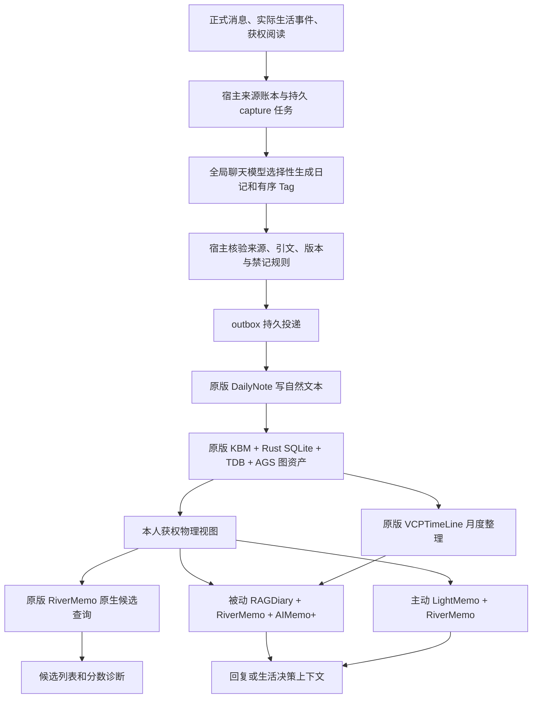

# VCP 记忆与持续生活移植：源码对照审计

审计日期：2026-10-23。结论针对审计时的工作区；本次不修改业务代码。

## 结论

**WorldlineBox 确实把 VCP 当前热记忆的原版数据库、向量检索和语义关系数学内核嵌入运行了。它不是一个借 VCP 名字包装的普通向量搜索。但“全部记忆、知识和持续生活能力，都按原逻辑完整移植”不成立。**

准确的现状是：**原版热记忆内核 + 原版部分外围插件 + WorldlineBox 自建的来源、权限、生活、学习和睡眠编排。**

四个问题分别回答：

1. **是否保留先进记忆思想？** 是。EPA、残差金字塔、AGS、有序 Tag 图、Spike、动态虫洞、RiverMemo 双场、Topology V3 有真实调用链，不只是仓库中保留了文件。
2. **是否完整继承 VCP 所有记忆/知识能力？** 否。独立冷知识服务、完整 DreamWave、通用日记合并归档等没有完整接入；多个可选检索流程没有进入日常调用。
3. **是否完全保持原版行为？** 否。运行副本有显式参数变化；模型、来源、物理隔离、注入方式和调度由宿主适配，其中有合理选择，也有已复现的接口缺陷。
4. **是否已证明效果与原版等价？** 没有。工程链已验证可运行；缺少同语料、同模型、同序列化输入下的上游/宿主成对评测。既有真实模型评测也保留了漏召回和内容问题。

不提供“完成了百分之多少”的数字：内核、插件、模式、产品行为的重要性不等，文件数量不能换算能力覆盖率。

## 审计对象和证据边界

| 对象 | 基准 |
| --- | --- |
| WorldlineBox | `C:/Users/hp/Desktop/project/new/WorldlineBox`；HEAD `d96664ffb19fba602bdd3054107565e1d4532e9d`，另有预先存在且继续变化的工作区修改 |
| 本地 VCPToolBox | `C:/Users/hp/Desktop/project/VCPToolBox`；HEAD `7ceecd48c46caac8168b909ade5febbc4a254e42` |
| WorldlineBox 固定上游版本 | 同为 `7ceecd48c46caac8168b909ade5febbc4a254e42` |
| 历史需求 | 已读取用户引用的 chat `01a15d49-96eb-7b02-99c3-c723d424973c`，包括最初原样替换目标和后续学习、跨入口记忆、梦与验证要求；历史完成声明不作为源码证明 |

本次对照的是用户指定的本地上游版本，不声称覆盖审计后远端新增提交。在线也核对了该固定提交的原始 `KnowledgeBaseManager.js`。本地源码及实际调用优先于 README、旧研究文档、历史聊天中的完成说明。

工作区有其他聊天并行编辑，不能把本报告说成冻结提交的全量验收。证据 JSON 记录了提取时的重要源码 SHA；本次没有覆盖或回滚这些修改，没有读取真实用户记忆库或聊天凭据，没有打包、部署或提交。

## 实际运行链

候选查询与实际正文查询是两次不同调用。图中 M 的顺序/分数不能当成 J 或 K 的逐条实际引用轨迹。

主要入口：`src/main/companions/memory-service.ts:234-311`；`src/main/vcp-memory/runtime.cjs:414-477`；`src/main/vcp-memory/peripherals.cjs:25-113`。

## 哪些保留了，哪些没有

| 能力 | 当前状态 | 依据与实际边界 |
| --- | --- | --- |
| Rust 记忆数据库业务、SQLite Write Actor/读池 | 原版迁入并运行 | vendor Rust/storage 与本地上游一致，实际写入、重启测试通过 |
| TDB-VEC/2-bit 检索、原 FP32 精排、checkpoint | 原版迁入并运行 | 内联 `vcp-tdb-index`，并非旧 USearch 路径 |
| EPA、残差金字塔、AGS、有序 Tag 网络、Spike/动态虫洞 | 原版迁入并运行 | 原生 Memo pipeline 与资产构造器实际调用 |
| RiverMemo 双场、Ω、Direct Anchor、Topology V3 | 原版迁入并运行 | 宿主调用 `executeNativeRiverQuery`，不是自己重新实现加权分数 |
| 被动浮现、主动回忆 | 原版插件接入 | 被动固定 RiverMemo+AIMemo+；主动 LightMemo/rivermemo |
| DailyNote 日记落盘 | 原版插件接入 | 选择什么内容、何时写入、来源验证由宿主实现 |
| 月时间线与摘要 | 原版 VCPTimeLine 接入 | 后台逐月生成，来源及版本验证后参与话题召回 |
| 自动 Tag | 已实现、两条宿主路径 | 自动日记由模型生成有序 Tag；手工资料标签队列复用原 TagMaster 提示词。原插件 `TagMaster=false` 不代表整个产品没有自动标签 |
| 独立冷知识库 TDBKnowledge | 未接入 | 无原服务/`triviumdb`/`tdbKnowledgeManager`；热核 TDB 存在不证明冷服务存在 |
| Group、显式时间/衰减、扩展、联想、额外重排等 | 源码部分保留，日常入口未完整开放 | 默认被动 marker 没有这些后缀。主动 LightMemo 默认仍有 BM25，不能说全系统没有 BM25 |
| 语义组和元思考资产 | 未完整启用/迁入配置 | 两边语义组均只有 example；原版受跟踪的元思考链配置未进入 vendor。不能据类名推定已运行 |
| 完整 DreamWave 多层梦联想 | 未迁入 | 宿主睡眠反思调用一次 River 搜索，非原 DreamWave 的多种子、多层、跨时间桶流程 |
| 通用日记合并与归档 | 普通伙伴工具不等价 | `memory.organize` 只改 tags；原 DailyNoteManager 的合并正文/归档能力在插件内，但没有等价暴露为普通伙伴整理闭环 |
| 持续学习目标、真实回忆自测、定向 new/reuse/revise | 宿主实现并接入 | 有证据、轮次和租约；仅目标内的定向整合，不等于通用全库合并 |
| 跨聊天入口身份、世界/社交、日程、情绪与认识演进 | 宿主实现并接入 | 没有整体原搬 OneRing/AgentAssistant/AgentDream；已有统一消息、世界和任务权威 |
| 应用退出后的持续认知 | 不具备 | 退出会关闭全部相关服务；重开补算物理时间不等于离线持续思考 |

## 原版热内核迁入的硬证据

### 文件和版本

执行 `node scripts/vendor-vcp-memory.mjs --verify` 得到 **127 个原文件校验通过**。另外逐个比较 vendor 文件与本地 VCPToolBox 原路径，**127/127 字节相同，缺失 0，差异 0**，包括 Windows 原生 `.node`。这同时排除了“只用自己的 manifest 自证”的局限。

Rust 子项目保留本地上游相应的 55 个非二进制文件和 1 个 Windows 二进制。后续新增审计文件不参与这个数量。

二进制 `vexus-lite.win32-x64-msvc.node` 为 10,628,608 字节，SHA-256 为：

`fa8f89310d75d07683f2bba2f81cffd33786be615fa661a1c72b1d9e2774bae5`

直接加载实测 ABI 2，有 18 项能力声明，包括 SQLite、write actor、read pool、TDB-VEC、checkpoint、Memo artifact、River query、LightMemo query；相关导出均为真实函数。结合真实 native worker 测试，可确认原生链可用。

**证明限度：** 本次没有从 Rust 源码重编译，也没有可复现构建或二进制内嵌源码 commit 的证据；“与本地上游二进制一致”不等于“已独立证明二进制必由随附源码构建”。

### 算法调用

宿主 `runtime.cjs:428` 调用原 `KnowledgeBaseManager.executeNativeRiverQuery`；原 KBM `:2781` 构造统一观测，`:2813-2844` 将观测与资产签名交给原生 River 联合查询；`RiverMemoEngine.js:223` 选择 `executeRiverQuery/executeRiverQueryHybrid`。

`vendor/vcp-memory/rust-vexus-lite/src/memo_pipeline.rs` 的实际执行顺序：

- `:1724` EPA，`:1729` Residual Pyramid。
- `:1740` 核心标签、语言与层级门控。
- `:1763` 动态虫洞，`:1769` Spike 有界传播。
- `:1784` 标签融合与增强查询向量。
- `:1798` 局部/迁移双场。
- `:1810` 观测句柄与原始精度向量池复用。

有序标签不是装饰：`memo_artifact_builder.rs:112` 按 file/position/tag 读出；`:200-210` 消费正反向增益、距离衰减和语义增益；`:608-615` 与 AGS 锚增益共同构造图资产。

因此，你关心的“自己形成语义关系网，利用当前语境诱发相关记忆”这部分思想确实在运行。这仍不保证每次关系传播都带来正确命中；数据规模、Tag 质量、向量模型与语料会影响其效果。

### 数据库名称与历史文档

本次核对的核心及依赖中没有找到 Raft 共识数据库实现。对应底座是 **Rust 持有 SQLite 业务事务 + 内联 TDB 向量检索**；TDB crate 描述自身为 TriviumDB 0.8.9 QuIVer 检索核的隔离移植。SQLite 本身也不是 VCP 从零编写的数据库。2-bit 主要用于导航/筛选，原 FP32 从 SQLite 提取精排，不能理解成所有向量精度都只剩两位。

本地最新白皮书 `docs/vcp-whitepaper.md:12,860-870` 已说明：独立 TagMemo 运行时退役、USearch 被 TDB 替代，RiverMemo V2 和 Topology V3 属于不同版本序列。旧 `MEMORY_SYSTEM.md`、`TagMemo_Wave_Algorithm_Deep_Dive.md` 有历史架构内容，不能以“没有重新启用旧 TagMemo”判断移植失败。

## 已复现的宿主适配问题

### 问题一：合法长日记、长查询被 4096 字符包装器拒绝

**证据：** 上层 `src/shared/companion-memory.ts:16,26,36` 允许日记正文 65,536 字符、query 16,000 字符；宿主 `runtime.cjs:12` 的统一 `identity()` 却限制 4096，`:36` 用它校验日记正文，`:416` 用它校验查询。这里的长度是 JavaScript 字符串长度。

直接调用真实 `normalizeNote`：4096 成功；4097、16000 均返回 `Invalid memory content`。真实 runtime 的 `search` 对 4097 字符查询在进入 API/原生检索前返回 `Invalid memory query`。上层普通回复 `memory-service.ts:326` 只截到 16000，`:343-346` 会将这种异常变成 pending/degraded 的无回忆结果。

**影响：** 被上层接受的长日记无法通过常规原版投递边界；长消息可能使该轮被动召回降级。这是宿主适配上限不一致，不是原版向量引擎无法切长文本。一般 snapshot 只选 indexed 日记（`memory-store.ts:474`），不能据此宣称所有新长文都会污染并阻塞已有全库；只有长文已出现在传给 replace 的集合时，整个 replace 的统一验证才会一起失败。

**建议：** 为 ID/路径、日记内容、query 分别制定与上层一致的限制，验证边界内长正文、跨 chunk 检索、重试和长话题被动回忆；不以静默截断丢弃信息。

### 问题二：tags/from/to 只筛选候选列表，没有筛选实际工具正文

**证据：** `memory-service.ts:284` 调 LightMemo 只传 folder/query/k/enginemode；`:298-301` 在另一次候选查询结果上应用标签、日期筛选。实际 `contextText` 没有经过这些筛选。`companion-memory-tool.ts:8` 对伙伴开放这些参数；`structured-agent.ts:123,137-148` 将返回值序列化给模型，另一工具路径 `service.ts:2190,2206` 也原样返回。

最小隔离复现使用真实 CompanionMemoryService 与工具 capability，仅以 fixture 替代存储和 VCP 返回值。同一本三篇文档：2026/flower、2026/train、2025/flower。请求 tags=flower、from/to=2026 年后，`memoryPage` 只有第一篇，但 `memoryContext.text` 仍包含三篇正文；捕获到的 LightMemo 参数确实不含这些筛选条件。

**影响：** 模型可能读到查询条件之外的同一获权语料，列表与实际检索正文不一致。这是查询准确性缺陷，本次没有证明跨伙伴越权。原生引擎具体会召回哪些文档依输入而定；复现证明宿主没有把限制落实到那条正文链，而不是断言任何 query 都返回三个文本。

**建议：** 使候选、实际正文与分页共同执行同一查询范围，并对原生路径与宿主路径做一致性验证。

## 有意适配产生的行为差异

### 三项去重参数与原默认不同

运行副本 `runtime.cjs:149-155` 将：

| 参数 | 原值 → 宿主值 | 实际影响 |
| --- | --- | --- |
| `KnowledgeBaseManager.deduplicationThreshold` | 0.88 → 1 | 原生标签融合的近重复阈值，可能改变 Tag 权重及增强向量 |
| `resultDeduplication.semanticThreshold` | 0.92 → 1 | RAG 候选语义去重 |
| `resultDeduplication.finalSemanticThreshold` | 0.97 → 1 | 最终结果语义去重 |

原注释的意图是保留否定、身份、更新更正细节，给 AIMemo 判断；这是有依据的选择，不是核心算法被重写。但需验证重复文档膨胀、旧新矛盾和 token 成本。

**不能说“全部语义去重已关闭”：** 硬去重仍在，KBM 另一项 `nativeRiverQuerySemanticThreshold` 默认仍为 0.92（`KnowledgeBaseManager.js:129,2841`）。既有文档对“保留新旧候选”的描述不能扩张成所有路径都不会合并近邻。

### 物理权限视图合理，但有成本

原图存在全局关系，仅事后过滤正文不能隔离图传播。因此宿主按 owner/获权视图建立独立物理库和图；`memory-view-cache.ts:43-49` 仅纯新增复用图，修订、撤回、dirty 写入重建。这保留了原数学的封闭语料条件，同时避免别人的私有 Tag 影响本人的查询。

代价是视图/原生资源重复、修订后的重建和冷启动。`CompanionVcpRuntime` 最大四个驻留 scope；全局 embedding 服务 `embedding-global-service.ts:50,116-117` 仍是共享有序队列。前台 `memory-service.ts:238,257` 每轮取得完整 snapshot 并同步视图，有随语料增长的宿主成本。管理语义搜索有另外的增量索引，不能将其温查询性能直接套给所有 Agent 调用。

### 原模板保留，不代表生成参数完全相同

原 `AIMemoHandler.js:771-772` 请求 temperature=0.3、max_tokens=40000；`VcpChatGateway` 只提取 messages，未将这两项交给生成函数，`index.ts:5013` 进入宿主统一 `generateCompanionText`。`model.ts:259,274,286,292` 的 provider 请求使用 8192 输出额度，也没有传原 temperature。TimeLine 走同一网关，具有同样边界。

因此“只换 HTTP transport、原逻辑完整不变”应限定为原召回、提示词与分批结构保留；模型推理参数和输出额度有变化。额外宿主身份/来源规则也会影响输出。对于很长的综合总结或推理模型可能有影响，但没有实际成对效果证据，不能断言所有总结因此错误或必然截断。

### 引力模式采用了一个固定组合

被动 marker 固定为 `[[...日记本::RiverMemo::AIMemo+]]`（`memory-service.ts:272`）；主动固定 LightMemo/rivermemo（`:284`）。这确实是自动回忆，不要求主脑先决定 search。

但原版的可选 Group、显式 Time、TimeDecay、Expand、Associate、Rerank 等没有因此自动全开。主动 LightMemo `nativeQuery.js:41-44` 默认启用 BM25，应与被动 marker 未加 BM25 分开。RiverThinking 在宿主默认 false，而原版也默认 false，不属于新增回归；额外 rerank 模型未配置时也不能说原版每次都比宿主多一次重排。

语义组 `semantic_groups.json/.edit.json` 在用户给的原版和 vendor 中都没有有效配置，均只有 example，所以这是两边都未落地的可选配置，不是搬丢了现成分组，更不等于原生有序 Tag 图不存在。另一项 `meta_thinking_chains.json` 则确为原版 Git 跟踪文件，包含 default 五阶段链，却未列入 vendor 资源；`MetaThinkingManager.js:21-29` 缺文件直接禁用，宿主也未生成元思考 marker。因此元思考链属于实现带入、运行资产和入口未完整接入。

上游历史向量/Shotgun 代码仍存在，也会处理上下文。默认不为所有 API 历史重新请求 embedding；原版与宿主都受缓存命中及该默认开关限制，不能把“提供最近消息”描述成每次对全历史完整向量化。

### 诊断不是最终引用证明

`memory-retrieval.ts:30,47-52` 明确候选查询与正文调用分离，缺少逐条聚焦引用。保留原分数且不编造淘汰原因是正确的；但当前 UI 分数只能说明另一查询的候选依据，不能完整回答“最终这个回答采用了哪条传播路径、哪些句子来自哪篇”。

人类「回忆」探针调用同一 active/passive 服务，但 passive 不带具体聊天的近期历史（`memory-probe.ts:29-30`），所以相同输入词不保证与某个聊天在不同历史语境下返回相同内容。

## 梦、整理和持续生活的完整性

### 梦存在，但外层 DreamWave 没有完整移植

宿主按真实睡眠阶段触发，采用 0.6 概率、八小时冷却、持久单次抽签；读取 indexed 日记并验证来源，生成有条件反思与明确标注的虚拟梦。`world-service.ts:319-368` 实际运行这条链；提交有版本/睡眠/禁记复核。它不是纯动画或提示词描述。

原版 `Plugin/AgentDream/DreamWaveEngine.js:565-830` 有多种子交叉 L1 共振桥、L2 级联、中期和深远时间桶、合成 waveVector 下探。当前宿主没有调用该文件；只作一次 limit=8 的 River 搜索。River 内部有多层数学，不会自动补齐缺失的外层 DreamWave 编排。

宿主还将一次梦限制于同 `sourceConversationId`（`world-service.ts:328-340`，`world-store.ts:1265-1277`），所以一般本人记忆已跨入口，不等于梦能把本人多个聊天/学习来源的经历共同联想。这个额外限制值得在本人实际权限范围内重新评估。

原 AgentDream 本身目前是 `.block`；合并/删除是 `pending_review` 提案，部分审批导出仍返回 not_implemented，不能夸大成原版默认就会安全自动删改全部日记。

### “整理”存在几种不同含义

- 普通 `memory.organize`：`memory-store.ts:516-518` 只替换 tags、升版、重索引。
- 原版 DailyNoteManager.organize：`daily-note-manager.js:289-464` 写合并正文、归档原文件、同步索引。插件和低层调用在，但普通伙伴工具没有实现同等闭环。
- 睡眠反思：追加有来源的认识/consolidation，不执行通用删除/归并。
- 持续学习目标：`learning-goal-integration.ts:145-202` 同一目标内有 claimHash 复用及 new/reuse/revise，修订保留来源。

因此不能说“没有任何整合”，也不能把改标签、生成摘要、目标内修订当成原版通用记忆合并和归档已经完整移入。

### 生活、学习及演进是实质实现，来源主要是宿主

真实消息、本人见证的伙伴互动、部分真实世界事件、获权文件读取都可进入来源账本。模型选择性写日记，不应每句话机械永久记录；任务成功、虚拟经历、主观反思、梦境有不同证据性质。持续学习的答题环节只取问题与真实 VCP 召回，评估环节另看原材料；这比“看着答案自评”更有验证意义，但同模型自测不等于客观掌握率。

动态情绪/关系与认识演进会使用有来源的记忆投影；稳定人格没有自动变成可任意改写内容，未进行模型权重训练。这可以称为有记忆支撑的行为变化，尚不足以证明长期人格成长质量。

不整体搬 OneRing/AgentAssistant 有合理架构原因：WorldlineBox 自己已有权威消息、世界状态、任务与身份，重复引入另一套权威容易冲突。但这属于功能重建/替代，不能宣称所有跨前端生态能力一并继承。

### 持续运行的实际边界

应用主进程活着时，世界约每 500ms 推进，日程每秒领取持久任务，记忆与学习在后台工作；不需要一直打开聊天页面。应用退出时 `index.ts` 调用 shutdown，`service.ts:2675-2707` 关闭全部相关服务。**退出以后没有持续模型思考、写日记或主动交流。**

重开可补算物理/作息时间，过长离线空窗不补造社交（`life-event-store.ts:166-182`）。失败 capture/outbox 有最多八次尝试，之后需要显式重试；不属于永久无限自愈。

## 本次验证与已有质量数据

### 新执行的工程验证

| 验证 | 结果 | 能证明什么 |
| --- | --- | --- |
| vendor manifest 校验 + 与本地上游直接逐字节比较 | 127/127 相同 | 指定移植文件完整且未改源码 |
| 内核、continuity、contract、transport、filesystem、gateway 等九个测试文件 | 59/59 通过，0 skip | 真原生读写/查询、更新删除、重启、隔离、worker 和网关路径 |
| dream、world service、continuity scheduler、world store、processing、life-event 六文件 | 90/90 通过 | 宿主生活与来源/调度机制 |
| 长度边界、带条件正文过滤探针 | 复现上述两个适配缺陷 | 现有全绿用例之外的真实契约不一致 |

共 **149 个现有测试通过**。真实 native 测试采用合成向量和 fixture 聊天；它们验证工程链和边界，不验证真实语义质量。没有新调用真实云聊天 API、重跑大规模真实模型、Cargo 编译、安装包验收或长期无人干预运行。

### 历史 1024 篇真实模型评测的复核

`artifacts/vcp-validation/large-memory-current/report.json`：2026-10-22 的真实内置向量/聊天模型合成语料评测，1024 篇手工编排且有来源的日记、72 个问题（64 有答案，8 无答案）。大量日记不是从 1024 次自然交流自动学得；另有十条来源的小规模自动采集子集。

| 指标 | 保存的结果 |
| --- | --- |
| 64 个有答案 query 的 Top1 / Top5 / Top10 | 75% / 90.625% / 93.75% |
| MRR@20 | 0.8273 |
| Top20 完全漏掉金标 | 2 个，多语言类别 |
| 多语言类别 Top5 | 62.5%（8 题的小样本） |
| 24 次被动聚焦及最终回答的自动表面检查 | 22/24；不是全面语义正确率 |

绑定报告 SHA 的人工复核解释：一处自动失败实为否定措辞的假阴性；两处无答案问题没有形成完整回答，其中一处只是提出继续检索，另一处无可解析正文；另有把项目名当成人并添加无依据互动的内容问题。不能只用 22/24 宣布“记忆准确率 91.7%”。

本次比对历史保存的 11 个源码 hash：`context.ts`、`memory-grounding.ts`、`memory-service.ts`、`vcp-embedding-gateway.ts` 已变化，其余包括核心 runtime/vendor 保持一致。所以这份评测是历史质量证据，不是当前工作区全部通过的真实质量回归；也不是与原 VCP 的公平成对比较。

## 建议的后续顺序

1. **先修确定的适配缺陷。** 统一正文/query 长度契约；统一标签、日期筛选与实际工具正文。用完整工具调用验证，而非只看 UI 列表或低层原生得分。
2. **明确需要继承的范围。** 若目标包括原版独立冷知识库，迁入原 TDBKnowledge 闭包并完成模型、scope、摄取与检索验证；不要把资料写入热日记当成冷服务已经存在。
3. **补足最影响“成长”的差异。** 在本人合法语料范围内接完整 DreamWave 多层召回；增加有来源的通用合并、替代、归档与恢复闭环，保留原文及衍生失效规则。原插件的审核/未完成部分仍须单独设计，不能盲目启用 `.block`。
4. **选择性开放原版检索模式。** 时间、语义组、扩展/联想、重排分别配置并确认实际生效；区分原版默认关闭、仅缺配置、完全缺模块。不要简单把所有后缀全加上。
5. **做固定基线的成对效果评估。** 同 embedding、同聊天模型、同 Tag 顺序、同文本序列化和稳定来源锚，分别跑本地原版与宿主；分开报告检索召回、实际聚焦覆盖、最终回答、更新更正、跨入口、梦跨经历关联、撤回和成本。专门覆盖近重复/否定/冲突，验证三项参数调整与仍为 0.92 的原生去重各自作用。
6. **再评估规模与持续运行。** 将首次建库、修订/遗忘后重建、多伙伴竞争、共享编码队列与 warm 查询分开；以自然事件流验证多日实际生活，不能只看压缩物理时间或自测分数。

这些是后续工作建议，本次没有擅自实施改造。审计已能回答“到底迁了什么、是否真的运行、哪些不等价和哪里有问题”，但不能替代修复后的质量验收。

## 审计工件

- `artifacts/vcp-validation/source-parity-audit-2026-10-23-evidence.json`：127 文件对照、源码 hash、历史数据摘要和本轮验证边界。
- `artifacts/vcp-validation/source-parity-audit-extract-2026-10-23.mjs`：只读提取源码及报告证据的可重复脚本，仅写上述证据文件。
- `artifacts/vcp-validation/source-parity-audit-2026-10-23-tests.json`：59 项的 Vitest 原始 JSON。
- `artifacts/vcp-validation/source-parity-audit-life-2026-10-23-tests.json`：90 项终端结果摘要，明确不是逐项 JSON reporter。
- `artifacts/vcp-validation/source-parity-audit-filter-probe-2026-10-23.cjs` / `.json`：本轮最小过滤/长度复现，直接以 `node` 运行，无 API、原生数据库或真实用户数据。

关键源文件可直接定位：

- [宿主记忆调用链](C:/Users/hp/Desktop/project/new/WorldlineBox/src/main/companions/memory-service.ts:234)
- [原生 runtime 与参数适配](C:/Users/hp/Desktop/project/new/WorldlineBox/src/main/vcp-memory/runtime.cjs:123)
- [原版原生 Memo pipeline](C:/Users/hp/Desktop/project/new/WorldlineBox/vendor/vcp-memory/rust-vexus-lite/src/memo_pipeline.rs:1724)
- [宿主 organize 的实际语义](C:/Users/hp/Desktop/project/new/WorldlineBox/src/companions/memory-store.ts:516)
- [宿主睡眠读取与联想](C:/Users/hp/Desktop/project/new/WorldlineBox/src/main/companions/world-service.ts:319)
- [原版 DreamWave](C:/Users/hp/Desktop/project/VCPToolBox/Plugin/AgentDream/DreamWaveEngine.js:565)
- [原版独立冷知识服务](C:/Users/hp/Desktop/project/VCPToolBox/TDBKnowledge.js:15)
- [固定提交的在线原始 KBM](https://raw.githubusercontent.com/lioensky/VCPToolBox/7ceecd48c46caac8168b909ade5febbc4a254e42/KnowledgeBaseManager.js)
