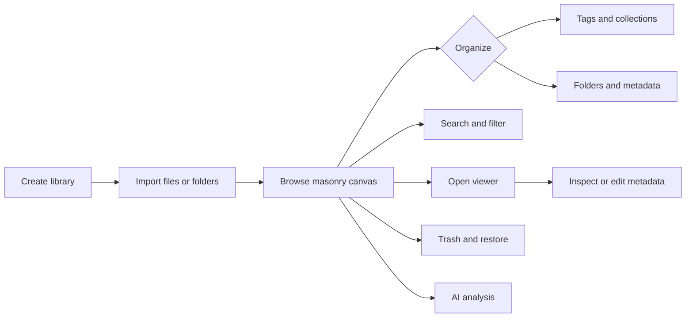

# User Guide

A WorldlineBox usage guide for end users. For Chinese, switch the site language; in the repository see `README.md`.

- [Install](installation.md) — macOS / Windows, upgrades
- [Basics](basics.md) — libraries, importing, workspace tabs, custom folder/collection appearance, browsing layouts, tags, collections, and the viewer
- [Built-in browser](browser.en.md) — tabs, bookmarks, session storage, downloads, and built-in asset capture
- [Search and filters](search-and-filters.md) — advanced query syntax, filter dimensions, and Shift multi-select
- [WebDAV cloud sync](sync.md) — server configuration, library binding, auto-sync, opening remote synced libraries
- [AI analysis](ai.md) — supported assets, automatic/manual analysis, jobs, and privacy
- [Browser extension](browser-extension.md) — save web images/videos from Chrome / Edge / Firefox
- [Using plugins](plugins.md) — install, enable, update, and uninstall plugins
- [Automation](automation.md) — automation scripts and MCP client connections
- [Troubleshooting](troubleshooting.md) — common problems and fixes

## Quick start

1. Install WorldlineBox (see [Install](installation.md))
2. Launch the app to open the DSH launcher. To manage assets, select Assets and create a local library
3. Drag images, videos, audio, 3D models, or text into the window, or click Import
4. Assets appear on the canvas. Double-click to open the viewer; right-click for more actions. Thumbnails, metadata, and AI analysis complete progressively in the background

Data stays in your local library directory; for syncing across machines, use WebDAV cloud sync (see [Sync](sync.md)).

## Interface at a glance

The application rail starts with the DSH launcher, the default home page, followed by Assets. Settings stays at the bottom and opens over the current module, also with Ctrl+, (⌘, on macOS). Animated and personal wallpapers apply across modules; switching preserves playback progress. The launcher does not require an asset library. The asset workspace has library navigation, an asset canvas, and an Inspector. On Windows, the Main menu contains File, Edit, Library, Window, and About, including diagnostics and update checks; macOS retains its native menu. Import, search, filtering, and sorting stay in the top toolbar.

See [Basics](basics.md) for the complete workflow.

## Documentation status

This directory describes the current user-facing product. Screens and available features can change between releases; follow the latest installer and release notes.
