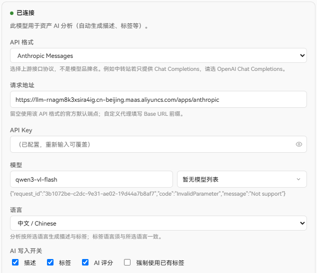
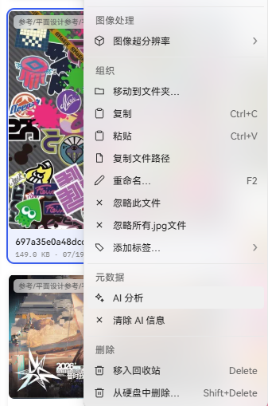

# Global model and AI analysis

WorldlineBox’s AI analysis uses your configured global AI service. Text assets work with text-only models; images, video frames, 3D views, and document first-page previews require image input. Supply the service’s API key and check its pricing first.

## Configure AI

Open `Settings → Global model` from the bottom of the application rail on Windows or macOS. The connection is stored for the application independently of an asset library; asset analysis options are grouped separately below it.

New installations default to DeepSeek's OpenAI Chat Completions endpoint, `https://api.deepseek.com`, and `deepseek-flash`. Built-in model choices are available without a key; actual requests require your API key. Previously saved custom providers and models are retained. Windows development and installed applications both use `%APPDATA%\WorldlineBox\ai-config.json`, with the key encrypted separately in `ai-key.enc`. Native DSH accounts and model configuration continue to belong to the launcher's shared save data.

### Connect a provider

- `API format`: choose the provider interface, such as `DashScope Multimodal (native)`, `OpenAI Chat Completions`, `OpenAI Responses`, `Anthropic Messages`, or `Gemini Native`. With a relay, follow the relay’s interface instructions.
- `Base URL`: usually leave it empty. For a relay or self-hosted gateway, enter the address supplied by that service. DashScope native uses an `/api/v1` root.
- `API Key`: paste the provider key. The eye icon shows it temporarily; after saving, the full key is not displayed. Enter a new key to replace it.
- `Model`: enter the provider’s model name; select a vision model when analyzing images. With a valid key, the picker can load models; if that fails, enter the name manually.
- `Language`: choose one language—Chinese, English, Japanese, or Korean—for descriptions and tags.
- Click `Test connection`, then `Save` after it succeeds.

Never put an API key in a script, plugin, screenshot, issue report, or MCP configuration.

### AI write toggles

- `Description`: summarize actual text or describe visual content, style, and mood.
- `Tags`: generate keywords for type, subject, purpose, or visual characteristics.
- `AI rating`: generate a 1–5 reference score.
- `Force existing tags`: choose only from tags already in the library.

AI content is stored separately from manual content; manual descriptions, tags, and ratings are not overwritten.

### Advanced settings

- `Concurrent analysis limit`: default 16, range 1–32; lower it if the provider rate-limits requests.
- `Maximum image edge`: default 2048 px, range 512–4096; images are reduced when needed and never enlarged.
- `Maximum tags`: default 8, range 1–32.
- `Chinese description limit`: default 100 characters, range 20–500.
- `English description limit`: default 60 words, range 10–200.
- `Output style`: `Normal`, `Concise`, or `Rigorous`.
- `Rating rubric`: define what scores from 1 to 5 mean.
- `Custom description prompt`: add description guidance such as “focus on composition and lighting”.
- `Custom tag prompt`: define the tag vocabulary. Never put a key or secret in a prompt.

### Automatic analysis

Accept the disclaimer and enable `Automatically run AI analysis on new assets` to queue supported new assets in the background; it is off by default and turning it off does not remove existing AI content.

## Supported assets

- Images and camera RAW: a resized image is sent.
- Video: a timestamped contact sheet is sent, not the original video.
- 3D models: a four-view image is sent.
- Readable text: TXT, Markdown, JSON, CSV, common source code and configuration formats reuse the text preview’s encoding detection and binary checks. At most the first **64 KiB of UTF-8 text** is sent, explicitly marked as a truncated excerpt when necessary. Code is never executed. Text-only models work.
- PDF / Illustrator AI: the existing **first-page image preview** is sent to a vision model. Only that visible page is analyzed; there is no full-document text extraction or access to other pages.
- Audio, Office documents, HTML, and formats without an input extractor are currently unsupported. Results are never invented from filenames. Audio playback or Office file import does not provide transcription or full-text understanding.

## Manual analysis and results

Choose `AI analysis` from an asset context menu or use the batch action for a multi-selection. `Analyze unanalyzed assets` skips assets that already have results; use normal `AI analysis` to re-analyze one.

Results appear in the AI section of the asset Inspector. A successful re-analysis replaces the current AI result and does not keep history; clearing AI content does not remove manual content or tag entities.

## Jobs and failures

Open `Window → Background jobs` to see queued, running, paused, failed, and completed AI jobs. You can pause, resume, cancel, or retry failed items. Network, rate-limit, and timeout failures are usually retryable; configuration, permission, quota, and unsupported-format problems must be fixed first.

If a video contact sheet or thumbnail is not ready, retry media generation from Background jobs before retrying AI. Failure messages include a short reason.

Empty, binary, or unreadable text produces a file-content error. A model without image input produces a vision-capability error while text analysis remains available. Authentication, permissions, quota, rate limits, network failures, timeouts, and invalid output have distinct messages. Transient failures use the existing bounded queue retry settings; the app never retries indefinitely, changes your model, or silently drops images.

## Privacy and cost

WorldlineBox does not upload an entire library or provide AI search. Only explicitly submitted, supported assets are sent to the selected provider; check its privacy terms and pricing before enabling AI.
