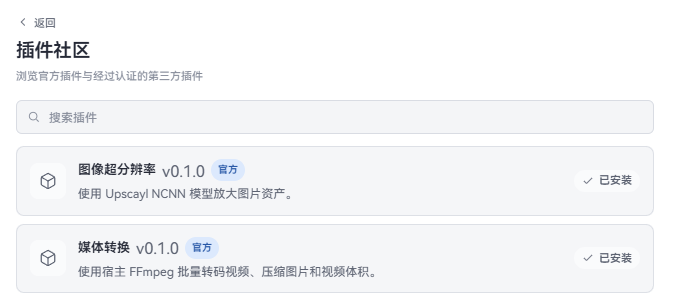

# 插件功能

插件可以为 WorldlineBox 增加新的工具、菜单或工作流程。插件不属于资源库中的普通资产，安装后可以随时启用或停用。

## 安装插件

官方插件和经过认证的第三方社区插件可以通过内置的「插件社区」一键安装：

- **官方插件**：由 WorldlineBox 团队直接开发并维护的扩展，带有官方徽章。
- **已认证插件**：由开源社区开发者创作，经过 WorldlineBox 官方安全审核与可用性检验后收录入官方目录的扩展。

1. 打开「设置」→「插件」，点击「打开插件社区」。
2. 浏览或搜索插件。点击卡片可查看作者、版本、仓库链接、权限声明以及详细说明；点击「安装」选择安装到「全局」或当前资源库。
3. 安装完成后返回插件列表。处于受限模式的插件可直接启用；无限制插件在首次启用前需要确认安全信任。

全局插件对本机所有打开的资源库生效；资源库插件仅对当前资源库生效。

如果你有插件作者提供的本地文件或 GitHub 仓库地址，可使用「高级安装」：

1. 在「设置」→「插件」点击「高级安装」。
2. 点击「安装 ZIP」或「安装文件夹」，或直接粘贴 GitHub 仓库 / Release 地址。例如：

   - 批量重命名插件：`https://github.com/dolag233/WorldlineBox-Plugin-Renamer`
   - 媒体转换插件：`https://github.com/dolag233/WorldlineBox-Plugin-MediaConverter`
   - 图像超分辨率插件：`https://github.com/dolag233/WorldlineBox-Plugin-ImageUpscaler`

3. 选择安装到「全局」或当前资源库。

*如果你是插件开发者，想让自己的插件收录到官方插件社区供所有人使用，请查阅[插件分发与认证指南](../manual/plugins/distribution-and-updates.md#5-成为官方插件与官方认证插件)。*

安装完成后，插件会出现在插件列表中。插件作者如果提供了使用说明，请按插件自己的说明完成配置。

## 启用和停用

- 在插件卡片上打开「启用」即可使用。
- 第一次启用资源库插件时，WorldlineBox 会询问是否信任它；只有确认来源可靠时才选择信任。
- 暂时不用时关闭「启用」，需要时再打开。
- 修改插件设置后可以点击「重载」，不必重启 WorldlineBox。

如果同一个插件同时安装了全局版和资源库版，插件列表会提示当前使用的版本，可以在那里切换或停用。

## 更新和卸载

GitHub 插件可以在插件设置中检查更新。自动更新默认关闭，开启前请确认插件来源。从插件社区安装的插件不会自动跟随 GitHub 最新 Release；目录里出现新版本后再到社区页更新。

卸载插件不会删除它可能保存的个人设置。如果以后重新安装同一个插件，希望保留原来的配置，可以直接重新安装；若插件提供了自己的清理入口，优先使用该入口。

## 遇到问题

如果插件没有出现在列表中、启用后没有反应，先检查插件是否安装在正确的范围，并重新打开插件设置。仍然无法使用时，请联系插件作者，并附上 WorldlineBox 版本、操作系统和插件名称；不要在反馈中公开 API Key 或其他隐私信息。

开发者请阅读[插件开发者手册](../manual/README.md)。
